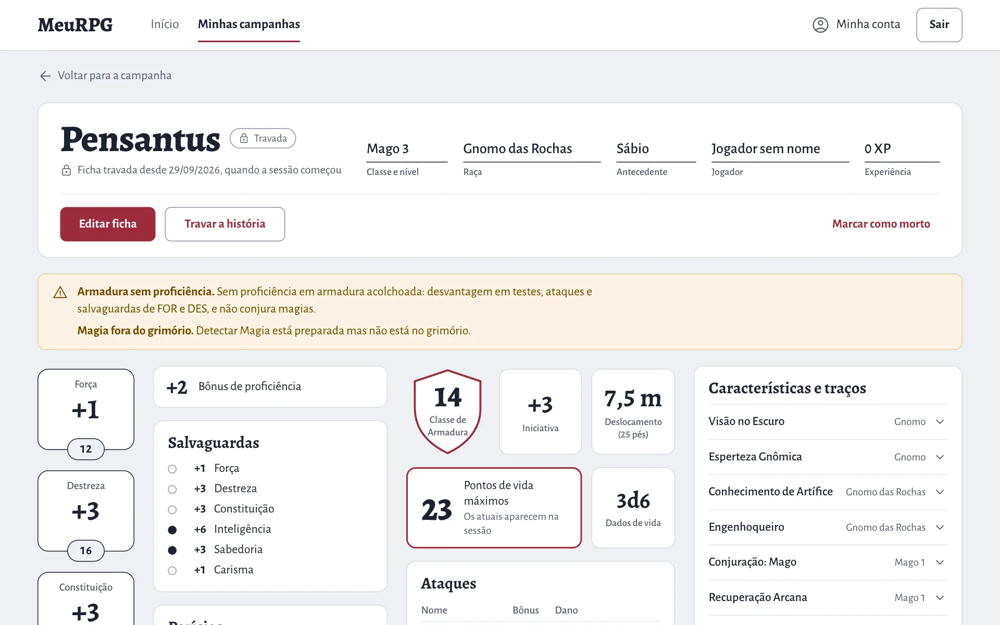
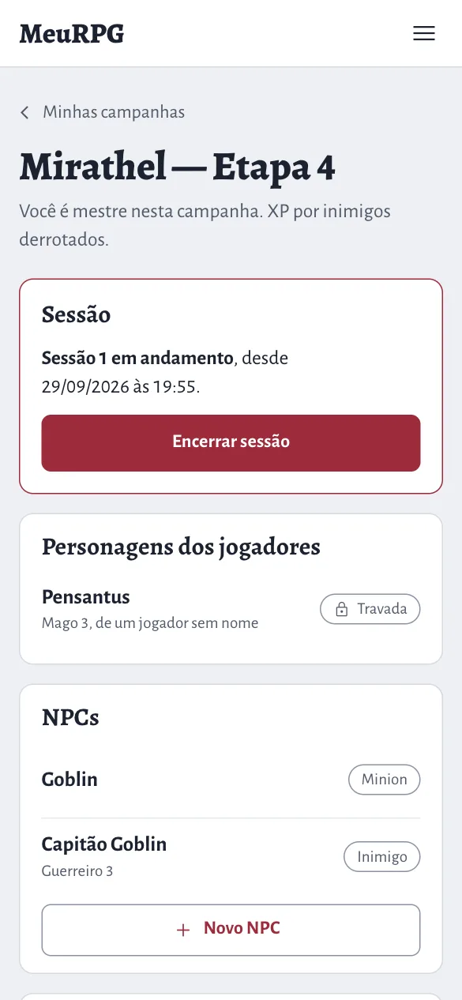
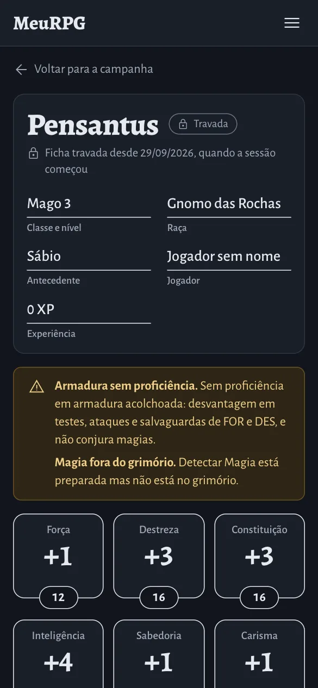

<h1 align="center">MeuRPG</h1>

<p align="center"><a href="README.md">English</a></p>

<p align="center">
  Onde uma mesa de D&amp;D 5e prepara e joga as suas campanhas.<br>
  O mestre conduz o jogo, os jogadores acompanham as suas fichas, e as regras fazem as contas.
</p>

<p align="center">
  <a href="https://github.com/PuraFome/meuRPG/actions/workflows/backend.yml?query=branch%3Amain"></a>
  <a href="https://github.com/PuraFome/meuRPG/actions/workflows/web.yml?query=branch%3Amain"></a>
  <a href="https://github.com/PuraFome/meuRPG/actions/workflows/e2e.yml?query=branch%3Amain"></a>
</p>

<p align="center">
  <a href="e2e/tests/a11y.spec.ts"></a>
  <a href="NOTICE"></a>
  <a href="LICENSE"></a>
</p>

<p align="center">
  <picture>
    <source media="(prefers-color-scheme: dark)" srcset="docs/img/ficha-desktop-escuro.webp">
    
  </picture>
</p>

## O que é

O MeuRPG é um companheiro para as campanhas de D&D 5e de uma mesa.
O mestre prepara o mundo e conduz a sessão ao vivo.
Os jogadores entram por convite, acompanham a ficha do personagem e agem no roleplay (RP) e no combate dentro do que as regras permitem.
O motor de regras faz as contas, e o servidor é a autoridade: o que o mestre esconde nunca chega a um jogador.
Mais na [visão do produto](docs/pt-BR/produto/visao.md).

As telas estão em português; a interface em inglês vem depois do MVP.
O que está pronto e o que vem a seguir está no [roadmap](docs/roadmap.md) (em inglês).

## O que uma mesa pode fazer

Cada item leva às histórias, com os critérios de aceite.

- **Entrar e conduzir campanhas.** O mestre cria uma campanha e convida jogadores, que entram já logados ou fazendo o login no caminho ([MR-001](docs/pt-BR/produto/historias.md#mr-001-criar-campanha), [MR-002](docs/pt-BR/produto/historias.md#mr-002-gerar-convite), [MR-003](docs/pt-BR/produto/historias.md#mr-003-entrar-pelo-convite)). Uma campanha inteira pode ser exportada e importada ([MR-050](docs/pt-BR/produto/historias.md#mr-050-pacote-da-campanha-exportar-e-importar)).
- **Personagens.** O layout da ficha oficial, calculado a partir do SRD 5.1, com NPCs, uma ficha que trava quando a sessão começa, personagens reservados e a aprovação do mestre ([MR-004](docs/pt-BR/produto/historias.md#mr-004-ficha-no-formato-do-pdf), [MR-005](docs/pt-BR/produto/historias.md#mr-005-criar-npcs), [MR-006](docs/pt-BR/produto/historias.md#mr-006-ficha-travada), [MR-024](docs/pt-BR/produto/historias.md#mr-024-aprovar-o-personagem-do-convite), [MR-049](docs/pt-BR/produto/historias.md#mr-049-personagens-reservados-e-links-para-assumir)).
- **A sessão ao vivo.** Os jogadores acompanham a sessão pelo celular, com as escolhas do mestre sobre o que mostrar, e um resumo fecha a sessão ([MR-011](docs/pt-BR/produto/historias.md#mr-011-iniciar-a-sessão), [MR-012](docs/pt-BR/produto/historias.md#mr-012-acompanhar-a-sessão), [MR-028](docs/pt-BR/produto/historias.md#mr-028-mostrar-uma-imagem-aos-jogadores), [MR-032](docs/pt-BR/produto/historias.md#mr-032-destaques-do-combate)).
- **Mapas sem spoiler.** Pontos de interesse, tokens, camadas, armadilhas, tesouros e névoa de guerra por jogador, com impressão na escala da mesa ([MR-008](docs/pt-BR/produto/historias.md#mr-008-pontos-de-interesse), [MR-009](docs/pt-BR/produto/historias.md#mr-009-mapa-sem-spoiler), [MR-033](docs/pt-BR/produto/historias.md#mr-033-imprimir-o-mapa-com-a-grade), [MR-035](docs/pt-BR/produto/historias.md#mr-035-armadilhas), [MR-036](docs/pt-BR/produto/historias.md#mr-036-névoa-de-guerra-pela-visão)).
- **Combate.** Iniciativa, turnos e movimento numa grade ou no teatro da mente. Na sua vez, o jogador vê o que pode fazer e rola com os dados do app ou com dados físicos ([MR-013](docs/pt-BR/produto/historias.md#mr-013-ordem-dos-turnos), [MR-014](docs/pt-BR/produto/historias.md#mr-014-sua-vez), [MR-034](docs/pt-BR/produto/historias.md#mr-034-movimentos-especiais), [MR-048](docs/pt-BR/produto/historias.md#mr-048-conjurar-magias-fora-do-combate)).
- **RP, pistas e quebra-cabeças.** Ações de cena com testes de perícia, ganchos e pistas, anotações dos jogadores, NPCs em cena e quebra-cabeças ([MR-015](docs/pt-BR/produto/historias.md#mr-015-ações-da-cena-de-rp), [MR-029](docs/pt-BR/produto/historias.md#mr-029-ganchos-e-pistas-da-cena), [MR-030](docs/pt-BR/produto/historias.md#mr-030-anotações-do-jogador), [MR-031](docs/pt-BR/produto/historias.md#mr-031-npcs-na-cena), [MR-038](docs/pt-BR/produto/historias.md#mr-038-quebra-cabeças)).
- **Progressão.** XP por combate, ouro, marco ou avulso, e uma subida de nível guiada pela ficha ([MR-016](docs/pt-BR/produto/historias.md#mr-016-dar-xp), [MR-040](docs/pt-BR/produto/historias.md#mr-040-subir-de-nível-pela-ficha), [MR-041](docs/pt-BR/produto/historias.md#mr-041-tesouros-e-xp-por-ouro)).
- **Criaturas e magias.** O bestiário do SRD, as criaturas do personagem e a consulta de magias ([MR-037](docs/pt-BR/produto/historias.md#mr-037-criaturas-do-personagem), [MR-042](docs/pt-BR/produto/historias.md#mr-042-bestiário), [MR-045](docs/pt-BR/produto/historias.md#mr-045-consultar-as-magias)).
- **O conteúdo e as regras da própria mesa.** Classes, raças, antecedentes e magias próprios, e os interruptores do que os jogadores podem usar ([MR-025](docs/pt-BR/produto/historias.md#mr-025-cadastrar-conteúdo-da-mesa)).
- **Geradores.** Masmorras, encontros pelo orçamento do grupo e tesouros ([MR-010](docs/pt-BR/produto/historias.md#mr-010-gerar-masmorras), [MR-043](docs/pt-BR/produto/historias.md#mr-043-gerar-encontros), [MR-044](docs/pt-BR/produto/historias.md#mr-044-gerar-tesouro)).
- **Imagens.** Uma galeria de imagens, o documento da campanha e arte gerada por IA feita só do que os jogadores já viram ([MR-018](docs/pt-BR/produto/historias.md#mr-018-documento-de-campanha), [MR-019](docs/pt-BR/produto/historias.md#mr-019-galeria-de-imagens), [MR-039](docs/pt-BR/produto/historias.md#mr-039-imagens-geradas-para-masmorras-e-cenas)).

## O visual: a ficha de papel

As telas imitam a ficha oficial de D&D 5e: os medalhões de habilidade, o escudo da CA, os pontos de proficiência.
Os temas claro e escuro seguem o sistema operacional, e cada tela funciona no celular, na mesa de jogo.
Os princípios, os tokens e como uma tela é desenhada: [Design](docs/design/README.md) (em inglês).

<p align="center">
  
  &nbsp;&nbsp;
  
</p>

## Como rodar

Precisa de Docker, Go, Node e `make`.
As versões e as outras ferramentas estão no [CONTRIBUTING](CONTRIBUTING.md#tools) (em inglês).

```bash
make up      # CockroachDB, migrations, devidp e o app em http://localhost:8080
make test    # testes do backend
make e2e     # testes de interface e de acessibilidade
make down    # derruba tudo
```

Abra `http://localhost:8080` no Chrome e clique em "Entrar".
O login vai para o devidp, um provedor de teste que só existe na sua máquina e no CI, e um clique em "Mestre Teste" faz o login.
As opções nativas, outros provedores de login e todas as variáveis estão em [Desenvolvimento local](docs/development.md) (em inglês).

## Stack

| Parte | O que usa |
| --- | --- |
| Backend | Go, um monólito modular que também serve o app |
| API | Protobuf e [Connect](https://connectrpc.com); o cliente TypeScript é gerado dos mesmos arquivos `.proto` |
| Banco | CockroachDB, com queries no sqlc e migrations no goose |
| Web | Angular com Angular Material, no visual da [ficha de papel](docs/design/README.md) |
| Login | OpenID Connect com PKCE e sessões no servidor |
| Regras | Um motor puro sobre o SRD 5.1, com os efeitos como dados |
| Infra | Cloud Run e CockroachDB no Google Cloud, em São Paulo |

Como é construído: [Arquitetura](docs/architecture/README.md).
Como é testado e conferido no CI: [Testes](docs/testing.md) e [CI](docs/ci.md).
Todos em inglês.

## Documentação

O índice completo está em [docs/README.md](docs/README.md) (em inglês).
Os documentos de produto e a privacidade também estão em português: [docs/pt-BR/](docs/pt-BR/README.md).
Como contribuir: [CONTRIBUTING.md](CONTRIBUTING.md) (em inglês).
Os dados que o app guarda: [Privacidade](docs/pt-BR/privacidade.md).

O primeiro app, um front end Angular com uma API NestJS, foi descontinuado e o código dele não existe mais; a auditoria dele está no [arquivo](docs/archive/legacy-code-quality.md) (em inglês).

## Licença e créditos

O MeuRPG é distribuído sob a [Apache License 2.0](LICENSE).
As regras vêm do System Reference Document 5.1 (SRD 5.1), sob a licença Creative Commons Attribution 4.0, e três tabelas vêm do SRD 5.2.1.
O app é compatível com a quinta edição ("5E compatible") e não usa nenhuma marca da editora.

> This work includes material taken from the System Reference Document 5.1 ("SRD 5.1") by Wizards of the Coast LLC and available at https://dnd.wizards.com/resources/systems-reference-document. The SRD 5.1 is licensed under the Creative Commons Attribution 4.0 International License available at https://creativecommons.org/licenses/by/4.0/legalcode.

Os nomes em português e os efeitos estruturados são nossos, e nenhum texto de livro fora do SRD entra no repositório.
Os dados do 5e-database (MIT), as fontes (Alegreya, OFL 1.1) e os ícones (Material Symbols, Apache 2.0) mantêm as suas licenças.
Cada atribuição está no [NOTICE](NOTICE), com as licenças em [`third_party/licenses/`](third_party/licenses/) e na página "Créditos" do app.
Como o conteúdo de regras é mantido: [Conteúdo de regras](docs/rules-content.md) (em inglês).
