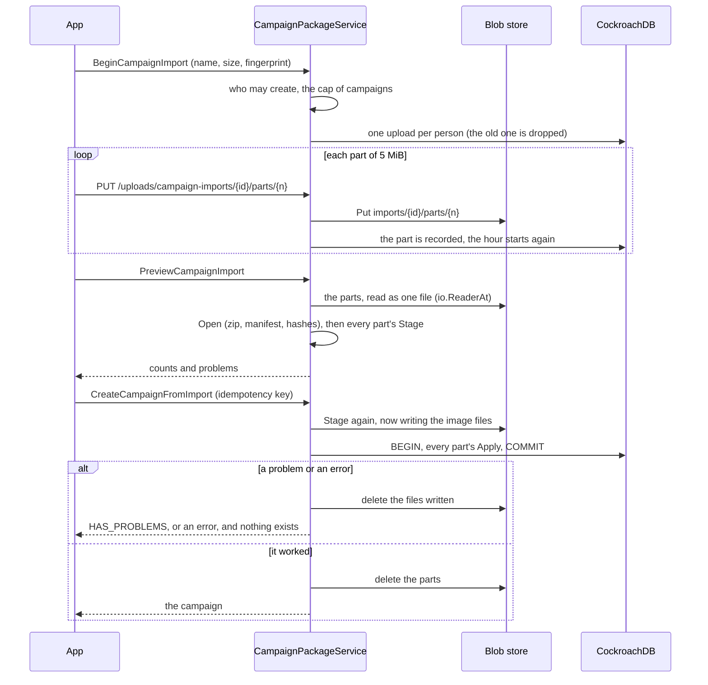

# Campaign package (MR-050)

A master exports a campaign as one file, `<campaign>.meurpg.zip`, and creates a campaign from such a file, on this server or another.
The code is `backend/internal/campaignpackage`.
The format is `proto/meurpg/campaignpackage/v1/format.proto`: the messages written inside the zip, as protobuf JSON with the field names of the `.proto`, embedding the API's own messages for sheets, traps, puzzles and table entries, so the format follows the API.
The calls are in `campaignpackage.proto` (`CampaignPackageService`).
The cleanup rules of the bucket are in [Operations](../operations/reference.md#campaign-package) and the personal data in [Privacy](../privacy.md#what-the-campaign-package-does-mr-050).

## The format

| Entry | Holds |
| --- | --- |
| `manifest.json` | Written last. The format version (`FormatVersion`, 1), the rules content version of the exporter, the date, the campaign's name, and every other entry with its kind, size and SHA-256. |
| `campaign.json` | The name, the XP mode, the table rules (with the dice mode) and the campaign document. |
| `images.json`, `images/<n>` | The gallery list and the stored image files. The thumbnail is made again on import. |
| `maps/<n>.json` | A map with its grid, flags, layers, points, scene actions, clues and battle encounters. |
| `npcs/<n>.json`, `characters/<n>.json` | The NPCs and creatures (with the master's notes) and the players' characters. |
| `puzzles/<n>.json`, `encounters.json` | The puzzles, and the encounters saved on the maps' battle points. |
| `content/<n>.json`, `content/options.json` | The table content entries and the options switched off. |

A package never carries the players' private notes, the session history and logs, accounts (ids, e-mails, names), owners and members, invites and claim links, or a player's fog memory.
A package also leaves play out: traps come back armed, treasures unfound, nothing a player found out or remembers.
Which maps and points are revealed is preparation and stays.

**Every reader is strict.**
A field the reader does not know is refused, in the manifest and in every entry, and so is a package whose `format_version` is above the reader's (told apart from a damaged one by reading that number first).
Entry names are only keys: lowercase letters, digits, `.`, `-`, `_` and `/` between segments, each starting with a letter or digit, never `..` (`ValidEntryName`).
The reader never extracts an entry to a path, since everything maps to ids, so there is no zip-slip.

The limits are constants in `format.go`:

| Limit | Value |
| --- | --- |
| The file | 200 MiB (`MaxPackageBytes`) |
| Entries | 2,000 (`MaxEntries`) |
| One entry | 10 MiB (`MaxEntryBytes`) |
| All entries together | 500 MiB (`MaxTotalBytes`) |
| Ratio between an entry and its compressed size | 100 (`MaxRatio`), judged only above 1 MiB |
| Problems listed in a preview | 100 |

The directory's entry count is read from the end record before `archive/zip` builds the directory; an entry is hashed through a reader cut at its declared size; a zip64 file is refused, because a package never needs it.

**Ids in the messages are handles inside the package.**
The importer gives everything a new id (`IDs`, in namespaces image, map, point, clue, character, puzzle) and rewrites every reference, including the `map:`, `character:` and `image:` links of the campaign document.
A link to something the package lacks gets an id that names nothing, which the app shows as "apagado".

## What each module owns

The module that owns a table writes it, so each module implements `campaignpackage.Part` for its own kinds, and the service runs them in a fixed order.

| Method | Does |
| --- | --- |
| `Export(ctx, tx, campaignID, snapshot)` | Reads the module's rows inside the export's one read transaction and adds entries to the `Snapshot`. |
| `Stage(ctx, import)` | Reads the module's entries, checks them with the rules of the call that makes the same thing by hand, records each problem and goes on (one preview lists them all), and prepares what `Apply` needs in memory. Writes nothing to the database; with `Commit` set it also writes the module's files to the blob store, recorded so they are deleted if the import does not end. |
| `Apply(ctx, tx, import)` | Inserts, inside the import's one transaction, with the ids chosen before. It may run again on a retry, so it makes the same rows each time. |

The parts run in this order, which `cmd/api` sets: the campaign (`campaigns`: the campaign, the master, the table rules, the document), the gallery (`maps`), the table content and characters (`characters`), the maps (`maps`), and the puzzles and encounters (`play`).
What one part finds for the next (which doors, points and player characters exist) passes in `Import.Facts`, so a puzzle's door, point, clue or part is checked against the package itself.

- **Images** go through `images.Process` in the upload's one-at-a-time slot, one file read at a time, and are stored under the new campaign's prefix only when the import is real (a preview writes nothing).
- **Maps** check the grid against the image's size, decode each layer with the grid, and run points through the same position, name, description and hook checks, the scene-check catalogue and the campaign limits as the app.
- **Table content** goes through the same shape, feature-key, size and name checks as `CreateTableEntry` (an entry whose name, in any case, another entry of its kind has is a `DUPLICATE` problem naming it), then the whole content is compiled at once with `Content.With`; an entry the engine refuses is a problem naming the entry.
  The campaign's content revision starts at 1.
- **Characters** are checked with `checkNewSheet` against that compiled content, so a sheet that needs a class of the table is judged with it.
  An NPC keeps its link to its SRD creature.
  The players' characters are inserted reserved (`characters.reserved`, MR-049): no owner, invisible to players until claimed ([Campaigns](campaigns.md#claim-links)).
- **Puzzles** are built again by their kind, which proves they can be solved from their start; the seed is kept so the start is the same.

## Export

`StartCampaignExport` records a row in `campaign_exports` (id: 128 random bits as 32 hex digits) and runs the export in the background, one at a time per instance, with a 20 minute limit (`exportTimeout`).

1. The campaign is read in one `db.ReadTx`, which sees one moment of the database, into a `Snapshot`: the JSON entries in memory (they are small) and the image files by key.
2. The zip is streamed through a pipe into the blob store, copying each image file through, so no image is held in memory.
3. Progress is written to the row at most once a second, and the same read tells the job it was canceled.
4. A restart leaves a `running` row, which the next read marks as interrupted after 10 minutes (`staleExportAfter`).

The file lives under `campaigns/<campaign>/exports/<id>.zip`, and the row expires 24 hours after it finished (`ExportTTL`; a failed or canceled export's row stays 1 hour).

`GET /downloads/campaign-exports/{id}` checks the session, then that the caller is the master of the export's campaign now (every refusal is the same `404`), the state and the expiry.
It answers `Content-Type: application/zip`, `Content-Disposition: attachment; filename="<name>"` (the campaign's name made ASCII and safe, `FileName`), `Cache-Control: no-store`, `X-Content-Type-Options: nosniff`, `Content-Security-Policy: default-src 'none'` and `Cross-Origin-Resource-Policy: same-origin`, with byte ranges.

## Import

- **The upload belongs to the account that began it.**
  Another account's part, preview, create or cancel gets the `404` of an upload that does not exist.
  `BeginCampaignImport` checks who may create campaigns and the account's cap first (the same checks as `CreateCampaign`, through the `Creation` interface that `campaigns` implements).
- **Parts** are 5 MiB (`PartSize`) blobs; `campaign_import_parts` says which arrived.
  A part must have exactly its length, and one sent twice replaces itself.
  Each part has 2 minutes to arrive.
- **Resuming.** The same fingerprint (the app makes it from name, size and date) resumes; another file drops the first upload and its parts.
  An upload and its parts live 1 hour after the last part (`UploadTTL`).
- **The package is read where it lies.**
  `partsReader` is an `io.ReaderAt` over the parts with a 256 KiB block of one part in memory, so the whole package is never assembled.
- **Preview and create run the same `Stage`.**
  The create differs by writing the files, and then runs every `Apply` in one `db.InTx` whose closure only writes through the transaction with ids chosen before it, so a retry makes the same rows.
  The campaign cap is counted inside that transaction too.
- **The idempotency key** is scoped to the caller with the hash of the request and stored on the campaign: a retry after a lost answer finds the campaign even with the upload gone, and the same key for another upload is `invalid_argument` ([API](api.md#idempotency-keys)).
- **A refusal is `HAS_PROBLEMS`** with the list of problems, and nothing exists afterwards.

## Cleaning

The rows of exports and uploads have no foreign key to the campaign or the account: a cascade would delete the row and leave the file where nothing names it.
`Sweep` runs when the server starts and every 10 minutes (`sweepEvery`):

- It deletes what expired, file first and row after.
- It also takes orphans, whatever their expiry: exports whose campaign or account no longer exists and uploads whose account is gone (deleting a campaign or an account does not call this package's code).
- `DeleteCampaignPackages` and `DeleteUserPackages` delete at once what a campaign or an account owns, for a caller that wants it.
- The bucket's own lifecycle rule is the last word ([Operations](../operations/reference.md#campaign-package)).

At shutdown an export in flight stops with the server (`Cancel`); the next read marks it interrupted.

## Rate limits and routes

The calls that read or write a whole campaign (start an export, begin, preview and create an import, download) share one per-user limit, and the part uploads have another ([API](api.md#abuse-limits)).
Both HTTP routes are in the namespaces the server reserves for the API (`/uploads/campaign-imports/` and `/downloads/campaign-exports/`), so the static handler never answers them.
Without a blob store (`BLOB_DIR` or `BLOB_BUCKET`), packages are off.
