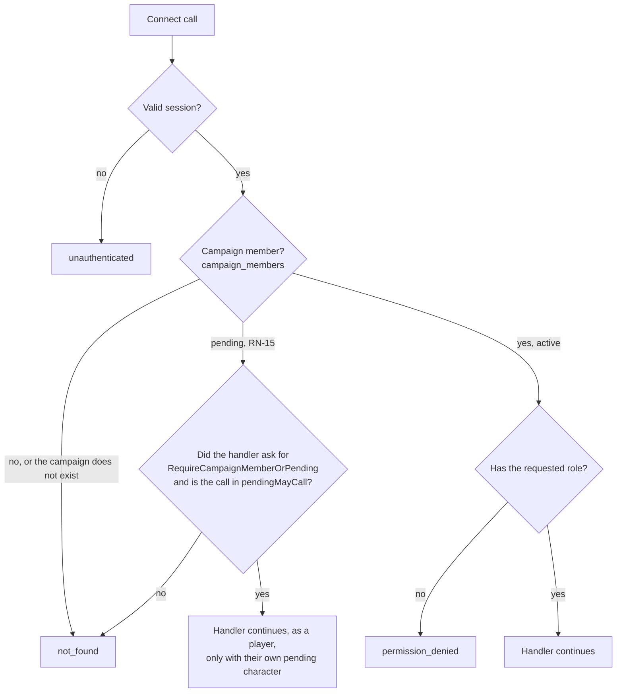
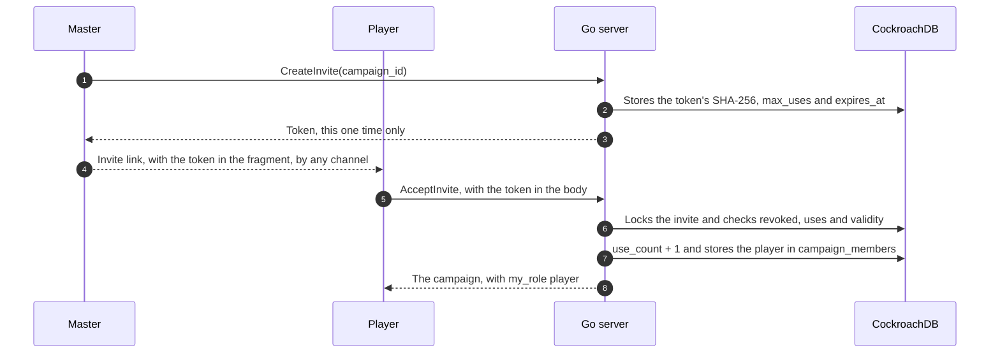
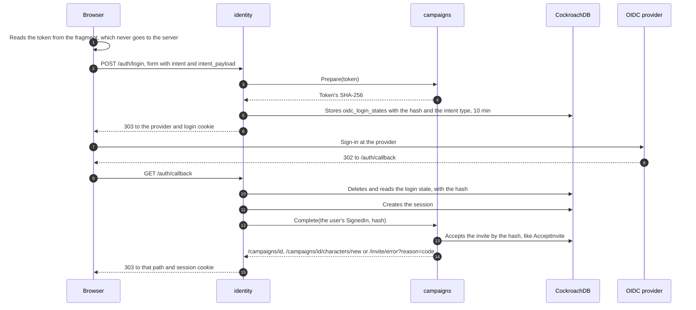
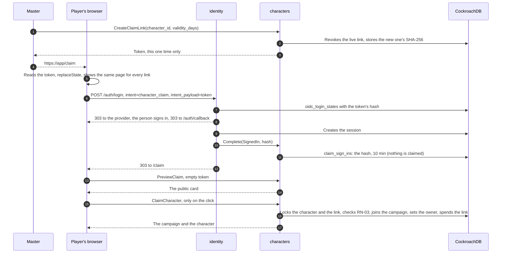
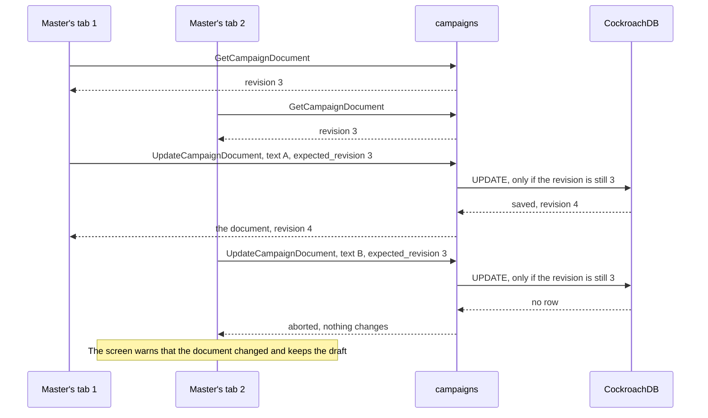

# Campaigns and authorization

The master creates a campaign and invites players; a player signs in and accepts an invite, becoming a player of that campaign (MR-001, MR-002, MR-003).
The code is `backend/internal/campaigns` for the campaign and `backend/internal/authz` for what each person may do (ADR-0011: roles per campaign, checked in the database on every request).
This page also covers the flows that begin at sign-in and end in a campaign: accepting an invite and claiming a reserved character.

## Calls

| Call | Who may |
| --- | --- |
| `CreateCampaign`, `ListMyCampaigns`, `AcceptInvite` | Anyone signed in. `ListMyCampaigns` also lists the campaigns where the person is a pending member, with only the name and the XP mode. |
| `GetCampaign` | Members. A pending member (RN-15) gets only the name, the XP mode and `awaiting_approval`. |
| `ListMembers` | Members. The pending member is not listed and gets `not_found`. |
| `CreateInvite`, `ListInvites`, `RevokeInvite` | The master. |
| `ListPendingMembers`, `RemovePendingMember` | The master. They list and remove pending members who have not created a character yet; deliberately not `ListMembers`, because these people are not members. Someone who already created a character is approved or refused through `CharacterService`. |
| `SetCampaignDiceMode` | The master (RN-18, [Dice](#dice)). |
| `SetMyDicePreference` | Members, the master too; a pending member gets `not_found`. |
| `GetTableRules` | Members and the pending member. |
| `SetTableRules`, `SetCampaignXpMode` | The master ([Table rules](#table-rules)). |
| `CampaignDocumentService`: `GetCampaignDocument`, `UpdateCampaignDocument` | The master ([Campaign document](#campaign-document)). |

`CampaignService` and `CampaignDocumentService` are mounted with a `no-store` interceptor: every response, errors included, goes out with `Cache-Control: no-store`.
Only `ListMyCampaigns` accepts GET, because its request is empty; the other reads carry the campaign ID and are `IDEMPOTENT`, POST-only ([API](api.md#contracts)).

## Authorization

The role is per campaign (RN-05): the row in `campaign_members` says whether the person is `master` or `player` in that campaign.
There is no global role and no role held in a token.

- **The database decides on every request.**
  Removing someone takes effect on their next call, without waiting for anything to expire.
- **Each handler starts with an explicit check:** `authz.RequireCampaignMember(ctx, id)` for any member, `authz.RequireCampaignRole(ctx, id, authz.RoleMaster)` for the master only, `authz.RequireSignedIn(ctx)` when being signed in suffices.
  The few calls a pending member may make use `RequireCampaignMemberOrPending` ([below](#pending-member)).
  The caller comes from `identity` through the `authz.Caller` interface ([Identity](identity.md#who-is-calling)).
- **One membership read per campaign per request.**
  `authz.Interceptor` gives each request a new memo; on ordinary HTTP routes `authz.Middleware` plays the same role.
  Without the interceptor a check fails with `internal`, never allows.
- **Streams check again.**
  A stream lasts minutes and its memo would last as long, so the handler calls `authz.RecheckCampaignMember` every 60 seconds; it rereads the login session and the membership without the memo and ends the stream with the error a new call would get.

A non-member gets `not_found` for a campaign that exists and for an invented one, with the same message, so nobody learns which campaigns exist.
Each module with a campaign-scoped service has a `TestAuthorizationMatrix` that calls every method as master, player, non-member, anonymous and pending member and fails when a new method has no row; `CampaignDocumentService` has `TestCampaignDocumentAuthorizationMatrix`.

### Pending member

A pending member accepted an invite with approval (RN-15, MR-024) and waits for the master to approve the character they created.
They are not a member: `campaign_members.status = 'pending'`, and `RequireCampaignMember` and `RequireCampaignRole` answer them exactly as they answer a stranger (`not_found`), so every existing and future call leaves them out without anyone remembering them.

- **A pending membership that never gets a character** is deleted 30 days after joining (`campaigns.PendingMemberLifetime`, a CockroachDB row TTL on `campaign_members.pending_expires_at`, see [Data](../data.md#tables-by-module)).
  The deadline binds as soon as it passes, not when the job runs: the membership reads ignore a pending member past it, `ActivatePendingMember` will not activate it, and an invite accepted by that person deletes the stale row first.
  The master sees and removes pending members earlier with `ListPendingMembers` and `RemovePendingMember`.
- **An ordinary invite (no approval)** accepted by a pending member of the same campaign promotes them in the same transaction: it spends a use, activates the membership and approves their character through the `campaigns.Characters` interface, which `characters` implements (`cmd/api` connects them with `SetCharacters`, because neither module imports the other).
- **They stop being pending in one of two ways,** always by the master and in the same transaction that decides the character: approval makes them an active player, refusal deletes the membership.

There is one exception, written in `authz` (`authz/pending.go`), not scattered across handlers: while waiting, they work on their own character.
Two locks must open:

1. The handler calls `authz.RequireCampaignMemberOrPending` instead of `RequireCampaignMember`.
2. The call is in `pendingMayCall`, the closed list of what a pending member may call.
   A handler outside the list that asks anyway still answers `not_found`, and the programming error goes to the log.

Inside an allowed call the pending member is a player (`RolePlayer`, `Membership.Pending`), and the handler narrows what they get.

| Call in `pendingMayCall` | What for | What the handler limits |
| --- | --- | --- |
| `CampaignService.GetCampaign` | See the campaign's name while waiting | Only `id`, `name`, `my_role` and `awaiting_approval` |
| `CampaignService.GetTableRules` | Read the ways of making ability scores the table allows (RN-24) | Read only |
| `CharacterService.CreateCharacter` | Create the one character, born pending | A player character, and only one (RN-03: the pending one counts as alive) |
| `CharacterService.GetCharacter`, `ListCharacters` | Read their own character | Only their own pending character |
| `CharacterService.UpdateCharacter`, `UpdateCharacterStory` | Edit the sheet and the backstory | Only their own pending character |
| `CharacterService.ResubmitCharacter` | Send the character back to the master after he asked for changes | Only the owner, only with a request open |
| `CharacterService.PreviewCharacter`, `PreviewChoices` | See the numbers and the choices of the sheet they are making, as the editor shows them | The checks of the save they preview |
| `CharacterService.GetAbilityRolls`, `RollAbilityScores` | Make the ability scores with the 4d6 the server stores (RN-24) | Players only; the rolls are theirs |
| `ContentService.ListContent`, `GetSpellDetails` | The catalogue and spell details the character editor offers | none |

`characters` shows them only their own `pending` characters (`canSee`, in `access.go`).
`ListMyCampaigns` needs no exception: it only asks for sign-in and lists the person's own memberships, pending ones included.
Changing the list changes RN-15: it needs the product decision, rows in the matrices (a column for the pending member) and `TestPendingMayCallIsTheAgreedList`.

## Invites

The invite is a link `https://<app>/invite#t=<token>`.
The token is 32 random bytes made by the server (`platform/secret`); the database stores only its SHA-256 (`campaign_invites.token_hash`), and `CreateInvite` returns the token once.

- **The token goes in the fragment (`#t=`),** which the browser never sends to a server, so it is in no log or `Referer`.
  The app reads the fragment and sends the token in the `AcceptInvite` body (ADR-0009).
- **Defaults and limits (RN-07):** one use and 7 days (`DefaultInviteUses`, `DefaultInviteLifetime`).
  The master may choose 1 to 20 uses and 5 minutes to 30 days, and may revoke at any time; whoever joined stays.
  A campaign may have at most 50 invites that still work ([API](api.md#what-an-account-or-a-campaign-may-hold-rn-30)).
- **Invite with approval (RN-15, MR-024):** per invite, `CreateInviteRequest.requires_approval` ("Exigir aprovação do mestre"; the default is not to require).
  Whoever accepts becomes a [pending member](#pending-member), spends one use, and the app takes them to create the character, which is born pending.
  The master approves or refuses that character through `CharacterService`; after a refusal the player needs a new invite.
- **Accepting again changes nothing:** a member gets the campaign back with `already_member` and no use is spent.
  A pending member stays pending with an invite that requires approval or one that no longer works.
- **Two players competing for the last use do not both get in.**
  Everything runs in one `db.InTx` with the invite row locked (`SELECT ... FOR UPDATE`); the `UPDATE` repeats the rules and a `CHECK` keeps `use_count` at or below `max_uses` (`TestAcceptInviteRaceForTheLastUse`).
- **An unusable invite** is `failed_precondition` with the `InviteUnusable` detail: expired, revoked or used up.
  Revoked wins over used up, which wins over expired; "used up" doubles as a warning that the link may have leaked.
- **Accepting needs sign-in.**

### Accepting an invite through sign-in

Whoever opens the invite link without a session signs in and accepts in one step, and nothing is kept in the browser (ADR-0009).
The token goes in the sign-in form's body, and the server keeps only its hash inside the login state, which is single-use and lasts at most 10 minutes.

1. The `/invite#t=<token>` page submits a same-origin `POST /auth/login` (`application/x-www-form-urlencoded`) with `return_to`, `intent=campaign_invite` and `intent_payload=<token>`.
2. `identity` checks the attempt limit and `return_to`, and asks `campaigns` to prepare the intent.
   `campaigns` checks the token's format and returns its SHA-256; `identity` stores the hash with the intent type in `oidc_login_states` and continues the sign-in.
3. At the callback, after creating the session, `identity` asks `campaigns` to complete the intent.
   `campaigns` accepts the invite by the hash, in the same transaction as `AcceptInvite`.
4. The browser goes to `/campaigns/<id>` (also for someone who was already a member); a new pending member goes to `/campaigns/<id>/characters/new`; an unusable invite goes to `/invite/error?reason=<code>`.
   The sign-in counts either way: only the destination changes.

| `reason` | When |
| --- | --- |
| `expired` | The invite passed its validity. |
| `revoked` | The master revoked it. |
| `used_up` | The uses ran out. |
| `not_found` | No invite has this token, or the campaign was deleted. |
| `invalid` | What the login stored is not a token hash. Only a bug causes this. |
| `unavailable` | The database did not respond; opening the link again may work. |

Rules that hold for any intent:

- **`identity` does not know `campaigns`.**
  It has a registry of intents by name (`identity.Config.Intents`) filled in `cmd/api/main.go`; each implements `identity.IntentHandler`: `Prepare(payload)` at the start returns what to store (at most 256 bytes, never a secret as received) and `Complete(ctx, who, data)` after the session exists returns where to go.
  The intents today are `campaign_invite` and `character_claim`.
- **`Complete` acts only for whoever just signed in.**
  The user arrives as `identity.SignedIn`, a capability only the `identity` callback can fill; `SignedIn{}` has no user and the invite's `Complete` refuses it before touching the database.
- **Nothing secret in a URL.**
  `GET /auth/login` refuses `intent` and `intent_payload` with `400`, `POST` refuses a query string, and `return_to` loses its fragment.
- **CSRF:** `POST /auth/login` goes through `http.CrossOriginProtection`, so a form from another site gets `403`.
- **Bad input stops before the provider:** an unknown intent, a payload without an intent, a malformed token or one over 1,024 characters is `400`; a body over 8 KiB is `413`; another `Content-Type` is `415`.
  Nothing is stored.
- **The destination passes the same check as `return_to`:** a path outside this site is replaced by `return_to`.
- **Logs** record the reason and the intent type, never the token or its hash (`TestIntentLogsHaveNoSecrets`).

## Claim links

A **reserved character** (MR-049) is a player character with no owner that the master made, or imported with a campaign package, for a player to take.
It is `characters.reserved = true` with `player_user_id` NULL (the `characters_reserved_shape` CHECK keeps that shape: a living player character of the master's, never claimed).
A character whose player deleted the account also has no owner (RN-16) but is not reserved; it stays visible to the master.
`characters.claimed_at` records that a player took the character through a link, so the master can give it back (`ReturnCharacterToReserve`) long after the link's row is gone.

The master's link is `https://<app>/claim#t=<token>`, built like the invite: 32 random bytes from `platform/secret`, only the SHA-256 stored (`claim_links.token_hash`), the token returned once by `CreateClaimLink` and put in the fragment.
What differs from an invite:

- **One live link per reserved character.**
  A new one revokes the old in the same transaction (`RevokeLiveClaimLinks`, then `InsertClaimLink`); the partial unique index `claim_links_one_live_per_character` holds it even if two calls race.
  Validity is 1, 7 or 30 days (7 by default) and the link works once.
  It has no idempotency key, like an invite.
- **A person, not a count.**
  A claim makes the signed-in person a member of the campaign and the owner of the character in one transaction (`campaigns.JoinAsPlayer`, `ClaimReservedCharacter`, `MarkClaimLinkUsed`).
  There is no approval step, and a pending join request of the same person becomes active with it.
- **RN-03 is the one specific refusal.**
  A person with a living character in the campaign gets `failed_precondition` with `CharacterBlocked` `LIVING_CHARACTER_EXISTS`, naming that character; a dead one does not count, and the unique index `characters_one_living_player_character` settles two claims racing for the same person.
  The master opening their own link gets `CLAIM_OWN_LINK`.
- **Every other failure is one answer.**
  A link never made, expired, used, revoked, whose character was deleted or already claimed, or a claim that lost a race, is the same `not_found` with the same sentence and no detail, from `PreviewClaim` and `ClaimCharacter`; so is a token of the wrong length or characters.
- **Locks in one order.**
  A claim finds the link, locks the character (`FOR UPDATE`), then the link; `RevokeClaimLink` locks the character, then the link.
  The two never wait for each other in a circle, and the second of a claim and a revoke sees the first's result.
  A revoke that loses to a claim answers `CLAIM_LINK_USED` with the player's display name.
- **Rate limits.** `PreviewClaim` and `ClaimCharacter` spend a try of the person and of the client address ([API](api.md#abuse-limits)).
  Neither the token nor its hash reaches the log.

**Signing in with the link never claims.**
Opened signed out, `/claim#t=<token>` shows one page whatever the link, with "Entrar com Google" and nothing about the campaign or the character; the server is not asked about the token before there is a session.
The button posts `POST /auth/login` with `return_to=/claim`, `intent=character_claim` and `intent_payload=<token>`.
`Prepare` checks only the token's format and returns its SHA-256.
`Complete` (right after the session exists) writes the hash to `claim_sign_ins` for that person for 10 minutes and sends the browser to `/claim`; it does not look the link up.
Back on `/claim` the page calls `PreviewClaim` with an empty token, meaning "the link this person signed in with", and the card appears only now.
Only a click on "Assumir este personagem" calls `ClaimCharacter`, and a claim deletes the `claim_sign_ins` row.

| Call | Who | Answer |
| --- | --- | --- |
| `CreateClaimLink`, `RevokeClaimLink`, `ReturnCharacterToReserve`, `DeleteReservedCharacter` | The campaign's master | Deleting a reserved character deletes its link (`ON DELETE CASCADE`); `ReturnCharacterToReserve` refuses a character in the open combat. |
| `PreviewClaim` | Any signed-in person | The public card (name, race, class, level, the campaign's name, who sent it), or `own_link` for the master, or the one `not_found`. Changes nothing. |
| `ClaimCharacter` | Any signed-in person | The campaign and the character, or `LIVING_CHARACTER_EXISTS`, `CLAIM_OWN_LINK` or the one `not_found`. |

**What no player sees (RN-10).**
A reserved character has no owner, so "a player reads only their own characters" already hides it from the list and from `GetCharacter`.
The queries that list the party leave it out with `NOT reserved`, so it is no combatant, no map token, no vision and no XP share; `LockSheets` skips it, so it locks with the first session that starts after it is claimed.
One given back to the reserve is left out of old session summaries and of puzzle names a player reads.
`MarkCharacterDead` and `SetStoryEditing` refuse it (`RESERVED`).
The leak tests (`backend/internal/leaktest`) carry its name, story and id and its link's token as canaries.

## Dice

How players roll is a campaign setting plus a preference per member (RN-18, MR-013, MR-014).
`Campaign` carries `dice_mode` (`players_choose`, `app` or `physical`); `GetCampaign` also carries `my_dice_preference` (`app`, the default, or `physical`).
`ListMembers` puts `dice_preference` on each `Member` only when the caller is the master, who sees each player's choice in the "Dados" panel; for a player the field is empty.
`SetCampaignDiceMode` and `SetMyDicePreference` return the saved value; repeating it is not an error and an unspecified value is `invalid_argument`.

- **Where a player rolls** is `campaigns.EffectiveDiceMode(mode, preference)`, a pure function: with `app` or `physical` on the campaign, the mode wins; with `players_choose`, the preference does.
  `Service.PlayerDiceMode` reads the campaign and the membership and applies it.
  The preference is kept, not erased, when the master changes the mode.
- **Only a forced mode binds** (`CampaignDiceMode`): with `players_choose` each roll is the player's to choose and the preference is the default a screen offers.
  A pending member counts, since they roll their ability scores by the campaign's rule.
- **`play` does not import `campaigns`:** it declares small interfaces and `cmd/api` hands it the service (`diceModes`).
- **NPCs always roll in the app.**

`backend/internal/platform/dice` is where rolling happens; `rules` stays free of randomness (ADR-0008).
`Parse` reads `d20`, `1d20+6`, `2d6 + 2`, `1d4 - 1` and refuses the rest: 1 to 100 dice, sides 4, 6, 8, 10, 12, 20 or 100, a modifier from -100 to +100.
`Roll(roller, expr)` returns the expression, the faces, the modifier and the total.
`Roller` is an interface: `Crypto` uses `crypto/rand` and `Fixed` returns given faces in tests.
`Physical(expr, sum)` checks a typed sum (between `N` and `N×sides`) and adds the modifier; the result has no faces.

## Table rules

The choices on the "Regras da mesa" page (MR-025, RN-24) belong to `campaigns` (`tablerules.go`, table `campaign_table_rules`, see [Data](../data.md)) and apply to the whole campaign.
Their shape, a plain value with no behaviour, is `platform/tablerules`, so modules share the type without importing each other.
The zero value is the SRD's defaults.

| Call | Who | What it does |
| --- | --- | --- |
| `GetTableRules` | Every member and the pending member | The rules, the style they form, the three preset styles and the numbers of the ability-score methods (standard array, point-buy costs, the 27 points, the typing range, from SRD 5.2.1), so the app does no arithmetic. With no row, the defaults. The dice mode and the rules are read in one read transaction. `IDEMPOTENT`. |
| `SetTableRules` | The master | Replaces all the rules at once ("Salvar regras"); the dice mode goes in the same transaction. They apply from now on: existing sheets stay as they are. |
| `SetCampaignXpMode` | The master | Changes the XP mode ([below](#xp-mode)). |

The rules in `TableRules` (the proto lists the values):

| Field | Meaning | Applied by |
| --- | --- | --- |
| `dice_mode` | The campaign's dice setting (RN-18) | `play`, `characters` |
| `combat_starts_with_map` | Whether "Iniciar combate" starts on a map by default (RN-25) | `play` |
| `fog_on_new_maps` | A map created from now on starts with fog of war. A new map has no grid yet, so it carries `fog_on_first_grid` and fog turns on with the first grid (`SetMapGrid`). | `maps` |
| `hit_points` | Level-up hit points: the player chooses (default), everyone rolls, or everyone takes the average | `characters` |
| `ability_methods` | Which ways of making ability scores are allowed; at least one | `characters` |
| `critical` | A critical hit: doubled dice (default) or the maximum plus a roll | `play` |
| `death_saves` | Visible to all (default) or hidden from everyone but the owner and the master | `play` |
| `feats_allowed` | Whether the level-up offers a feat in place of the ability increase. A sheet write is not gated by it. | `characters` |
| `hidden_area_hits` | What an area spell does to the hiding of a hidden creature it hits: reveal (default), keep hidden, or ask the master | `play` |
| `enemy_reactions` | Whether a player's action against an enemy waits for the master's one-tap answer only when an enemy has a reaction (default), or always | `play` |
| `house_rules` | Up to 20 one-line reminders of 1 to 200 characters, shown and never enforced | the page |

- **The table style is not stored.** `StyleOf(dice mode, combat with map, fog on new maps)` returns `TUDO_NO_APP`, `MESA_FISICA`, `TEATRO_DA_MENTE` or `PERSONALIZADO` when the three values match none of the presets.
  The presets come in the `GetTableRules` response for the screen to fill the fields; a style fills only those three.
- **Who reads what.** `characters` reads the sheet-related rules through `ContentSource`, in the writer's transaction.
  `maps` reads `FogOnNewMaps` through `maps.MapDefaults`.
  `play` reads the combat rules through `play.CombatDefaults` (`CombatWithoutMap`, `StoredTableRules`), which `campaigns.Service` implements; its `Config.Defaults` is optional, and without it every combat is the SRD's, without a map.
  The critical hit, death saves, hidden-area and enemy-reaction rules are combat rules and do not go through `ContentSource`.

### XP mode

`SetCampaignXpMode` changes `campaigns.xp_mode` (`enemies`, `gold` or `milestones`) after creation and stores the time (`xp_mode_changed_at`).
The mode also decides "Pode subir de nível" (RN-12), so changing it moves the pending level-up notices without writing to any sheet.
If XP was already given (an award not undone, a milestone added), the call refuses with `failed_precondition` and the `XpModeChangeBlocked` detail (`awards` and `total_xp`) until the master sends `confirm`; with none given, or for the mode the campaign already has, it just changes.
Nothing is converted: the XP given and the history stay, and the new mode applies from here on (RN-09).
The count comes from `progression` through `campaigns.XPAwards.AwardedXP`, read in the transaction that changes the mode with the campaign row locked (`SetXPAwards` in `cmd/api`).
An award and a mode change take turns: the award reads the mode inside its own transaction (`CampaignXPMode(ctx, tx, ...)`), and under `SERIALIZABLE` one of the two retries.

## Campaign document

Each campaign has a Markdown document that only the master reads and writes (MR-018): game preparation, gallery images, links to maps and sheets.
It is master-only because it holds spoilers; if players ever read part of it, the authorization and this section change.
The code is `backend/internal/campaigns/document.go`, the contract `proto/meurpg/campaigns/v1/campaign_document.proto`, the table in [Data](../data.md#tables-by-module).

| `CampaignDocumentService` call | Master | Player | Non-member | Anonymous | Pending member |
| --- | --- | --- | --- | --- | --- |
| `GetCampaignDocument`, `UpdateCampaignDocument` | yes | `permission_denied` | `not_found` | `unauthenticated` | `not_found` |

- **One document per campaign.** The row in `campaign_documents` is born on the first save; before that the document is empty at revision 0.
  Deleting the campaign deletes it; deleting the account of whoever edited last does not.
- **Revision, as on the sheet.**
  The app sends the revision it read (`expected_revision`) and the server saves only if it is still the stored one, in one statement: `INSERT ... ON CONFLICT DO NOTHING` on the first save, `UPDATE ... WHERE revision = <read>` after.
  If someone saved first the answer is `aborted` and nothing changes; the screen warns and keeps the draft.
  The same save repeated (same text, same person, one revision up) returns the saved document, not `aborted`: it is a lost response or a double click.
- **The text** is at most 200 KiB (`MaxDocumentBytes`, 204,800 bytes of UTF-8, counted in bytes; a `CHECK` repeats it).
  Line breaks and tabs are allowed and `\r\n` becomes `\n`.
  Other control characters, and the invisible ones that change text direction, are `invalid_argument`, which names the field and never repeats the text.
  Nothing else changes: spaces at the ends stay, because in Markdown they count.
- **Who edited:** the response carries `updated_at` and `updated_by_display_name`, asked of `identity` through `Profiles`.

Besides ordinary Markdown, the app understands three links of its own:

| In the text | On the screen |
| --- | --- |
| `[text](map:<map id>)` | A link that opens the map in a window, without leaving the document |
| `[text](character:<character id>)` | A link that opens the sheet in a window |
| `` | The image; the text in brackets is the alt text and the caption |

The IDs are UUIDs that the editor's pickers write; the master never types one.
The server stores them as text and checks nothing.
A link to something deleted, or from another campaign, shows as unavailable ("mapa apagado", "ficha apagada", "imagem apagada").
Images come only from the gallery: the app does not load an external URL, and the CSP (`img-src 'self' data:`) would not allow it.

**The server does not render the document.**
The app turns the Markdown into a token tree and draws each token with Angular, never `innerHTML`, so no document text becomes HTML or script.
Each link is resolved by the usual calls and routes with their own authorization: an ID in the text grants access to nothing, so a link never shows someone what they may not see, even if the master-only rule changes.

