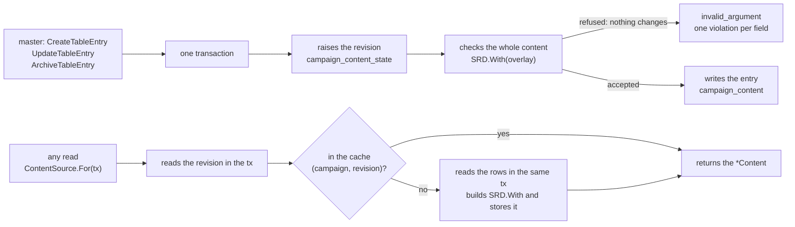
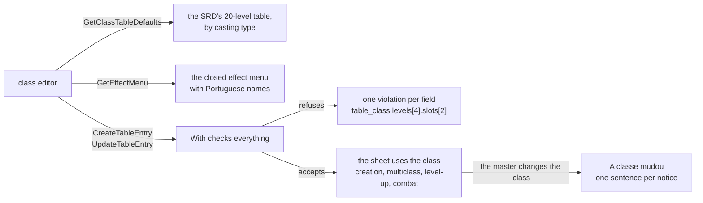

# Characters module: table content

The content the master registers (MR-025, RN-23, ADR-0018) is stored, served and takes effect at once, in `characters`.
The engine that checks and merges it is [`Content.With`](rules-table-content.md); this page is the storage, the API, the live read, the switches, the packs and the spell page.
For the module around it see [Characters](characters.md).

## The content source

Every read of rules content in `characters` goes through a `ContentSource` (`contentsource.go`), never through a `*rules.Content` held in the service:

```go
For(ctx context.Context, tx pgx.Tx, campaignID string) (*rules.Content, TableRules, error)
```

- **It returns the campaign's content and table rules.** `TableRules` are the table's choices (RN-23, RN-24); their zero value is the SRD defaults (the player chooses to roll or take the average for level hit points, all ability-score methods, critical doubles the dice, death saves visible, combat with a map, new maps without fog, no reminders): each field says what the table changes, never what the SRD already does.
  The type belongs to `platform/tablerules` (`tablerules.Rules`, a value with no behaviour) and `characters.TableRules` is an alias, so `campaigns` (which stores the rules), `characters`, `maps` and combat share it without importing each other.
- **It receives the caller's transaction** (`nil` outside one): the implementation reads the campaign's content revision inside it, by the rule that no read goes through the pool inside `db.InTx`.
  Whoever is in a transaction passes the `tx`, and the `campaignID` comes from what the call already knows.
- **One content per request.** A request asks for the content once and passes it along; in combat views, `CombatRoster.ContentNames(ctx, tx, campaignID)` returns a names function tied to a content.
  A write asks for the content before the transaction (or inside it, with the `tx`), never after the commit: a failure there would make the client repeat a write that already took effect.
- **`ContentFor`** skips reading the rules, for what does not need them.
  `SRDSource` (the SRD for every campaign, no database) is for tests and for those without a database; `Config.SRD` serves the few points without a campaign.
- **The seams with `play`** carry campaign and transaction where they read the content without knowing which campaign: `CombatRoster.ContentNames`, `CreatureSheet`, `CreatureTurnOptions`, `CreatureSave` and `CreatureEyes`.
- **The `ListContent` catalogue is built per content**: the same content gives the same catalogue, and a table's content has its own.
  At most 8 catalogues are kept (`maxCatalogs`), each held weakly, so the contents of an edited table do not stay alive.

## Storage and API



| Piece | What it does |
| --- | --- |
| Storage | `campaign_content` (one row per entry; `data` is the kind's message as protojson) and `campaign_content_state` (the campaign's revision). It lives in `characters` and not in `campaigns` because `characters` does not write a column of another module. The switched-off keys are `campaign_content_off`. See [Data](../data/README.md). |
| The protos | `rules/v1/table_content.proto`: one message per kind (`TableClass`, `TableSubclass`, `TableRace`, `TableSubrace`, `TableBackground`, `TableSpell`, `TableFeat`, `TableOption`, `TableClassFeature`, `TableCreature`; ten kinds, `TableContentKind`) one to one with `rules`' `Table*` types, and `TableEntry`, which reads return. The writes and the full read are `TableContentService`; the catalogue stays `ContentService.ListContent`, which also carries the table's entries and the `archived` mark. |
| Writes (master only) | `CreateTableEntry`, `UpdateTableEntry`, `ArchiveTableEntry`, `UnarchiveTableEntry`. Each is one transaction that starts by raising the revision (so two writes of a campaign run one after the other), reads all entries, applies the change and checks the campaign's whole content with `SRD.With`: a refused content changes nothing, the revision included. The error is `invalid_argument` with a `TableContentRefusal` detail, one `TableContentViolation{field, reason}` per engine error, with the path in the body's own names (`table_class.levels[4].features[0].effects[1].value`). The server adds `immutable` (kind, key, parent class or race changed; a feature key the entry never had; a spell going between cantrip and leveled), `duplicate_name` (another entry of the kind has the name, case-insensitive), `size_limit` (64 KiB an entry, `MaxTableEntryBytes`) and `limit` (more features or traits than the engine allows, counted in the handler before the transaction, so a huge body never holds the campaign's revision). A stale entry (`expected_revision` different from the entry's `revision`) is `aborted` with `TableContentBlocked` `STALE`. An archived entry can still be edited and stays archived; archiving twice is `ARCHIVED`, unarchiving one that is not archived is `NOT_ARCHIVED`. Archiving and unarchiving are not changes to the entry: they touch neither its `revision` nor its `updated_at`, but they raise the campaign's revision for the cache. |
| Keys | The entry's key is born from the name (accents removed, `a-z0-9-`, up to 60, with `-2`, `-3`... if taken; the engine's reserved words become a single word) and never changes, not even when the name does. Feature keys are the server's: `feature:class-<start of name>-<hash>--<feature name>@mesa` (and `subclass`, `race`, `subrace`, `background` in place of `class`, with `trait:` and `background-feature:` on the last three). The start of the entry's name is up to 16 characters and the hash is 6 characters of a SHA-256 of the whole entry key, so two long names that start the same never collide and the feature still fits the engine's 60 characters; `--` never appears in a name. A feature keeps its key while it exists: the editor returns it on update and, if it does not, the one of the same level and name takes it back. A key the entry never had is refused (`immutable`). |
| `ListTableEntries` | The entries in full, by kind and name. The master receives all (archived too, with `archived_at`) and, in each, how many sheets use it (`characters_using`, "Em uso por N fichas"). A player receives the entries they may see, in full (numbers and effects), never a count and never the archived or switched-off ones (a subclass or subrace whose class or race is switched off neither, unless their sheet uses it). Of the creature kind a player receives only the entries whose key a character of theirs holds, live, archived or switched off, whole. A pending member does not read it. |
| What a player never receives of an archived entry | The players' catalogue is a copy (`proto.Clone`, filtering the six lists) without archived and switched-off entries. `GetLevelUpOptions` does not offer an archived subclass unless the player's sheet has it. `GetSpellDetails` answers `not_found` for an archived spell unless a sheet of theirs uses it. No archived key reaches a player even by reference: the catalogue, `ListTableEntries` (which also clears archived keys from each body's class lists, granted spells and always-prepared lists), the spell details and the level-up options clear them from the reference lists (`Spell.class_keys`, `list_class_key`, `TableSpell.class_keys`, `TableCasting.list_from`, `TableEffect.spells`...). The catalogues carry what is needed to read the engine's content: `Race.choice_bonuses`, `Race.choice_bonus_sets`, `Race.sizes`, `Race.size`, `Subclass.spellcasting`, `ClassSpellcasting.list_class_key`, `Background.equipment_pt`. |

## The live source

`TableSource` (`tablesource.go`; `NewTableSource(pool, srd, campaigns)`) is one object for content and rules.

- **`For(ctx, tx, campaign)`** reads the revision inside the caller's `tx` and returns `SRD.With(overlay)` and the stored rules (`TableRulesReader.StoredTableRules`, which `campaigns.Service` implements, through the same `tx`); `ContentFor` skips the rules.
  With no revision row (a campaign without content or switches) it returns the SRD itself, building nothing.
- **Outside a transaction,** a hit costs reading the revision through the pool; a miss opens a read transaction that reads the revision and the rows again, so the content stored under a revision is that revision's.
- **The cache** is by (campaign, revision), at most 8 contents (`maxLiveContents`) and at most 24 MiB of stored entry data (`maxLiveBytes`), the newest always staying; the least recently used leaves first.
  A miss builds the content only for whoever asked, reading the rows in the same `tx`, with no shared `singleflight`: a request holding a connection while waiting for another that needs one is how the pool hangs.
  Two that miss at once both build and the second to store wins.
  A write never fills the cache, since what it builds can still roll back.
  Memory and time are in [Operations](../operations/reference.md#memory-budgets); a content of 1,000 entries keeps 4 MB (7 MB with 6,000 effects) and a miss takes 80 to 90 ms, so the eight contents come to 59 MB at most ([Performance](../performance.md#table-content-at-its-limits)).
- **The order against a sheet write.** `CreateCharacter` and `UpdateCharacter` read the content before the transaction and again inside it; if the revision changed, the sheet is checked again with the new content.
  `LevelUpCharacter` reads inside the transaction.
  Serialization conflicts (40001) are retried by `db.InTx`.

## "A classe mudou", on the server

A change takes effect at once, also on locked sheets.
The rules side (`ChangedSince`, `Issue.Keys`, the sentences) is in [Table content](rules-table-content.md#a-classe-mudou).
This is what the server stores and shows:

- Each sheet stores, inside its own document and written by `checkSheet` (create, edit and level-up; what the client sends is ignored), the content revision (`FullSheet.content_revision`), the notices it already had (`known_issues`, each by code, field and exact sentence) and, for a still-flagged entry, the revision at which the sheet was up to date with it (`content_baselines`).
- On every read, `Content.ChangedSince` lists the table entries the sheet uses that changed later, and the server shows for each changed entry only the new notices whose keys include it: `DerivedSheet.changed_content` (the key, the name, the field, the revisions, the date of the change and the exact sentences) and a `table_content_changed` `Issue` per entry.
- The notice disappears by itself when nothing remains tied to it; a change that left no new notice on that sheet shows nothing; there is no "dismiss".
- Saving the sheet does not clear it: on saving, the notices that were flagged and still stand stay out of `known_issues` and the entry stores the base revision in `content_baselines`, so the next read flags them again; only fixing what the notice says clears it.
- It is a notice, never a `Validate` error.
  So that `Validate` never refuses an unrelated edit because of a change, the server refuses on the entry itself the only change `Validate` checks against a sheet: a spell going from cantrip to leveled.
  The others (a class's casting, a race's bonuses, a background's skills) only generate `Derive` notices.
- Only the owner and the master read it; the player never receives the history of changes or who made them.
- `UpdateTableEntry` returns `affected_characters`: the sheets that use the entry and ended up with new notices tied to it, with the player's name, for the master's "Fichas com aviso" list.

## Archived and switched-off entries as new choices

- `CreateCharacter` and `UpdateCharacter` refuse an archived key that the new sheet has and the earlier one did not (`Content.ArchivedKeys`, comparing the two; a creation's is compared with nothing): `failed_precondition`, `CharacterBlocked` `ARCHIVED_CONTENT`, with the `content_key`.
  `LevelUpCharacter` and `PreviewLevelUp` refuse with `LEVEL_UP_REFUSAL_REASON_ARCHIVED_CHOICE`.
- The same for a switched-off key (or a child of a switched-off class or race), but only for a player: `SWITCHED_OFF_CONTENT` and `LEVEL_UP_REFUSAL_REASON_SWITCHED_OFF_CHOICE`.
  The master is not refused: the switch hides the option from players, not from any sheet the master edits.
- A sheet that already uses the key keeps working (`Derive`, `Validate`, names, level-up), and an unrelated edit is never refused.
- A sheet with an `@mesa` key does not change campaign: `CheckSheetCanMove` (`failed_precondition`, `TABLE_CONTENT_STAYS`, with the first key) exists for it.
  Nothing calls it yet, since characters are not copied between campaigns; whoever builds that must call it before writing.

## Player options and the live hint

The master switches on and off, per campaign, each class, subclass, race, subrace, background, spell, feat, option, class feature and creature, from the SRD and the table (`campaign_content_off`, one row per switched-off option; no row means on).
The options screen has no creature group, so creatures are switched through the API only.
What is switched off never reaches a player, in any read; the master sees everything with the `off` mark.
The engine side is [Switches and hidden keys](rules-table-content.md#switches-and-hidden-keys).

| Piece | What it does |
| --- | --- |
| In the source and cache | `TableSource` reads the switched-off keys in the same transaction as the revision and adds them to the content; the cache stays by (campaign, revision). A campaign that only switched options off already has a revision and a content of its own. |
| What the player never receives | A switched-off option is treated as archived at every point: the catalogue, `ListTableEntries` (which also clears switched-off keys from each body's references), `ListSpells` (`SpellFilter.Hidden`; a hidden `class_key` answers like an unknown one, an empty list, unless a sheet of theirs uses the class), `GetSpellDetails` (`not_found` unless a sheet of theirs uses it), `ListCreatures` (a table creature is left out of the list a player reads unless a character of theirs holds a live creature of that key) and `GetCreature` (`not_found` unless a character of theirs holds one), the level-up options, and the reference lists inside other entries. Everything but the creatures filters with the single predicate `Content.Hidden`; a table creature is the master's whatever its state, so a player reads it only when a character of theirs holds a live creature of its key (`callerHeldCreatures`). |
| `ListOptionSwitches` (master only) | The screen's list by kind and name: every class, subclass, race, subrace, background, spell, feat, table option, table class feature and table creature of the campaign, each with the key, kind, name, `table`, `off`, `archived`, `hidden`, `parent_key` (a subclass's class, a subrace's race), `level` (a spell's) and `characters_using` (how many player sheets use it, once per sheet). Reads the content and the sheets in one transaction. |
| `SetOptionSwitches` (master only) | Switches up to 1,400 options (`MaxOptionSwitches`: the SRD's 358 and the 1,000 entries of a table, so a whole campaign switches off in one call; about 0.2 s for 1,000 keys) in one transaction: reads the content, checks each key (`invalid_argument` for a key that is not switchable, a repeated one, none or more than 1,400), raises the campaign's revision and stores the set. The response is built without the live source (`SRD.With` of the rows the transaction sees plus the new set), because a write never fills the cache. An archived entry can also be switched. A request that changes nothing rolls the transaction back (the revision does not rise) and notifies nobody. The response carries the revision, how many options changed (`changed`) and those that changed for the players (`options`, the subclasses of a switched-off class included). |
| The live hint | Every write to table content (create, edit, archive, unarchive, the switches, an import) sends `content_changed` (stream field 23, no fields) to everyone watching the campaign, after the commit. It carries neither the entry nor the key (RN-10): each reader reads again with their own role. `characters` calls `Live.PublishContentChanged`, which `play` implements with the puzzles' time gate (one hint per campaign every 250 ms; the last change is never left without a notice) and the hub's `Coalesce`. With no open session nobody listens, and readers read the current content on opening. |

Who listens in the browser is on [the browser side page](characters-web.md#live-updates).

## Content packs (`ExportTableContent`, `ImportTableContent`)

A campaign's own content travels as a pack (MR-025): one file, `{"format": "meurpg.table-content", "version": 1, "name": "...", "entries": [...]}` in proto JSON (`TableContentPack`; the proto field names), each entry a `TableEntry` with only its `key`, `kind`, `name_pt` and body.
The revision, dates, counts, `off` and `archived` belong to the campaign and are left out; the features keep their keys.
Only the master calls either RPC.
The code is `tablecontent_pack.go` and `tablecontent_pack_json.go`.

| Piece | What it does |
| --- | --- |
| Export | One read transaction: every entry of the campaign, archived ones included, sorted by key; the pack's name is the campaign's (`CampaignNames`). |
| Strict reading | The request carries the file as `pack_json` (bytes) because the Connect JSON codec drops unknown fields: `readPackJSON` parses it with `protojson`, walks the JSON against the message and turns every field the message lacks (a misspelled name) into a violation of its entry at its path (`unknown_field`; outside any entry, a `pack.` violation). |
| The pack itself | Checked before the database is read, in both modes, and answered as `invalid_argument` with a `TableContentRefusal` whose fields start with `pack`: at most 3 MiB (`MaxPackBytes`; 1,000 entries are 1.1 to 1.4 MiB), `format` and `version`, at most 1,000 entries (the `limit` and `size_limit` violations of the pack are those of `pack_json`, the file: a `pack` message with more than 1,000 entries, or a `pack_json` over 3 MiB, is refused earlier as `invalid_argument` with a `RequestRefused` detail, see [Request size limits](api.md#request-size-limits)), a one-line label of 80 characters at most, for each entry a kind, a key `<kind>:<slug>@mesa` of that kind, or `option:<set>:<slug>@mesa` with a known set for an option (the SRD's keys, another suffix, capitals and reserved words are `bad_key` and `reserved_key`), no repeated key, exactly the body of its kind and a `name_pt` equal to the body's. |
| Planning | `planImport` runs for each entry what create and update run (the shape, the feature count, the feature keys, the 64 KiB), then compares with the stored one: new, updated (the fields that differ), unchanged, or refused. A feature key the stored entry lacks is kept when it starts with the entry's own stem; the engine refuses one another entry already has. Every violation of an entry is reported. |
| The engine | The whole campaign (what is stored with the pack's entries put in) goes through `Content.With`, with the pack's keys as `Strict`. `With` reports one entry at a time, so each failing pass refuses the entries it names and leaves them out of the next (at most 25 passes, `maxImportPasses`); violations of the whole table (a limit, a stored entry the pack would break) are violations of the pack as a whole. |
| Preview | A read transaction: nothing is written and the revision does not move. One outcome per entry, in the pack's order, and the totals. |
| Apply | One transaction: raises the content revision, plans, then writes every new and updated entry at that one revision, or nothing: a refused entry makes the call `invalid_argument` with all the violations, each with its entry's `key`. An import that changes nothing rolls the bump back. Updated entries keep their `archived_at` and their switch; new ones are on for the players. After the commit: `content_changed` once, and the names of the players of the sheets left with issues. |
| Idempotency | `idempotency_key` is scoped to the campaign (`campaign_content_imports`: the key, the hash of the request, the answer). Inside the transaction, after the bump, the key is looked up: the same request returns the first answer and writes nothing; another request is `invalid_argument`. |
| Leaks | Both RPCs are master-only, and nothing new reaches a player (the leak and authorization tests list them). |

## Table classes and subclasses end to end

The server gives the class editor everything it needs, and the flows of a table class (create, level up, play, change) work end to end; the web draws what the server sends and computes no table.



- **The two reads** (`tablemenu_rpc.go`, master only): `GetClassTableDefaults` and `GetEffectMenu` return `rules.Content.TableDefaults` and `EffectMenu` unchanged (see [Table content](rules-table-content.md#the-class-editors-data)).
- **One field per refusal.** Every refusal of a class or subclass is a `TableContentViolation` with the exact field the editor draws and a stable reason; what `With` says about the whole content keeps the field empty and the 1,000-entry limit has the reason `limit`.
- **Multiclass at creation.** `CreateCharacter` accepts a sheet with more than one class, each with its subclass, the table's included.
  The SRD prerequisites are sheet notices (`multiclass_prerequisite`) for the master and refuse a player's sheet; a subclass before its level is the `subclass_level` notice.
  Hit points follow the table rule (RN-24): with "roll", the calculation is of levels after the first, summing the classes (`HIT_POINTS_RULE` refuses the average and missing rolls), and the first level is the first class's full die.
  Spell slots follow the multiclass caster table.
- **A class's own list names SRD spells.** `TableCasting.srd_spell_keys` goes through `tableCastingOf` into the overlay like the other casting fields and is stored with the body (protojson in `campaign_content.data`; an absent field is an empty list).
  The overlay builder checks it with the class (see [Table content: rules](rules-table-content.md#the-class)), so a refusal is a violation at `table_class.casting.srd_spell_keys[<i>]` or at the field itself.
  `ListSpells`, the sheet's `Derived` and the level-up read the class's list from the campaign's content, so a character of the class prepares and learns those spells and gets no `spell_not_on_list` for them.
- **A subclass whose spells are expanded.** `TableSubclass.spells_expanded` goes through `tableSubclassOf` with the always-prepared list.
  The sheet then has no given spell from the subclass: its spells are on the class's list to choose from, and the `spell_sources` of `PreviewChoices` offer them (`patron_spells`) from their class level on.
- **Expertise only where proficient.** `TableEffect.only_proficient` goes through `tableEffectsOf`; `Derive` reads it when the sheet is worked out, so a change of the character's proficiencies moves the doubled skills with no write.
  The effect menu served by `GetEffectMenu` carries it as the `yes_no` field `only_proficient` of the `proficiency` type.
- **The casting subclass at level-up.** `LevelUpSubclass` carries what a third caster adds on choosing the subclass: `spells`, `spells_kind`, `spell_list_class_key`, `max_spell_level`, and for one that prepares, `prepares` and `prepared_max_after`.
  The subclass's always-prepared spells enter the sheet at their level and do not count against the limit.
- **A table spell in combat** goes through the same `CombatSpell` and the campaign's content: attack, save (half or nothing), damage per level or per cantrip tier, healing with the modifier, concentration, slots and the log work as for an SRD spell.
  `link.Spell` carries `TargetCount` and `TargetPerLevel` and `maxTargetsOf` uses them before the spell's type.
  `GetTurnOptions` carries `SpellTargets.targets_per_level`.

## Table options

`TABLE_CONTENT_KIND_OPTION` (`option` rows of `campaign_content`, key `option:<set>:<slug>@mesa`) is an option the master adds to one of the SRD's option sets: an Eldritch Invocation, a Metamagic option, a fighting style, a Pact Boon, a Hunter's Prey, Defensive Tactics, Multiattack or Superior Hunter's Defense, or, in the set `table_feature`, an option of a table feature's option list (`table_option.offered_by` is that feature's key).
The key names the set and the set never changes (`table_option.set`, `immutable`); the slug is unique within the set, and the key may have up to 100 characters (migration 00281 widens `campaign_content_key_valid` and `campaign_content_off_key_valid`).
`TableOption` is a feature (name, text, effects) plus `set` and an `OptionPrerequisite`; the engine side is in [Table content](rules-table-content.md#table-options).
It goes through the same writes, archive mark, switch (`SetOptionSwitches`, `ListOptionSwitches` lists it with the kind), pack, "A classe mudou" notice ("A opção mudou") and player view as the other kinds; a player's copy drops a hidden class, option, pact or spell from the prerequisite and from the effects.
The choice engine reads it with the SRD options: `GetLevelUpOptions`, `PreviewChoices`, `CompleteCharacterChoices` and the sheet's own save list it in the choice of its set, blocked with its reason when the character lacks a prerequisite, and refuse a pick that does not qualify (`PREREQUISITE_UNMET`) or that the master switched off for the players (`SWITCHED_OFF_CONTENT`).

## Table class features

`TABLE_CONTENT_KIND_CLASS_FEATURE` (`classfeature` rows of `campaign_content`, key `classfeature:<slug>@mesa`, migration 00282) is a feature the master adds to a class at a class level, optionally taking the place of one of the class's own.
`TableClassFeature` has `class_key`, `level`, `replaces_feature_key` and the feature body; the key and the class never change (`immutable`), the level, the replaced feature and the body do.
It goes through the same writes, archive mark, switch (`SetOptionSwitches`, `ListOptionSwitches`), pack and player view as the other kinds, and a sheet that has the class gets the notice "A classe mudou" when it changes.
The engine side is [Table class features](rules-table-content.md#table-class-features).
A player's copy drops a hidden class, a hidden replaced feature and the effects' hidden references.

## Table creatures

`TABLE_CONTENT_KIND_CREATURE` (`creature` rows of `campaign_content`, key `creature:<slug>@mesa`, migration 00289) is an SRD creature with adjustments: hit points, armor class, a damage bonus on its attacks, extra text traits and attacks of its own.
Its numbers can be formulas of its owner: `tableCreatureOf` maps all of them, and a violation reads like `table_creature.attacks[2].to_hit`.
`TableCreature` has `base_key` (an SRD creature, which never changes: `immutable` at `table_creature.base_key`) and the adjustments; the limits and refusals are in [Table creatures](rules-table-content.md#table-creatures).
A base the SRD lacks is refused as `dangling_reference` at `table_creature.base_key`, and an entry over 64 KiB as `size_limit`.
It goes through the same writes, archive mark, switch (`SetOptionSwitches`, `ListOptionSwitches` lists it with the kind) and pack as the other kinds.
Its player view is the whole entry or none: `playerReads` lets a creature row through only for a player who holds its key.
Nothing is deleted: the way out of an entry is the archive mark or the switch.

- **Where it resolves.** `GiveCreature` accepts its key where it accepts an SRD creature, and a table spell's `summon` brings it ([Table spell summons](rules-table-content.md#table-spell-summons)).
  `GetCreature`, `ListCreatures`, `CreateNpcFromCreature` and the combat read it from the campaign's content.
  The NPC made from it has "criatura da mesa" in its description.
  "Pôr no combate" keeps one combat-only NPC per campaign and creature for the SRD's, whose stat blocks never change.
  For a table creature the NPC's key also holds a digest of the numbers of the sheet the entry makes (the description is left out).
  An edit that changes the numbers makes another NPC.
  An edit that changes only the name, or changes the numbers back, finds the NPC it had.
  A monster added after the edit has the entry's current numbers, and the monsters already in a fight keep the ones they joined with.
- **When a number is copied.** `character_creatures.hp_max` is copied from the entry when the creature is given.
  Editing the entry changes no creature already held.
  For an entry with no formula, the armor class (`CharacterCreature.armor_class`) and the actions are read from the content every time.
  A held creature shows the entry's current armor class and attacks with its current damage bonus.
- **Formula creatures.** For an entry with a formula, the creature is created with a snapshot of its numbers (`character_creatures.stat_block`, migration 00297). A creature a table spell summoned has the circle of the cast slot in `slot()`, and `source` `table` with the spell in `summon_key` (migration 00299).
  `insertSummoned` derives the recipient's sheet with the campaign's content and active states, makes the environment with `rules.OwnerEnv`, runs `ResolveCreature` with the circle of the slot the spell was cast with (0 for a creature the master gave), stores the JSON and takes `hp_max` from the result.
  `CreatureSheet`, `CreatureTurnOptions`, `CreatureSave` and `CreatureCheck` take the creature's ID and read the snapshot, and so does the list's `armor_class`.
  A creature whose row is gone has the content's static numbers (`TestMR578_ACreatureWithoutARowFallsBackToTheStaticNumbers`).
  The snapshot follows neither the owner's later levels nor an edit of the formulas; the text of the creature is read from the content.
  A snapshot is used whenever the row has one, whatever the entry's formulas are (the list and the combat read it the same way).
  `rules.ResolvedDerived` matches the snapshot's own attacks to the entry's by the key of their action: one in both keeps the snapshot's numbers, one new in the entry has the static numbers, and one the entry lost is dropped.
  `GetCreature` and `ListCreatures` show the content's owner-less stat block, not a snapshot; the creature list's `armor_class` and the combat show the snapshot.
  "Pôr no combate" and "Criar NPC" have no owner and use the entry's static fields.
- **Archived and switched off.** An archived or switched-off entry keeps resolving for the creatures already held.
  They stay in the owner's list and join combats.
  Archived, switched off or live, a table creature is the master's: a player reads it only while a character of theirs holds a live creature of its key.
  `ListCreatures`, `GetCreature` and `ListTableEntries` leave it out for any other player (`GetCreature` answers `not_found`).
  The holder reads it whatever the entry's state, and the master reads every entry and can give it.
- **Who uses it.** `characters_using` is 0 for a creature entry, because a held creature is not part of a sheet.
  No sheet gets the notice "A classe mudou" when a creature entry changes.
- **What it is not.** The SRD spells' summon choices, Wild Shape, and the encounter generator, evaluator and swaps do not offer it.
  The encounter tools refuse its key as unknown content.
- **Packages.** A campaign package carries the creature entry with the rest of the table content.
  A package without the creature of an NPC's link is refused as unknown content.
  A package battle encounter that names a table creature is refused as unknown content.
- **The web app.** It has no editor for creatures and no creature group in the options screen.
  A creature is created and switched through the API or a content pack.

## Wild Shape and spell slots

`wild_shape`, `slot_recovery` and the `gives_slot` and `spends_slot` fields of `grant_action` are on the effect menu ([rules](rules-table-content.md#the-closed-menu-of-effects)); `tableEffectsOf` maps their proto fields (`max_cr`, `max_cr_from`, `form_cost`, `magical_attacks`, `no_fly`, `no_swim`, `gives_slot`, `spends_slot`, `recover_max_level`, `recover_levels`) like the others.
`combatCharacter` fills `link.Character.WildShapeCost` from `Derived.WildShape.Cost`, and `featureActionOf` fills `link.FeatureAction.GivesSlot` and `SpendsSlot`.
The vitals keeper has `GiveSpellSlot`, `SpendSpellSlot` and their undos; a slot made by `GiveSpellSlot` is counted as created, like Flexible Casting's, and goes with the next long rest.
`UseArcaneRecovery` takes the feature key and reads `vitalsMax.recoveries` (`Derived.TableRecoveries`); with no key it is the wizard's own.

## Spell targets and the "Magias" page

Every spell, SRD or table, says who it catches, and the players' "Magias" page (MR-045) reads that, the search and the filters from the server.
The code is in `rules/spelltarget.go`, `rules/spelllist.go`, `characters/spelllist.go` and `characters/spelldetails.go`.

**An SRD spell's target.**
The importer reads 5e-database's `area_of_effect` (shape and size in feet) into `spells.json` (`area_type`, `area_size_ft`) and refuses a shape that is not cone, cube, cylinder, line or sphere and a size that is not a multiple of 5 (see [Rules content](../rules-content.md)).
`srdTarget` decides in this order:

| When | The target |
| --- | --- |
| The spell is in `effects/spell_targets.json` | What the file says |
| The spell has a structured area | `TargetArea`, with the shape and size. The structured data wins; the text is not read. |
| Magic Missile and Scorching Ray | `TargetCreatures`, 3 and 1 more per spell level above the spell's own (`PerSlotLevel` 1): a dart or a ray each, and the same number the app reads in `targets_per_level` |
| A spell attack | `TargetCreature` |
| The SRD text says area ("20-foot radius", "up to three creatures", a Self spell that deals damage or asks for a save...) | `TargetCreatures` without a number (`Count` 0: the caster picks how many; the master judges) |
| Self range | `TargetSelf` ("Só quem conjura") |
| The rest | `TargetCreature`, with `PerSlotLevel` 1 when "at higher levels" says "one additional creature" |

`SpellTarget.LabelPT()` writes the label sent in `SpellDetails.target.label_pt`: "Uma criatura", "Várias criaturas", "Só quem conjura" or the area ("Cone de 4,5 m", "Esfera de 6 m", "Linha de 30 m"), with metres from `MetersPT` (5 ft = 1.5 m, decimal comma, no decimal when whole, kilometres from 1,000 m).
The app writes the rest of the spell (time, range, duration, components) in `spell-details-format.ts`.

**`effects/spell_targets.json`** is handwritten and corrects, in our words, the spells the database or the text gets wrong.
The types are closed: `creature`, `creatures` (with `count` and `per_slot_level`), `area` (shape and size), `self` and `none` ("no creature": a point, an object, a place, nobody to pick); every key is an SRD spell, `label_pt` replaces only the page's text, and the file follows the content revision rule.
For `self` and `none`, `play` lists only the caster, refuses another target (`link.Spell.CasterOnly`) and rolls nobody's save.
The file covers, by kind: one creature (Telekinesis), only the caster (the detect spells, Speak with Plants, Branding Smite, Divine Favor, Flame Blade, Contact Other Plane, Magic Jar, Scrying, Wish), no creature (Arcane Eye, Magnificent Mansion, Dancing Lights, Druidcraft, Fabricate, Light, Major Image, Minor Illusion), several creatures with the SRD's number (Bless and Bane, Mass Healing Word, Prayer of Healing, Mass Suggestion, Telepathic Bond, Water Walk, Wind Walk, Astral Projection, Heroes' Feast), an area the database lacks (Hypnotic Pattern, Plant Growth, Purify Food and Drink, Glyph of Warding), and spells where only the text changes (Flame Strike, Forbiddance, Mirage Arcane, Teleportation Circle, Guards and Wards, Fire Storm).
`TestStructuredAreasAgainstTheText` pins the list of spells where the structured area and the text still disagree; spells that only the text calls area and the file does not correct stay "several creatures" without a number, which blocks nobody since the master is never limited by the number of targets.

**`ContentService.ListSpells`.**
Active members only (the pending member gets `not_found`), `IDEMPOTENT`, with `query`, `class_key`, `levels`, `school_keys`, `character_id`, `page_size` (1 to 400, 100 by default) and `page_token`; it returns the light `Spell`, ordered by Portuguese name, with `total`.

- **The search** finds the Portuguese or English name, without accents and case-insensitive.
- **The class** is its list: the spells that cite it, or the list the table class reuses.
  A casting subclass (the third caster) takes the list of the class it casts from.
  A class without a list gives an empty list.
- **"Só as que posso aprender"** (`character_id`): the list of each casting class on the sheet, up to that class's highest level, cantrips included; in a multiclass, each class's list by its level in it.
  The sheet's owner and the master may ask; another player gets `not_found` and a basic sheet `failed_precondition`.
- **Who sees what.** The player never receives an archived or switched-off spell, nor an archived or switched-off class's key in `class_keys`; the master receives them with `archived` or `off`.
  Switching a class off does not hide its list's spells: only the class key leaves `class_keys`.

**The "Outro" background.**
The free-text background follows SRD 5.1's "Customizing a Background": the sheet's `CustomBackground` has `proficiency_keys` (two tools or languages), `feature_name` and `feature_text` (the player's words) and `equipment` (text).
`Validate` checks the limits (at most 2 tools or languages, each an SRD tool proficiency or language, no repeats; feature name up to 40 characters; text up to 1,000; equipment up to 500).
What is missing is a `Derive` notice (`missing`, one per part), never an error, and only when the sheet already has some of the new parts.
`Derive` applies it: the tools become proficiencies, the languages enter `Languages`, the feature enters `Features` (`background-feature:custom`, origin `background:custom`), and the equipment comes out in `DerivedSheet.background_equipment_pt`.
Level-up changes none of it (`full.custom_background` is locked).
