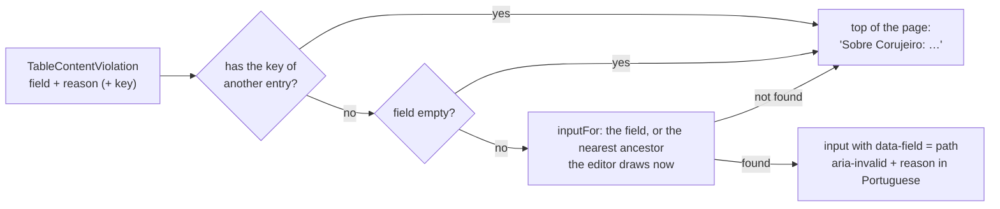

# Characters module: the browser side

The character editor, level-up, the table-content editors and the table rules screens draw what the server sends and compute no rule (ADR-0008).
This page says how each is put together and which server calls it uses.
For the server side see [Characters](characters.md) and [Table content](characters-table-content.md); for the app in general see the web app documentation.

## Live updates

The hint `content_changed` goes to everyone watching the campaign, with no content, and each reader reads again what it shows with its own role (a player never receives, on read, what the master switched off).

- **`ContentWatcher`** (`core/content/content-watcher.ts`) opens the session stream (the same `LiveStream` and ADR-0005 rules: backoff, closed with the tab hidden, no retry without access) only when the campaign has an open session (`OpenSessions` asks the server every 30 s, `POLL_INTERVAL_MS`).
  It groups notices arriving within 300 ms (`CONTENT_DEBOUNCE_MS`; the server already lets one through every 250 ms) into one read, clears the wait when the page leaves, and reads again on a `ready` that is not the page load's own: a session that opens with the page already up connects within 30 s and its first `ready` already reads, because a hint can be lost while the stream is down.
- **Each page declares it** in its own component (`providers: [ContentWatcher, LiveSessionSourceLive]`), one stream per page, and reads what it shows.
  The listeners are the table content list and the entry page (the open editor keeps the body and revision the master is editing, and a "Salvar" after another write still says the entry changed), "Opções para os jogadores" (a read that started before a master change is discarded), "Magias" (the list in its current filter, the "Mostrar mais" pages that were open, the open spell and the class names), a player's character editor (the master's does not listen, because they write the content; what was typed stays and a sentence says the lists changed), and level-up.
- **Level-up** reads the character, the options and the catalogue again: `LevelUpClient` keeps the catalogue per campaign and character and the hint asks for `fresh`, so the client memory never serves an old list.
  Choices still in the offer stay (`adopt`), and a pick made on the old screen in the moment before it re-renders goes to the new draft too (`LevelUpDraft.handOver`, `LevelUpSession.handOver` for a die rolled in the app whose answer arrives after the rebuild).
  The sentence only appears if what the page shows changed.
- **The open sheet** and the campaign's character list read again on `xp_changed` through `XpWatcher` (`core/play/xp-watcher.ts`), one more callback on the same stream; the sheet uses it for "A classe mudou".
- **The stream client** (`core/play/live-stream.ts`) keeps the stream's state and ADR-0005's timing: `connect` is the loop over one connection, `receive` is what one message does (`ready` makes it live, `ended` closes it), `failed` is what a failed connection does (a fatal error ends it, any other is tried again after the backoff), and `scheduleReconnect`, the dead-stream timer and the hidden-tab timer keep the timing.
  Which handler of the page a message reaches is a table by kind in `live-stream-dispatch.ts` (a new kind is a new row; a kind the page left no handler for, a heartbeat and an unknown kind do nothing), and the handlers are described in `live-stream-handlers.ts`.
  `live-stream.dispatch.spec.ts` holds every kind to its handler.

## The character editor

`pages/character-editor` is a page that owns the two forms and the page state and builds plain classes for the rest; its template binds their members directly (`views.blocks()`, `picks.toggleSkill($event)`, `server.pendingSteps()`, `submitting.submit()`).
What a page or a list shows is a pure function of the catalogue and the form, each with its own spec:

| File | What it holds |
| --- | --- |
| `editor-state.ts` | The page state, titles, lead, cancel link, the XP a new sheet starts at, and the request that asks the server to derive the draft. |
| `editor-core.ts` | The interface every plain class reads the page through: the state, the two forms and the picks. |
| `editor-catalog.ts` (`views`) | What the catalogue and the form say together: the select options and their "saiu da lista" entries, the class blocks, the spell sections, the page texts. |
| `catalog-views.ts`, `spell-views.ts` | The pure functions under it: the sentences under the selects, the Constitution the preview adds up, the skills the lists give; what each caster section lists, its searches and numbers. |
| `catalog-changes.ts` | Whether a re-read catalogue differs from the one on screen, and which form control holds a key the master switched off. |
| `editor-picks.ts`, `skill-picks.ts` | What is picked beside the form's controls (skills, expertise, extra classes, feats, rolls, choices) and the toggles of skills and expertise. |
| `spell-picks.ts` | The cantrips, known and prepared spells of the "Magias" step and their searches. |
| `editor-draft.ts` | The draft the form and the picks add up to, and what is wrong with it (`invalidSummary`, the problems that have no control of their own). |
| `full-draft.ts`, `full-form.ts` | The draft the request carries, the problems the blocks and the rolls still have, what the server's answer takes out of the picks; the form and its limits. |
| `editor-server-draft.ts`, `hit-points-server.ts`, `server-choices.ts` | What the server derives from the draft: hit points and spell numbers (`PreviewCharacter`) and the class and race choices (`PreviewChoices`). |
| `editor-submit.ts`, `save-flow.ts` | The save button and what it does before the request (the first problem opens its step); the request of a create or an edit, its idempotency key, the navigation and what a refusal does to the page. |
| `editor-loader.ts` | What the page reads to open (the lists of a new sheet or the lists and the sheet of an edit, the table of ways to make scores), how it fills the forms and the picks with them, the counters that drop the answer of a route the person left, and the re-read on `content_changed`. |
| `editor-spell-details.ts` | The "?" next to a spell: the dialog on a desktop, the bottom sheet on a phone. |
| `character-editor-catalog-map.ts`, `character-editor-sheet-map.ts` | The wire to view-model mappers for the catalogue and for the sheet (the form and the init it sends back). |
| `class-blocks.ts` | The arithmetic only of splitting what the catalogue gives: total level, each level's die after the first (in class order, the order of `HitPoints.rolls`), and the spell sections (one per casting class or casting third-caster subclass, with the list, which class it comes from, and the highest spell level at its level). No prerequisite, hit point or slot is computed there. |

State several parts share lives in `EditorPicks` and `SpellPicks`, which the component builds first and hands to the other plain classes through `EditorCore`; the page itself keeps only the route, the step and choice-group view children, two effects (the subclass waiting for its level, the starting XP) and the class-block handlers.
`EditorStepper` builds a step's content the first time it opens and keeps it; the `eager` step ("Habilidades" under table rules) comes from the start.

- **The catalogue** comes from `character-editor-source.live.ts`, which reads from `ListContent` the table flags (the `@mesa` key and `archived`), each class's skills and saves, the list a table class reuses, the third-caster subclass's casting, the race's choice bonuses, the background's equipment, and `NamedKey.kind` (tool, armor, weapon, skill, save, language, other: "Outro" offers tools and languages without guessing from the key).
  `Subclass.always_prepared` lets the editor show the always-prepared spells on creation.
- **Editing asks for the catalogue with the sheet** (`ListContent` with `character_id`), so the entries that sheet uses come back even archived or switched off.
  A key the catalogue does not know never reaches the screen: "uma opção que saiu da lista".
- **Server previews.** The "Pontos de vida" box asks `PreviewCharacter` (debounced, `hit-points-server.ts`) for `hit_points_from_effects` and adds it to the per-level rows it writes itself; with every roll typed, the box's total is the saved sheet's maximum.
  The "Magias" step asks it for `spellcasting` and counts "N de M" against the class tables, warning "Prepare até M" while a preparing class has fewer than it takes.
  A failed call leaves the box with its own dice arithmetic and a note.
  `server-choices.ts` does the same for the class and race choices.
- **The "Habilidades" step** (`table-ability-scores`, only for the player creating a sheet and the pending member; the master and NPCs keep the free editor) uses `loadAbilityTable` (the rules, the numbers and the stored roll), `RollAbilityScores` and `CreateCharacter`'s `ability_method`.
  Each method writes the six numbers into the form and the step stays incomplete, with the reason, until the method finishes: the standard array uses the server's values; point buy sums the costs the server gave ("Restam N pontos"); 4d6 asks `RollAbilityScores` (never `crypto.getRandomValues`) and shows the stored roll, the same after a reload; with a physical die (RN-18) the player types the dice once, after the question "Guardar estas rolagens?"; typing goes from 3 to 18.
  The player's own draft shows only the method the server recorded (`FullSheet.ability_origin`), with its limits and, in 4d6, the dice stored on the sheet.
  Creation hit points follow `TableRules.hit_points`.
  The refusals appear by reason in `describeCharacterError`.
- **Pending state.** The pending sheet shows the player "Esperando a aprovação do mestre"; the master sees "Aprovar personagem" and "Recusar personagem", and refusing asks for a confirmation ("Confirmar recusa") because it deletes the character for good.

## Level-up screen

The page `/campaigns/:id/characters/:characterId/level-up` (lazy, `pages/level-up`) is a client of the level-up calls.
`core/levelup` holds the screenless part: `LevelUpClient` (the calls, plus the campaign's content and dice preference), `levelup-flow.ts` (each level's steps and the pickers' lists, from the server and the content), `LevelUpDraft` (the picks in signals, with `levelup-lists.ts` for the lists and counts they are read against, `levelup-abilities.ts` for the increase or the feat, `levelup-missing.ts` for what is missing, `levelup-picks.ts` for the toggles and `levelup-request.ts` for the `LevelUpChoices` to send), `levelup-summary.ts` (the "before → after" lines), `levelup-errors.ts` (refusals by code and reason, never by message) and `LevelUpFeed` (the master's read).
The page side adds `LevelUpSession` (what the steps share), `LevelUpReader` (every reading of the character, the options and the catalogue that makes a session, numbered so only the newest of two overlapping reads lands) and `LevelUpFocus` (where the focus and the scroll go as the page changes).
`levelup-flow.withSubclass` folds into the server's options what the chosen subclass adds (`LevelUpSubclass`: spells, list, level, whether it prepares and the maximum); before the choice, and for a non-casting subclass, the steps read the server's options untouched.

- **On every choice** `LevelUpPreview` calls `PreviewLevelUp` (debounced 150 ms, `QUIET_MS`; a response overtaken by a newer one is discarded) and the screen shows the "O que muda", the new maximum of prepared spells and the first refusal.
  With the hit die rolled it also asks with the average, so the "Média" card shows the life with it.
  The screen does no rule arithmetic.
- **The steps** are Habilidades, Vida, Magias and Resumo; a step with no choice does not exist.
  "Escolhas" (subclass, feature options, skills, expertise) comes before Magias, because the subclass may give cantrips.
  The first step is the class ("Subir em qual classe?").
- **Hit points** follow `LevelUpOptions.hit_points_rule`: `ROLL_ONLY` shows no average and opens on the die, `AVERAGE_ONLY` only the average, `PLAYER_CHOOSES` the two cards.
- **Saving** is one call, `LevelUpCharacter`, on "Confirmar o nível N", with the revision read.
  `aborted` and `LevelUpRefusal` appear in place; the confirmation returns to the sheet through the navigation state (never Web Storage).
  "Ler a ficha de novo" after a stale revision rebuilds the session with the new sheet and options and carries along the choices that still hold.
  When the answer to a confirmation is lost, the stale retry reads the sheet and, if it is already at the level asked for, goes to the sheet as after a confirmation.
- **The master** reads `ListLevelUps` through `LevelUpFeed` (one page of 50, the list reading all pages), and the page reads again on `xp_changed` when the campaign has an open session.
  "Recente" is "confirmed in the last 24 hours", storing nothing in the browser.

## Bestiary

The bestiary is `ListCreatures`; there is no second list, and the Wild Shape and summon callers send the same fields and receive the same rows.
Two lazy routes (`campaigns/:id/bestiary` and `campaigns/:id/bestiary/:slug`, the sheet with "Criar NPC") and the "Bestiário" row of the campaign page's "Preparação" tab; only the master sees them.
The server lets any member read the SRD, so the page asks the campaign for the role (`BestiaryAccessCheck`) and tells a player it is the master's.
The list asks for all creatures in one call (`page_size` 400) and filters on the server (name, type, size, `min_cr`/`max_cr`); the search lives in the address parameters.
The sheet reuses `StatBlock`.
The "Criar NPC" idempotency key is born once per opened dialog; the dialog's armor class, hit points, speed and abilities come from the creature sheet, and the attacks that go along come from `Creature.npc_attack_names`.

## Table content screens

The screens of MR-025 and RN-23 use only the server of [Table content](characters-table-content.md): the browser writes no list and does no rule arithmetic, and what the server refuses comes back on the field.

- **Routes** (`pages/content/content.routes.ts`, `loadChildren`, so the editors and the client stay out of the initial bundle): `''` is the list (`content-list`), `options` is "Opções para os jogadores", `import` the pack import, and `new/:kind` and `entries/:key` are the same entry page (`content-entry`), which picks the editor (spell, race, subrace, background, feat, class, subclass) when the caller is the master on a notebook and the read view (`entry-read`) otherwise: the player, and the master on the phone.
  The entry's key (`race:corujeiro@mesa`) is a single encoded segment.
- **The client** (`core/content/content-client.ts`, `TableContentClient`): the list, the writes (`save` creates or swaps the body with the revision the editor read), archive and unarchive, the effect menu, the class defaults and the campaign catalogue.
  Failures are read through the typed detail (`TableContentRefusal`, `TableContentBlocked`), never the message.
  Each violation arrives at the field's exact path, all of an entry's at once.
- **The drafts** (`spell-draft`, `feature-draft`, `effect-draft`, `feat-draft`, `class-draft`): the form as plain values, with distances in metres (5 ft = 1.5 m; `rangeFeet` and `rangeMeters` are the only arithmetic) and the conversion to the request body.
  The body carries only what the choice uses: a spell's mechanics (`Só texto` has no attack, save, damage or healing), the shape and size only on an area, and for an effect only the fields the server's menu says the type reads (`draftToEffect`).
- **The damage warning** (`core/content/spell-warnings.ts`, `unappliedDamage`): the spell editor shows "O app não sabe aplicar este dano" under the combat mechanics when a saved spell has damage and no attack, no saving throw, no area and a target other than the caster alone.
  It is a client-side note beside the form, with no code from the server; it never blocks "Salvar magia", and it goes away when the master picks an attack or a saving throw, or an area target.
  Dice typed under "Só texto" are not sent, so only a saved body raises it.
- **What comes from the server and what is screen text.** The effect menu (`GetEffectMenu`: types, fields, closed lists with Portuguese names, SRD options, formula functions, tag prefixes), the abilities, damage types, languages, proficiencies, skills and schools (`ListContent`) and the race bonus limit (-4 to +4) come from the server; the picker (`shared/effect-picker`) and the editors draw what it sends.
  The browser keeps only screen text: labels, hints, the refusals' sentences (`content-violations.ts`) and the shape and mode options (cone, cube, action, minutes), which are screen names of closed `.proto` fields.
- **From violation to field** (`core/content/content-violations.ts`):

  Every editor field carries its own path in `data-field` (`table_race.traits[1].effects[0].value`), so the path finds the field without a table per editor; what the editor draws now comes from one function per editor (`spellFieldPaths`, `featurePaths`).
  The text comes from the reason and the shape of the path (`violationText`: indexes become `[]`), in Portuguese, and focus goes to the first field with an error (`focusField`).
- **The archive question** is `archive-question` (in place, on the notebook) or `archive-sheet` (bottom sheet, on the phone).
  Unarchiving asks nothing.
  After a write that changes an entry in use, the response carries `affected_characters` and the page lists "Fichas com aviso".
- **The player** reads entries through `ListTableEntries` and `core/content/content-read.ts` writes them in rows and sections.
  The effect menu is only read by the master, so the player sees the feature's text and, of the effects, only what a sentence says without the menu.
- **Shared pieces.** `shared/segmented`, `shared/sheet` (`sheet-host.ts` and `sheet-frame/`: the bottom sheet on the phone, the dialog elsewhere; a sheet that sends a create or a write calls `lock(true)` while the request runs, so Esc and the backdrop do not close it and the answer is not lost to a second try under a new idempotency key), `shared/form-fields`, `shared/effect-picker`, `shared/feature-editor` and `shared/level-grid`.
- **The "Disponível para os jogadores" switch** of each editor and the "Opções para os jogadores" screen use `ListOptionSwitches` and `SetOptionSwitches`; the switch belongs to the entry (`TableEntry.off`), never to the class body.

### Class and subclass editors

- **The numbers come from the server.** `TableContentClient.classDefaults` brings the proficiency bonus, the improvement levels, the subclass level and a 20-row table per casting type.
  `core/content/class-draft.ts` pastes those rows into the draft (`rowsOfTable`), says whether the master edited them (`rowsEdited`, for the "Refazer a tabela dos 20 níveis?" question before swapping the casting) and returns them as `levels`.
  A stored class with `start_level` 0 receives the default's.
  A stored third-caster subclass is compared with the default only on the casting columns.
- **The features** are a single list, each with its level; `classFeatureBase` says where the request puts each (`table_class.levels[4].features[0]`), so a refusal lands on the right field and opens the closed feature.
  The "N de 60" counter uses the menu's limit.
- **The grid** (`shared/level-grid`) scrolls inside (titles pinned on top, the level on the left), one `<input>` per cell with `data-field` (`table_class.levels[4].slots[2]`) and an `aria-label`; arrows change row and Page Down jumps five.
  It shows the levels the casting type's default uses, and "Mostrar os 9 níveis de magia" opens the rest.
  The third-caster subclass uses the same grid without bonus and features.
- **The refusals, all at once.** `addClass` and `addSubclass` (`overlay_class.go`) gather the violations with `entryErrors`, each at its path.
  Two are not for one field: "passou das 60 características" goes to the top of the panel with the counter in red, and an always-prepared spell's goes to the group of its level (`groupOfAlwaysPrepared`).
  What the request refuses on a whole row appears under the grid, with the level.
- **The page** (`pages/content/class-editor`, `subclass-editor`, `class-parts/`): sections with the list beside (`SectionNav` marks the section in view with an `IntersectionObserver`, says "Com erro" where there is a refusal, and stays pinned while scrolling), a fixed save bar, and the same refusal, archive and "Fichas com aviso" pieces as `content-entry`.
  Only the master on a notebook edits; on the phone they read.

## Table rules screens

The screens that use the table rules of the campaigns module (RN-24, `GetTableRules`, `SetTableRules`) and the [ability scores of a new sheet](characters.md#creating-a-character): the browser shows the numbers the server gives and sends what the player chose.

- **"Regras da mesa"** (`/campaigns/:id/rules`, `pages/table-rules`, lazy): the master edits and the player reads the rules in words in `rules-read`; the campaign carries the panel for both, and the master's "Dados" panel only summarizes the dice mode and links here. The yes/no rules are `rule-switch` (the fog switch and "Os jogadores veem a CD dos testes de resistência", `show_save_dc`); the page always sends every rule back with `SetTableRules`. The screens that show a save (the effect-save sheet and its result, the "Seus efeitos" card, the combat log, the trap activity, the concentration question and its result in `reaction-prompts.ts` and `reaction-results.ts`, the reminder on the damage that threatens a concentration) print "CD n" only when the server sent the DC (`dcLabel` in `core/format/save-dc.ts`) and never work one out (the concentration question also drops "metade dos N de dano", which would give the DC away).
  `TableRulesClient` reads `GetTableRules` and stores `SetTableRules` (the whole page at once, with the dice mode) and `SetCampaignXpMode`.
  The page's style is computed in the browser from the three presets the server sends (`styleOf`: the dice, combat and fog match a preset, or "Personalizado"), because the person sees the style before saving; choosing a style only copies the three values (`applyPreset`).
  The XP mode has its own flow: `SetCampaignXpMode` without `confirm`; with XP already given the `XpModeChangeBlocked` refusal opens the question with the number of awards and XP, and only the confirmation sends `confirm`.
- **The calibration** lives in the map editor's "Grade" panel (`grid-panel` and `grid-panel/calibrate-ask`).
  `SetMapGrid` always carries the map's factor, so changing only the columns does not lose the calibration.
  The "Mudar a grade?" question only opens when the change deletes the layers and something is painted or seen; `core/maps/calibration.ts` says the effect (`scales`, `clears` or `same`) with the server's rule.
  With a combat on the map the button is off with the reason written, and the server's `COMBAT_RUNNING` refusal says the same.
