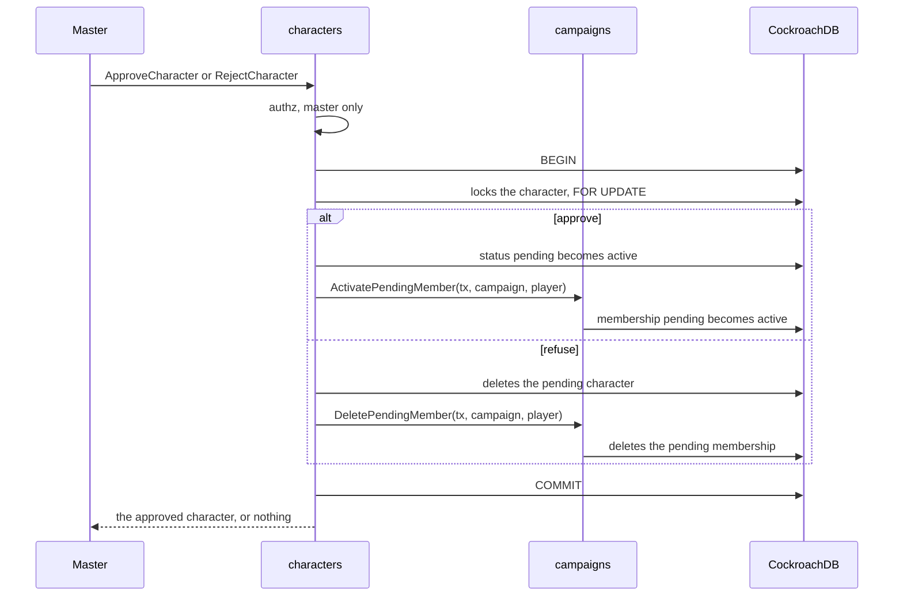

# Characters module: characters and sheets

The player creates their own character and the master creates the NPCs; the sheet comes back with the numbers computed by the server (MR-003, MR-004, MR-005, MR-006).
The character of someone who joined through an invite with approval waits for the master to approve or refuse it (MR-024, RN-15).
The code lives in `backend/internal/characters`, the tables are in [Data model](../data/README.md), and the arithmetic is in the [rules module](rules.md).

The module serves three Connect services:

| Service | What it serves | Page |
| --- | --- | --- |
| `CharacterService` | Characters, stories, master notes, approval, reserved characters and claims, level-up, character creatures. | This page. |
| `ContentService` | The rules catalogue and everything public about the SRD (spells, creatures, presets). | [Content service](#content-service). |
| `TableContentService` | The master's own content, its switches and packs. | [Table content](characters-table-content.md). |

Related pages: [Table content](characters-table-content.md) (live content, switches, packs, the spell page), [Browser side](characters-web.md) (the editors and screens), [Rules module](rules.md).

## Principles

- **The sheet stores choices, not numbers.** `CharacterSheet` is a full sheet (`FullSheet`: player, enemy and boss) or a basic one (`BasicSheet`: minion and story NPC).
  The full one stores content keys, like `class:wizard`.
  Every write goes through `rules.Validate` and every read through `rules.Derive`, which returns the `DerivedSheet`.
  The browser never computes a rule.
- **An NPC gives XP (MR-016).** `FullSheet` (enemy, boss) and `BasicSheet` (minion) have `challenge_rating` (`"0"`, `"1/8"`...
  `"30"` or empty) and `xp_value` (0 to 1,000,000); a player's sheet refuses both with `invalid_argument`.
  The server stores what it receives: filling the XP from the level is the editor's job.
  `characters` also adds and subtracts the sheet's XP at `progression`'s request and says, in `GetCharacter`, whether the character can level up.
- **The NPC portrait (MR-031).** `FullSheet` and `BasicSheet` have `portrait_image_id`, an image from the campaign gallery checked through the `Gallery` interface (the maps module).
  A player's sheet refuses it.
  The field lives in the sheet's JSON.
- **The backstory is separate** (`CharacterStory`: personality, appearance, history, allies), with its own lock and its own call, `UpdateCharacterStory`.
- **One revision.** Sheet and story share one `revision`.
  Whoever saves sends the revision they read; if the sheet changed meanwhile the answer is `aborted` and nothing changes.
- **Master notes** live in a separate table and come out only through `GetMasterNotes`.
  No other response carries them (RN-11).
- **Hit points follow the maximum.** When a save changes the sheet's maximum hit points, the character's current hit points follow in the same transaction (set ones gain what the maximum gained, none ends above a lower maximum, never-set ones stay full).
- **Free text.** The server trims spaces at the ends.
  One-line fields refuse line breaks, control characters, the line and paragraph separators (U+2028, U+2029) and invisible characters (zero width, text direction, word joiner, byte order mark, the Hangul fillers) and need at least one visible character; multi-line ones accept line breaks and tabs but refuse the same invisible characters.
  Both return the text in Unicode form NFC.
  The zero-width joiner stays legal because emoji sequences need it.
  The limits are in the `characters.proto` comments.
- **Responses.** Every response, errors included, goes out with `Cache-Control: no-store`; every read carries an ID, so it is `IDEMPOTENT` and POST-only.
- **A campaign holds at most 1,000 characters and NPCs**, living and dead, the combat-only NPCs of creatures in a combat not counted (RN-30, `DefaultMaxCharactersPerCampaign`); a create past it is `resource_exhausted`, and a retry of a create that already went through is answered, not refused.
- **Create is idempotent by key.** `CreateCharacter` and `CreateNpcFromCreature` take an `idempotency_key` (a UUID the app makes once per action), scoped to the caller (`callerCreateKey`: a version 5 UUID of caller and key, stored as `create_key` with a unique index on campaign and key).
  A retry returns what the first call made; the same key with another request is `invalid_argument`.

## Wiring

`characters.New(Config)` takes the pool, `Profiles` (display names, from `identity`), `PendingMembers` (the campaign's membership, from `campaigns`), the `ContentSource` and the SRD.
`cmd/api` connects the rest after creation, and `CheckWired` fails the start when one is missing:

| Setter | Interface | What it is for |
| --- | --- | --- |
| `SetGallery` | `Gallery` | Which images are in a campaign's gallery (NPC portraits), from `maps`. |
| `SetLive` | `Live` | The session stream: `PublishXPChanged`, `PublishVitalsChanged`, `PublishContentChanged`, implemented by `play`. |
| `SetCreatureHost` | `CreatureHost` | The combat that holds a character's creatures, from `play`. |
| `SetReviewHost` | `ReviewHost` | The streams a review or revival is told on, and the combat a revived character returns to, from `play`. |
| `SetLevelUps` | `LevelUps` | Whether a character can level up (RN-12), from `progression`. |
| `SetCampaignNames` | `CampaignNames` | The campaign's name for an exported content pack (optional). |
| `Config.Dice` | `DiceRules` | The campaign's dice setting (RN-18), from `campaigns`. |

No two modules import each other: `play` declares what it needs from characters and `Service` implements it (see [What other modules read](#what-other-modules-read-from-this-one)), always taking the caller's transaction and no caller, because the other module has already authorized.

## Who may do what

Every handler starts with one explicit check: `authz.RequireCampaignMember` when any member may call it, `RequireCampaignRole` when only the master may, and `RequireCampaignMemberOrPending` for the calls a pending member may make too (the `pendingMayCall` list in `authz/pending.go`: create, get, list, preview and update their own character and its story, resubmit, `PreviewChoices`, the ability-score rolls, `GetTableRules`, `ListContent`, `GetSpellDetails`).
What a player may see and change is then decided from the character's row (`canSee`, `playerEditsSheet`, `playerEditsStory` in `access.go`).

| Call | Master | Owner (player) | Other player | Non-member | Anonymous | Pending member (RN-15) |
| --- | --- | --- | --- | --- | --- | --- |
| `CreateCharacter`, player type | `permission_denied`, unless `for_player` (a reserved character) | Yes; `failed_precondition` if they already have a living one (RN-03) | Yes, their own | `not_found` | `unauthenticated` | Yes, only one, born pending |
| `CreateCharacter`, NPC | Yes | `permission_denied` | `permission_denied` | `not_found` | `unauthenticated` | `permission_denied` |
| `GetCharacter`, `UpdateCharacter`, `UpdateCharacterStory` of a player's character | Yes | Yes, within the locks below | `not_found` | `not_found` | `unauthenticated` | Only their own pending character |
| The same of an NPC | Yes | `not_found` | `not_found` | `not_found` | `unauthenticated` | `not_found` |
| `ListCharacters` | All, NPCs and pending included | Only their own | Only their own | `not_found` | `unauthenticated` | Only their own pending one |
| `SetStoryEditing`, `MarkCharacterDead`, `ReviveCharacter` (player characters) | Yes | `permission_denied` | `permission_denied` | `not_found` | `unauthenticated` | `not_found` |
| `ApproveCharacter`, `RejectCharacter`, `RequestCharacterChanges` | Yes | `permission_denied` | `permission_denied` | `not_found` | `unauthenticated` | `not_found` |
| `ResubmitCharacter` | `not_found` | Yes (their own pending character, with a request open) | `not_found` | `not_found` | `unauthenticated` | Yes (their own) |
| `GetMasterNotes`, `UpdateMasterNotes` | Yes | `permission_denied` | `permission_denied` | `not_found` | `unauthenticated` | `not_found` |
| `CreateClaimLink`, `RevokeClaimLink`, `ReturnCharacterToReserve`, `DeleteReservedCharacter` | Yes | `permission_denied` | `permission_denied` | `not_found` | `unauthenticated` | `not_found` |
| `PreviewClaim`, `ClaimCharacter` | `own_link` / `CLAIM_OWN_LINK` | Any signed-in person who is not the campaign's master, whether or not a member | same | same | `unauthenticated` | same |
| `PreviewCharacter` | A new NPC sheet and a character it sees and may edit; `permission_denied` for a new player sheet | A new player sheet and their own character while the sheet is not locked | A new player sheet; another player's is `not_found` | `not_found` | `unauthenticated` | A new player sheet and their own pending character |
| `PreviewChoices` | Yes | A new sheet and their own character | `not_found` | `not_found` | `unauthenticated` | A new player sheet and their own pending character |
| `CompleteCharacterChoices` | Yes | Yes, their own | `not_found` | `not_found` | `unauthenticated` | `not_found` |
| `GetCampaignOpenChoices` | Yes | `not_found` | `not_found` | `not_found` | `unauthenticated` | `not_found` |
| `GetAbilityRolls`, `RollAbilityScores` | `permission_denied` | Yes | Yes | `not_found` | `unauthenticated` | Yes |
| `GetLevelUpOptions`, `PreviewLevelUp` (while `can_level_up`) | Yes | Yes | `not_found` | `not_found` | `unauthenticated` | `not_found` |
| `RollLevelUpHitPoints`, `LevelUpCharacter` (while `can_level_up`) | `permission_denied` | Yes | `not_found` | `not_found` | `unauthenticated` | `not_found` |
| `ListLevelUps` | Yes | `permission_denied` | `permission_denied` | `not_found` | `unauthenticated` | `not_found` |
| `CreateNpcFromCreature` | Yes | `permission_denied` | `permission_denied` | `not_found` | `unauthenticated` | `not_found` |
| `ListCharacterCreatures`, `GetSummonOptions`, `ListWildShapeForms` | Yes, any player character | Their own character | `not_found` | `not_found` | `unauthenticated` | `not_found` |
| `RenameCreature`, `DismissCreature` | Yes | Their own character's creatures | `not_found` | `not_found` | `unauthenticated` | `not_found` |
| `GiveCreature`, `AdjustCreatureHitPoints` | Yes | `permission_denied` | `permission_denied` | `not_found` | `unauthenticated` | `not_found` |
| `ContentService.ListContent`, `GetSpellDetails` | Yes | Yes | Yes | `not_found` | `unauthenticated` | Yes |
| `ContentService.ListSpells`, `ListCreatures`, `GetCreature`, `ListTrapPresets`, `ListLightPresets` | Yes | Yes | Yes | `not_found` | `unauthenticated` | `not_found` |
| `TableContentService.ListTableEntries` | All entries and the counts | Only the entries a player may see, in full, never a count | Same | `not_found` | `unauthenticated` | `not_found` |
| `TableContentService` writes, switches, packs, `GetClassTableDefaults`, `GetEffectMenu` | Yes | `permission_denied` | `permission_denied` | `not_found` | `unauthenticated` | `not_found` |

A member who may not see a character (another player's, or any NPC for a player) gets `not_found` with the same message as a character that does not exist, so nobody discovers NPC IDs.
`TestAuthorizationMatrix` calls each method as each role and fails if a new method appears without a row.

## The player's locks (RN-01)

The owner edits the sheet while it is a draft, or while it waits for the master's approval.
Once a session starts, the sheet locks (`LockSheets`, called by `play` inside the transaction that starts the session, which also ends every story-editing permission); the backstory too, and the player edits it only while the master releases it (`SetStoryEditing`), until the next session starts.
The master edits everything, always.
The computed numbers are never editable.

The refusals come in the `failed_precondition`'s `CharacterBlocked` detail (the `CharacterBlockedReason` enum in `characters.proto` has the full list), and win over a stale revision, since trying again would not help.
The main reasons:

| Reason | When |
| --- | --- |
| `SHEET_LOCKED` | The player edits the sheet after a session started. |
| `CHARACTER_DEAD` | The player edits a dead character (RN-03). |
| `LIVING_CHARACTER_EXISTS` | A second living character in the campaign (RN-03), also on a claim and a revival. The detail names the living character. |
| `STORY_LOCKED` | The player edits the backstory of a locked or dead character without the master's release. |
| `NOT_PENDING`, `AWAITING_APPROVAL` | The master refuses a character that is not awaiting approval; marks as dead or levels up one that still is. |
| `CANNOT_LEVEL_UP` | A level-up call on a character that cannot level up (RN-12): an NPC or one at level 20. |
| `DICE_FORCED_PHYSICAL`, `DICE_FORCED_IN_APP` | The app's die or the typed die against the campaign's dice setting (RN-18). |
| `HIT_POINTS_AVERAGE_ONLY` | `RollLevelUpHitPoints` on an "average only" table. |
| `ARCHIVED_CONTENT`, `SWITCHED_OFF_CONTENT`, `TABLE_CONTENT_STAYS` | A new choice of an archived or switched-off table entry, or a sheet with an `@mesa` key moved to another campaign. |
| `NOT_RESERVED`, `NOT_CLAIMED`, `RESERVED`, `CLAIM_LINK_USED`, `CLAIM_OWN_LINK`, `CHARACTER_IN_COMBAT` | Reserved characters and claim links. |
| `NO_CHANGES_REQUESTED`, `NOT_DEAD` | `ResubmitCharacter` with no request open; `ReviveCharacter` of a living character. |
| `CREATURE_IN_COMBAT`, `CREATURE_LIMIT` | A character's creatures (at most 40 at a time). |

An `invalid_argument` names the field with the proto path (`sheet.full.base_scores.intelligence`) and the `InvalidField` detail, and never repeats what the person typed.

## The basic (NPC) sheet

`BasicSheet` stores `initiative_bonus` (-10 to +20) and up to three `BasicAttack`: name (1 to 40 characters), attack bonus (-10 to +20), damage dice (1 to 20 dice of 4, 6, 8, 10 or 12 faces), damage bonus (-20 to +40), damage type (the SRD's 13) and reach in feet (0 to 600; 0 is melee, 1.5 m).
The reach is in the API, but the screen has no field for it: it returns the value as it came.
The old free-text `attack_bonus` and `damage` fields ("1d6+2 cortante") stay in the `.proto` only to read sheets saved before the structured attacks.

The conversion happens on read, with no migration: `loadSheet` calls `upgradeLegacyAttack` (`legacy_attack.go`), a pure function that reads "NdS+K type", in Portuguese or English, and turns it into an attack called "Ataque" with the old bonus, zeroing the old fields.
If the text cannot be read, the old fields stay and the screen shows "Dano antigo: …" for the master to redo.
The stored JSON only changes when the master saves again; whoever saves with attacks has the old fields cleared (`cleanBasicSheet`), and without attacks the old text is kept, so saving never erases it.

## Creating a character

`CreateCharacter` runs in two phases (`createcharacter.go`): `readNewCharacter` reads and checks the request before the transaction, and `insertNewCharacter` checks again what may have moved and inserts the row.
The content is read before the transaction and again inside it; if the campaign's content revision changed meanwhile, the sheet is checked again with the new content, and the write holds for only one of the two sides.
`UpdateCharacter` has the same shape (`updatecharacter.go`: `readSheetSave`, `preparePortraitSave`, `writeSheetSave`).

**Ability scores of a new sheet (RN-24).**
When a player creates a sheet, the server checks the base scores (before the race bonus) against the method they said they used (`ability_method`) and against the methods the table allows (`TableRules.AbilityMethodsOff`).
The check is creation only: the master's NPCs and the master's later edits stay free.
The arithmetic is pure, in `rules/abilitymethods.go`:

- the standard array (15, 14, 13, 12, 10 and 8, each once, in any order);
- point buy of 27 points (each value from 8 to 15, costs 0, 1, 2, 3, 4, 5, 7, 9);
- 4d6 drop the lowest (the six stored results, each once);
- typing (3 to 18).

The first three come from SRD 5.2.1 (CC BY 4.0, in `NOTICE`).
The refusal is `failed_precondition` with the `AbilityScoresRefusal` detail (reasons `METHOD_NOT_ALLOWED`, `NOT_STANDARD_ARRAY`, `BAD_POINT_BUY`, `NO_ROLLS_STORED`, `NOT_THE_ROLLS`, `TYPED_OUT_OF_RANGE`); a malformed sheet stays `invalid_argument`, before.
The server records the method on the sheet (`FullSheet.ability_origin`: the method and, for 4d6, the six sets) and ignores the value the client sends on creation and edit.
While the sheet is the player's draft, the player's edit that changes the base scores is checked against the recorded method (`keepAbilityOrigin`).
Without `ability_method` the request comes from an app that predates the rules: while the table allows every method only the sheet's ordinary check holds; once the master switches a method off the field is mandatory.

**The server's 4d6.**
`RollAbilityScores` rolls six sets of four d6 with `platform/dice` and stores them in `character_ability_rolls` (one per player and campaign).
Calling again returns the same sets, so reloading does not roll again; `GetAbilityRolls` reads them without rolling.
The `CreateCharacter` that uses the sets deletes the row in the same transaction; a refused sheet does not spend them.
With physical dice (RN-18) the player types the six sets once (`typed_dice`, each die 1 to 6; the server drops the lowest of each set): a table that forces the app refuses typed dice, one that forces physical refuses the server's roll, and "each player chooses" accepts both.
Who rolls is the player or the pending member; the master gets `permission_denied`.

**Other creation checks.**

- Positive `extra_ability_bonuses` may not exceed what the race lets you place plus 2 per Ability Score Improvement reached (`rules.FreeAbilityPoints`): `EXTRA_BONUSES`.
- Hit points above level 1 follow the table rule: `HIT_POINTS_RULE`.
- **Feats are the master's in the editor** (`featguard.go`): `CreateCharacter` and `UpdateCharacter` compare the sheet's feats with the stored ones and, for anyone but the campaign's master, answer `permission_denied` when they differ.
  A player's feats come from `LevelUpCharacter` and the table's choices.
- **Multiclass prerequisites** (`multiclassguard.go`): a player's create or update is refused (`failed_precondition` with the level-up refusal, at `sheet.full.classes[i].class_key`) when a class misses a prerequisite the stored sheet did not already miss.
  The master's editor goes past it with the sheet's `multiclass_prerequisite` notice, and `PreviewCharacter` stays open so the editor shows the notice while the player types.
- An archived or switched-off table key that is new to the sheet is refused (see [Table content](characters-table-content.md#archived-and-switched-off-entries-as-new-choices)).

**`PreviewCharacter`** derives the sheet the editor is making or editing and writes nothing (no transaction; it reads through the pool).
It accepts exactly the callers and sheets the save it previews accepts, through the same helpers (`checkCreatorKind`, `checkNewSheet`, `refuseNewChoices`): without a `character_id` it checks what `CreateCharacter` checks, with one what `UpdateCharacter` checks.
The ability method and the portrait are not checked (the save does them; neither changes the numbers).
The editor reads from the answer `hit_points_from_effects` (what `hp.max` effects add, such as Dwarven Toughness) and `spellcasting` (`cantrips_known`, `spells_known`, `prepared_max` of each casting class), so the browser copies no rule arithmetic.

## Class and race choices

The questions and their rules are `rules`' (see [Class and race choices](rules.md#class-and-race-choices)); `choices.go` checks who may ask, turns the answer into messages and writes the picks of a sheet that is locked for the player.

| RPC | What it does |
| --- | --- |
| `PreviewChoices` | The groups, counts, spell sources (patron and Magical Secrets lists) and refusals for a draft or a locked sheet. Read-only; the draft's overlay is made by `sheetForChoices`. In the pending-member allowlist, because a pending member edits their own draft. |
| `CompleteCharacterChoices` | A locked sheet's missing picks (`ChoicePick`), judged by the same engine; changes nothing else (RN-01). Idempotent by key, one transaction, writes the session event `character_choices_completed`. |
| `GetCampaignOpenChoices` | For the master: the characters with open choices (`OpenChoicesCharacter`). |

`CharacterSummary.pending_choice_count` feeds the tag on the campaign.
A sheet created before choices existed is never rewritten, only counted.
`ListCharacters` also gives the master, for each living player character whose sheet is not locked yet, the choices still open (`open_choices`: skills, cantrips, spells known and prepared, Expertise, tools and languages, from `Derived.OpenChoices`; the last three are counted by `checkExpertiseCount` and `checkProficiencyPicks` against the picks the class, the race's traits and the background give, with the picks of the "Escolhas" step and the sheet's free-text tool and language lists as what was picked, and each also raises an issue `missing` on its field: the expertise field, or `full.feature_choice_keys` for the tools and languages), which the "Sessão" card shows before a session starts.

## Approving or refusing the character

The character created by a pending member is born `CHARACTER_STATE_PENDING` (RN-15, MR-024).
The player edits sheet and backstory while waiting; the session does not lock it and it does not die.
The master sees it in "Esperando aprovação" in the campaign's "Personagens" section, opens the sheet and decides:

- **`ApproveCharacter`**: the character becomes a draft (it locks at the next session) and the player's membership becomes active.
  Approving again, or approving a character that never waited, changes nothing.
- **`RejectCharacter`**: the character is deleted, with the backstory and master notes, and the pending membership too.
  The player no longer sees the campaign and needs a new invite.
  For a character that is not pending: `failed_precondition` (`NOT_PENDING`).
- **`RequestCharacterChanges`** ("Pedir ajustes"): the character stays pending and gets a row in `character_reviews` with the master's reason (1 to 500 characters, required).
  The invite and the pending membership stay; the master can still approve or reject.
  Asking again replaces the reason and the time.
- **`ResubmitCharacter`** ("Enviar de novo"): only the owner, only while a request is open (`NO_CHANGES_REQUESTED` otherwise); the review becomes `REVIEW_RESUBMITTED` and the reason stays for the master's history.

The review calls carry an `idempotency_key` scoped to the campaign and the caller; the last key and the hash of its request are kept on the review row, so a retry returns what the first call did and tells the stream nothing, and the same key with another request is `invalid_argument`.
The reason is the master's text about a player: `Character.review` reaches only the master and the owner, a list carries the status alone (`review_status`), and the log line has only its length.
The streams get the contentless hints `character_changes_requested` and `character_resubmitted`, for the master and the owner (`ReviewHost`, implemented by `play`).

Approving and rejecting touch two tables of two modules in one transaction: `characters` changes the character and asks `campaigns` to change the membership through `PendingMembers` (`ActivatePendingMember`, `DeletePendingMember`).
Both lock the character row first (`SELECT ...
FOR UPDATE`), so an approval and a refusal at once happen one after the other: the second finds the character already active (the refusal gets `failed_precondition`) or already deleted (the approval gets `not_found`), never half of each.

## Reserved characters and claim links

A reserved character (MR-049) is a player character with no owner that the master made (`CreateCharacter` with `for_player`) or imported with the campaign's package, for a player to take.
It is `characters.reserved = true` with a null `player_user_id`.
`characters.claimed_at` says a player took it through a link and keeps it while they own it, so the master can give it back (`ReturnCharacterToReserve`).
The calls are in `claims.go`.

The master's link is `https://<app>/claim#t=<token>`, built like an invite's: 32 random bytes from `platform/secret`, only the SHA-256 stored (`claim_links.token_hash`), the token returned once by `CreateClaimLink`, in the URL fragment so no server, log or `Referer` sees it.

- **One live link per reserved character.** A new link revokes the old one in the same transaction, and a partial unique index (`claim_links_one_live_per_character`) holds it even when two calls race.
  The validity is 1, 7 or 30 days (7 by default), fixed when the link is made; the link works once.
  A link has no idempotency key, like an invite: its secret exists only in the response.
- **A person, not a count.** `ClaimCharacter` makes the signed-in person a player of the campaign (`PendingMembers.JoinAsPlayer`, no approval step) and the owner of the character in one transaction.
  The character's revision does not change.
- **RN-03 is the one specific refusal.** A person with a living character in the campaign gets `LIVING_CHARACTER_EXISTS` naming it; the unique index `characters_one_living_player_character` settles two claims racing for the same person.
  The master opening their own link gets `CLAIM_OWN_LINK`.
- **Every other failure is one answer.** A link never made, expired, used, revoked, whose character was deleted or already claimed, or a claim that lost a race, is the same `not_found` with the same sentence and no detail, from `PreviewClaim` and `ClaimCharacter`.
- **Locks in one order.** `ClaimCharacter` finds the link, locks the character, then the link; `RevokeClaimLink` locks the character, then the link.
  They never wait for each other in a circle, and the second of a claim and a revoke sees the first's result.
  A revoke that loses to a claim answers `CLAIM_LINK_USED` with the player's display name.
- **Rate limits.** `PreviewClaim` and `ClaimCharacter` spend a try of the person (burst 20, then one every 3 s) and of the client address (burst 60, then one a second; the address as in `platform/ratelimit.ClientKey`, see `TRUSTED_PROXY_HOPS`), on top of the general limits: `resource_exhausted` with `Retry-After`.
  Neither the token nor its hash goes to the log.
- **`ReturnCharacterToReserve`** gives a claimed, active character back to the reserve; refused with `NOT_CLAIMED`, or `CHARACTER_IN_COMBAT` while it fights. **`DeleteReservedCharacter`** deletes it with its link, story and notes (cascade).

**Signing in with the link never claims.**
Opened signed out, `/claim#t=<token>` shows one page whatever the link: what a claim link is and "Entrar com Google", with nothing about the campaign or the character.
"Entrar com Google" posts `POST /auth/login` with `return_to=/claim`, `intent=character_claim` and `intent_payload=<token>`.
The sign-in intent handler (`Service.ClaimIntent`, `ClaimIntentKind`) only checks the token's format and keeps its SHA-256; after the session exists it writes the hash to `claim_sign_ins` for the person for 10 minutes and sends the browser to `/claim`.
Back on `/claim` there is no secret in the address, so the page calls `PreviewClaim` with an empty token, which means "the link this person signed in with"; the card appears only now.
Only a click on "Assumir este personagem" calls `ClaimCharacter`.
The sign-in mechanics are in the identity module's documentation.

**What no player sees (RN-10).**
A reserved character has no owner, so the rule "a player reads only their own characters" already hides it from the list and from `GetCharacter`.
The queries that list the party leave it out with `NOT reserved` (vitals, combat party, map characters, party vision), so it is no combatant, no map token, no vision and no XP share; `LockSheets` skips it, so it locks with the first session after it is claimed.
`MarkCharacterDead` and `SetStoryEditing` refuse it (`RESERVED`).
The `leaktest` matrix has the reserved character's name, story and ID and its link's token as canaries.

## Leveling up

The player levels up from the locked sheet, only while `can_level_up` is true (RN-01, RN-12).
The module does the part that needs the database; what a level gives and what the sheet may change is [rules'](rules-level-up.md).

- **`GetLevelUpOptions`** (read): the class's `LevelUpOptions` (the first class if `class_key` is empty) with Portuguese names, the campaign's `dice_rule` and the die the server already rolled (`kept_hit_point_roll`).
  For the master and the owner.
- **`PreviewLevelUp`** (read): the derived sheet of afterwards with the choices applied, and the first refusal if any (`LevelUpRefusal`, as data, not as an error).
  The web has no rules engine, so the server does the arithmetic, including the new maximum of prepared spells.
  A choice refused as archived or switched off returns no `after`, so a player guessing a key does not read its features.
  It stores nothing.
  It carries `multiclass_summary` when the sheet has more than one class after the level.
- **`RollLevelUpHitPoints`**: the server rolls the class's hit die with `platform/dice` and stores it in `character_level_up_rolls`, per character and level.
  Calling again returns the same roll (`already_rolled`); asking for another class is refused (`HIT_POINT_ROLL_OTHER_CLASS`).
  A campaign that forces physical dice refuses it.
  Owner only.
- **`LevelUpCharacter`**: receives the revision and the choices, builds the new sheet from the stored one (the client never sends a sheet), runs `rules.Validate` (`invalid_argument` for what is malformed) and `rules.CheckLevelUp` (`failed_precondition` with the `LevelUpRefusal` detail), and in one transaction stores the sheet (revision checked, `aborted` if stale), the record in `character_level_ups`, and deletes the used die.
  The order of refusals: dead or pending character, stale revision, "cannot level up", a stored sheet that no longer passes today's rules (`SHEET_NEEDS_MASTER`: no choice fixes it, the master corrects it in the editor), die, rules.
  It has no idempotency key: a retry is a stale revision, never a second level.
  Owner only; the master keeps the editor.
- **`ListLevelUps`** (read): the master's "O que mudou": the campaign's or a character's level-ups, newest first, in pages (`page_size` 1 to 50, opaque `page_token`), each with the player, the class, the levels before and after, the choices and the Portuguese names.
  The master is told through the stream and reads the list, with no approval or veto.

**Dice and RN-18.**
The campaign's rule comes from `campaigns` through `DiceRules`: `FORCED_PHYSICAL` refuses the app's die, `FORCED_IN_APP` refuses the typed number, and with "each player chooses" each roll's applies.
The typed die is a number from 1 up to the class's die.

**Hit points and the table rule (RN-24).**
`TableRules.HitPoints`, read with the content in the transaction, says which method holds, in both calls: with "roll", the average is refused; with "the average", every die is refused.
`GetLevelUpOptions` says which holds in `hit_points_rule` (`PLAYER_CHOOSES`, `ROLL_ONLY`, `AVERAGE_ONLY`), apart from `dice_rule`, which says where to roll.
A method the rule does not accept is the `HIT_POINTS_RULE` refusal (field `choices.hit_points.method`); a `PreviewLevelUp` without a method has not chosen yet and is not refused.
A die stored before the rule changed stays stored; the rule applies at leveling time.

**Live.**
Level-up reuses the contentless `xp_changed` notice (stream field 14), which already means "read the XP and levels again": `characters` calls `PublishXPChanged` through `Live`.
It also calls `PublishVitalsChanged`, since the maximum and current hit points changed: `play` sends the same `vitals_changed` the master's correction sends, to the master and the player of the character only (RN-10).
Nothing needs to clear `can_level_up`: it comes from the sheet's XP and the milestone mark, and the sheet's level changed.

## Death and revival

`MarkCharacterDead` (master, player characters) sets the status `dead`; it is idempotent, keeps the first `died_at` and does not change the revision.
The character is never deleted, and the player may now create a new one.
`ReviveCharacter` (`revive.go`) brings a dead character back: status active, the sheet's lock as it was, 1 hit point, no death save counted; it spends nothing and has no time limit.
`ReviveDead` serves the Revivify spell for `play` with the same function.
A player with another living character blocks it (RN-03), and a combat that is not over takes the character back to its place in the order.

## NPC from a creature

`CharacterService.CreateNpcFromCreature` (`npcfromcreature.go`; "Criar NPC", MR-042) makes a named NPC with a basic sheet from the SRD stat block.
Master only; the kind is `MINION` (the default) or `STORY`, since the full sheet of `ENEMY` and `BOSS` asks for class and race, which a creature lacks.

- The sheet is built from `Content.CreatureByKey` and `MonsterDerived` and passes through the same checks as a typed basic sheet (`cleanBasicSheet`): armor class, average hit points, speed (the walking one, or the largest), initiative (the Dexterity modifier), size, CR, XP, the abilities and up to three weapon or spell attacks with the bonus, the reach and the first damage.
- `BasicAttack` holds a single damage: the other parts go in the description ("Mordida: +2d6 fogo."); the save and other effects stay in the SRD sheet; an attack without damage or with a die the sheet lacks is left out.
- The description also carries, for the master, the Multiattack count in words and the creature's Spellcasting or Innate Spellcasting in Portuguese (`npcspellcasting.go`: ability, DC, attack bonus, and the spells by level with their slots, cut to 1,500 characters): for the master to read; the NPC's own spells in combat come from `rules.Content.MonsterCaster` (see `play/creatures.md`), not from this text.
- Attack names come out in Portuguese (`attack:<name>`), plus `monster_key`, the link to the creature.
  Both are server-only: `checkSheet` zeroes them on input and `UpdateCharacter` keeps the saved ones (`keepCreatureLink`).
- It is a copy: the numbers do not follow the creature afterwards.
  Like every NPC it belongs to the master and its token on a map is born hidden (RN-04, RN-10).
- `Creature.npc_attack_names` is filled by `GetCreature` with the same function, so the dialog and the sheet never differ.

The monsters of "Pôr no combate" use the same sheet: for each creature put in a combat, the module keeps one NPC marked `combat_only` (`combatmonsters.go`), so the master's list never shows it, and `play` makes the combatant a copy of it.

## Content service

`ContentService` is served here because the catalogue is built from the campaign's `ContentSource`, and ADR-0018 places table content in `characters`.

| RPC | What it does |
| --- | --- |
| `ListContent` | The campaign catalogue: the SRD plus the table, with `content_version` and `table_revision`. Built once per content (`catalogFor`). With `character_id` it also returns the entries that sheet uses even if archived or switched off, only for the sheet's owner (a pending member included) or the master; another sheet, an NPC or a basic sheet is `not_found`. It also carries the skills each race, subrace and background gives (`skill_keys`) and the XP that reaches each level (`level_xp`). Each casting class carries `max_spell_level_by_level` (from `rules.MaxSpellLevelFromSlots`). |
| `GetSpellDetails` | Everything the SRD says about one spell, see [Combat engine](rules-combat.md#spell-details). Same access as `ListContent`, pending included; an unknown or hidden key is `not_found`. |
| `ListSpells` | The "Magias" page, see [Table content](characters-table-content.md#spell-targets-and-the-magias-page). |
| `ListCreatures`, `GetCreature` | The bestiary (see [Creatures](rules-creatures-items.md#creatures)): filters, order by Portuguese name, pages of 1 to 400 (50 by default) with an opaque `page_token` valid only for the same filters. Creatures are public rules but only an active member asks; the pending member gets `not_found`. Each `CreatureSummary` carries armor class and average hit points, so a bestiary row comes from one call. `DerivedSheet` carries the speeds, `save_actions` and, on `Attack`, `notes`; `Sense` carries `sense` ("darkvision"...). |
| `ListTrapPresets`, `ListLightPresets` | The presets, the severity table and the damage per level for the master's map form. Public rules, active members only. |

The points without a campaign stay on the plain SRD (`Config.SRD`): the condition names, the skills of a scene and the presets, which no table changes.

## What other modules read from this one

`Service` implements the interfaces other modules declare.
Each method takes the caller's transaction and runs after the other module's own authorization; none carries the master's notes (RN-11).

| Interface (module) | What `characters` provides |
| --- | --- |
| `SheetLocker` (play) | `LockSheets` at the start of a session. |
| `VitalsKeeper` (play) | `ListVitals`, `GetVitals`, `AdjustVitals` and the lasting effects' writes (`SetHitPointsMaxBonus`, `SetExhaustion`, `SetArmorBase`); see [Vitals and rests](#vitals-and-rests). |
| `CombatRoster` (play) | The combatants (`CombatParty`, `CombatCharacters`, `SessionCharacters`), their turn options and sheet numbers (`combatturn.go`), spells as cast (`combatspells.go`), reactions (`combatreactions.go`), features read while rolling (`combattraits.go`), scene checks (`combatscene.go`), casting outside combat (`castingoutside.go`), the dead for Revivify (`dead.go`), the monsters of a combat, and the character's creatures (`charactercreatures_roster.go`). |
| `Party` (progression) | `Party`, `Names`, `AddExperience` (`progress.go`): the sheet's XP belongs to the sheet's owner. |
| `CharacterDirectory` (maps) | The characters that may stand on a map (`MapCharacters`), NPC portraits (`NpcPortraits`), party levels for the treasure generator (`PartyTotalLevels`), party vision (`PartyVision`), a creature's map tokens. |
| Campaign package (campaigns) | The table content, NPCs, creatures, notes and reserved player characters of the campaign package (`package.go`, `package_players.go`), checked by the same calls that make them by hand. |

## Temporary states

The states a table feature defines (a stance, a form) that are on for a character are `characters.active_states`, a JSON list of `{key, rounds_left}` in the order they began.
It is a column of the character, not of the vitals, because the sheet's numbers depend on it: every `Derive` of the sheet (`derive`, `maxima`, the combat sheet) passes the keys as `Build.ActiveStates`, and the vitals view and its revision follow the column.
`SetActiveStates` (the `VitalsKeeper` the combat calls) replaces the list and checks that every key is a state the sheet defines; a key the content does not define is dropped on the next write and ignored on read.
A short rest ends the states that say `short_rest`, a long rest the ones that say `short_rest` or `long_rest`; reaching 0 hit points ends the ones that say `incapacitated`; `AdjustVitals` with `end_states` ends the keys it names. The characters module only drops them; in a combat, play writes the combatant's numbers again and the state lines for what ended (outside a combat there is no combat log, so no line).
Starting and counting down are the combat's ([Lasting effects](play/lasting-effects.md#table-states)).

## Vitals and rests

A player character's current and temporary hit points, spell slots used, pact slots used, hit dice used by die size and class resources used last from one session to the next (RN-02; table `character_vitals`).
The maximums are never stored: they come from `rules.Derive`, and the stored values are clamped to them on every read.
A character without a row is fresh: full hit points, nothing used.
The messages are `play`'s (`playv1.CharacterVitals`); this package imports `play`'s generated types, never package `play`.

- **`AdjustVitals`** is the master's correction, one value of the request at a time, each checked against its maximum (`vitals_change.go`).
  `SetHitPointsMaxBonus`, `SetExhaustion` and `SetArmorBase` are the lasting effects' writes.
  Temporary hit points are capped at 999 only to keep typos out.
- **Hit dice** are stored by die size (`hit_dice_used_by_die`, a JSON object); a row written before sizes were kept has a count with no sizes, read as the largest dice spent first, so an old character never gets more healing than the old count allowed.
- **Rests** (`rests.go`): `PreviewRest` and `TakeRest` plan what a short or long rest gives back (resources by recharge, pact slots, spell slots and the slots Flexible Casting made, the end of temporary hit points and Aid, hit dice by the player's choice), with the arithmetic from [rules](rules.md#rests-and-class-resources).
  A long rest gives nothing to a character at 0 hit points.
  The recharge is `rules.RestRecovery` (all, one use or none) and the character's `on_event` rest hooks run last (`restHooks`, from `vitalsMax.hooks`); `CombatSheet` hands play the feature actions with their cost and result and the hooks of the death save and of the drop to 0 (`link.Sheet.Hooks`).
  `SpendHitDie`, `SongOfRest`, `CreateSpellSlot` and `ConvertSpellSlot` (Flexible Casting, with their undo) and `UseSlotRecovery` (Arcane and Natural Recovery) change the numbers; `play` decides who may ask and when and writes the history.
- **Wild Shape and the familiar's eyes** (`wildshape.go`): the form is part of the vitals for the API (`CharacterVitals.wild_shape`) and lives in `character_wild_shapes`; this file is the one place that reads it back into the character's numbers (`rules.WildShapeDerived` does the arithmetic).
  `AssumeWildShape`, `SetWildShape`, `FamiliarOf`, `SetFamiliarSight` and `MapCreatures` serve `play`; `ListWildShapeForms` is the player's read of the beasts allowed now.
- **The character's creatures** (`charactercreatures.go`, MR-037): the familiar, the animals and undead a spell summoned, the creatures the master gave.
  A creature belongs to a player's character, lasts from one session to the next until dismissed, and a character has at most 40 at a time.
  The RPCs are `ListCharacterCreatures`, `GetSummonOptions`, `GiveCreature`, `RenameCreature`, `DismissCreature` and `AdjustCreatureHitPoints`; `charactercreatures_roster.go` serves `play` (recording a cast, joining a combat, concentration ending, hit points written back).
  The rules say what a spell may summon; this module reads and copies.

The play-side rules of these flows (who may rest, the history, the combat) are in the [play module](play/README.md).
