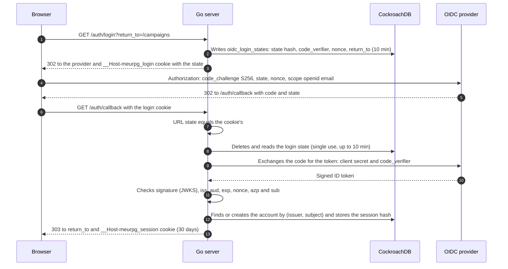

# Identity: sign-in and session

The master signs in through an OpenID Connect (OIDC) provider with Authorization Code and PKCE, and the server opens an opaque session of at most 30 days, kept in an `__Host-` `HttpOnly` cookie (ADR-0002).
The code is `backend/internal/identity`.
It knows no particular provider: Google in production, the devidp (a local OIDC provider) or a fake one in tests.
Everything comes from configuration ([CONTRIBUTING](../development.md#sign-in-with-another-oidc-provider)) and from OIDC discovery (`/.well-known/openid-configuration`).
A sign-in without Google for players (RN-17) is not implemented; see ADR-0009.

## Routes

| Route | What it does |
| --- | --- |
| `GET /auth/login?return_to=/path` | Stores the login state and sends the browser to the provider. `return_to` accepts only a path of this site; a fragment is discarded. |
| `POST /auth/login` | The same, from an app form, with an optional **login intent** (`intent` and `intent_payload`): something the server completes right after sign-in, like accepting an invite ([Campaigns](campaigns.md#accepting-an-invite-through-sign-in)). The form may also carry `prompt=select_account`, the only `prompt` accepted, which makes the provider offer its account chooser; any other value is `400`, and the `GET` route never reads it. |
| `GET /auth/callback` | Checks everything, creates the session, writes the cookie, completes the intent if any and returns to `return_to` (or wherever the intent sends). |
| `IdentityService.GetMe` | Who is signed in (account ID and display name) and when the session ends. `NO_SIDE_EFFECTS`. |
| `IdentityService.SignOut` | Revokes the current session and clears the cookie. The user's other sessions continue. |
| `IdentityService.SignOutOtherSessions` | Revokes all the user's other sessions and returns how many ended. The current session stays (ASVS 5.0 V7.4.3). |
| `IdentityService.CountOtherSessions` | How many other sessions still work. `NO_SIDE_EFFECTS`. |
| `IdentityService.UpdateProfile` | Changes the display name (1 to 40 characters; empty clears it). |

The display name is the only name the app shows for a person.
It never comes from the provider.
`campaigns` asks `identity` for names through a `Profiles` interface that `identity.PostgresStore` implements, so it never reads the users table.

## Sign-in sequence

The callback refuses with `400`, creating no session, when the login cookie is missing or its state does not match the URL's, when the state does not exist, was used or is older than 10 minutes, when the provider returned an error, when the code exchange failed (PKCE included) and when the ID token fails any check.
`aud` must be only our client ID, and `azp`, when present, too.
A browser has one login cookie, so a second sign-in started in it (another tab) replaces the first: the first callback fails with `state_mismatch` and creates nothing, and the second completes.

## Session

- **Token.** 32 random bytes (`crypto/rand`) in the `__Host-meurpg_session` cookie with `Secure`, `HttpOnly`, `SameSite=Lax` and `Path=/`.
  The database stores only the SHA-256 (`auth_sessions.token_hash`).
- **Absolute lifetime:** 30 calendar days from sign-in (`identity.SessionLifetime`), not renewed by use (NIST SP 800-63B-4, AAL1).
- **Idle lifetime** (ASVS 5.0 V7.3.1): a session unused for 14 days ends and behaves like one that does not exist (`unauthenticated`).
  `SESSION_IDLE_TIMEOUT` changes it, from `1h` to `720h` ([Operations](../operations/reference.md#environment-variables)).
  Use never extends the 30 days.
- **Last use** is written to `auth_sessions.last_used_at` at most once every 10 minutes per session (`sessionTouchEvery`): the interceptor reads the session, which already carries the field, and only if it is older issues one `UPDATE ... WHERE id = $1 AND last_used_at < $limit`, outside any transaction and without failing the request on error.
- **An open stream counts as use.**
  Every 60 seconds the stream rechecks (below), which also checks the idle limit and records the use, so someone watching a live session for days does not lose the login.
- **Sign out of other devices** deletes, in one statement, every other session of the user that has not expired, idle ones included, because an idle row is unusable only under today's timeout.
  The token stops working at once, on any instance.
  A stream open on one of those devices ends at its next recheck, within 60 seconds (accepted, because what the member receives in that window is only what they could already see, RN-10).
- **Signing out** deletes the session row.
- **Signing in again** in the same browser makes a new token (the old one is never reused, which rules out session fixation) and revokes the previous session after the new one exists.
- **`max_age` and `auth_time`.** The server sends `max_age` only if `OIDC_MAX_AGE` is set (Google does not document it; the devidp gets `1h` locally).
  The ID token's `auth_time` is recorded in `auth_sessions.auth_time` and never used to decide.
  What forces re-authentication every 30 days is the server session, not `max_age`.

## Erasing an account

An account is erased with `DELETE FROM users`, by the operator on a request ([Privacy](../privacy.md#delete-the-account)); the app has no code for it.
The foreign keys do most of the work (cascades for sessions, memberships and the person's own rows, `SET NULL` for the author of what stays), and nothing in the database reaches an ID inside a JSON document.
For the who-saw lists in `session_events` payloads, a `BEFORE DELETE` trigger on `users` removes the ID in the same statement, so the account and its ID in the history go together or not at all ([Play data](../data/play.md#session_events-and-session_event_kinds)).
The trigger reads only the events of the campaigns the account belongs to, through the indexes of `game_sessions` and `session_events`.

## Who is calling

The session enters a request's context only through `identity`, after the cookie is checked in the database: the interceptor on Connect calls, and `AuthenticateRequest`, the same step for the ordinary HTTP routes (image upload and download, campaign package).
No exported function puts a session, or an arbitrary user, in the context.

- **Other modules receive the caller through `authz.Caller`** (`UserID(ctx) (string, error)`), which `identity.Service` implements; `cmd/api` connects the two ends.
  With no valid session the answer is `unauthenticated`; if the database does not respond, the interceptor returns `unavailable`, so the app does not think the user signed out.
- **Handlers ask `authz`:** `authz.RequireSignedIn(ctx)` when being signed in suffices, `authz.RequireCampaignMember` or `RequireCampaignRole` for a campaign ([Campaigns](campaigns.md#authorization)).
- **Other modules' tests use a fake `Caller`**, declared only in that module's `_test.go` files, instead of fabricating a session.
- **`identity.Store` keeps the door closed too:** its session and login-state methods are unexported, so no other package creates or queries a session.
- **The login intent too:** `IntentHandler.Complete` receives the user as `identity.SignedIn`, a capability with a private field and no constructor that only the `identity` callback fills.

So a mistake in a new module cannot become a way to impersonate someone: a user in the context requires a valid session cookie.

A stream rechecks every 60 seconds (`play.DefaultRecheck`): `authz.RecheckCampaignMember` rereads the login session (`identity.Service.RecheckSession`, through `authz.SessionRechecker`) and the membership, without the memo, and ends the stream with the error a new call would get.

## CSRF

Protection comes in layers (ADR-0009):

| Layer | What it stops |
| --- | --- |
| `SameSite=Lax` cookie | The browser does not send the cookie on a POST or `fetch` from another site. |
| `http.CrossOriginProtection` around the mux | Refuses with `403` a POST, PUT or DELETE from another origin, by `Sec-Fetch-Site` or by comparing `Origin` with `Host`. GET always passes, so no GET may change state without its own protection. |
| `connect.WithRequireConnectProtocolHeader()` | Every unary Connect call requires `Connect-Protocol-Version: 1` (or `connect=v1` in a GET's URL). Another site could send that header only after a CORS preflight, which the server never grants. |
| `state` in the login cookie, PKCE and `nonce` | Protect `GET /auth/callback`, which creates a session even though it is a GET. Nobody can make a victim's browser finish a login someone else started. |

The image upload (`POST /uploads/images`) is not Connect, so the protocol header does not apply; `http.CrossOriginProtection` and the cookie protect it.
`TestCrossSiteUploadsAreRefused` checks that a cross-site upload gets `403` and stores nothing.

## Login attempt limit

`/auth/login` writes a row to `oidc_login_states` on each call and `/auth/callback` deletes one (a made-up state with a matching cookie reaches the database), so both are limited in memory before anything else, and they share one limit, `GET` and `POST` together.
A sign-in is one login and one callback.
Past the limit the response is `429` with `Retry-After`, storing and deleting nothing.

| Limit | Value (`identity/login.go`, `loginRateLimit`) | Why |
| --- | --- | --- |
| Per client IP | 40 at once (20 sign-ins), then 1 every 3 s | Room for a table behind one Wi-Fi; one client cannot fill the table. |
| Global | 200 at once, then 2 per second | Bounds what a botnet writes (7,200 rows per hour per instance, which the row TTL deletes within the next hour). |

The client's limit is checked before the global one, so a client over its own limit does not spend everyone's quota.
IPv6 counts by `/64`.
Where the IP comes from is in [API](api.md#abuse-limits).
The IP never goes to the log.

## No provider

The server starts without `OIDC_ISSUER`: the startup log warns that sign-in is off, `/auth/login` and `/auth/callback` answer `503` and `IdentityService` answers `unavailable` (`identity.MountDisabled`).
Every module that needs a caller (campaigns, characters, play, maps, progression, notes, campaign package) is not mounted either.
If the provider is down when the server starts, discovery is tried again at the next sign-in.
