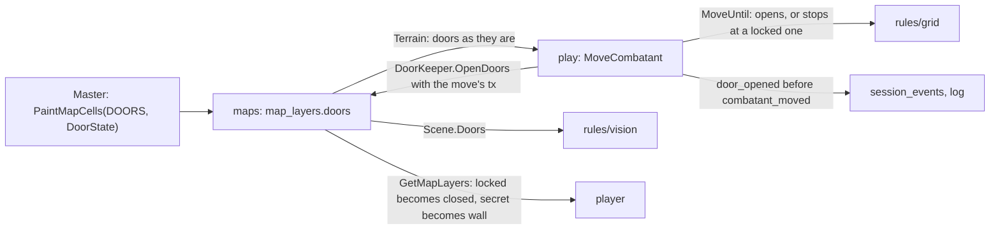

# Doors

Doors (MR-010, RN-26) are the map's fifth layer.
`maps` stores them and reads them per player, `rules/grid` and `rules/vision` use them, and `play` opens a closed door when a move enters it.
The dungeon generator fills them ([Dungeons](dungeons.md)).

## The pieces

| Piece | What it does |
| --- | --- |
| `grid.Door`, `grid.DoorLayer` | The six states (none, open, closed, locked, portcullis, secret) and the 4-bit layer (`NewDoorLayer`, `DecodeDoorLayer`, `Get`, `At`, `Set`, `Encode`, `Count`). `Door.BlocksSight`: closed, locked, secret. `Door.BlocksMove`: locked, portcullis, secret; a closed door does **not** block, the move opens it |
| `grid.Terrain.Doors` | The layer along with the others. Closed, locked and secret count as a wall for cover (`CoverBetween`); the portcullis gives no cover. `Move` (the planning) lets a closed door pass and lists it in `Move.Opens`, blocks the locked one (`StopLocked`), the portcullis and the secret one (`StopWall`); a jump crosses no door that is not open. `Reach` uses `Move` |
| `Terrain.MoveUntil` | The real move: opens the closed doors the line crosses (`Stopped.Opens`, only as far as it got) and **stops before** the locked (`StopLocked`, `LockedAt`), portcullis and secret ones, with the cost of what was walked. A door painted on a square that is also a wall is a wall |
| `grid.SightWalls`, `vision.Scene.Doors` | Sight and light stop at walls **and** at closed, locked and secret doors; the portcullis and the open door let them through |
| `Door.AsPlayerKnows`, `Terrain.ForPlayers` | What a player knows before trying: a locked door reads closed, a secret door is a wall (and no door). The player plans the move with this (`planOn`); the real arithmetic runs with the truth |
| `maps` | `loadLayers` and `PaintMapCells` (value 0 to 5, the same batch, revision and notice rules as the other layers). `layerSet.forPlayers` and `filterLayers` hand the player doors as they know them. `Terrain` returns the truth to `play`. Changing the grid or image deletes the layer with the others. `OpenDoors` and `DoorsChanged` (`doors.go`) are the seam with `play` |
| `play` | `DoorKeeper` (declared in `play`, implemented by `maps`). In a player's `MoveCombatant`, `openDoors` writes the layer **with the move's transaction** (nothing through the pool inside `InTx`) and one `door_opened` event per door that really opened (`Secret` if the mover is hidden; it carries where they came from, so `stamp` gives the line to whoever saw the mover). After the commit, `DoorsChanged` notifies (`map_changed`; on a fogged map `vision_changed` to whoever the change reaches) and `combat_log_changed` goes out. The log builds a `COMBAT_LOG_KIND_DOOR_OPENED` entry (field `door`: col and row) per event. The master's move also walks over doors: it opens the closed ones and stops before a locked one, portcullis or secret one; a forced move does not walk |

## Rules in play

- **Locked.** The move stops before the door. The response carries `locked_door` and the cost is what was walked; if the first step is already the door, it is a refusal (`ENCOUNTER_BLOCKED_REASON_DOOR_LOCKED`) and nothing is spent. A player only receives `locked_door` for a door they know (see or remember); in the dark it is `stopped_early`, like anything in the way (RN-10). The app does not keep that the player "already knows" a door is locked: their `GetMoveOptions` treats it as closed until tried again.
- **Undo.** A move that opened a door is undone like any other: the character goes back and the spent movement returns. **The door stays open** and the log line stays (the `door_opened` event is the door's, not the move's). The event is written before `combatant_moved`, so undo acts on the move.
- **Who receives the line.** On a fogged map `stampDoor` stores `fogged` and `seen_by` on every `door_opened`, whoever opened it: the players whose known terrain (seen now or remembered, before the change) had the door, plus the mover's player. When the mover is an NPC, a player who only knows the door must also have seen the NPC, on the square it came from or the one it stands on. The others receive neither the line nor the square. Without fog, everyone, except if the combatant is hidden (never a line with a hidden combatant, RN-20). A remembered door shows today's state: a door opened in a corridor the player remembers changes for them and sends `vision_changed`.
- **Painting.** The server compares what the player reads (walls and doors as they know them) before and after painting doors. If it did not change (locking a closed door, a secret door over a wall), the revision rises on the master's counter, like light, and only the master receives `map_changed`. A door painted over a creature is not checked: on a fog map the creature stays hidden until the door opens (the app warns the master first).
- **What the player never receives** (RN-10): the secret door (the wall layer has a wall on that square and the door layer has nothing), the fact that a door is locked before trying (the layer says closed), and on a fogged map any door on a square they neither see nor remember. `TestRN10_PlayersNeverSeeASecretDoor` reads the responses as the app (JSON).

## Doors on the web

The door screens only draw what the server sends and paint through `PaintMapCells`; no rule lives in the browser.

| Piece | What it does |
| --- | --- |
| `core/maps/layers.ts` | `decodeLayers(packed, player)` reads the `doors` layer (4 bits per square: square `n` is the low nibble of byte `n / 2` when `n` is even and the high one when odd) into `DoorSquare` (`col`, `row`, `state` 1 to 5, `axis`, the opening's direction, following `planDoor`'s rule: floor on both sides). For the player the client guard (RN-10) draws a locked door as closed and discards a secret one even if it came. `doorCounts` counts by kind for the legend and the "Portas" line of "Camadas" |
| `shared/map-layers` | `app-door-mark` (one mark per kind, also in the legend and the editor's buttons), `app-map-layers` (draws the doors that arrive, in the editor, in the fog and in combat), `app-map-layers-legend` (the map's doors right after "Parede") and `app-door-picks` (a transparent button per door, only on the master's screen) |
| `core/maps/door-paint.ts` | `planDoor` is the rule of a tap of the "Porta" tool (`planDoorBlock` applies it to blocks on a calibrated map). It returns the writes in the **safe order** (the door first, then the wall goes away; to remove, the wall comes back, then the door goes away: never a gap in between) or the refusal. `EditorPainting` applies them through the same queue as the other layers and checks the map's tokens (`Occupant`) before a door that hides whoever is in it. If the second write is refused, the editor reads the layers again |
| `pages/live-session/door-sheet` | The door sheet (`openSheet`: a bottom sheet on the phone, a dialog from the tablet up): paints `OPEN`, `CLOSED` or `LOCKED` at once, and `CLOSED` to reveal a secret door (first erasing the wall painted under every square of the door's drawing square). The map updates through the stream (`map_changed`) |
| Combat | `MoveCombatant` returns `lockedDoor` (`MoveResult`) and the "Mover" page stays open with the notice; the `DOOR_LOCKED` refusal goes through `combatErrorMessage`; the log writes `COMBAT_LOG_KIND_DOOR_OPENED` as "<nome> abriu a porta." |

- **Only what arrives is drawn.** The player's layer has no locked door (it comes as closed) and no secret door (a wall in the wall layer), so no web mark needs to know how to hide anything. The player's legend never says "trancada" or "secreta".
- **Outside combat a player does not move the token** (`PlaceMapToken` is the master's), so "the player walks to the door" is combat only; in exploration the master opens, closes and locks through the door sheet.
- **Where the master touches a door:** the session map with fog on and the combat map (the session page, not the phone crop). The session map without fog is only the image, without layers, and has no doors on top.
