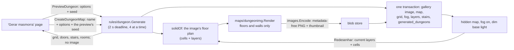

# Generated dungeon maps

The `DungeonService` (`proto/meurpg/maps/v1/dungeons.proto`, in the `maps` module, mounted in the same `Mount` as `MapService`) turns the output of `rules/dungeon` into a campaign map (MR-010, RN-26).
The generator itself (options, seeds, invariants) is in `backend/internal/rules/dungeon`; the code here is `backend/internal/maps/dungeons.go` and the image is `maps/dungeonimg`.
**All calls are the master's, and a player (or a non-member) gets `not_found` from all of them**, as from a hidden map: the room list, the options, the seed and the secret door are the master's alone (RN-10).
What a player reads of the map goes through `MapService`, the fog and the door filters, like any map.
Nothing here goes to the session stream except the map's own `map_changed`.

| Call | What it does |
| --- | --- |
| `PreviewDungeon` | Generates and returns only the floor plan: the grid (1 bit per open square, the wall layer's format), the doors with true kind and axis, the stairs and each room's floor. It stores nothing, so the page can call it on every option change. An option the request does not send takes the generator's default (`optional` on numbers; enum `UNSPECIFIED`). Without a seed the server draws one (`crypto/rand`) and returns it, so "Outra semente" is a new call. The options come back as used |
| `CreateDungeonMap` | Generates, draws, stores and assembles the map in one transaction (below). The page sends the seed it showed in the preview, so the map is what it showed. Once the options are validated, creation continues even if the caller leaves (`context.WithoutCancel`) |
| `GetDungeonRooms` | The room list beside the map: exits (the door's true kind, the trap, the room on the other side), each room's scene points (`scene_point_ids`: scene points whose square is on the room's floor, found on the spot), all doors (passages included), the stairs, the entrance, the options, the seed, the generator version, and `image_is_generated` (the map's image is still the one the generator drew). It reads what was stored at creation, never the layers: a door the master changed later still appears as generated |
| `PlaceDungeonScene` | "Pôr uma cena nesta sala": calls `CreateMapPoint` (the path of every point: limit of 200, born hidden) with an RP scene point "Sala N" on the middle square of room N. May repeat; each call makes a point |
| `RedrawDungeonMap` | "Redesenhar" ([below](#redrawing-keeps-the-layers)) |

## Validation, deadline and limits

- **Options.** `Generate` checks every option before drawing: an out-of-range option is `invalid_argument` with the `DungeonOptionRefused` detail (the generator's option name, like `room_side_min`; empty for `ErrNoSpace`, when silhouette and size leave no room for a room). An enum value the server does not know (`mask = 99`) is refused, never turned into the default. The API accepts up to 199 × 399 (the layers' limit); the page's presets go from 21 to 121, and a typed size holds.
- **Deadline and concurrency.** The generator does not interrupt, so it runs in a goroutine: after 2 s (`dungeonDeadline`) the call answers `deadline_exceeded` and the goroutine ends by itself. At most 4 generations run at once (`dungeonGate`) and **one preview at a time per campaign** (a second at once is `resource_exhausted`; the page asks again with the latest options), because the preview is requested on every change.
- **Request limit.** Creating and redrawing share a bucket per campaign (in memory, like every server limit): a burst of 4, then one every 15 s, and a burst of 20 for the whole server; past it, `resource_exhausted`. The preview is not limited, only by the deadline and the 4 simultaneous generations.

## What creation does

Outside the transaction: generate; check that the campaign has room (fewer than 200 maps, a gallery below its limits: `resource_exhausted` otherwise, before anything is drawn or a limit token spent); check the request limit; draw the image and store the two files in the blob store (as an upload does before its row).
The image goes out without a reference image (the small JPEG a stored image travels as for the model); it is made the first time the dungeon is used as a reference, like for any older image.

In a single transaction (`db.InTx`, only `WithTx`) it checks the 200-map limit and the gallery quota again (this is the check that decides) and inserts:

- the gallery image (`<name> (masmorra)`, the master's);
- the map (hidden, RN-10);
- the grid (columns = the dungeon's width, calibration factor 1);
- fog on with **dim** base light ("Penumbra"): a "Claro" map shows the players the whole floor plan, so the room behind a secret door would show; in Penumbra, even with a textured image, it only appears to whoever sees it;
- the layers, the stairs and the record.

If any step fails, the files are deleted and nothing remains.

| Layer or point | How the server fills it |
| --- | --- |
| Walls | **Every square that is not open** (`!open` of `WallsMask`): the walls and all the rock behind them, so a wall mark covers the whole mass, the image's hatching does not disagree with the editor's, and no token can be dropped in rock |
| Doors | One per door marker: **passage (`archway`) = nothing** (it is floor); `closed` = closed; `locked` = locked; `barred` = portcullis; `secret` = secret. **A trapped door is the same door** (closed, locked or secret; RN-26): the map has no trap point, and only the room list says "Porta com armadilha" (`DungeonExit.trapped`) |
| Stairs | Sub-map points **without a destination** (a staircase to another map is for the master to link), named "Escada para cima" and "Escada para baixo", in the middle of the square, **born revealed** like a door (with fog on, a player sees one only where they see the square). The first is the entrance. `MapPoint.stairs` (`StairDirection`: up or down; column `map_points.stairs`) goes to whoever receives the point. The screen draws the seal with the arrow and the name on the map, the legend and the list ("Escada", never "Submapa") without searching by name or square |
| Rooms | Only in the list (`generated_dungeons.rooms`): the image never carries a room number |

## The image

`maps/dungeonimg` is pure: a function of the floor plan.

- **Floors and walls only.** The floor is paper, every floor edge next to a wall gets an ink outline, and the walls and the rock behind them get **a smooth dark fill**. The hatching is not in the image: the app draws it over every square of the wall layer, so the map has a single wall treatment, the editor's. The page's preview uses the same palette and mark.
- A passage, closed, portcullis or locked door is drawn as **floor**, a **secret door as a wall**, and no room number or stair appears. Doors are an overlay the app draws from the layer, so they can open and close.
- **Size.** Pixels per square are `⌊8192 / max(columns, rows)⌋` capped at 24, below the upload's 40 megapixels.
- **Encoding.** A 4-colour palette PNG (one byte per pixel) through `images.Encode`, the same path as an upload without the decoding: no metadata (ADR-0012), with the 480 px thumbnail. The image stays hidden like every gallery image; on a fogged map the player gets tiles, never the image.
- **The plan is a function of the layers** (`solidOf`): solid is the wall layer's square and the secret door's; everything else, doors included, is floor. A wall the master cleared becomes a hole. Creation and "Redesenhar" use the same code.
- Timings: `go test -bench Render ./internal/maps/dungeonimg` and `TestDungeonMapCreationTiming -v` (see [CONTRIBUTING](../../../CONTRIBUTING.md#dungeon-map-measurements)).

**The record** (`generated_dungeons`, see [Data](../../data.md)) holds the options as used, the seed, the generator version, the final cells (2 bits per square) and the rooms.
Only the master reads it.
Because the cells are stored, a new generator version never changes a map that already exists.

## Redrawing keeps the layers

Normally, swapping a map's image (`UpdateMap`) deletes the layers and the players' memory (`clearLayers`), because a layer is measured by the grid.
`RedrawDungeonMap` redraws the image **at the same pixel size** from the current walls and doors (a wall the master painted is a wall, one they cleared is floor, a secret door still secret is a wall and a revealed one is floor) and puts it on the map through `replaceMapImageKeepingLayers`, the narrow operation that **only it and the textured map use** ([Image generation](image-generation.md#usar-como-imagem-do-mapa)).
It does **not** call `clearLayers`: layers, points, tokens, the players' fog memory and the layers' revision stay.

- **Preconditions.** The map has a grid; the old image is the map's now; both images belong to the map's campaign; the new one has exactly the old one's size. Otherwise `failed_precondition` with `MapBlocked` `IMAGE_CHANGED`, or `invalid_argument` for another campaign. It uses `SetMapImageOnly` (the map's revision rises).
- **Only the generator's image is swapped and deleted.** `generated_dungeons.image_id` stores the image the generator drew (created and swapped in the same transaction). If the map's image is another (the master uploaded theirs), if the grid or the image's size no longer match, or if the layers row vanished (a new image or grid deletes layers, also a grid removed and put back), the answer is `IMAGE_CHANGED` and nothing is drawn or deleted. Otherwise the drawing would come from empty layers and every wall would become floor.
- **Concurrency.** The server reads the map and layers and draws **outside the transaction**. The transaction locks the map row, reads everything again and checks that the image, the grid and the **floor plan the image shows** (walls plus the doors that count as walls) are the same, else `aborted` ("tente de novo"). Comparing the plan, not `layers_revision`, keeps a door a character opened during play from aborting the drawing. It also compares the grid factor with the one the drawing started from: a calibration that keeps the squares and changes the factor (13 squares of 3 for 39 of 1) is `IMAGE_CHANGED`, because a dungeon is drawn one image square per rules square.
- **The gallery.** A full gallery refuses a redraw only when it would grow the gallery: the old image that goes away frees its place, in the first look and in the transaction (`TestRedrawInAFullGalleryIsAllowedWhenTheOldImageGoes`). The old image leaves the gallery (row and files) unless something else uses it. The transaction asks again what it can read (another map's background, an image left with the players, the image the session shows via `LiveSession.ImageShown`) and clears portraits that appeared meanwhile (`ClearPortraits`, and the stage listens), like `DeleteGalleryImage`; what it cannot read inside it (the stage, a portrait) is asked before.
- **After the commit,** the fog tiles are forgotten (they are cut from the image) and the players who see the map receive `map_changed`.

## RN-10: what the player never receives

The room list, the record (options, seed, version), the doors' true kind (the player reads a locked door as closed and a secret one as a wall, through the door filters), anything before the master reveals the map (a hidden map is `not_found`), and the image, which the fog never hands over whole.
`TestRN10_PlayersReadNothingOfADungeon` reads the responses as the app (JSON) and searches for the seed and the list's words.

## On the web

The generator screens only draw what `DungeonService` sends; no generation runs in the browser and no player makes a call (the server answers `not_found`).

| Piece | What it does |
| --- | --- |
| `pages/maps/dungeon-new` | The "Gerar masmorra" page (lazy route `campaigns/:id/maps/dungeon`). The preview is requested 350 ms after the last change, one at a time (a change during a request waits for it and asks again with the latest options). The page's own ranges (21 to 121, the room sides) refuse before asking, and a server refusal (`DungeonOptionRefused`) falls on the field it names. "Criar o mapa" sends the options and the seed of **the preview on screen**, never the current form's (a response for old options is discarded by a counter). "Parar de esperar" only aborts the wait, and leaving the page also aborts it (the server finishes the map) |
| `shared/dungeon-preview` | Draws the compact layout: the walls (the `open` bits) as one SVG path with the map's hatching, the grid, doors by `shared/map-layers` marks and stairs by `app-stair-mark`, plus the count and the legend |
| `pages/maps/dungeon-rooms`, `dungeon-image` | The room list and the "Imagem" panel with "Redesenhar", the master's, in the editor (the list also on the phone). `core/maps/dungeon-info.ts` reads `GetDungeonRooms` once per map and image, **only when the server says** the map is a generated dungeon (`Map.generated_dungeon`, the master's alone, always false for a player). A `not_found` is "nenhuma masmorra aqui"; any other failure shows a notice with "Tentar de novo". The map's stair seals come from the point's field, not from this read. The "Salas" list sits beside the map, which stays in place and goes to the chosen room |
| `core/maps/dungeon-*.ts` | The client, the error sentences (by typed detail, never the message), the form's options and the drawing-only arithmetic (`wallPath`, `doorSquaresOf`) |
