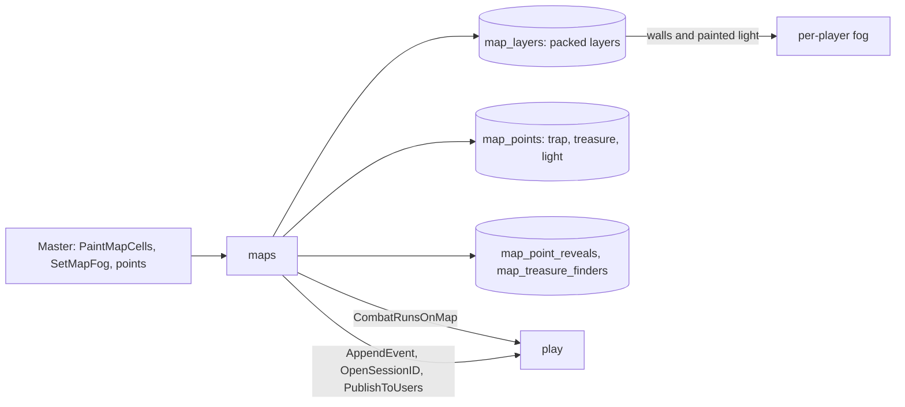
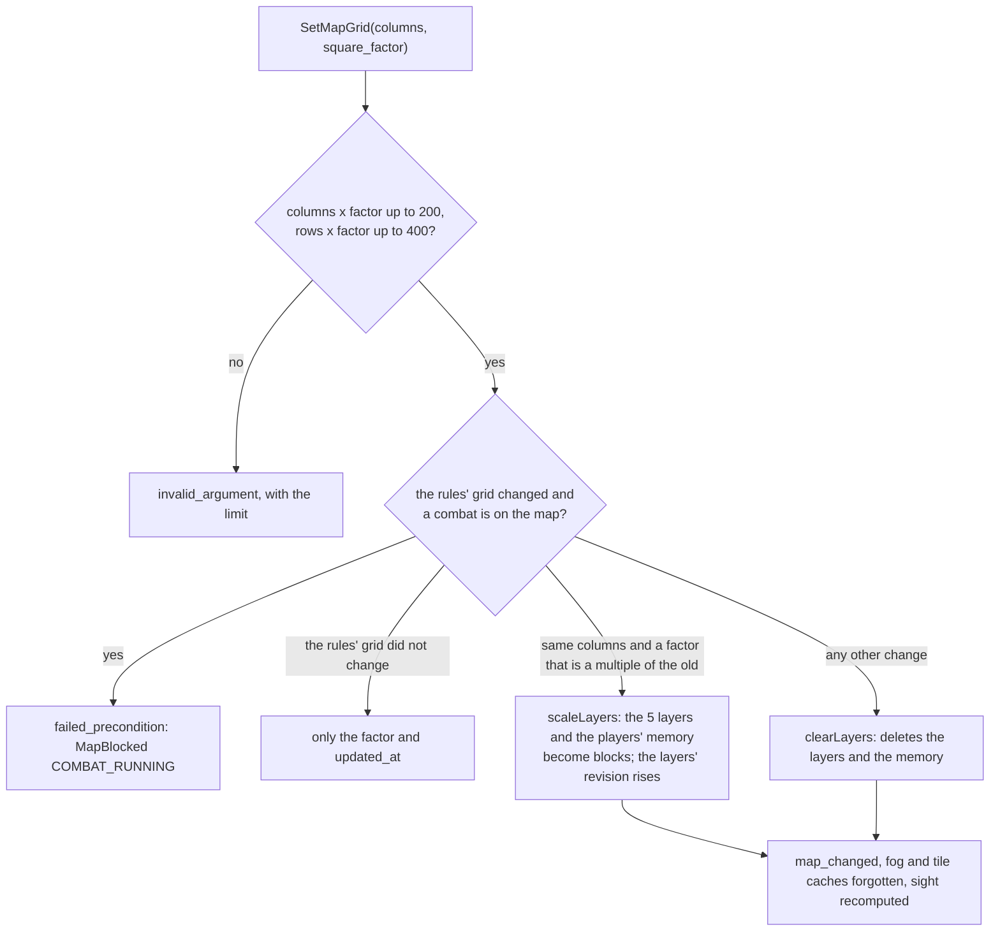

# Layers, grid calibration and the map editor

The server stores the layers painted on a map's grid and the grid's calibration; the master's map page paints them (MR-025, MR-034 to MR-036, MR-041, RN-25).
The server code is in `layers.go`, `calibration.go` and `mapservice.go` (`backend/internal/maps`); the screen is `web/src/app/pages/maps/map-page` (computer) and `map-manage` (phone, no painting).
No rule arithmetic lives in the browser: what a light reaches, who would notice a trap, the DCs and what each player sees come from the server.

## Layers

- **The five layers.** Difficult terrain and wall (1 bit per square), cover (2 bits: none, half, three-quarters), light (2 bits: unpainted, dark, dim, bright) and doors (4 bits: none, open, closed, locked, portcullis, secret; see [Doors](doors.md)), in the `rules/grid` format (see Grid, vision and presets in [Architecture](../rules-maps.md#grid)).
- **Storage.** The `map_layers` table, one row per map, not four `maps` columns: `maps` is read whole by almost every call and the layers would go along every time. A map with nothing painted has no row, and a layer with nothing painted is `NULL` (sent empty). The limits on the largest grid (200 × 400) are 10 KB per 1-bit layer, 20 KB per 2-bit layer and 40 KB for doors.
- **Painting.** `PaintMapCells(layer, value, squares)` takes up to 400 squares per call (`maxPaintSquares`), all inside the grid (a square outside refuses the whole batch). The last write wins, with no revision, because painting is dragging; repeating what is already there changes nothing and does not raise the revision. The call locks the map row (`GetMapForUpdate`), so consecutive batches wait for each other. `failed_precondition` `NO_GRID` without a grid.
- **Revisions.** `Map.layers_revision` rises once per change of the layers a player reads (terrain, wall, cover, doors). The **painted light**, which no player reads, has its own counter (`maps.light_revision`) and the master reads the sum, so a player's number never says when the master paints light. On a fogged map a player receives 0 in `Map.layers_revision` and, in `GetMapLayers`, a number of what they receive. Both are **separate** from `Map.revision` (the guard of name and image), so painting never makes another tab's `UpdateMap` fail with `aborted`.
- **What deletes the layers.** `clearLayers` deletes the `map_layers` row, raises the revision and deletes the players' memory (`map_vision_memory`: a bitmap only serves the grid it was made for) when:
  - the drawing's columns change (or a smaller factor, or one that is not a multiple of the old; see [Grid calibration](#grid-calibration)), or
  - the map's image is swapped.

  The same grid (same rules' columns and rows, even with another calibration), the same image or a new name delete nothing. Swapping the image of a map with a grid is refused (`invalid_argument`) if the new image's proportion would take the rules' grid beyond 400 rows. Both changes are refused with `failed_precondition` and the `MapBlocked` `COMBAT_RUNNING` detail while an unfinished combat is on the map (`encounters.map_id`). `maps` asks `play` through `maps.CombatMaps` (`play.Service.CombatRunsOnMap`, wired in `cmd/api`) **inside the same transaction** that locks the map row and decides whether the grid or image really change. The textured map ([Image generation](image-generation.md#the-textured-map)) and "Redesenhar" ([Dungeons](dungeons.md#redrawing-keeps-the-layers)) swap the image **without** deleting layers or memory.
- **Who reads the layers.** `GetMapLayers`: the master receives the five. A player of a map they see receives wall, terrain, cover and doors (doors as they know them), never light. With fog, only the squares their character sees or remembers ([Fog](fog.md)). `fog_withheld` says an empty result means "nothing you know".
- **The fog settings.** Three `maps` columns: `fog_enabled` (off by default; needs a grid, and removing the grid turns it off), `base_light` (`dark` by default) and `group_vision`. `SetMapFog` changes each by itself; turning fog off keeps the layers. Turning it on copies the image if it serves something else ([Fog](fog.md#the-image-of-a-fogged-map)).
- **Notices.** Painting sends `map_changed` at most once per second per map (`hintGate`, `defaultLayerHintEvery`): the first goes out at once, the following become one at the end of the second, and the last change is never left without a notice. See [Maps in the live session](live-session.md).

## Grid calibration

The calibration (MR-025, RN-25) says how many 1.5 m squares each square of a map's drawing is worth.
`SetMapGrid(columns, square_factor)`: `columns` are the **drawing's** columns (4 to 200; 0 removes the grid and turns fog off) and `square_factor` is 1 to 20 (0 means 1).
The rules' grid, `columns × factor` wide and `rows × factor` high, may not exceed 200 × 400.
Combat without a grid is described in [Architecture](../play/theatre.md).

- **Two columns, no reader changed.** `maps.grid_columns` stays the rules' grid (the drawing's columns times the factor) and `maps.grid_factor` stores the factor. The rules' rows are the drawing's (`RowsFor`, from the image's proportion) times the factor (`grid.EngineGrid`, `gridOf`), so a drawing square is always a whole block of rules' squares. The layers, fog, tiles and `play` (which copies the grid when combat starts) read `grid_columns` and `grid_rows`; `Map` also carries `drawn_columns`, `drawn_rows` and `square_factor` for the screen to draw the drawing's lines and count in rules' squares.
- **Scaling.** `grid.ScaleStep(old, new)` says whether the change is lossless (the new factor is a multiple of the old). `Layer`, `LightLayer`, `CoverLayer` and `DoorLayer` have `Scaled(k)`, which puts the origin square's value in each square of the k × k block. `maps` (`calibration.go`) scales the five layers and each player's bitmap in `map_vision_memory` (current epoch only) **inside `SetMapGrid`'s transaction**, and raises the layers' revision. Any other change deletes, as above.
- **Memory in progress.** `scaleLayers` raises the sight epoch (`vision_epoch`) and stores the scaled memory in the new epoch, so a fog update that read the map before the change cannot write the old grid's bitmap over it.
- **Doors.** A door is the whole drawing square, the factor × factor block. Scaling gives every square of the block the same door in the same state. Painting a door (`PaintMapCells`, layer `DOORS`) paints the whole block, so locking, unlocking or revealing is one action (other layers paint square by square). Opening by walking (`OpenDoors`) opens all closed squares of the block and returns one square per block, so `play` writes one `door_opened` event per door.
- **The same grid.** If the rules' columns and rows stay equal (24 columns of 1.5 m to 12 of 3 m, with the image's proportion matching), only the factor changes: nothing is deleted, scaled or refused because of a combat.
- **The image.** The `UpdateMap` that swaps a map-with-grid's image checks `grid.EngineGrid` against the new size and refuses (`invalid_argument`, with the 200 × 400 limit) if the grid would pass 400 rows.
- **Points, tokens and traps.** Positions are in image base points and fall in the right block by themselves. A trap's `area_size` counts 1.5 m squares and is **not** scaled: after a calibration the same number of rules' squares covers a different part of the drawing, and the master edits the trap if they want the same drawing squares.
- **RN-10.** After scaling, a player of a fogged map receives only what they see or remember **on the new grid**: the scaled memory is a superset of the earlier one, and sight is recomputed on the fine grid (`refreshVision`). `TestMR025_TheFogKeepsWhatWasSeen` reads the responses as the app.
- **What stays.** Combat is refused while it runs (combatants are on squares of the old grid), and `StartEncounter` copies the rules' grid. The dungeon generator always uses factor 1.

## The map editor

The editor is the master's map page (`pages/maps/map-page`).
The browser only draws and checks formats (the same limits as the `.proto`, so a field can say what is wrong before the server refuses).

### Painting

- **`PaintedLayers`** (`core/maps/paint-layers.ts`) keeps `GetMapLayers`' bytes in full-size vectors (1 bit per square for wall and terrain, 2 for cover and light, row by row as in `rules/grid`), changes squares at once and decodes again for what the editor draws. Decoding happens once per animation frame (`perFrame`), not per square. The painting code is in `EditorPainting` (`pages/maps/map-editor/editor-painting.ts`), without DOM.
- **`PaintQueue`** (`paint-queue.ts`) receives the strokes and sends `PaintMapCells` in batches. Squares of one layer, one value and **one map** join in a batch (each keeps the `campaignId` and `mapId` of when the stroke was made). A batch goes out 150 ms later (at once on mouse release), at most 400 squares per call, **one call at a time, in stroke order**, so the last write wins as the server says.
  - A failure retrying may solve (`unavailable`, `deadline_exceeded`, `aborted`, the network) leaves the batch at the head of the queue ("Não salvou"); `retry()` sends it again, and what already went out does not repeat.
  - Any other refusal (`not_found`, `permission_denied`, `NO_GRID`) says what happened by the typed reason, **discards what was waiting** (strokes on a screen the server disagrees with) and makes the editor read the layers again.
- **`PaintSession`** (`paint-session.ts`) joins the queue and the layers and says whether painting is possible: before the first read answers, or if it fails, painting is off and never says "Tudo salvo". A read never overrides waiting strokes (it waits for the queue to empty and checks again), and a new grid empties the queue.
- **Leaving with strokes waiting** sends them (`flush`); if the server does not receive them, the page asks ("Há traços que o servidor não recebeu", `canDeactivate` with the `confirmLeave` pattern). Closing the tab with the queue busy asks the browser's question (`beforeunload`).
- The editor reads the layers again only when the map opens or the grid changes (`layers_revision`), never while strokes wait. It does not listen to the stream: what another tab painted appears on reload.
- Frame timing of a drag across the biggest map: [CONTRIBUTING](../../performance.md#the-map-editor-in-the-browser).

### Combat, erasing and errors

- **Painting during a combat holds**; changing the grid and swapping the image do not (`MapBlocked COMBAT_RUNNING`, shown by the typed reason, never the message). The combat on the map comes from `GetEncounter` (`CombatOnMap`: the open session's latest combat, in a state other than "ended", on this map). Without a session, or with the read failing, the screen does not warn beforehand and the server refuses all the same. After a typed refusal and when the window regains focus the page reads again whether there is a combat (`staleFlags`).
- **Ask before erasing.** Changing the grid or image deletes layers and the players' memory, and the server does not say whether there is memory. The editor asks when anything is painted **or** the fog is on. "Mudar a grade?" always opens: with nothing to lose it carries no warning and the button reads "Mudar a grade"; with something to lose, "Apagar e mudar a grade". "Trocar imagem" with nothing to lose goes straight to the picker, otherwise asks first ("Trocar a imagem?").
- **Each call says its own reasons** (`editorErrorMessage(err, call, what)`): painting says `NO_GRID`; the grid, `COMBAT_RUNNING`; the image swap, `COMBAT_RUNNING` and a full gallery (`resource_exhausted`: the image copy); the fog, `NO_GRID` and a full gallery; the points, `TREASURE_CONVERTED` and `TREASURE_FOUND`; creating a point, the 200-point limit. A reason a call cannot give falls to the code's general message.

### Points and "Ver como"

- `CreateMapPoint` carries what the kind requires (a trap with DC to find 15, area 1 and the "on entering" trigger; a Torch light; a treasure of 0 gp) and the kind's panel edits the rest.
- Panels follow the `PointPanel` contract: `changes()` returns only what changed (`null` if nothing changed or any field breaks a rule), and `discard()`. The trap sends the whole `TrapSpec`, because `UpdateMapPoint` replaces it. The drafts (`trap-draft`, `light-draft`, `treasure-draft`) are pure functions.
- The marker of a trap, chest or light point (`app-map-marker`) is just the click area **when the screen draws the pins** (`pinsDrawn`: the editor, the master's phone, the player's map without fog and the maps dialog in documents, which project `app-map-pins`); otherwise the marker draws its own icon. The selection is the ring of the drawn pin. `TrapNoticers` lives in `shared/trap-noticers` (the editor's panel and the session card).
- **"Ver como"** reuses the session's `ViewAsMap` and `app-view-as-map`; the button text differs (`backTo`: "à sua vista") and the state lives in the editor.
