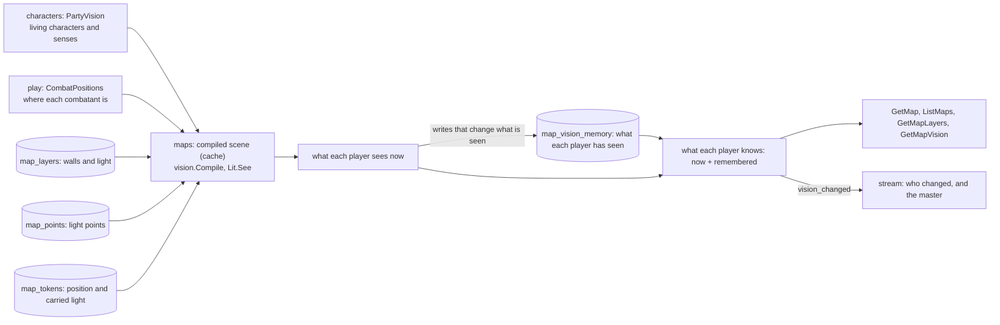

# Fog of war

On a map with fog on, **the player only receives what their character sees now or has seen** (MR-036, RN-10).
The arithmetic is `rules/vision` (pure, tested against the sketch cave); `maps` builds the scene, asks the package what each player sees, stores what was seen and filters each response.
The code is in `fog.go` (scene, cache, memory, update), `fogreads.go` (`GetMapVision`, "Ver como", `ForgetMapVision`, filters), `fogwrites.go` (who learns of each write), `fogimage.go` (the image copy), `fogcombat.go` and `tiles.go` (image tiles), and on the other side `characters/partyvision.go` and `play/mapseam.go`.
The rules that turn fog on and the base light are in [Editor](editor.md#layers); the events are in [Maps in the live session](live-session.md).

## Each person's eyes

- A player sees through their **living character**, on the token's square or, while a combat runs on the map, on the combatant's square (`maps.CombatMaps.CombatPositions`, implemented by `play`; tokens return to their place at the end of combat).
- With "Visão do grupo" on, everyone sees the union of all player characters' sight.
- A character without a token on the map sees nothing new (only what they remember); a dead one neither.
- Senses (darkvision, blindsight, truesight, Devil's Sight) come from the derived sheet through `maps.CharacterDirectory.PartyVision` (implemented by `characters.Service`). In Wild Shape the beast's senses rule, so a druid in beast form loses Devil's Sight, and the familiar a player is seeing through arrives as `link.PartyMember.Eyes`.
- The carried light lives on the token (`map_tokens.carried_light`) and moves with the token or the combatant. A token the master hid keeps lighting the map without appearing.

## The scene and the cache

The scene (grid, walls, base light, painted light, light points, carried lights, and the squares of clouds and magical darkness) becomes a `vision.Lit` (`vision.Compile`). It does not depend on who looks and is the expensive part.

- The `Lit` lives in a cache of **8 scenes** (`litCacheSize`), keyed per map by the grid, base light, the two layer revisions, the light sources and the squares of the zones that change sight (`litKeyOf`). Each scene keeps up to **24** views of those who already looked (`viewsPerScene`); beyond that the views start over.
- Concurrent requests for the same scene compile it once (`sync.Once` on the entry); the others wait. No goroutine per request.
- A map's updates wait for each other on a per-map lock (32 locks chosen by ID).
- `ListMaps` reads the party once for all fogged maps and stores each player's point count by (map, sight revision, points).
- Sizes and timings: `go test -run '^$' -bench FilteredMap -benchmem ./internal/maps` and `TestSceneMemory`; see [CONTRIBUTING](fog.md#the-budget).

## Zones that block sight

Fog Cloud, Stinking Cloud and Darkness are zones of `play` (RN-37).
`CombatPositions` carries their squares in `Clouds` and `MagicDark` (`maps/link`), and `obscuredLayer` turns each list of `obscured` into a layer of the map's grid for `vision.Scene.Clouds` and `MagicDark`.
`play` tells `maps` that a zone changed through `VisionChanged`, as Wild Shape and a familiar's sight do, so the revision of what the players see moves and the usual `vision_changed` goes out, also to the master; no RPC or event of its own carries it.
In `rules/vision`:

- A line that crosses a cloud square is blocked, as a wall blocks it, but the cloud square itself is not a wall.
- A square in a cloud is not seen from outside, and a viewer in a cloud sees only its own square.
- That a viewer inside a cloud sees only its own square, and that a line crossing a cloud is blocked, is the table's ruling.
- The SRD heavy obscurement only blinds a creature trying to see something in the area.
- Blindsight within its range sees through a cloud.
- A square of magical darkness has no light (`Dark`) and darkvision does not work in it. Truesight, blindsight and Devil's Sight do.
- Devil's Sight (`Senses.DevilsSightFt`, 120 feet from the warlock invocation) sees darkness as bright within its range, magical or not.
- Devil's Sight leaves dim light dim, so a passive check in dim light keeps its penalty.
- Devil's Sight sees through no cloud.
- A viewer in magical darkness with only darkvision is in the dark; with Devil's Sight it is not (`InTheDark`), which is what the master's light warning reads.

A hidden caster's cloud or Darkness still turns its squares unseen for the players.
That effect never reveals the caster.
The players get its footprint as the squares they cannot see now, with no zone and no caster.

A map without fog never builds a scene, so its zones change nothing about sight.
An attack or damage roll gets no advantage or disadvantage from a cloud or a Darkness.
Who sees whom for a reaction follows them: a reactor that cannot see the mover or the caster through a cloud, or in a Darkness without Devil's Sight, truesight or blindsight in range, gets no opportunity attack, Counterspell or reaction to damage (`reactorSees`).
Whether an NPC attacks a player it cannot see with disadvantage is not ruled, nor is any attack rule on a map with the fog off (issue #700).

## What was seen stays

The table `map_vision_memory(map_id, user_id, seen, updated_at)` stores, per player and map, a bitmap of the squares already seen (the `rules/grid` format: 1 bit per square, at most 10 KB).
It only grows, and only squares: **never creatures**.

- **When it is written.** Only while the players see the map (revealed, or the current map). A map the master prepares in secret stores nothing, and the players' first look is stored when it starts being seen (`SetMapRevealed`, the current map, the combat's map: `SessionMaps.MapShown`).
- **By what.** By **writes that change what someone sees** (`refreshVision`, after the transaction): placing or moving a token, changing a carried light, painting wall or light, creating, moving, changing or deleting a light point, changing the fog, base light or "Visão do grupo", deleting the layers (grid or image swapped) and, through `Service.CombatMoved`, a combat move (after every move that landed, its undo and the 0 HP rule's return). **Never on a read.**
- **Clearing.** The master clears everyone's memory with `ForgetMapVision` ("Esquecer o que foi visto"); changing the grid columns or the image does the same inside `clearLayers`. Each clearing raises the map's **epoch** (`maps.vision_epoch`) and each memory row stores the epoch it was made in: a row of an old epoch reads empty, and a write only happens if the map is still in the update's epoch (checked inside the `INSERT`), so an update already running never brings back what was erased.
- Updates of one map are serialized on the per-map lock, so two "read, add, write" cycles do not lose each other.

## What each read returns to a player

The master's reads do not change; the master's `as_character_id` returns exactly what that character's player receives.

- **`GetMap` and `ListMaps`:** no image ID, URL or thumbnail (`image_withheld`, only the size). Points only if a square of theirs (the whole area, for a trap) is seen now or remembered, and only points the player would receive without fog (the trap, light and treasure rules hold on top); points of merely remembered squares are marked `remembered`. Tokens: every player character's always (the group knows where its people are), an NPC's only on a square seen now and if the master did not hide it. `point_count` counts what they receive.
- **`GetMapLayers`:** wall, difficult terrain, cover and doors only on squares seen now or remembered, plus the walls next to a seen square; **light never**. The revision is a number of what they receive, never the map's counter; `fog_withheld` says an empty layer means "nothing you know".
- **`GetMapVision`:** each square's state in 4 bits (`0` unseen, `1` wall seen, `2` seen in grey, `3` dim, `4` bright, `5` remembered), the grid, a `revision` (a number of the states) and `character_on_map` (false: "Seu personagem não está neste mapa").
- A point, token or layer the player does not see gets the same `not_found` as one that does not exist, and no count says what was left out.
- **"Ver como" and parents.** For the master's "Ver como", a map the players do not see is as hidden as for the player (sub-map destination and "Submapa de ..."), and the JSON is the same. "Submapa de A" only appears to a player through a point of A on a fogged map, on a square they see or remember.
- **Who may "Ver como" and forget the memory** (ADR-0011): only the master. A player who sends `as_character_id` gets `permission_denied` before anything else; an NPC or a character that does not exist gets `not_found`.

### A bright base light opens the floor plan

With the fog on and `base_light = 'bright'` ("Claro"), a player receives the terrain of every square, seen or not.

- The image tiles cover the whole image; the wall, terrain, cover and doors layers (`filterLayers`) have every square (a secret door as a wall, RN-26); and the states in `GetMapVision` say "seen" for squares not in sight.
- Creatures and points do **not** change: tokens, NPCs, points and the "remembered" mark still come from line of sight (`Lit.See`, or the union for "Visão do grupo").
- The code keeps the two apart in `playerView`: `codes` is sight (read by `known`, `seenNow`, `pointKnown`, `tokenSeen`), and `terrainAll` comes from the base light and is read only by `terrainKnown` (layers, tiles) and `pack` (states). The view's `revision` hashes both, so a change of sight still sends `vision_changed`.
- "Penumbra" and "Escuro" keep the terrain by sight and memory. The image generated from a map (MR-039) stays by sight on every base light.
- Changing only the base light notifies the players of nothing (it is the master's); only the fog switch and "Visão do grupo" do. `Map` carries `fog_enabled` and `group_vision` to everyone and `base_light` only to the master.

## The master's light warning

`ListCharactersInTheDark(campaign_id, map_id)` (`maps/darkwarning.go`) tells the master which player characters see nothing where they stand. It is the master's alone: a player gets `permission_denied`, a non-member `not_found` (RN-10), because the answer is worked out from lights a player cannot see.

- **One light model.** It builds the same scene as the players' views (`newSight`: the base light, the painted light, the Luz points and the carried lights, hidden NPCs' included, the walls and doors) and asks `vision.Lit.InTheDark` of each living player character that stands on the map (its token's square, or its combatant's while a combat runs). A character is in the dark when its own square is `grid.Dark` (the light is dark there, or the square is in a Darkness) and none of its darkvision, blindsight, truesight or Devil's Sight covers it.
  A viewer with only darkvision in a Darkness is in the dark. `See` always marks the viewer's own square as known (grey in the dark), so this is a separate question over the same light and the same senses.
- **What it lists.** Per character: id, name, square (`col`, `row`) and the cause (`DARKNESS_CAUSE_NO_LIGHT_NO_DARKVISION`), in the order the characters module lists the party. An empty list means nobody is in the dark.
  Fog off, a map without a grid, a character without a token on this map and a dead character list nobody.
  "Penumbra" and "Claro" list nobody either, unless a Darkness is up.
  A Darkness makes its squares dark whatever the base light.
  The cause is always `DARKNESS_CAUSE_NO_LIGHT_NO_DARKVISION`, for no light and for a Darkness alike.
  The map's base light name is the master's `Map.base_light`, already in `GetMap`.
- **When to ask again.** The read has no stream of its own. Every change that moves a light or a character already reaches the master as `map_changed` (a carried light, set or put out, by the master or the owner; a Luz point; a token placed, hidden or shown; painting; the fog and base light) or as `token_moved` (a character's move). A change of what is seen (a Darkness appearing, moving or ending, a Wild Shape, a familiar's eyes) reaches him as `vision_changed` (`SessionMaps.VisionChanged`).
  The master's screen reads again on those three (`scheduleVision` reads the warning with the vision), and a failed read shows no warning.

Tests: `TestRN10_DarkWarning_*` (`maps`), `TestInTheDark` (`rules/vision`), and in `leaktest` the row of the reads table and `TestTheDarkWarningIsTheMastersAlone`.

## The stream

The notice is `vision_changed{map_id}`, contentless: the app reads `GetMapVision` and the map again.
It goes to **each player whose sight, memory or received layers changed**.
The master gets it too, alone and uncoalesced, whether or not a player's view moved.

- `refreshVision` stores the last revision each player was notified of and compares. A `GetMapVision` read does **not** count as a notice: a page reads the view as soon as a `token_moved` arrives, sometimes before the move's recalculation, and if the read counted, the recalculation would find nothing new and the page would leave an enemy on the map that had left the view. The revision includes the filtered layers, so terrain or cover painted where they see, or a wall where they only remember, also notify; so does a player who only remembers and has no living character.
- After a restart, or when the server drops a map (the last 64 used maps stay, `maxTrackedMaps`), a player the server has no record of is only notified if something they see or remember really changed.
- Delivery uses `LiveSession.PublishToUsersCoalesced`: the hub does not queue another `vision_changed` of the same map on a stream while one waits (`live.Event.Coalesce`; `Subscription.Taken` releases the next).
- **NPC tokens.** On a fogged map an NPC token's move reaches a player only as `vision_changed`, and only if the token was or is on a square they see now and the master did not hide it; never as `token_moved`, which would carry the square. While a combat runs on the map the NPC stays out of the map for the player (combatants belong to combat, see Per-player combat under fog in [Architecture](../play/fog.md#combat-under-fog)).
- **The session page** therefore reads the combat again on `vision_changed` while a combat with a map is on screen, for a player: the NPCs a player gets come only from the combat read, and a player whose sight changed (their own move, an ally's with "Visão do grupo", a light, a door) may now see an NPC the last read left out. The server filters that read per player, and the hub's coalescing keeps it to one per burst.
- A change to a point goes (`map_changed`) only to players who see or remember one of its squares. Painting goes only through the `vision_changed` of whoever's sight changed, at most one per second per map.

## The image of a fogged map

The player never receives the original image of a fogged map (RN-10).
`Map` carries no ID, URL or thumbnail, and the `GET /images/{id}` route refuses the image that is the background of a map with fog on (`ImageIsOnAFogMap`), whatever other reason it has to be in sight.
What the player sees of the image are their [tiles](#per-player-image-tiles).

To keep that rule from cutting another use of the same file, the server **copies the image** when it serves something else:

- **Turning fog on** (or swapping the image of a map that already has fog) when the image is also another map's background, an image left with the players, the image shown in the session or an NPC's portrait on stage. The copy is a new gallery image (same bytes, name "… (névoa)") that becomes the map's; the other use keeps the old ID. It counts toward the campaign quota, and a full quota refuses the change with `resource_exhausted`. An image the map has only to itself is not copied.
- **The inverse:** showing in the session, leaving with the players, setting as a portrait or using on a map without fog an image that is a fogged map's background gives a copy for that use (`SessionMaps.PrepareShow` and `PortraitImage`, `CreateMap`, `UpdateMap`), with the same quota. The shown image is the copy (the response's ID is its).
- **Reuse.** A copy made to show or be a portrait is marked `gallery_images.copy_of_image_id` (deleting the source cuts the link). The next show or portrait of the same image finds it, so showing again or turning "keep" on makes no new copy and sends no event. A copy that has since become the background of a fogged map is not reused.
- **Races.** Two simultaneous uses prepare a copy each; the row is added in the transaction of the use (`Insert` returns the image to use and whether its own row was made), which finds the copy the other committed first and deletes its own files, so the gallery keeps one. `PrepareShow` copies the files first and leaves the row to the show's transaction, after it locked the open session: a refused show (`NO_OPEN_SESSION`, a full gallery) commits no row and its files are deleted.

- **The read before the transaction.** The calls that give a map an image (`UpdateMap`, `SetMapGrid` with the table's fog rule, `SetMapFog`, "Usar como imagem do mapa") read the map first to know which copy to prepare, and one helper, `imageCopyFor` (`fogimage.go`), prepares it. A read that fails refuses the call, never "no copy needed". `UpdateMap` and the generated image's use also remember the fog the copy was prepared for: if the fog changed before the lock (the revision does not move with it), the call is refused (`aborted`, and `MAP_CHANGED` for the use) and the master repeats it.

Tests: `TestRN10_FogMapImageIsCopiedWhenShared`, `TestRN10_AFogMapsImageIsNeverReusedRaw`, `TestRN10_AFogMapsImageCopyNeedsRoom`, `TestFogCopyRetry`, `TestFogCopyPreReadThatFailsRefusesTheCall`, `TestUpdateMap_AFogSwitchedOnMeanwhileRefusesTheCall`.

## Per-player image tiles

The player of a fogged map receives the image in **16 × 16-square tiles** (`tileSquares`), each assembled on the server only with the squares they see now or have seen.
The rest of the tile is **opaque black** ("Não visto" in the design), never transparent or low alpha (RN-10, MR-036, ADR-0016).
The code is `maps/tiles.go`.

- On a "Claro" map every square counts as known for the tiles (`playerView.terrainKnown`), so the index lists every tile and the player gets the whole image in pieces; creatures and points stay by sight.
- A grid finer than the image's pixels (a 10 × 10 px image with 200 columns) leaves tiles with no pixel: the index omits them, and asking for one answers `404`.

### What is guaranteed

Two images that differ only inside squares the player does not know give **byte-identical tiles** for them.
`TestRN10_TileOracle` proves it for a 1:1 PNG, a PNG larger than 2,048 px (integer factor or not, even or odd grid) and a JPEG of either size.
How:

- The working copy is shrunk **square by square** (`Scale` with the square's source rectangle): a pixel of one square is never computed with pixels of its neighbour.
- In **PNG**, the tile also darkens **1 pixel** of the known side of every border with an unknown square.
- In **JPEG** (`images.Process` stores q88 with 4:2:0 chroma), chroma is split and the DCT spreads inside a 16 × 16 source-pixel block (an MCU). The tile darkens **every block touching an unknown square**, so on a JPEG map the fog's edge is darker by up to one block, and a map with very small squares loses more of each known square. A PNG map has no such loss.
- Since a tile also depends on its surroundings, the server stores per tile the squares the player knows in a window of 16 + 2 × ring squares (ring 1 in PNG; in JPEG what covers 18 source px, at most 18). The revision and the cache use that window, so when a neighbour becomes known the tile changes.

```mermaid
flowchart LR
    Vision["GetMapVision: tiles_path, tile_squares and tiles (tx, ty, revision)"] --> App["App: fetches only new tiles or with a new revision"]
    App --> Route["GET /images/maps/{map}/tiles/{tx}/{ty}?r="]
    Route --> Auth["Session, active member and visible map: 3 reads"]
    Auth --> Kept["The player's tiles, kept in memory until a write changes what they see"]
    Kept --> Cache{"Tile cache"}
    Cache -- "has it" --> Out["PNG"]
    Cache -- "does not" --> Limit["Per-user miss limit (429)"]
    Limit --> Gate["One render at a time (waits 8 s, then 503 with Retry-After)"]
    Gate --> Copy["Working copy of the map (up to 2,048 px, square by square)"]
    Copy --> Draw["Opaque black, and the pixels of known squares, without the borders"]
    Draw --> Out
```

### The route and the index

- **Route.** `GET /images/maps/{map}/tiles/{tx}/{ty}?r=<revision>` (same origin, session cookie; under `/images`, so the static server and the dev proxy already treat it as API). Authorization is the map's: a non-member, a pending member, a map the player does not see, a map without fog, a tile outside the grid and **a tile with no known square** all give the same `404`; without a session, `401`. The **master receives no tiles** (a `404`; they read the whole image from `GET /images/{id}`); with `?as=<character id>` they receive that character's player's tiles ("Ver como"), and a player who sends `as` gets `404`. No URL a player receives leads to the whole image.
- **Index.** `GetMapVision` carries `tiles_path`, `tile_squares` (16) and `tiles` (`tx`, `ty`, `revision`): only the tiles that exist for the asker, empty for the master, on a map without fog, and with images off. The `revision` is a number of the known squares around the tile, the image and the grid; the app fetches again only a tile whose revision changed. Memory only grows, so a tile only gains pixels until the master clears the memory. Each square's shading (seen, grey, remembered) the browser draws from `GetMapVision`'s states; the tile carries only pixels.
- **Per-request cost.** Each request checks the session, the membership and whether the player sees the map (`GetMapTileInfo`: three reads). The player's tiles (which exist, each one's revision) live in memory (`viewSet`), per map and player; `GetMapVision` leaves them there so the next tile request does not redo the view. Every write that changes what someone sees, swapping the image or grid, "Esquecer o que foi visto" and deleting the map discard them. A per-map generation keeps a view built during a write from being stored, and 30 s without a write (`viewsTTL`) also discards them.

### The budget

- **Working copy.** The stored image is decoded once per map and grid, **after reading the header**: an image whose decoding would exceed 192 MiB (`decodeLimit`; a 16-bit PNG over 24 megapixels, which a 16-bit gray with a `tRNS` chunk counts as at 8 bytes a pixel) is refused with `503`. It is shrunk to **at most 2,048 px on the longer side** and kept in an LRU of **two maps** (`workingSet`). Decoding takes the image-upload slot (`Service.processing`), so an upload and a first tile never decode at once.
- **One render at a time** (`tileRenderer.gate`): a request waits up to 8 s (`renderWait`), then gets `503` with `Retry-After: 2` and `reason: BUSY`.
- **Cache-miss limits.** Per user, a burst of 60 and one miss every 100 ms (`platform/ratelimit`); past it, `429` with `Retry-After` and `reason: RATE_LIMITED`. A tile in the cache does not count.
- **Tile cache.** Ready PNGs live in an LRU of **32 MiB counted in bytes** (`tileCacheBytes`; each tile is cloned because a `Buffer` keeps slack). The key is the image, the grid, the tile and the **known squares around** it, never the user: two players with the same view of a tile, and every fully seen tile, share one. Whoever asks again for a tile another just rendered renders nothing (the request checks the cache again after waiting its turn).
- **Capacity limit.** The working copy belongs to the whole server, two maps at a time. With three fogged maps in play at once the copies take turns and each swap decodes the image again, holding the render turn.
- **Invalidation.** Swapping the image or the grid, "Esquecer o que foi visto" and deleting the map discard the working copy, the tiles and the players' tiles (`tiles.forget`). The key already holds the image, the grid and the known squares, so an old tile is never served by mistake.
- **Browser cache.** `Cache-Control: private, no-cache`, `ETag` (the revision) and `Vary: Cookie`, like a player's image: the browser asks on each use and receives `304` while the view is the same, `404` when the player loses the map. `?r=` is only a cache key; the server always builds the tile from what the player knows now. The `ETag` is checked before rendering, so a `304` renders and decodes nothing (it costs the three reads).
- **PNG, not WebP.** Go's library only decodes WebP, and encoding would need a new dependency. Lossless PNG is exact and the black stretches compress to almost nothing.
- Memory against `GOMEMLIMIT` is in [Operations](../../operations/README.md); timings come from `go test -run '^$' -bench Tile -benchmem ./internal/maps` and `MEURPG_MEASURE=1 go test -run 'TestTileMemory|TestTileRequestTiming' -v ./internal/maps` (see [CONTRIBUTING](fog.md#the-budget)).

Tests: `TestRN10_TileOracle`, `TestRN10_JPEGKeepsTheInteriorOfAKnownArea`, `TestRN10_TilesCarryOnlyWhatThePlayerSaw`, `TestRN10_APlayerWhoSawNothingGetsNoTile`, `TestRN10_TileAuthorization`, `TestRN10_TileCaching`, `TestRN10_TheViewIsKeptBetweenTileRequests`, `TestRN10_TileMissesAreRateLimitedPerUser`, `TestRN10_TilesAreInvalidated`, `TestRN10_TheIndexListsOnlyTilesWithAKnownSquare`, `TestTileBudget_*` and `TestProcessStoresPNGsAs8Bit`.
