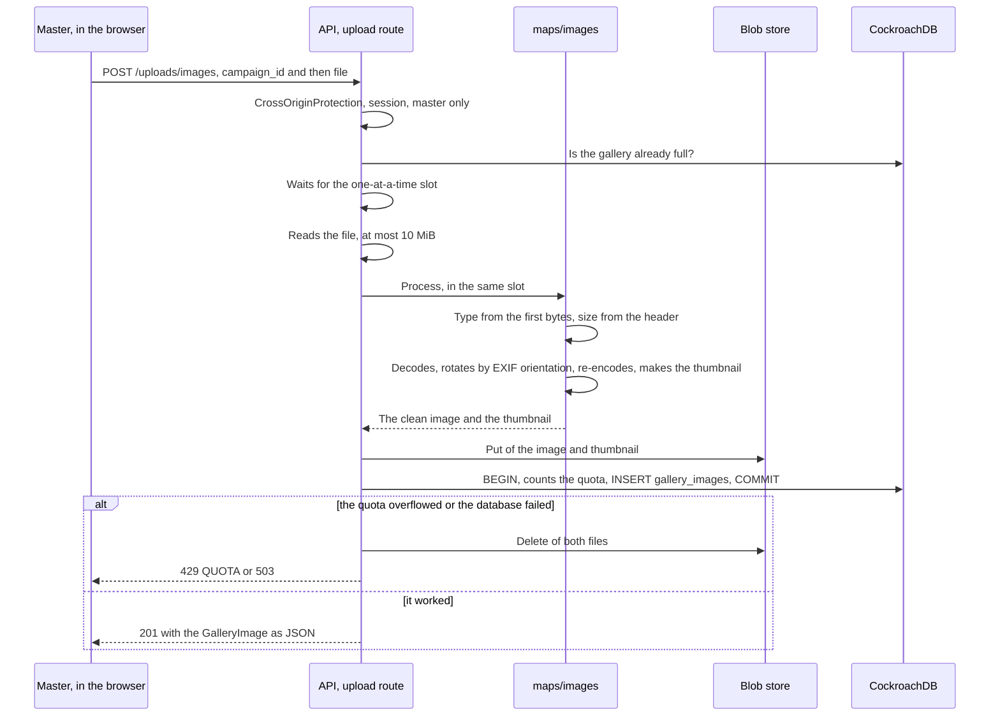

# Gallery images: upload, storage and serving

The gallery stores the images the master uses on maps and in the campaign document (MR-019).
The server accepts only JPEG, PNG and WebP, re-encodes each image with no metadata at all, and delivers it only to whoever may see it: the campaign master, or a player while the image is visible to them (RN-10).
The code is in `backend/internal/maps` (`upload.go`, `serve.go`, `gallery.go`) and `backend/internal/maps/images`; storage is `backend/internal/platform/blob`.

| Route or call | Who may | What it does |
| --- | --- | --- |
| `POST /uploads/images` | The campaign master | Receives the image (`multipart/form-data`: `campaign_id`, then `file`), checks, re-encodes, stores and answers `201` with the `GalleryImage` as JSON |
| `GET /images/{id}` and `GET /images/{id}/thumb` | The image's campaign master; a player only while they see the image | Delivers the image, or the thumbnail (480 px on the longer side) |
| `GalleryService.ListGalleryImages` | The master | Lists the gallery, newest first, with the quota usage |
| `GalleryService.RenameGalleryImage` | The master | Changes the name (1 to 80 characters, one line) |
| `GalleryService.DeleteGalleryImage` | The master | Deletes the row and the files. `failed_precondition` if a map uses the image; if it is an NPC's portrait, the portrait is cleared (MR-031) |

Uploading and downloading are not Connect calls because the body is a file.
Both routes use the same session cookie and the same `authz` checks as the rest of the API (see Who is calling in [Architecture](../../architecture.md#who-is-calling)).
The whole contract, with the errors, is in the `GalleryService` comment in `proto/meurpg/maps/v1/gallery.proto`.

## Uploading

- **The order saves work.** `campaign_id` comes before the file, so whoever is not the master is refused before the server reads 10 MiB. A quick look at the quota also comes first. Then the request waits for the processing slot **before** reading the file, so the bodies of uploads queued behind a busy slot are never in memory: at most one file is, from its read to the end of its decode. The client's 45 seconds to send the file (`uploadSlotReadTimeout`) start when its turn does. The quota check that counts is the one inside the transaction, which CockroachDB's `SERIALIZABLE` protects from two simultaneous uploads.
- **The type comes from the bytes,** never from the file name or the browser. SVG, GIF and the rest are refused.
- **Decompression bombs.** The server reads only the header first (`image.DecodeConfig`) and refuses above 8,192 px on a side (`MaxSide`) or 40 megapixels (`MaxPixels`). It also estimates the memory decoding will use (a progressive JPEG or a 16-bit PNG spend much more per pixel) and refuses above 256 MiB (`maxDecodeBytes`). The estimate follows the type `png.Decode` returns, not the header's colour model: a gray PNG with a `tRNS` chunk decodes to NRGBA (NRGBA64 at 16 bits). One image is processed at a time per instance, so a few simultaneous uploads cannot exhaust `GOMEMLIMIT` (see [Operations](../../operations.md)).
- **Re-encoding is what cleans.** The new image has only pixels: EXIF (with GPS), XMP, ICC profiles, a PNG's text chunks and anything hidden after the image are gone. PNG stays PNG (stored with 8 bits per channel, so the map and an NPC's portrait keep transparency, and the thumbnail keeps alpha). JPEG stays JPEG at quality 88. WebP becomes JPEG, or PNG when it has transparent pixels.
- **The photo stays upright.** A phone stores the sensor's orientation in EXIF. Since EXIF goes, the server rotates the pixels first.
- **The name** comes from the file name, without folders, extension or control characters, cut at 80 characters ("Imagem" when nothing is left). The master can rename it.
- **Files before the row.** If something fails after a file was written, both files are deleted. A crash in the middle may leave files without a row, which nobody reaches.
- **The quota** is 300 images and 500 MiB per campaign (`DefaultMaxImages`, `DefaultMaxBytes`), counted on the re-encoded images.

### Upload errors

The route is not Connect, but errors use Connect codes in a small JSON the app translates by `reason`: `{"code": "invalid_argument", "reason": "UNSUPPORTED_TYPE", "message": "..."}`.
The `message` is English, for developers; the screen has its own text per `reason`.

| HTTP | `code` | `reason` | When |
| --- | --- | --- | --- |
| 400 | `invalid_argument` | `UNSUPPORTED_TYPE` | Not JPEG, PNG or WebP |
| 413 | `invalid_argument` | `TOO_LARGE` | More than 10 MiB, uploaded or after re-encoding |
| 400 | `invalid_argument` | `DIMENSIONS` | Too many pixels |
| 400 | `invalid_argument` | `CORRUPT` | Looks like an accepted image, but does not open |
| 400 | `invalid_argument` | `MALFORMED_REQUEST` | Not a `multipart` form, a field is missing or extra, or the order is wrong |
| 429 | `resource_exhausted` | `QUOTA` | The campaign already has 300 images, or would pass 500 MiB |
| 401, 403, 404 | `unauthenticated`, `permission_denied`, `not_found` | none | No session; a player; a non-member (or no such campaign) |
| 503 | `unavailable` | none | Images off (no `BLOB_DIR` or `BLOB_BUCKET`), or the database or storage did not respond |
| 500, 504, 499 | `internal`, `deadline_exceeded`, `canceled` | none | The Connect protocol's statuses (`httpStatus`, in `maps/httperror.go`) |

The `CrossOriginProtection` `403` (an upload from another site) comes before all this, in plain text; the app never sees it.

## Where images are stored

`backend/internal/platform/blob` is a small interface (`Put`, `Open`, `Delete`) with two implementations: the disk (`FS`) and Cloud Storage (`GCS`).
Keys are `campaigns/<campaign>/images/<id>` and `…/<id>.thumb`, so everything of a campaign shares one prefix.

| Where | How |
| --- | --- |
| Local environment | `BLOB_DIR=/var/lib/meurpg/images`, a Docker Compose volume (`images`) that survives `make down` |
| Tests | A temporary folder per test |
| Production | `BLOB_BUCKET`: a private Cloud Storage bucket reached by `blob.GCS` (the JSON API over `net/http`, with the service account's token from the metadata server; see [Operations](../../operations.md#images)) |

- **On disk,** each file starts with a line holding the type (`image/jpeg`), then the image. `Put` writes a temporary file and renames over it, so nobody reads half a file. Every operation goes through an `os.Root`, which refuses any path outside the folder (symbolic links included), and the key only accepts lowercase letters, digits, `.`, `-` and `_`. Errors do not carry the path.
- **Only one store is chosen.** `BLOB_BUCKET` and `BLOB_DIR` together, or `BLOB_DIR` on Cloud Run, stop the server at start. If the bucket cannot be reached at start, the server logs a warning and keeps the store on: each call then succeeds or fails on its own.
- **In Cloud Storage** the object name is the key and the content type is the object's. `Put` is one media upload. `Open` streams the object and, when the reader seeks (`http.ServeContent` does), asks for the rest with a `Range` header. The `ETag` the image routes send comes from the image's ID, not from the store.
- **Without `BLOB_DIR` or `BLOB_BUCKET`,** images are off: upload, download and `GalleryService` answer `503`/`unavailable`, the startup log warns, and the rest of the app works.
- **Deleting an image** removes the row first and the files after: without the row nobody reaches the files, so a failed file delete exposes nothing (it is logged).
- **Deleting a campaign** cascades the rows but not the files. Whoever implements campaign or account deletion must also delete the prefix `campaigns/<campaign>/` (see [Privacy](../../privacy.md)).

## Serving images

The master downloads every image of the campaign; a player only the images they see now (RN-10).
`GET /images/{id}` (and `/thumb`) checks, in this order:

1. A valid session, else `401`, before looking for the image.
2. The image exists and the asker is an active member of its campaign, else `404`, the same as for an image that does not exist, never `403`.
3. For a player, the image is visible to them now, else `404`. It is visible when it is the background of a map they see (revealed, or the open session's current map), the image the master shows in the open session (MR-028), an image left with the players (`campaign_left_images`), or the portrait of an NPC on the open scene's stage (MR-031). **Never** the background of a map with fog on (`ImageIsOnAFogMap`): the player only receives it drawn square by square ([Fog](fog.md)). The reads belong to each module: what the session shows comes from `play` (`LiveSession.OnScreen`), maps from one query (`ImageIsOnAVisibleMap`, through the `maps_image_id_idx` index), and the stage from `LiveSession.ImageOnStage`, only if the others did not suffice.

Only after that comes `If-None-Match`'s `304` (read as the RFC 9110 entity-tag list: several values, the weak validator `W/` and `*`).
So not even a stranger learns the image exists by sending the ETag, and a player does not keep an image they no longer see.

| Header | Value | Why |
| --- | --- | --- |
| `Cache-Control` | Master: `private, max-age=31536000, immutable`. Player: `private, no-cache` | An ID's bytes never change (a new upload gets a new ID), so the master caches for a year. A player may stop seeing the image at any moment, so their browser asks again on each use: `304` without a body while they see it, `404` after |
| `Vary` | `Cookie` | One browser used by two people never answers for the other |
| `ETag` | `"<id>"` (thumbnail: `"<id>.thumb"`) | The browser revalidates without downloading again |
| `Content-Type`, `Content-Length` | From the stored file | none |
| `X-Content-Type-Options: nosniff`, `Content-Disposition: inline` | none | The browser treats the file as the image `Content-Type` says |
| `Content-Security-Policy: default-src 'none'` | none | Opened alone in a tab, the response runs nothing |
| `Cross-Origin-Resource-Policy: same-origin` | none | Another site cannot embed the image |

The app's CSP accepts the images (`img-src 'self'`), the Angular handler leaves `/images` and `/uploads` to the API (`isAPIPath`), and in `ng serve`, `proxy.conf.json` forwards both.

**RN-10 with images.** Knowing an ID is not enough: the player keeps the IDs of maps hidden again and of images no longer shown, and the route checks again on each request.
An ID only reaches a player in a response they may read, and an image the master takes back from "left with the players" returns to `404` (`TestRN10_PlayersOnlyFetchImagesTheyCanSee`).
An image's gallery name goes to a player only on the shown image and the ones left with them, as a caption; on a map, only to the master.
The gallery, which lists all images, is the master's alone (`TestMR019_PlayersCannotListTheGallery`).
What the server cannot reach: an image the browser already drew, and what someone saved or photographed from the screen.

## Gallery in the app

The gallery screen (`/campaigns/:id/gallery`), the campaign page's "Galeria" panel and the image picker use three pieces of `web/src/app/core/images/`, all loaded only by lazy routes.

- `GalleryClient`: the generated `GalleryService` (list, rename, delete).
- `ImageUploader`: `POST /uploads/images` with `XMLHttpRequest` and `FormData` (`campaign_id`, then `file`, without setting `Content-Type`). It is XHR, not `fetch`, because only XHR reports upload progress; the app has no `HttpClient`. The `201` becomes the generated `GalleryImage` (`fromJson`).
- `UploadQueue`: sends the files one after another, each with its own progress, cancel and error. Before sending it checks type (JPEG, PNG or WebP), size (10 MB) and image count with the `GalleryUsage` from `ListGalleryImages`. The quota's bytes stay with the server, which counts the re-encoded image.

Each error's text comes from the `reason` (or the code, or the HTTP status), never from the `message` (`upload-errors.ts`).
Images on screen always come from `/images/<id>` or `/thumb`, same origin; the CSP does not allow previewing the file before upload (a `blob:` URL).
