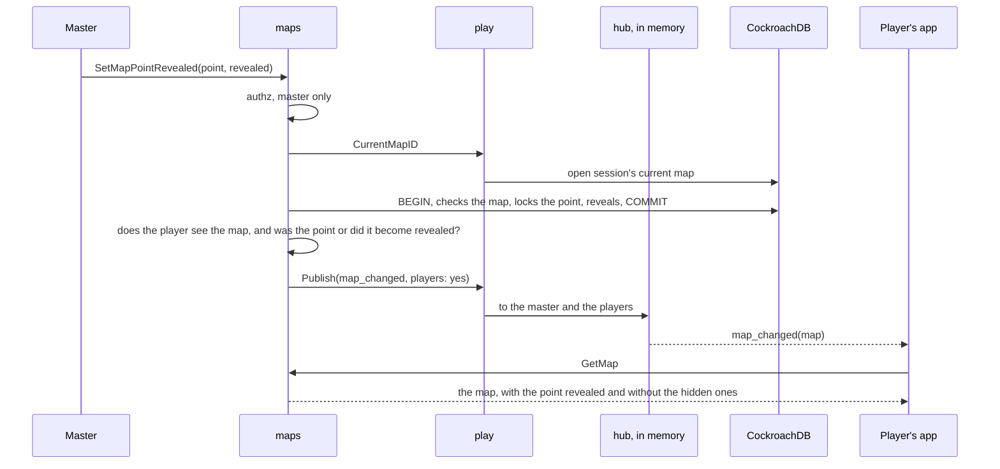

# Maps in the live session

With the session open, each change to a map reaches whoever is on the session page at once, through `play`'s stream.
`maps` decides each event's audience, because only it knows what the change touched: the master always receives, and a player only when the change touches something they see, before or after it.
A change only to hidden things does not reach the player, not even as a `map_changed` on a map they see.
Without an open session nobody is subscribed and nothing is published; the app reads the maps when it opens the screen.

| Event | When | Who receives it |
| --- | --- | --- |
| `current_map_changed{map_id}` | The master changes the current map, or deletes it (empty) | Everyone |
| `map_changed{map_id}` | A point is created, changes, is deleted, revealed or hidden, or its scene's action changes; a token is placed, hidden, shown or removed; the map changes name or image, is revealed, hidden, created or deleted; a layer is painted; the fog changes; a treasure is marked or unmarked; a trap is revealed | The master; the players, if they see the map before or after **and** the changed thing before or after. Exceptions: a trap revealed to some characters notifies only their players; a carried light only the owner; a light layer only the master; on a fogged map a change to a point notifies only players who see or remember one of its squares, and a layer only goes through `vision_changed` |
| `token_moved{map_id, character_id, x_bp, y_bp}` | The master moves a token that was already on the map | Everyone, if the token is visible on a map the players see; otherwise only the master. On a fogged map only a player character's: an NPC's reaches the player as `vision_changed` |
| `trap_noticed{map_id, point_id}` | A player's character noticed a trap while passing near (MR-035) | Only their player, and only if they see the map; never another player nor the master (RN-10). The screen shows "Você notou uma armadilha." and reads the map again |
| `vision_changed{map_id}` | On a fogged map, what a player sees or remembers changed, or an NPC moved on a square they see | Only the players it touches, at most one in each stream's queue; never the master ([Fog](fog.md#the-stream)) |

- **`map_changed` is only a notice.** It carries no content: the app reads the map again (`GetMap`), already filtered, so a point's name or description never travels through the stream. If the player no longer sees the map, `GetMap` answers `not_found` and the app leaves it; a `map_changed` for a map the app does not list yet (just revealed) means the list changed (`ListMaps`).
- **`token_moved` carries the position:** the app moves the token without reading the map again. A map read that began before that edit (or before the answer of the master's own call) is dropped and made again, so an older answer never puts the token back and the screen's other changes are not lost. The same rule holds for the scene (`SceneState`) and the notes (`NotesState`): a local answer does not discard a read in flight, it makes the screen read once more. When two reads of the map overlap (a screen's own refresh and the stream's), the older answer is dropped and whoever awaited it waits for the newer read, so a screen that reads the points right after its refresh (the trap search naming what it found) sees the newest map. An answer for a map other than the open one (the master switched maps before the reply) is not put into the open map. Stage calls of different NPCs overlap, so an older answer arriving after a newer one is not applied. A new token comes as `map_changed`, because the app needs the name.
- **Changing a map's visibility** also notifies the maps with a sub-map point leading to it: the point's destination appears or disappears for the player.
- **The master's light warning** has no event of its own: the master's screen reads `ListCharactersInTheDark` again on `map_changed` and `token_moved`, which every change to a light or to where a character stands already sends the master ([Fog](fog.md#the-masters-light-warning)).
- **Painting** sends `map_changed` at most once per second per map ([Editor](editor.md#layers)).

