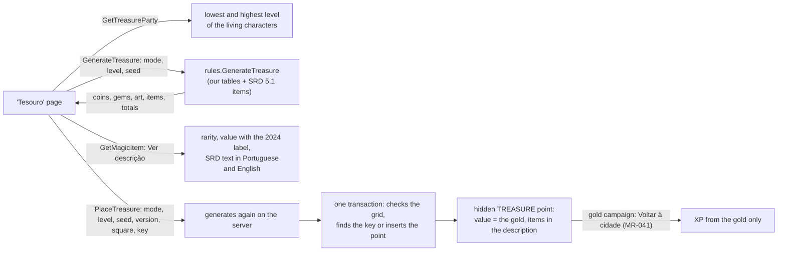

# Treasure generator (MR-044)

The treasure generator is a pure function of `rules` (`treasure.go`, `treasure_generate.go`): the mode (`individual` or `hoard`), the party level (1 to 20) and a **seed** always give the same treasure.
`TreasureService` (`proto/meurpg/maps/v1/treasure.proto`, in the `maps` module, mounted in the same `Mount` as `MapService`) serves it to the master and puts it on a map (RN-09, RN-10).
**All calls are the master's; a player, a pending member and a non-member get `not_found` from all of them** (the function `requireDungeonMaster`, shared with `DungeonService`), so a generated treasure never reaches a player before they find the point.
The tables and loading rules are in [CONTRIBUTING](../../rules-content.md#rules-content-srd) (`effects/treasure.json`, `effects/magic_item_values.json`).

## The tables are ours

SRD 5.1 has no random treasure tables, so no number, value or name comes from a book or another site (`effects/treasure.json`, in Portuguese).
There are four party-level bands (1 to 4, 5 to 10, 11 to 16, 17 to 20; `TreasureBand` gives a level's band), each with an individual and a hoard mode.
An **individual** treasure is coins only (what a creature carries); a **hoard** has coins, gems, art objects and magic items.
Each coin row is a type (`pc`, `pp`, `pe`, `po`, `pl`), a roll (`3d10*11`: dice, times a multiplier, plus or minus a fixed number, never below 0) and the chance of appearing.
Gems, art and items have a chance of existing, how many (another roll) and the weights of what each is: the value tier (gems, art) or the rarity (items).

The criteria:

1. **Coins start from a target of average gold per band and mode,** tied to the SRD 5.2.1 values ([below](#item-values)): a hoard's coins are worth on average **half an item of the band's typical rarity**, an individual's **a twentieth** of that. The typical rarity is uncommon in band 1 to 4 (400 gp), rare in 5 to 10 (4,000), very rare in 11 to 16 (40,000) and legendary in 17 to 20 (200,000). The targets are 200, 2,000, 20,000 and 100,000 gp for a hoard and 10, 100, 1,000 and 5,000 gp for an individual. The rolls hit those averages in a format of ours: the bulk comes from a band's "main" coin (silver at first, gold in the middle, platinum at the end), with change in a smaller coin, multipliers that are not powers of ten, and a chance for the coin to appear.
2. **Gems and art have a value scale of our own,** and art is the gems' shifted half a step. Gems: 6 gp at the first tier and three times the previous, rounded to two digits (6, 18, 54, 160, 490, 1,500, 4,400 gp). Art: the same ratio from 9 gp (9, 27, 81, 240, 730, 2,200, 6,600 gp). A gem and an art object never share a value. Loading refuses a tier above 10,000 gp. Each hoard band uses the tiers that fit it, with weights of ours.
3. **Gem names are real stones, in Portuguese, grouped by how easy the stone is to find, cut and buy** in Brazil and Portugal: craft-fair stones at the bottom (smoky quartz, chalcedony, sodalite), everyday jewellery's in the middle (amethyst, citrine, garnet, peridot, aquamarine), what only a good jeweller has above (imperial topaz, chrysoberyl, alexandrite, rubellite tourmaline, noble opal) and kingdom-priced ones at the top (ruby, cut emerald, diamond, Paraíba tourmaline). No stone is in a tier because a book's list put it there.
4. **Art objects were written from scratch for a Portuguese-language table:** objects, materials and craftspeople invented by us. Each tier has four names of up to 60 characters, all different.
5. **Items follow what is expected of each band:** 1 to 4: 1 to 3 items, mostly common and uncommon; 5 to 10: 2 to 5, common to rare; 11 to 16: 2 to 5, uncommon to very rare; 17 to 20: 2 to 4, rare to legendary. The weights are ours.

| Band | Individual (gp in coins) | Hoard: coins (gp) | Hoard: gems | Hoard: art | Hoard: magic items |
| --- | --- | --- | --- | --- | --- |
| 1 to 4 | 9 | 207 (copper, silver, gold) | 2d4, 70%, 6 to 54 gp | 1d2, 40%, 9 and 27 gp | 1d3: common 55%, uncommon 40%, rare 5% |
| 5 to 10 | 95 | 1,981 (silver, electrum, gold, platinum) | 2d4, 80%, 18 to 160 gp | 1d4, 60%, 27 to 240 gp | 1d4+1: common 20%, uncommon 45%, rare 35% |
| 11 to 16 | 944 | 19,798 (electrum, gold, platinum) | 2d6, 85%, 54 to 1,500 gp | 1d4, 70%, 81 to 2,200 gp | 1d4+1: uncommon 25%, rare 45%, very rare 30% |
| 17 to 20 | 5,055 | 99,750 (gold, platinum) | 2d6, 90%, 160 to 4,400 gp | 1d4, 80%, 240 to 6,600 gp | 1d3+1: rare 25%, very rare 50%, legendary 25% |

A level on a band's edge uses its own band.
The master chooses the level, and the screen proposes the **party's lowest living level**, so the treasure does not exceed what the weakest character can take.
Loading refuses malformed tables: a band that leaves a level out, a roll that cannot be read, a coin, tier or rarity that does not exist, a repeated name or one over 60 characters, an individual mode without coins, a draw with tiers and rarities together, more than 12 gems, 6 art objects or 6 items, and a rarity with no item to draw.
The 1,000,000 gp limit counts only gold (coins, gems and art, the worst case), because it is the value of a treasure point; items never enter it.
A treasure's description always fits the 2,000 characters of a point (`TestTreasureDescriptionAlwaysFits`).

## What is drawn, and how far a seed holds

- **One random sequence each** for coins, gems, art and items, derived from the seed and a phase constant mixed by SplitMix64 (`seed ^ splitmix(phase)`): changing the item table does not change the same seed's coins. The generator is ours (SplitMix64, pinned to its reference vector by `TestTreasureRNGMatchesSplitMix64`, with Lemire's unbiased integers, as in the dungeon generator), not `math/rand`, whose sequence is not promised across Go versions.
- **A seed gives the same treasure within a content version, and only within it.** Changing the tables or items (a new `fx.<n>` revision) changes every seed's treasure. So `Treasure` carries the `content_version`, `PlaceTreasure` requires it back, and a different one is `failed_precondition` with `TreasureBlocked CONTENT_CHANGED` ("gere de novo"). To keep a name fix from shuffling seeds, each rarity's units are drawn **in key order**, not Portuguese-name order.
- **Items** use `MagicItemUnits` (see Magic items in [Architecture](../rules-creatures-items.md#magic-items)): the rarity is drawn by weight, then one of its units and one of the unit's options. A "Varia" family (the Potion of Healing) comes out as one of its variants, and the value is the variant's. **An artifact never comes out:** the table refuses the `artifact` rarity and `varies`.
- Equal gems and art objects join (two fire agates are one piece of `count` 2).
- Each coin stack is worth `quantity × coin value` in whole gp, rounded down (10 pp = 1 gp, 2 ep = 1 gp, 100 cp = 1 gp, 1 pp = 10 gp): 7 cp are worth 0 gp.
- **Totals:** `coins_po`, `gems_po` and `art_po` add up to **`gold_po`**, the point's gold; `items_po` is the items' value, apart.
- `TestTreasureGolden` pins a treasure per band and mode, with gems and art in every hoard.

## Item values

Values are the "Magic Item Rarities and Values" table of SRD 5.2.1 (p. 205, CC BY 4.0, 2024 rules), in `effects/magic_item_values.json`: common 100 gp, uncommon 400, rare 4,000, very rare 40,000, legendary 200,000; the artifact has no price ("sem preço", `priceless`).
`Content.MagicItemValue(key)` applies three rules:

- **A consumable is worth half** (the table's note: the common Potion of Healing is worth 50 gp). Consumables are those of `effects/consumables.json`.
- **A Spell Scroll is worth its rarity's whole value, undivided.** This is an engineering decision: SRD 5.2.1's note excludes the scroll from the halving, and our scrolls are the 2014 ones, with SRD 5.1's rarity per spell level. The screen says so.
- **A "Varia" family has no value of its own,** only its variants.

Every value comes with the label "Valores do SRD 5.2.1 (regras de 2024)" (`value_label`), because the items are SRD 5.1's and the prices 5.2.1's. `NOTICE` credits SRD 5.2.1 (CC BY 4.0) for this table too.

## The calls

| Call | What it does |
| --- | --- |
| `GetTreasureParty` | The lowest and highest level among living, active player characters ("O grupo está nos níveis 4 e 5") and how many; 0 with none. Reads through `CharacterDirectory.PartyTotalLevels`, which `characters` implements (the same `ListCombatParty` as XP) |
| `GenerateTreasure` | Rolls and stores nothing. Without `party_level`, uses the lowest living level (with no living character: `failed_precondition` with `TreasureBlocked NO_PARTY`). Without `seed`, the server draws one and returns it ("Gerar outro" is a new call without a seed). A missing mode or a level outside 1 to 20 is `invalid_argument` |
| `GetMagicItem` | What "Ver descrição" shows: names, category, rarity, attunement (English and Portuguese), consumable, scroll, the value (absent on the artifact and a varying family), `halved`, `priceless`, the label, the SRD text in English (`description`) and Portuguese (`description_pt`, with `description_pt_missing`), and a family's variants. A key that is not an item is `not_found` |
| `PlaceTreasure` | Puts the treasure on a map. It requires the mode, level, **seed** and `content_version`; it **does not read the party level** (the level comes in the request) and **generates again on the server**, trusting no total from the app. It creates a **hidden** `TREASURE` point (RN-10) in the middle of square `column`, `row` of the rules' grid (1.5 m squares; with calibration `grid_factor` 2, one drawing square is 2 × 2 of them), with `treasure_value_po` = the gold (`gold_po`: coins, gems and art, **never the items**) and a Portuguese description of coins, gems, art and items (name, rarity, "exige sintonização", no values). The name is the master's, or "Tesouro de covil" / "Tesouro individual" |

`PlaceTreasure` refusals:

| Cause | Answer |
| --- | --- |
| A map without a grid | `failed_precondition`, `MapBlocked NO_GRID` |
| A different content version | `failed_precondition`, `TreasureBlocked CONTENT_CHANGED` |
| A square outside the grid | `invalid_argument` |
| A map of another campaign | `not_found` |
| A map with 200 points | `resource_exhausted` |

Every `invalid_argument` of the treasure calls carries a `TreasureInvalidField` detail naming the request field (`column`, `row`, `name`, `idempotency_key`, `content_version`, `seed`, `mode` or `party_level`) and the app words each one; only a square outside the grid makes the dialog read the map again.

## Idempotency

`PlaceTreasure` carries an `idempotency_key` of 1 to 64 characters, which the app picks once per dialog.

- The key **holds in the campaign:** `<campaign id>:<key>` is stored in `map_points.create_key` with the **hash of the whole request** (map, square, mode, level, seed, name, content version) in `create_hash`, and the partial unique index on `create_key` keeps idempotency right even with simultaneous calls.
- A repeat **with the same hash** returns the first call's point (the `INSERT ... ON CONFLICT DO NOTHING` and a read in the same transaction make a single point). The same key with **any other request** is `invalid_argument` ("idempotency_key was used for another change"), so a repeat never returns a treasure the point does not have.
- The repeat holds at the 200-point cap, returns the point **as it is now** (the master may have edited or revealed it) and publishes nothing new.
- All in one transaction, only with `WithTx`: the key lookup, the grid, the point count and the `INSERT`. The content version and the `currentMap` are read before it.

## In play

The point is a treasure like one the master makes by hand: a player only receives it when the master reveals it or the party finds it, and `publishPointsChanged` sends a player nothing while it is hidden ([Points](points.md#treasure-found)).
In a gold campaign "Voltar à cidade" converts it to XP (MR-041: 1 XP per gp, only `gold_po`; see [Progression](../progression.md#voltar-à-cidade-mr-041)).
**Magic items never become XP:** they stay in the description, and `items_po` is a number for the master.
The screen reads the campaign's `xp_mode` through `CampaignService.GetCampaign` to know what happens to the gold.

Tests: `go test ./internal/rules -run 'Treasure|Hoard|Families|MagicItemValues'` (no database; the invariants over thousands of treasures, the golden, the loader's refusals), `FuzzGenerateTreasure` and `BenchmarkGenerateTreasure` in `rules`, and in `maps` the `TestMR044_*` set (generating as the master, the party level, placing, refusals, idempotency, racing calls, the point cap, calibrated maps, the content version, the gold-only conversion) with `TestTreasureAuthorizationMatrix` and `TestRN10_APlayerNeverSeesAPlacedTreasureUntilRevealed`.

## The client

The screen is `web/src/app/pages/treasure/` (route `campaigns/:id/treasure`, lazy) and the rest is `web/src/app/core/treasure/`.

- `TreasureClient`: the four calls.
- `treasure-errors.ts`: each refusal by the code and the typed detail (`TreasureBlocked`, `MapBlocked`), never the message.
- `treasure-format.ts`: sentences and values, no rule. The browser only sums gold and the items' value for "Valor total", multiplies each gem, art or item's value by its grouped quantity ("2 × Ágata", 2 × 6 gp) and doubles the value of an item the server gave halved to say "metade de 100 PO".
- `TreasureAccessCheck`: the campaign's role and `xp_mode`, for the gold line.

The browser has no list of items, gems or art objects: everything comes from the server.
"Pôr no mapa" (`PlaceSheet`) is a dialog on the computer and a sheet on the phone (`openSheet`).
The square comes from the map the master sees (`app-map-view` with `app-editor-overlay`, the grid in rules' squares with the calibration drawn), the room from `GetDungeonRooms`.
**One idempotency key per request:** the dialog makes the key on opening and swaps it whenever the map, the square or the name changes, so a retry of the same request (a lost response) returns the same point and a different request is never refused for reusing a key.
