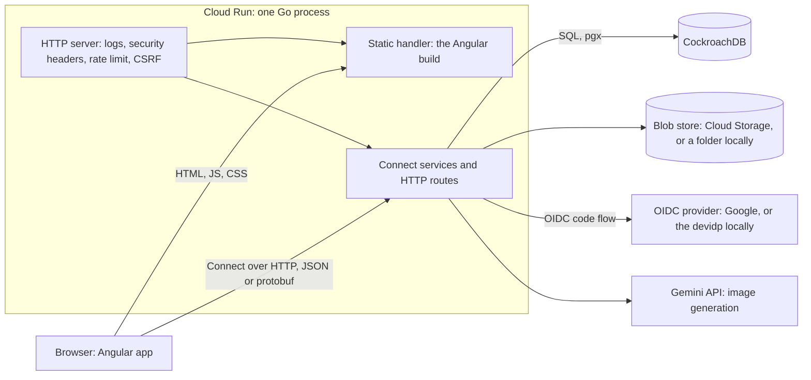
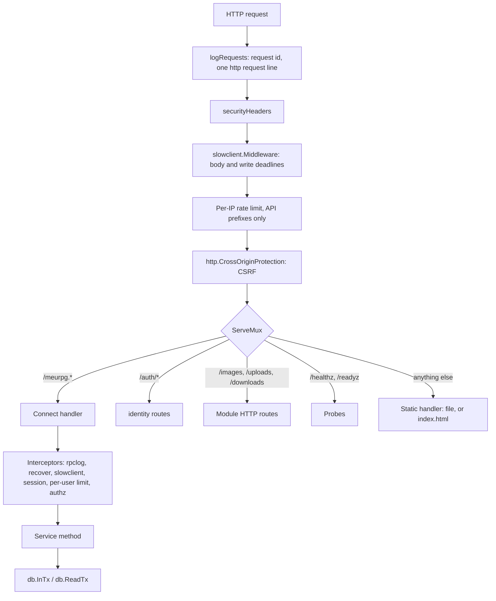

# Architecture overview

MeuRPG is a Go modular monolith on Cloud Run that serves a Connect API and the Angular app from one origin, on top of CockroachDB.
Angular only draws the screen: every rule runs on the server.
This page says what the pieces are, how they may depend on each other and how a request travels.
The other pages of this folder go deep on each piece.

## The pieces

| Piece | Choice |
| --- | --- |
| Backend | Go, one deployable (`backend/cmd/api`) built from modules under `backend/internal`. |
| API | Protobuf and Connect (connect-go on the server, connect-es in the browser), generated by buf from `proto/`. See [API](api.md). |
| Frontend | One Angular app in `web/`, built to static files that the Go server serves on the API's origin. See [Web app](web.md). |
| Database | CockroachDB, accessed with pgx and sqlc, schema by goose migrations. It runs at `SERIALIZABLE`, so every write retries on SQLSTATE `40001`. See [Transactions](transactions.md). |
| Sign-in | OpenID Connect with PKCE, then an opaque server-side session in an `__Host-` `HttpOnly` cookie. See [Identity](identity.md). |
| Real time | A Connect server stream, open only during a game session and only while the tab is visible. Nothing else stays connected. |
| Images | A blob store (`platform/blob`): a folder (`BLOB_DIR`) locally, a Cloud Storage bucket (`BLOB_BUCKET`) in production. Without either, image routes answer `503`. |
| Hosting | Cloud Run in `southamerica-east1`; the database is in the same region. Sizing, scaling and cost are in [Operations](../operations.md). |

One instance serves the app (`max-instances` 1): the rate limits, the stream fan-out and some caches live in process memory and are exact only with one instance.
Changing that means revisiting those pieces ([API](api.md#abuse-limits)).

Decisions that are hard to undo are written as ADRs in a private repository.
Code and documents here cite only the number, for example ADR-0002.
The ones that shape this folder: ADR-0001 (modular monolith, Go as the BFF, Protobuf and Connect), ADR-0002 (sessions), ADR-0003 (Cloud Run and CockroachDB), ADR-0005 (stream, one instance), ADR-0006 (Angular on the same origin), ADR-0008 (rules as data), ADR-0009 (invite in the URL fragment, CSRF layers), ADR-0011 (authorization per campaign).

## Modules

Each backend module is a directory `backend/internal/<module>`.
A module reaches another only through that module's `link` package or through a shared root.

| Module | Owns |
| --- | --- |
| `identity` | Sign-in with an OIDC provider, login sessions, users and display names. [Identity](identity.md). |
| `campaigns` | Campaigns, members (including the pending member of an invite with approval), invites, the dice mode, the table rules, the XP mode and the campaign document. [Campaigns](campaigns.md). |
| `characters` | Characters, sheets, backstory, the master's notes, claim links, the editor's rules catalogue and the table content. |
| `play` | Game sessions, scenes, combat, puzzles and the live stream. |
| `maps` | Maps, points, tokens, fog of war, the image gallery, generated dungeons and AI images. |
| `progression` | XP awards, milestones and level-up readiness. |
| `notes` | The players' private notes and the clues each player holds. |
| `campaignpackage` | Exporting a campaign to one file and creating a campaign from such a file. [Campaign package](campaign-package.md). |
| `authz` | Who may do what in a campaign. Pure checks plus the interceptor that carries them. [Campaigns](campaigns.md#authorization). |
| `rules` | The D&D 5e calculations and the SRD content as data. No database, network, clock or randomness. |
| `system` | `SystemService.GetServerInfo`: the build's version and commit. |
| `platform` | The shared plumbing: configuration, database, HTTP server, logs, rate limits, dice and more (list below). |

`platform` packages: `blob`, `config`, `db`, `dbtest` (test harness), `dice`, `httpserver`, `idem`, `logging`, `names`, `nostore`, `ratelimit`, `rpcerr`, `rpclog`, `safego`, `secret`, `slowclient`, `tablerules`, `testenv`, `wiring`.

### Module boundaries are a test

`TestModuleBoundaries` (`backend/internal/archtest`) reads every import under `internal/` with `go/parser` and fails the build when a module reaches into another.
It needs no database and runs in the `go-db` CI group `rest`.

- **Link packages.** `maps/link`, `notes/link`, `play/link` and `progression/link` hold the small plain types that cross the interfaces between modules.
  The modules declare those interfaces and `cmd/api` wires them.
- **Shared roots.** Any module may import `authz`, `identity` and `campaignpackage` (their root package only), `rules` with all its sub-packages, and `platform/*`.
- **Everything else is closed.** From any other module a non-test file may import only that module's `link` package.
  Nothing under `internal/` imports `cmd/`; outside `internal/`, only `gen/` and `migrations/` may be imported.
- **The edges are a table.** `prodEdges` lists every module-level dependency of the production code and `testEdges` the ones only test files add.
  Both are exact: a new edge fails until it is added on purpose, and an edge nothing imports any more fails until it is removed.
- **One cycle is allowed:** `maps` and `play` need each other (the map reads the combat's positions, the combat reads the map's terrain and traps), each through the other's `link` package.
  The test fails on any other cycle.
- **Tests** may also import another module's root package, to start its real service, and the helpers in `testHelpers` (`characters/contenttest`, `identity/oidctest`, `maps/images/gen`), never another module's sqlc package.

### Wiring is checked at startup

`cmd/api` builds the modules and connects the collaborators that need each other with `Set...` calls in a fixed order (`wireModules`).
The compiler cannot see a forgotten call, and a `nil` collaborator can fail silently: a `nil` fog source means "no fog of war", so players would see the NPCs the master hid (RN-10).
So each module has a `CheckWired()` that lists the setters it needs (`platform/wiring`), and `wireModules` calls them all: a missing `Set...` stops the server from starting, with its name in the message.
`TestTheRealWiringIsComplete` builds the real wiring without a database or a sign-in provider.

Without `OIDC_ISSUER` or without `DATABASE_URL`, `wireModules` is never called: only the system service, the static app and the probes are served, and sign-in answers `503`.

## A request's path

The outermost layers are in `platform/httpserver`; the Connect options are in `connectOptions` (`cmd/api/main.go`); each service builds its own interceptor chain from the session interceptor `identity` provides.

1. **Log and headers.** The server makes the request id and writes one `http request` line when the request ends ([Logs](logs.md)); every response carries the security headers ([Web app](web.md#security-headers)).
2. **Deadlines for slow clients** ([API](api.md#slow-clients)) and the **per-IP limit** ([API](api.md#abuse-limits)).
3. **CSRF.** `http.CrossOriginProtection` refuses a cross-origin state-changing request ([Identity](identity.md#csrf)).
4. **Routing.** Connect services are mounted at `/meurpg.<module>.v1.<Service>/`.
   `/auth/*` is the sign-in flow; `/images/`, `/uploads/` and `/downloads/` are plain HTTP routes of the `maps` and `campaignpackage` modules.
   Every other path is the Angular build, with `index.html` as the fallback for the router.
5. **Connect interceptors**, outermost first: `rpclog` (logs the final outcome), `WithRecover` (a panic becomes `internal`), the stream send deadline, then the service's own chain: the session interceptor finds the caller, the per-user rate limit runs, and `authz.Interceptor` prepares the per-request membership memo.
   Every unary call must carry `Connect-Protocol-Version: 1`.
6. **The handler** starts with an explicit authorization call (`authz.Require...`), validates, then runs its writes in `db.InTx` and its multi-statement reads in `db.ReadTx` ([Transactions](transactions.md)).
7. **After the commit**, the handler publishes to the stream and touches files.
   Errors become Connect codes in one place ([API](api.md#error-codes)).

## Where to read next

| Subject | Page |
| --- | --- |
| Protobuf rules, error codes, idempotency, rate limits | [API](api.md) |
| `db.InTx`, `db.ReadTx`, the one-connection rule | [Transactions](transactions.md) |
| What a log line holds and never holds | [Logs](logs.md) |
| The Angular app, its serving, CSP and session state | [Web app](web.md) |
| OIDC sign-in, sessions, CSRF | [Identity](identity.md) |
| Roles, pending members, invites, claim links, table rules, the document | [Campaigns](campaigns.md) |
| The campaign file format, export and import | [Campaign package](campaign-package.md) |
| Tables and columns | [Data](../data.md) |
| Deploy, secrets, alerts, cost | [Operations](../operations.md) |
| Personal data and vendors | [Privacy](../privacy.md) |
