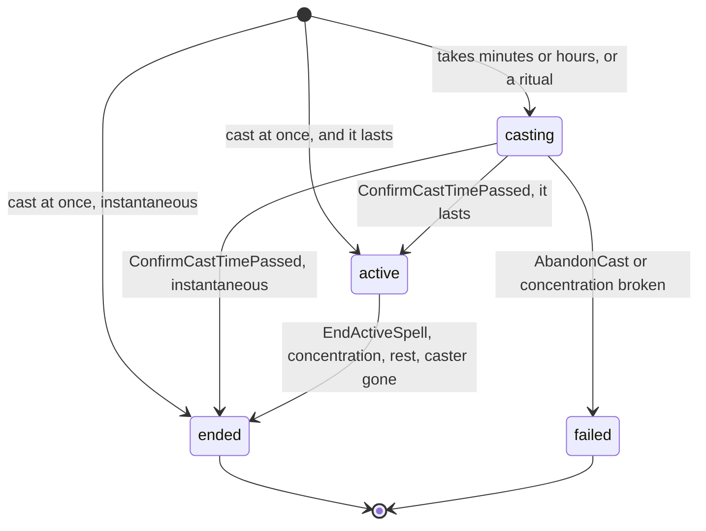

# Casting

In combat a spell is `CombatService.CastSpell` (MR-014); between fights it is `CastingService` (MR-048, RN-32).
Both spend the slot and the action in the same transaction as the effect, so a resend with the same key spends nothing and a refused cast does not either.
Summoning spells are described in [Creatures](creatures.md#casting-summons).

## Casting in combat

`CastSpell` spends the slot and the action (or bonus action) on casting.
Who casts: the player on their own character on their turn (a prepared spell or a save cantrip from the options list); the master on any combatant on turn (an NPC with a full sheet casts from the sheet; NPC slots are not counted, only player characters').
The spell, the level (`slot`: level or pact, none for a cantrip) and the targets are checked against the character's `TurnOptions`; the targets against what they see, the range and how many targets the spell accepts:

- **Range.** Self only the caster, Touch 5 ft, otherwise the spell's range; multiplied for a spell attack when the caster's table feat has a `ranged_attack` with `range_multiplier`.
  The master is never limited.
- **How many targets.** `SpellDetails.Target` says whether a spell hits an area and how many it takes: what the master wrote on a table spell, the 5e-database's structured area on an SRD one and, for one without a structured area, the SRD text read with two patterns (`rules/spelltarget.go`).
  A spell attack takes one target, so a wrong guess never blocks the master.
  A table spell goes through the same `CombatSpell`, with the campaign's content (see [Architecture](../characters-table-content.md#spell-targets-and-the-magias-page)).
- **At most 10 listed targets**, the master's too: what each target suffered stays in the cast's event, and a `session_events` payload is at most 16 KiB.
  A placed area spell is not listed: it reaches who the server finds inside, up to the 40 combatants a combat holds.
  Past 10 listed is `invalid_argument`.
- **Roll mode of a spell attack.** `GetTurnOptions` writes the mode, sources and `critical_on_hit` on each target of a spell attack, as on a weapon attack (see [Attacks and damage](attacks-and-damage.md#roll-modes)).
- **Held rolls.** A leveled spell attack against one target, an effect's save and a concentration save may wait for Lucky or a Bardic Inspiration die (see [Held rolls](held-rolls.md)).
  A cast held by a reaction window (Counterspell) is replayed with the stored request.

What the casting does depends on what the spell is:

| The spell is | What the casting does | What is left for `RollDamage` |
| --- | --- | --- |
| Spell attack (Ray of Frost, with `attack_type`) | One d20 per target (`roll_in_app`, or `d20_face` for a single target, RN-18 on each roll), against the AC as in `RollAttack`; a hit opens the pending damage, and Shield can hold it | Each hit's damage |
| Save (Burning Hands, Sacred Flame) | The server rolls each target's save: a full-sheet NPC uses `Derived.SavingThrows`, a basic sheet made from a creature uses the stat block's saves; a basic sheet typed by hand has no bonus, rolls d20 + 0, and the master's log says so (`bonus_known` false; for a player it is always false and the app never reads it). A player character is rolled in the app with the sheet's bonus (the master's `amount` has the last word). Whoever passes takes half (rounded down) or nothing, as the spell says | One roll for the whole casting for each damage type: the pending damages of a casting share a `cast_id`, and rolling one settles all of the same type. A spell with two damage types (Ice Storm, Flame Strike, Meteor Swarm) opens one pending damage per type per target (`pending_damage_id`, `more_pending_damage_ids`), each read against the target's resistance to its own type |
| Magic Missile | The darts (3, plus one per level above) are split among the targets, at least one in each, summing exactly; no attack roll | Each target's damage: 1d4 + 1 per dart |
| Healing | A pending damage that is a heal | The roll with the casting modifier heals at once, up to the maximum, per NPC and per character (through `character_vitals`); whoever was at 0 HP rises and the death saves reset |
| Reads HP (Sleep, Colour Spray, Power Word, Spare the Dying, Heal, False Life, Aid) | The server reads each target's HP and applies the effect at once, in the same transaction | None |
| Revivify | See [Death and revival](death-and-revival.md) | None |
| The rest (Web, Misty Step) | Spends and logs; the effect is the table's, and the master marks conditions afterwards | None |

**What a casting rolls at once and what stays with the master (RN-22).** A casting opens the saving throw and damage the spell asks for when it is cast.
Saves that come later, when a creature enters the area or ends its turn in it (Flaming Sphere, Web, Sleet Storm, Earthquake), are not automated: the data records their dice without a saving throw, so a casting spends the slot, logs and rolls nothing, and the master calls for each save as creatures move.
A lasting effect with an end-of-turn save uses the reaction window (see [Lasting effects](lasting-effects.md)).

**Damage types a spell lets the caster pick.** A spell that lists more than one damage type either deals them all (Ice Storm, Meteor Swarm, Flame Strike) or lets the caster pick: `damage_type_key` of `CastSpellRequest` names the type, and `SpellDetails.damage_choice` says how.
With `scale` (Flame Strike) every type is dealt and the dice a higher slot adds go to the picked one; with `alternative` (Spirit Guardians) only the picked type is dealt.
An empty pick takes the spell's first type; a type the spell does not offer is `invalid_argument`.
The cast sheet draws the pick as radio cards (`damage-type-picker`) whenever `damage_choice` is set, and a new pick is a new request with a new idempotency key.

**The bonus action spell limit.** `combatants.spell_cast` and `combatants.bonus_spell_cast` say which kinds of spell the combatant cast this turn (a cantrip with a casting time of 1 action counts as neither); `ResetCombatantTurn` clears both and the undo of a cast puts them back.
A spell is refused with `BONUS_ACTION_SPELL_LIMIT` when a bonus action spell was cast and this is not that cantrip, or when this is a bonus action spell and another one was cast.
Reactions (Shield) do not count.
The disabled spell row says which side blocks it (`spellReasonText`).

**Concentration.** A concentration spell puts its name in `concentration_spell`; casting another swaps it, and the log says which ended (see [Attacks and damage](attacks-and-damage.md#conditions-and-concentration)).
The cast sheets show a damage cantrip's dice from `Attack.spell_dice`, never from the first row of the spell's table.

## Spells that read HP

Six SRD spells roll no damage because what they do depends on the HP of whoever is in the area, and two more (False Life and Aid) change hit points without being damage or healing (MR-014).
What each does is handwritten content in `rules/srd51/effects/spells.json`, in a closed set of types the loader checks; changing the file needs a new revision (see [Contributing](../../rules-content.md#changing-an-effect-a-name-or-a-text)).
`rules.SpellEffect(key, level)` returns the effect already at the slot's level.
An `hp_pool` takes plain dice (no bonus, at most 30) of a die that exists at a table (d4, d6, d8, d10, d12, d20, d100).

| Type | What it does | Spells |
| --- | --- | --- |
| `hp_pool` | Rolls a total of dice (plus extra dice per level above the spell's) and goes through the creatures in ascending current HP, skipping those already unconscious or at 0; each one whose HP fits in what is left gets the condition, and the total goes down by its HP | Sleep (5d8, +2d8, Unconscious), Colour Spray (6d10, +2d10, Blinded) |
| `hp_threshold` | A creature with HP equal to or less than N suffers the effect: a condition or death | Power Word Stun (150, Stunned), Power Word Kill (100, dies) |
| `zero_hp_target` | Only holds on a creature at 0 HP, and leaves it stable | Spare the Dying |
| `flat_heal` | Heals a fixed value (plus an amount per level) and ends conditions | Heal (70, +10 per level; ends Blinded and Deafened) |
| `temp_hp` | The targets gain temporary hit points: a die rolled (`dice`, in the app or typed with `pool_sum`) plus `amount`, and `amount_per_level` more for each level above. Not healing; temporary HP do not stack, so a target keeps the larger | False Life (1d4 + 4, +5 per level) |
| `max_hp` | The targets' maximum and current HP both rise by `amount` (plus `amount_per_level`). The bonus is kept (`character_vitals.hit_points_max_bonus` for a player character, `combatants.hp_max_bonus` for an NPC or creature) until the master ends it (`EndCombatEffect`; for a player's character a long rest also clears it). Two casts keep the stronger bonus; a character at 0 HP gets up with the new current HP and its death saves reset; an NPC or creature at 0 stays down; the undo puts bonus, HP and maximum back. No temporary HP. `SpellEffectResult.gain` says `MAXIMUM` or `CURRENT` to everyone who sees the line; `hit_points_after` and `hit_points_max_after` go to the master and the target's player | Aid (5, +5 per level; up to three creatures) |
| `ignores_cover` | No effect on HP; the spell's saving throw gets no cover bonus | Sacred Flame |
| `revive` | Brings a dead character back (see [Death and revival](death-and-revival.md)) | Revivify |
| `summon` | Creatures that join the group (see [Creatures](creatures.md#casting-summons)) | Find Familiar, Animate Dead, Conjure Animals |

The arithmetic is pure, in `rules/combat/hpspells.go` (`ResolvePool`, `ResolveThreshold`, `ResolveZeroHP`, `ResolveFlatHeal`): ties keep the targets' order and the limit holds with HP exactly equal to N.
In `play`, `combat_spells_hp.go` reads the real HP and applies the result: the condition through the same field `SetCombatantConditions` writes; "death" defeats an NPC (0 HP) and takes a player character to 0 HP with three death-save failures, for the master to confirm (`ConfirmDeath`, RN-03); a character at 0 HP under Spare the Dying becomes stable.
The pool's total is rolled on the server (`roll_in_app`) or typed (`pool_sum`) and follows the campaign's dice mode (RN-18).
The cast event stores, per target, the HP before, what was affected and what the undo needs.
A druid in a beast form has the beast's hit points for these spells: Sleep and the Power Words judge the beast's pool, and Power Word Kill takes the beast to 0 (the form ends, nothing carries over).

**Who receives what (RN-20).** `SpellCast` and `CombatLogSpell` carry typed fields; the app never reads text.
`effect_kind`, `effect_condition_key` and, per target, `SpellEffectResult.outcome` go to everyone who sees the line; `pool_roll` only to the master and the caster's player; `effect_threshold` and per target `reason`, `hit_points_before`, `pool_order` and `pool_left` only to the master; `healed` to the master and the target's player (on an NPC the amount would tell how many HP were missing).
A heal appears in the log with the recovered amount only for the master and the target; others receive the roll.

## Casting outside combat

`CastingService` (`casting.proto`) casts spells between fights.
The rules are in `rules/casting.go`, `rules/combat/outside.go` and `healing.go`; `play` (`casting*.go`) holds the state, takes the open session's row lock like every write, and publishes after `COMMIT`.
`characters` reads the sheet for it (`castingoutside.go`: the spells the character can cast and Mage Armor's armor class) and hands the answer over through `link` types.
One row of `spell_casts` is one casting, from start to end, and the rows of a session are also its log.

| Call | Who may | Typed refusals (`CastingBlocked.reason`, `failed_precondition`) |
| --- | --- | --- |
| `GetCastOptions` | The character's player; the master for any character with a full sheet | None of its own: lists each spell with its reason (`NO_SLOT`) and `in_combat` |
| `CastSpellOutsideCombat` | The character's player; the master for any, an NPC with a full sheet included | `IN_COMBAT`, `CAST_IN_PROGRESS`, `NO_SLOT`, `TARGET_WEARS_ARMOR`, `TARGET_OUT_OF_REACH`, `CLASS_CANNOT_RITUAL`, `NOT_A_RITUAL` |
| `ConfirmCastTimePassed` | The master only | `CAST_NOT_GOING`, `NO_SLOT`, `IN_COMBAT` |
| `AbandonCast` | The caster's player; the master | None. A cast that is not going again changes nothing |
| `EndActiveSpell` | The caster's player; the master | `CAST_NOT_ACTIVE` (still being cast: use `AbandonCast`) |
| `ListSpellCasts` | Campaign members, each reading what RN-10 and RN-20 allow | None |

Every call also answers `NO_OPEN_SESSION`, `unauthenticated` and `not_found` for a campaign the caller is not in.
The slot, targets and dice are checked by the server alone: `invalid_argument` covers a spell that is not the caster's, a slot that does not fit, a ritual with a slot and a missing roll.

- **One cast, two steps when it takes time.** An action, bonus action or reaction takes effect at once.
  A spell of a minute or more, and every ritual (casting time plus 10 minutes, no slot, no higher level: SRD 5.1 "Rituals"), starts in `casting`: nothing is spent and the caster concentrates on the casting from the start.
  The master says the time has passed and calls `ConfirmCastTimePassed`, which spends the slot and applies the effect.
  The app keeps no clock.
  If the concentration breaks, the cast fails (`interrupted`) and no slot is spent.
  The unique partial indexes make it a fact of the table: one `casting` row and one concentrating row per caster.
  Casting a second concentration spell ends the first and the creatures it summoned (`ended_cast_ids`, `dismissed_creature_ids`).
- **Rituals follow the class.** `rules/casting.go` allows a ritual to a bard (spells known), a cleric or druid (prepared) and a wizard (the spellbook).
  The warlock's Pact of the Chain casts only Find Familiar that way.
  The Book of Ancient Secrets invocation is not implemented.
- **A combat that starts does not cancel a long cast.** The combatant carries the concentration (`spell_casts.carried_encounter_id`, given back when the combat ends), the caster spends the action each turn, and the cast can be confirmed only outside combat (`IN_COMBAT`).
  `combatants.mage_armor_ac` copies Mage Armor's armor class when a combat starts or the character joins.

What the server applies when the spell takes effect:

| Spell kind | Effect |
| --- | --- |
| Healing | One roll for the whole cast (server roll or typed sum, RN-18), the slot's level and casting modifier, up to each target's maximum; the Life Domain adds Disciple of Life, Blessed Healer and Supreme Healing |
| False Life | Temporary hit points; the larger value stays |
| Mage Armor | Base AC 13 + Dexterity for a target with no armor; a target in armor is refused (`TARGET_WEARS_ARMOR`). Ending the spell takes it back |
| Summons | The same creatures as `CastSummon`, with the same concentration rule |
| Aid | Recorded; raising the maximum waits for the stored maximum bonus (not applied outside combat) |
| Anything else | Recorded in the log; the master narrates |

An NPC has no hit points or slots outside combat, so a cast on an NPC changes nothing about it and an NPC caster spends no slot.
Reach is measured on the session's current map (touch 5 ft, ranged the spell's distance, 5 ft a square); without a map, grid or token the master judges and nothing is refused (`TARGET_OUT_OF_REACH` carries `missing_ft`); the master is never held to reach.

**How a lasting spell ends.** The master or the caster ends it (`EndActiveSpell`, `dismissed`), the caster's concentration moves on or stops (`concentration`), the caster is gone (`caster_gone`), or a rest covers the whole duration: a short rest is 1 hour, a long rest 8 hours.
Durations are game time, never the wall clock.
`endSpellsAtRest` is the seam the master's rest calls.
After damage outside combat, the master's HP correction returns the DC (10 or half the damage) in `AdjustCharacterVitalsResponse.concentration_dc` and `concentration_cast_id`; 0 HP ends the concentration.

**Who sees what (RN-10, RN-20).** The master reads every cast.
A player names an NPC on the stage by its place on it (`StageNpc.id`), never by the character id, in the targets they send and in everything they read.
A cast by an NPC that is not on the stage is stored with `secret = true` and its hint goes to the master only.
What a cast did to a target (`effect`, `amount`, `extra_hit_points`, HP before and after, armor class) goes only to the master and the target's player; everyone else reads the dice and the spell (`TestAHealingCastShowsItsEffectOnlyToTheTargetAndTheMaster`).
The stream hint is `spell_casts_changed` (contentless); the caster and player targets also get `vitals_changed`.
The history gets `spell_cast_outside`, `spell_cast_started`, `spell_cast_finished`, `spell_cast_interrupted` and `spell_cast_ended`, with ids and numbers only.

**In the app.** The session page holds `casting-panel` (the caster's "Conjurar", the cast going on, the spells that last with "Encerrar", the log; for the master the queue with "Concluir conjuração", a note that outside a combat there is no clock, and "Conjurar como NPC") and `cast-out-sheet` (the spell, the way, the slot, the targets, the dice).
The panel reads `ListSpellCasts` again on each `spell_casts_changed` and on every `ready`.
Targets and reach come from `GetCastOptions`; the app holds no range, ritual or target-count rule.
Ending a concentration, or casting one over another, asks first in an alert dialog whose focus starts on "Cancelar".
A summoning spell asks for no target in `cast-out-sheet`: it opens the creature sheet (`SummonSheet`).

Tests: `go test -run 'TestCastingOutside|TestRN10_CastingOutside' ./internal/play/`.
