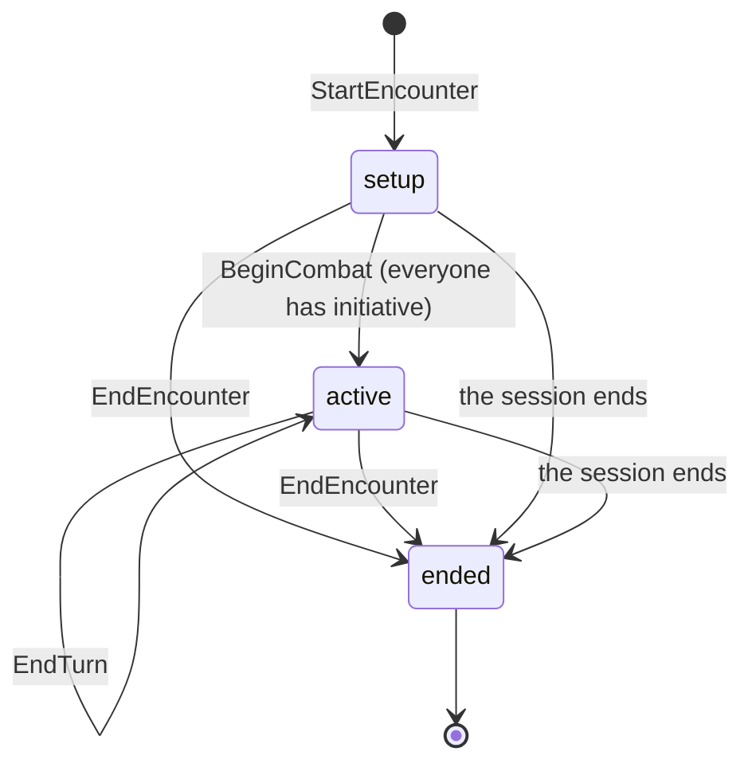
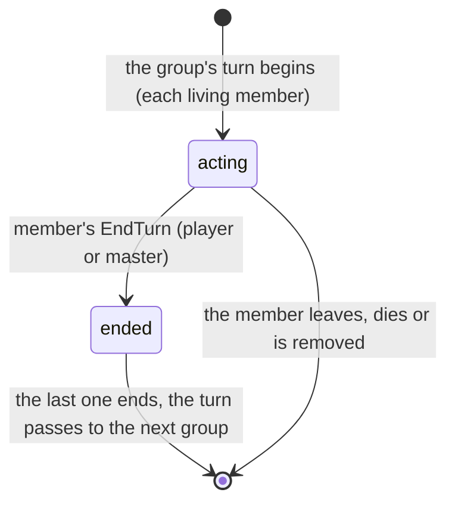

# Combat

A combat (in the code, an *encounter*) lives inside the open session: the master picks who fights, everyone rolls initiative, and turns rotate until the master ends it (MR-013).
The contract is `CombatService` (`proto/meurpg/play/v1/combat.proto`); its events travel on the session stream.
It is a separate service from `PlayService` because combat keeps growing; both are implemented by `play.Service`.

This page covers the lifecycle, the calls, the turn order, the joint turn and what each side sees.
Attacks and damage are in [Attacks and damage](attacks-and-damage.md), movement in [Movement](movement.md), spells in [Casting](casting.md).

## Where the code is

| File | Holds |
| --- | --- |
| `combat.go` | `EndTurn` and `EndEncounter` (the thin handlers) |
| `combat_start.go`, `combat_setup.go`, `combat_join.go` | `StartEncounter`; the initiative, the order of a tie, `BeginCombat` and the roster; who joins and where each one stands |
| `combat_endturn.go`, `combat_turn.go` | The phases of `EndTurn`; the joint turn |
| `combat_place.go`, `combat_surprise.go`, `combat_partedit.go` | "Colocar no mapa"; surprise; removing a part of a pending damage |
| `combat_write.go` | The transaction every change shares (`combatTx`, `write`, `finish`) |
| `combat_view.go` | Who sees what, and the publishers of the live events (`publishEncounterChanged`, `publishTurnChanged`, `publishCombatantMoved`) |
| `combat_rules.go` | The arithmetic, pure and tested without a database |
| `combat_turn_options.go`, `combat_spell_targets.go` | The options of a turn and who each one can target |
| `combat_attack.go`, `combat_damage.go`, `combat_parts.go` | The attack roll, the damage roll and its parts |
| `combat_cast.go`, `combat_spells.go` | Casting a spell and what each kind of spell does to its targets |
| `combat_apply_damage.go`, `combat_hit_points.go`, `combat_take_action.go` | The master settling a hit, NPC hit points, the standard and feature actions |
| `table_effects.go` | The table's costed, healing and temporary hit point actions, the `on_event` hooks of a death save and of a drop to 0, and the pool that recharges on initiative |
| `combat_gate.go` | Why a combatant cannot act now |
| `combat_landing.go`, `combat_pending_view.go` | Where a damage or heal lands, and the pending damage as the viewer reads it |
| `combat_events.go`, `combat_log.go` | Event payloads and the log |
| `combat_vitals.go` | Slots, uses and HP through `character_vitals` |
| `combat_undo.go`, `combat_undo_kinds.go` | Undo |

`RollAttack`, `CastSpell`, `RollDamage`, `TakeAction`, `ApplyPendingDamage` and `DiscardPendingDamage` share one shape: the handler reads the request into a `*Call`, runs the transaction as a `*Flow` whose phases keep the order of the reads, the dice and the writes, and answers from a `*Out`.
The frozen characterization tests pin that order.

Pure rules live in `rules/combat`.

## Lifecycle

A partial unique index (`encounters_one_open_per_session`) guarantees one open combat per session even when two calls race.
Ending the session ends the combat in the same transaction.
The mode (`grid` or `theatre`) is chosen at the start and never changes (see [Theatre of the mind](theatre.md)).

## Calls

### Setup and turns

| Call | Who may | What it does |
| --- | --- | --- |
| `GetStartRoster` | Master, session open | Who would enter a combat started now: the party's living player characters, each with whether it has a token on the fight's map (the battle point's destination or the current map) and the square that token gives it, and whether another character's token holds that square (`shares_square`: it would start with no square). Changes nothing; `StartEncounter` still puts each combatant on its token's square when nobody stands there, and a combat that ends puts each token on its combatant's square (`combat_roster.go`) |
| `StartEncounter` | Master, session open | Creates the combat in `setup`, on the current map (which needs a grid), on a battle point's map, or with none in theatre. Puts the group and NPC copies; each NPC rolls initiative at once. With `monsters`, also puts bestiary monsters in the same transaction (see [Encounters](encounters.md)) |
| `GetEncounter` | Members, filtered | The session's latest combat, including one that just ended, or none |
| `SubmitInitiative` | The player on their own character; the master on any | d20 rolled in the app (`roll_in_app`) or the typed physical d20 (`d20_face`), under RN-18. Only in `setup`. A character creature's roll sets its whole summon group. A player's character that holds a Bardic Inspiration die, or a halfling's 1, gets a question first (`held_roll_offer`, see held-rolls.md) |
| `SetInitiativeOrder` | Master | Orders a tie (same total and bonus) |
| `BeginCombat` | Master | `active`, round 1, the first in the order on turn. Without someone's initiative: `INITIATIVE_MISSING` with who is missing |
| `EndTurn` | The member's player; the master (any) | Ends one member's part of the turn; when the last acting member ends, the turn passes to the next group not defeated and, after the last, the round rises. `aborted` if `expected_combatant_id` is no longer a member who acts. Refused with `PENDING_DAMAGE` (damage to roll, to apply, or a reaction of the combatant on turn pending) unless the master passes anyway (`discard_pending_damage`); `DEATH_SAVE_DUE` for a player's character with a death save to roll (the master too: he rolls it with `RollDeathSave`, in the app or with a typed d20, and then ends the turn); `REACTION_PENDING`, `OPPORTUNITY_PENDING`, `HIDDEN_REVEAL_PENDING` while those wait. If nobody is on turn (the combatant left or its character was deleted) only the master calls, and the turn restarts from the first in the order in the same round |
| `EndEncounter` | Master | `ended`; the players' tokens go where they stopped. Ending again is not an error |
| `AddCombatants` | Master | Reinforcements (NPCs), initiative rolled at once |
| `AddMonsters` | Master | "Pôr no combate" (see [Encounters](encounters.md)) |
| `RemoveCombatant` | Master | Takes someone out; if it was their turn, the turn passes. Refused (`PENDING_DAMAGE`) while a damage the combatant attacked with or took is still to roll or apply. A character's effects go back to game time when it leaves in setup (`effectRowsToCharacters`; its inspiration die is not given back). A creature leaving because its owner or the master dismissed it cannot be refused: the damage waiting on it is written as dropped (`damage_discarded`, before the `combatant_removed`) |
| `SetCombatantSide` | Master | "Aliado" or enemy for an NPC (`side_set`); passes over opportunity offers now between allies |
| `SetCombatantHidden` | Master | Hides or shows an NPC |
| `SetCombatantCover` | Master | Cover by hand (none, half, three-quarters, total); cleared when the combatant moves |
| `SetCombatantConditions` | Master; the player only to end their own concentration | See [Attacks and damage](attacks-and-damage.md#conditions-and-concentration) |

### Acting

| Call | Who may | What it does |
| --- | --- | --- |
| `GetTurnOptions` | The player on their own character; the master on any | What the combatant can do now, with targets, distances, modes and the damage still to roll; answers off turn with everything disabled and the reason |
| `RollAttack`, `RollDamage`, `ApplyPendingDamage`, `DiscardPendingDamage`, `RemoveDamagePart` | See [Attacks and damage](attacks-and-damage.md) | The two-step attack |
| `RequestRollMode`, `AnswerRollModeRequest`, `CancelRollModeRequest` | Player asks; master answers | A mode the server did not suggest |
| `CastSpell`, `PreviewSpellArea`, `ResolveHiddenReveal`, `EndConcentration` | See [Casting](casting.md) | Spells |
| `TakeAction` | The player on their own character, on their turn; the master on any combatant on turn | Standard actions and feature actions; the table's actions that spend several points, heal or give temporary hit points (`spend`, `heal_target_combatant_id`: see [Attacks and damage](attacks-and-damage.md#the-tables-actions-that-spend-heal-and-give-mr-025)) |
| `AnswerRageEnd`, `EndRage`, `UseHitRider` | The barbarian's player / monk's player; master (also a creature's rider) | See [Attacks and damage](attacks-and-damage.md) |
| `UseCreatureAction` | The master, for the NPC on turn | A save action or an action with no roll from the NPC's stat block: see [Attacks and damage](attacks-and-damage.md#a-creatures-actions-and-riders) |
| `SpendLegendaryAction` | Master | The legendary actions of a creature on a text option, at another creature's turn: see [Legendary actions](#legendary-actions) |
| `MoveCombatant`, `GetMoveOptions`, `SpendMovement`, `StandUp` | See [Movement](movement.md) and [Theatre](theatre.md) | Movement |
| `OfferOpportunity`, `WithdrawOpportunity`, `DeclineOpportunity`, `SkipOpportunity` | See [Movement](movement.md); the master's `OfferOpportunity` works in both modes | Opportunity attacks |
| `AnswerReaction`, `MarkReactionRolling`, `ResolveConcentrationSave`, `UseReaction`, `DeclineReaction` | See [Reactions](reactions.md) | Reaction windows |
| `RollDeathSave`, `ConfirmDeath` | See [Death and revival](death-and-revival.md) | The fallen |
| `AdjustCombatantHitPoints` | Master | "Dano/Cura" of an NPC: damage, healing or an exact value, and temporary HP. An NPC taken to 0 HP stops concentrating, with the end a damage to 0 HP has (`endConcentrationAtZero`: the spell's effects, its creatures and the log line); the undo of the adjustment takes that end back with it |
| `EndCombatEffect` | Master | Ends an effect such as Aid (idempotent by key, not undoable) |
| `UndoLastAction` | Master | See [Undo](undo.md) |
| `ListCombatLog`, `GetCombatHighlights` | Members, filtered | See [Combat log and events](combat-log.md), [Highlights](highlights-and-summary.md) |

State errors are `failed_precondition` with the `EncounterBlocked` detail and a reason: `MAP_HAS_NO_GRID` (with the `map_id`), `NO_CURRENT_MAP`, `ENCOUNTER_ALREADY_OPEN`, `NOT_IN_SETUP`, `NOT_ACTIVE`, `NOT_YOUR_TURN`, `NOT_PLACED`, `TOO_FAR` (with `missing_ft`), `SQUARE_OCCUPIED`, `WALL_ON_SQUARE`, `NO_FREE_SQUARE`, `TOO_MANY_COMBATANTS`, and in actions `ACTION_USED`, `BONUS_ACTION_USED`, `REACTION_USED`, `ATTACKS_USED`, `ATTACK_ACTION_FIRST`, `NO_SLOT`, `NO_USES`, `TARGET_OUT_OF_REACH`, `TARGET_DEFEATED`, `TARGET_DEAD`, `COMBATANT_DOWN`, `PENDING_DAMAGE`, `REACTION_PENDING`, `DEATH_SAVE_DUE`, `DAMAGE_ALREADY_ROLLED`, `DAMAGE_NOT_ROLLED`, `NOTHING_TO_UNDO`, `WRONG_DICE_MODE` and more (the enum in `combat.proto` is the list).
Callers never depend on message text; the app turns the code and detail into Portuguese (`combat-errors.ts`).

## Legendary actions

A creature whose stat block has legendary actions has `rules.LegendaryActionsPerRound` (3, SRD 5.1) a round.
What it spent is kept as `creature_spent.legendary_actions` ([Data](../../data/combat.md)).
Only the master spends them, one option at a time, at the option's cost.
Three paths share one rule (`combat_legendary_spend.go`):

| Path | Option kind | What it does |
| --- | --- | --- |
| `SpendLegendaryAction(option_key)` | `text` | Counts the cost and writes `legendary_action_spent`, a master-only event and line. The master plays the option by hand. |
| `RollAttack` with `legendary_option` | `attack` | The attack flow as it is (reaction windows, pending damage, log), made off the creature's own turn. It spends the cost instead of the action, the attacks made, the reaction and the running start. One attack for each spend. It is not a reaction and not the extra action. |
| `MoveCombatant` with `legendary_option` | `move` | A walk by the usual rules with a budget of its own: see [Movement](movement.md#legendary-moves). |

An option of kind `attack` is `LEGENDARY_WRONG_KIND` in `SpendLegendaryAction`, and so is one of kind `move` while the creature stands on a square.
The `ActionKey` of an attack option must be the stat block action of the `attack_key` (`LEGENDARY_WRONG_KIND` otherwise).

The rule is checked before anything is rolled, and again with the spend inside the transaction of the action, so a refused action spends nothing.
It refuses with these reasons:

- `NOT_ACTIVE`: the combat is not running.
- `LEGENDARY_UNAVAILABLE`: the creature is not an NPC with legendary actions, is defeated, is incapacitated, or is in a Haste lethargy.
- `LEGENDARY_OWN_TURN`: the creature has the turn.
- `REACTION_PENDING`: a reaction window or hold is open, so nobody's turn goes on.
- `LEGENDARY_OPTION_UNKNOWN`: the creature has no such option.
- `LEGENDARY_WRONG_KIND`: the option is not of the kind the call makes.
- `LEGENDARY_NONE_LEFT`: the cost is more than what is left.

A creature surprised at the start of the combat cannot spend either.
A player gets `permission_denied`.
The actions come back when the creature's own turn starts (`ResetCombatantTurn`).
A `move` option of a creature with no square (a combat without a map, or a creature not placed) is one the engine cannot walk.
It is offered as text and spent through `SpendLegendaryAction`, with the master-only line and the undo.
The master reads `actions_left`, `usable_now` and, on each option, `affordable` in `Combatant.legendary`.
The text spend is a master-only line (`COMBAT_LOG_KIND_LEGENDARY_SPENT`: creature, option name as the SRD has it, cost).
Its stream hints, `encounter_changed` and `combat_log_changed`, go to the master alone, and so do those of its undo.
The players cannot count the spends.
An attack and a move are the ordinary lines every player reads, with the ordinary hints.
Their event keeps the cost as `spend_cost`, a name that does not say what paid it (RN-20, RN-29).
A legendary attack that a reaction window holds spends nothing while it waits.
The replay the last answer releases spends its cost once, as the master that asked.
Legendary Resistance is a trait of the same stat block: see [Legendary Resistance](creatures.md#legendary-resistance).

## How `play` reads the other modules

| Interface | Implemented by | What for |
| --- | --- | --- |
| `CombatRoster` | `characters.Service` | Who can fight, with initiative bonus, speed and maximum HP (`rules.Derive` for a full sheet; as it stands for a basic one). A character's AC, attacks, standard actions and feature actions (`link.Sheet`); `TurnOptions` with the slots and uses already spent; the spell as the caster casts it (`link.Spell`); a target's save bonus (a basic sheet has none: `Known` false); `MarkDead`, `ReviveDead`, `DamageModifiers`, `SceneOptions`, `PartyLevels`, `MonsterNpc`, `CreatureEyes` |
| `DiceModes` (`ForcedDice`) | Adapter over `campaigns.Service.CampaignDiceMode` | What the campaign forces: nothing, everything in the app, or everything physical (RN-18). The player's preference only sets the default the screen highlights |
| `MapKeeper` (and `MapGrid`, `BattlePoint`, `MapTokens`, `SetTokenPositions`) | `maps.SessionMaps` | The grid, a battle point's map, token positions, and moving the players' tokens at the end |
| `CombatDefaults` | `campaigns.Service` adapter | The table rules (`StoredTableRules`, `CombatWithoutMap`) |

A basic sheet becomes a minimal `rules.Derived` (structured attacks as `basic:0`, `basic:1`, and the ten standard actions), so the engine serves the Goblin as it serves a full sheet.

## The grid and the order

The map has `grid_columns` (4 to 200 squares of 1.5 m across the image's width); rows follow the image's proportion (`round(columns × height / width)`, 1 to 400) and are not stored.
The combat copies the grid when it starts (`encounters.grid_columns` and `grid_rows`), so changing the map's grid afterwards touches nobody.
Each combatant starts on the square of the character's token if it has one (of several copies of an NPC, the first), otherwise without a position: the master places it.
Movement is in [Movement](movement.md).

**The order (RN-19).** Highest total first; on a tie, highest bonus; on a tie of both, the order the master decided (`SetInitiativeOrder`), otherwise the order of entry.
Whoever has not rolled goes last.
The server stores each position (`order_index`) and rebuilds the order on every roll or reinforcement.
A player rolls their own initiative once; the master can correct any value.
Each NPC rolls its own on the server with `crypto/rand`; the physical die is validated by `platform/dice`.

## Joint turn

A turn belongs to a group (MR-013, RN-19): combatants side by side in the order with the same initiative total, players and NPCs, form a group (`groupRuns`, `combat_turn.go`); someone alone on their total is a group of one.
The group is not stored: it is computed from the order and totals when the turn reaches it (`nextTurnGroup`), and `combatants.turn_state` stores the answer (`idle`, `acting`, `ended`) until the turn passes.
Reordering a tie, bringing in a reinforcement or hiding a member mid-turn does not change a turn that began.

- **Who still acts.** `othersActing` counts members whose part has not ended and who are not defeated; a member that dies or is taken to 0 HP (an NPC) never holds the group, and the current member is the first living one (`turnFor`).
- **Start of the turn.** `startTurn` ends what ends at the start of effects, resets for each living member the movement, action, bonus action, Dash, reaction, Shield bonus and the death save due (`ResetCombatantTurn`), and points `current_combatant_id` at the first.
- **"Is it their turn"** is always `actsNow` (in the turn and the part not ended): `MoveCombatant`, `RollAttack`, `RollDamage`, `TakeAction`, `CastSpell`, the death saves, the reactions and `GetTurnOptions`.
  Undo stays closed after an ended part (`turn_part_ended` is not undoable).
- **What each receives (RN-20).** `Encounter.turn_group_ids` and `Combatant.turn_part_ended` only for a group that has a player character, never with a hidden member.
  An NPC-only group reaches the player as the ids they see, with no chosen `current_combatant_id` or total, plus `npc_only_groups` for the plural "os Goblins".
  A player's economy reaches them, the master and the other players of the same group.
- **Events.** `turn_part_ended` (a part ended, the turn still standing) and `turn_ended` (the turn passed), plus the log line "Brisa encerrou a parte dela".
  The line of a part is the master's alone when the member is hidden or its group has no player character, also when the turn waits for the saving throws of effects: the player's log and `combat_log_changed` do not carry it.
  No stream event of its own: `encounter_changed` and `turn_changed` suffice.
- **On the web.** `core/combat/joint-turn.ts` (pure) groups the order; the master's card is `joint-card`, and `end-part` and `joint-others` are the player's.
  `CombatState.applyTurn` reads the combat again when `turn_changed` moves the current combatant inside the same round (a part ended in the group): the event does not say whose part ended. The screen that made the call already holds the answer, which is newer than the event.

## Who sees what (RN-10, RN-20)

The filter runs on the server (`combat_view.go`).
`TestRN20_PlayersNeverReceiveHiddenCombatantsOrNPCNumbers` reads the player's response as the app's JSON and searches it for the hidden combatant and the NPC's numbers.

| What | The master sees | The player sees |
| --- | --- | --- |
| A hidden combatant (a new NPC is born hidden) | All | None: not the id, name or position |
| A hidden one's turn | The combatant | "Vez do mestre": empty `current_combatant_id`, `master_turn` true |
| An NPC's HP and temporary HP | The numbers | One word: Ileso, Ferido, Muito ferido (half or less) or Derrotado |
| Any combatant's AC | `Combatant.armor_class` and `AttackRoll.target_armor_class` | Never: only Acertou or Errou |
| An NPC's initiative | Total, d20 and bonus | Only the order |
| A player's initiative | Everything | The total of every player; the d20 and bonus only of their own |
| A player's HP | The numbers | Their own from the live session; the others' only as "Caído" at 0 HP |
| Speed, movement left, action, bonus action, reaction | All | Only of their own character |
| Which character an NPC is a copy of | Yes | No |

## Idempotency and concurrency

Every write carries `idempotency_key`.
One transaction locks the open session's row, checks the key in `session_events`, changes the rows, writes the event and ends.
A repeated key changes nothing and stores nothing; the response is the combat as it is, and only the generic hints are published (`encounter_changed`, and `combat_log_changed` when the first event was not hidden), because the first call may have died before telling.
An attack's or damage's response is rebuilt from the stored event: a resend never rolls again; another change's key, or the same key with another request (the hash kept on the event), is `invalid_argument`.
Two simultaneous changes wait for each other, so a double tap on "Encerrar turno" never skips two turns: the second brings an `expected_combatant_id` that is no longer on turn and gets `aborted` (`TestEndTurnIsIdempotent`).

## Combat on screen

The session page (`pages/live-session`) reads the combat (`CombatClient.turn.get`, `core/combat`) at every `ready` and after each `encounter_changed` newer than its copy; `CombatState` compares revisions and sets an older copy aside.
`combatant_moved` applies in place; a combatant the screen does not know makes it read. `turn_changed` applies in place only when it is the very next revision of the copy on screen (the master's event carries the combat's `revision`; a player's says 0, with no number to compare, and applies), because a patched copy claims the revision of the event and must hold everything up to it. An event more than one revision ahead (something in between, such as the master setting a character to 0 hit points, is not in the copy), and a turn that moves to a combatant who is down (its death save due is the server's to decide at the start of the turn), and a part that ends inside a joint turn (the event names only the new current combatant, not who ended), make the page read the combat again. An event no newer than the copy changes nothing.
A read that began before one of those events, or before an answer to a call was applied, is dropped when it answers, and the page reads again up to 3 times (`CombatState.changedSince`).
A read that fails is retried once 1.5 s later; after that the next stream event or reconnection reads it.
The "Alvo" of an NPC's attack (`NpcCard`, `defaultTarget`) starts on the nearest hostile creature in reach (hostile: the party against the enemies by `side`), then the nearest hostile out of reach, and never an ally unless no other creature exists. It is worked out again when the options change because the NPC moved, until the master picks a target by hand (`pickedByHand`; a new turn starts clean).
The pass-turn question ("Passar a vez de Toren, que ainda não agiu?", `unactedPlayerOnTurn`) is for a conscious player character who has spent nothing; a character at 0 hit points (down, stable or dying) is never asked: their death save is the whole turn.
The server has already filtered what each sees: the screen only draws what arrives.
`CombatView` (`pages/live-session/combat`) picks the screen: for the master the initiative, the combat and the summary; for a player "Role a iniciativa", the turn with the map and the Move page, and the summary.
Errors become Portuguese through the code and `EncounterBlocked` detail (`combat-errors.ts`); `blockedMessage` is a table of sentences by reason, and the log's `logLine` a table of one builder per kind in `combat-log.ts`.
Dragging a token saves one move at a time per combatant (`MoveSaves`); if the server refuses, the token goes back and the screen says why.
The combat code loads only with the session page.
The grid has its own page (`/campaigns/:id/maps/:mapId/grid`, `MapService.SetMapGrid`) and printing the map another (`/campaigns/:id/maps/:mapId/print`, MR-033, web only; see [Design](../../design/maps.md#printing-pagesmapsmap-print)).

`CombatClient` (`core/combat/combat-client.ts`) holds five parts built on one `CombatClientBase` (the generated client and the keyed sender): `turn` (setting up, turns, actions, undo, log, highlights), `moves` (movement, sides, cover, opportunities, roster), `attacks` (attacks, damage, roll modes, reactions, concentration), `casts` (spells, hidden reveals) and `combatants` (death saves, conditions, effects, hit points). Screens call `api.attacks.rollAttack(...)`, never a forwarder on the client.

**How `CombatView` is put together.** The component (`combat-view.ts`) holds the effects and the calls of the turn, on top of three abstract classes that hold the inputs, the derived values and the parts (`combat-view-state.ts`, `combat-view-derived.ts`, `combat-view-parts.ts`); the logic is in parts it builds in field initializers, each a plain class that reads the screen through a few getters, so each is tested with the same fake `CombatClient`:

- `CombatCalls` (`core/combat`): the one call at a time with its `busy` and `error`, the answer applied and the combat read again after a stale refusal; every other part shares it.
- `MoveFlow`: the "Mover" page, the jump, the master's drag and the reach.
- `CombatSheets`: opens every sheet and dialog and knows which are open.
- `CombatNotices`, `CombatDeaths`, `CombatRage`, `CombatInitiative` and `CombatOffers`: the notices of a form or a concentration that ended, the death saves, the rage question, the initiative and the master's opportunity offers; the template binds them (and `sheets`, `moves`) directly, as `deaths.roll($event)` or `moves.confirmMove($event)`.
- `CombatReads`: what the screen reads from the services around the combat (death-save rule, spell details, roster, beast, familiar).
- `MasterAutoPass` (`core/combat`): the master's reaction clock (see [Reactions](reactions.md)).
- What a sheet is handed is built by pure functions next to it (`attack-sheet/attack-sheet-data.ts`, `cast-sheet/cast-sheet-data.ts`) and what the screen derives by `core/combat/combat-derived.ts`.

The cast sheet and the attack sheet follow the same pattern one level down: `cast-sheet-view.ts`, `cast-result-view.ts` and `attack-sheet-view.ts` are pure; the state several parts share lives in plain classes (`CastDamage`, `CastQuestions`, `ModeRequests`, `AttackQuestions`).
Sheets live in one frame (`sheet-frame`, scrolling inside with a fixed footer) and open through `openSheet` (a sheet on the phone, a dialog from the tablet up).
While a sheet's own request is in the air it cannot be dismissed, so its answer is always shown and a second sheet never starts a second spend.
Each action carries its own `idempotency_key`, made once and resent on the retry; the key follows the request, not the sheet (`ActionKey`): the same values again are a retry and keep it, while another die, slot or target is a new request with a new key.
`SpellCatalog` reads `GetSpellDetails` only when the screen needs it and forgets it on `content_changed` and on every `ready`.

## The master acting for a player's character

The master may make any act of a player's character on its turn (attack, cast, feature, death save, Wild Shape, summon, familiar, Bardic Inspiration, move, end of turn); the server takes the master where it takes the character's player (`mayAct`), on that combatant's turn only.

- **Marked in the log.** A log line the master's hand made for a player's character (the kinds in `actedForPlayerKinds`) carries `CombatLogEntry.by_master`, derived from the event's user against the character's player; every viewer of the line gets the flag, so the player reads "(pelo mestre)" when back. The master's own tools (hit point corrections, conditions, confirming a death) are not marked.
- **No lock.** The player and the master may both act during the turn; the economy is the character's, so the second act reads what the first left.
- **Targets follow the character's eyes.** For an attack or a cast the master makes for a player's character, the target is found as the character's player would find it (`combatTx.actorSight`): a creature the master hid, or an NPC in the dark of a fog map, is `not_found`. `GetTurnOptions` for that character, read by the master, keeps such creatures listed with `TargetInReach.not_seen` and `untargetable` so the screen can dim them. The master's reads of an NPC's turn are untouched.
- **Reaction questions.** A reaction window of a player's character stays answerable by the player and by the master. The master reads `ReactionWindow.unanswered` once the player's first 10 s (`heldPlayerFirst`) pass without an answer. The first answer wins; a later one is refused with `REACTION_ALREADY_ANSWERED` ("Já respondido").
- **Initiative and group checks.** `SubmitInitiative` and `RollForPlayer` take the master for any character, in the app or with a typed d20 (physical dice); `BeginCombat` still refuses with `INITIATIVE_MISSING`, naming who is missing, until every combatant has one.
