# Death and revival

A player character at 0 HP is "Caído" and rolls death saves; the master confirms a death; a dead character can come back by the master's `ReviveCharacter` or by the Revivify spell (RN-03).
The code is `combat_death.go`, `revive.go`, `revivify.go` and `revivify_requests.go`.

## The fallen

A player character at 0 HP is "Caído" (the word comes from `character_vitals`).
Their turn starts with a death save to roll (`death_save_due`, for them and the master), and the turn waits for them.
Whoever drops to 0 HP during their own turn (an opportunity attack, the master's correction) does not owe the save that turn: the first is at the start of the next turn (SRD 5.1; `changeVitals` marks `death_save_rolled`).

```mermaid
stateDiagram-v2
    [*] --> Down: reached 0 HP
    Down --> Down: death save (success or failure), damage at 0 HP (one failure; two on a critical)
    Down --> Stable: 3 successes
    Stable --> Down: damage (both counts were already clear: one failure counts)
    Down --> Dying: 3 failures
    Dying --> Dead: the master confirms (ConfirmDeath)
    Down --> Standing: natural 20, or any heal (1 HP or more): the counts reset
    Stable --> Standing: any heal
    Dying --> Standing: any heal
    Dead --> [*]
```

- **The save.** `RollDeathSave` (the owner, or the master) uses `combat.DeathSave`: 10 or more is a success, less a failure, a natural 1 is two failures, a natural 20 returns with 1 HP through `character_vitals`.
  The d20 is the app's or typed, on each roll (RN-18).
- **Damage at 0 HP.** Damage that hits someone at 0 HP (the master's "Aplicar") does not lower the HP: it adds a failure (`combat.DamageWhileDown`), two on a critical.
- **Stable.** A character that becomes stable has both counts back at zero (`tally` clears the failures and keeps the three successes as the stable marker); damage to a stable character (`failuresWhileDown`) starts the counts over, so it counts one failure.
- **Healing.** Any heal above 0 resets both counts: a spell, Second Wind, the natural 20, the master's HP correction (`AdjustCharacterVitals`) and an undo, all through `changeVitals`.
- **`EndTurn`.** A player who tries it with the save still to roll gets `DEATH_SAVE_DUE` (the master passes the turn anyway).
- **Dying.** With three failures the character is dying: the master sees "Morrendo" and confirms with `ConfirmDeath`, which calls `MarkCharacterDead` (the character becomes `dead` and the player may create another), marks the combatant out of the order and passes the turn if it was theirs.
  For the players the word stays "Caído", with the counts (public, unless the table hides them from everyone but the owner and the master: see [Table rules in combat](table-rules.md#hidden-death-saves)).
  The app never says someone died before the master confirms.
  `ConfirmDeath` cannot be undone: the character is already dead in `characters`.
- **Kept counts.** The counts stay on the combatant's row: the ended combat keeps them for the summary ("Caída: 1 sucesso, 1 falha"), and a new combat starts at 0 and 0.
  A creature never falls: at 0 HP it is defeated and has no death saves (see [Creatures](creatures.md)).
- **Exhaustion** level 6 goes through the same confirmation (see [Lasting effects](lasting-effects.md)).

## Bringing the dead back

Two ways, one function.
The master's `ReviveCharacter` (character service) and the Revivify spell both end in `characters.reviveTx`:

1.
   RN-03 first: the player's other living character refuses it with `LIVING_CHARACTER_EXISTS` and names it; nothing changes.
2.
   Then `status = 'active'` with the lock as it was.
3.
   Then 1 HP through `AdjustVitals`; slots, class uses and hit dice stay.

For a combat that is not ended, `characters.ReviewHost.ReviveInCombat` (`play`) takes the combatant out of `defeated` in the same transaction (`ReviveCombatant`: no death save counted, `turn_state = idle`, so it acts on its next turn in its place in the order) and writes `character_revived` to the combat's log; outside a combat the characters module appends the event to the session.
Neither path is undone by `UndoLastAction`.
The combatant keeps `death_round` and `death_order_index`, set by the same `UPDATE` that sets `defeated` (`SetCombatantHitPoints`, `SetCombatantDeathSaves`), so every path to a death is covered; `Encounter.deaths` lists them for the master (with `fits_revivify` and the switch) and, with the round only, for the owner.

### Revivify in a combat

`CastSpell` with `spell:revivify` branches to `castRevivify` (`revivify.go`): `SpellTarget.dead_target_id`, `material_confirmed` (the diamonds are a reminder the caster ticks; the app keeps no inventory), a slot of the 3rd level or more, and the action.
Everything `PreviewRevivify` offered is checked again in the cast's transaction:

- the target is a dead player character (confirmed by the master) or an NPC;
- it is hidden from nobody the caster's player cannot see;
- it is within touch (5 ft; without a grid the master judges, RN-25);
- its minute has not run out (`windowOf`: `window_rounds` of the `revive` kind in `effects/spells.json`, 10; in the tenth round only up to the place in the order where it died);
- the master did not mark it.

A player gets one `failed_precondition` for all of these, for a target that is not dead and for one that does not exist, so nothing tells a far creature from a hidden or marked one (RN-10); the master is held to the window and his own switch only.
`PreviewRevivify` lists for a player only the targets, and for the master also `unavailable` with `TOO_FAR`, `TOO_LONG_AGO`, `NOT_SEEN`, `HIDDEN` or `MASTER_BLOCKED`.
The cast event is a `spell_cast` with `fx_kind = revive`, `material` and the hit's `revived_character_id` and `death_round`; the log shows the diamonds to the master and the caster, and the round only to the master.

### Revivify out of combat

The app does not count time without a combat, so `RequestRevivify` (the same checks minus the range and the window) writes a `revivify_requests` row in `pending` and spends nothing; the master and the caster's player get `revivify_changed`.
`ConfirmRevivifyTime` (master only; any other caller gets `not_found` for every `pending_id`) answers in one transaction: `within_minute` spends the slot (`spendSlot`), calls `ReviveDead`, appends `character_revived` to the session and marks the request `confirmed`; otherwise it marks it `denied` and spends nothing.
RN-03 failing rolls the whole answer back and the request keeps waiting.
The master's switch `SetRevivifyBlocked` writes `combatants.revivify_blocked` and `characters.revivify_blocked`; a blocked character is `not_found` to a player's request.
`ListRevivifyRequests` lists them.
