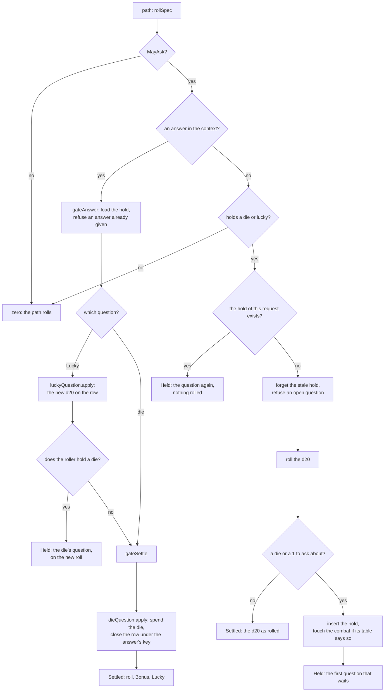

# Held rolls

A d20 that may wait for a question is rolled, kept, asked about and settled in one place: the held-roll gate.
The questions are the halfling's Lucky (RN-35), a Bardic Inspiration die, and, after the result, the fighter's Indomitable and the rogue's Stroke of Luck (RN-35).
Lucky and the die are asked in that order, so the player decides after seeing the d20 and before the result (SRD 5.1).
The code is `held_gate.go`, `held_store.go`, `held_questions.go`, `held_answer.go`, `held_registry.go`, `held_roller.go`, `combat_lucky.go`, `inspiration_held.go`, `inspiration_lucky.go` and `inspiration_outside.go`.

## The thirteen kinds

Whichever path rolls the d20 asks the same gate.

| Kind (`heldKind`) | Path | Where it is held |
| --- | --- | --- |
| Weapon attack | `RollAttack` (the attack is written under the request's key from the request the hold kept, with the mode the gate pinned in it, so the stored hash is the pinned request's; the request made again gives the written attack back, `retryOfHeldAttack`, and the same key for another request is refused) | `inspiration_holds` |
| Spell attack against one target | `CastSpell` (`inspiration_held.go`) | `inspiration_holds` |
| The effect's saving throw | `RollEffectSave` (a retry of a written save answers with its result read back from the event, the Bardic Inspiration die's sides and face included: the event keeps the die in `Res`) | `inspiration_holds` |
| The concentration save | `ResolveConcentrationSave` (a retry of a written save answers with its result read back from the event: the d20, the Bardic Inspiration die in `Res` and the d20 Lucky rolled again) | `inspiration_holds` |
| Scene check | `RollSceneCheck` | `inspiration_holds` |
| Group check | `RollGroupCheck` | `inspiration_holds` |
| Trap search | `SearchForTraps` (out of a combat, and the Search action of a combat: its roll is the combatant's, in the round, and the action is spent once the d20 waits for nobody) | `inspiration_holds` |
| Puzzle hint try | `TryPuzzleHint` (the try row keeps the die in `bonus_sides` and `bonus_face`, so a retry answers with it) | `inspiration_holds` |
| Death save | `RollDeathSave` (a character at 0 hit points, on its turn; the master may roll for an absent player and then waits for the player's first 10 s) | `inspiration_holds` |
| Contest check | `StartContest` (the initiator's d20) and `RespondContest` (the defender's); one kind, since both are an ability check | `inspiration_holds` |
| Hide check | `Hide` (the Stealth check) | `inspiration_holds` |
| Counterspell check | `AnswerReaction` (the ability check of a Counterspell above the slot's level) | `inspiration_holds` |
| Initiative | `SubmitInitiative` (a player's character in SETUP; the master may roll for it and then waits for the player's first 10 s) | `inspiration_holds` |

**Death saves.** The d20 of a death save is gated like a saving throw with no modifier (`deathSaveWrite`): a Bardic Inspiration die the combatant holds or a halfling's 1 keeps it with the counts untouched until the answer, and the die moves the total across 10 (`combat.DeathSaveWith`) but never a natural 1 (two failures) or a natural 20 (back with 1 hit point). The event keeps the die (`Res`, which the undo gives back) and the Lucky reroll. A failed death save is also offered Indomitable once Lucky and the die are answered, and the counts stay untouched until that is answered too. The player's screen shows the question under the counts (`CombatDeaths.held`, read again from the combatant's `held_roll_offer`).

**Contests.** The d20 of each side of a contest is an ability check (SRD 5.1), so a Bardic Inspiration die the combatant holds, or a halfling's 1, keeps it until the player answers. Both paths prepare the check first (`prepareCheck`: the number and the circumstances behind the mode, nothing written), put the d20 through the gate (`gateCheck`) before anything is spent, and finish it with the roll the gate gave back (`finishCheck`): a kept d20 spends nothing, opens no contest and writes no event, and the response carries `held_roll_offer` instead of the contest. Only a player's own check, or the master's for a player's character, can wait (the master after the player's first 10 s); a creature's, an NPC's and a grapple that came from an attack roll as they always did. Both paths share the kind `contest_check`, so the hold keeps the request as an `Any` and `rerunContest` runs the one that asked. A Cutting Words window comes first: the die it takes off is part of the modifier the hold keeps (`gateCheck`), and an answer does not open the windows again (`holdCheck`).

**Hide.** The Stealth check of a Hide is an ability check (SRD 5.1) and uses the same three steps as a contest's (`prepareCheck`, `gateCheck`, `finishCheck`). The d20 is kept before the action (or the bonus action of Cunning Action) is spent and before the attempt is written; the response carries `held_roll_offer` instead of the attempt, and the answer settles it with the die added. A Cutting Words window comes first, as for a contest.

**Counterspell.** The ability check of a Counterspell whose slot is below the spell (`counterspellCheck`) is put through the gate before the reaction or the slot is spent (`counterspellD20`). A kept d20 leaves the window open and writes nothing, and the response of `AnswerReaction` carries `held_roll_offer` instead of the result; the answer runs `AnswerReaction` again with the same request and settles the check with the die added (the line of the check shows it as part of the modifier). A reactor that is not a player's character (an enemy wizard, the master's NPC) rolls at once.

**Initiative.** Initiative is a Dexterity check (SRD 5.1), so `initiativeGate` asks a character that holds a Bardic Inspiration die, or a halfling whose d20 shows a 1, before the total is set. The combat is in SETUP, so the roller is the character alone (no combatant has a die yet) and the die is the one in `character_inspiration`, which carries into the combat when it begins; the hold is the character's, and the combat's read hands the question to the character's combatant (`openInitiatives`, for its player and the master) so a reload finds it. Nothing is written while it waits: the initiative stays unset and the player can still be told "Esperando". The die adds to the total, not to the bonus, so a tie is still told by the same bonus. An NPC's and a creature's initiative, and the master's roll for them, wait for nobody.

**Not held, on purpose:**

- a cast with several attacks or targets (Scorching Ray with more than one ray, Twinned Spell) or one that waited for a reaction window;
- the attack cantrips (they hold as weapon attacks through `RollAttack`);
- the master's rolls (the master never waits here);
- the saving throws the app rolls for a target inside someone else's call (a spell's save, a hit rider's, a trap's, a Hellish Rebuke's), because the target's player is not rolling, so they are never offered Indomitable (see Indomitable below).

One exception: a spell's save against a creature with Legendary Resistance and a use left is held for the master, whether it passed or failed, d20s kept ([Creatures](creatures.md#legendary-resistance)).

For the saves rolled inside someone else's call, a halfling's Lucky is applied automatically: `autoLucky` (`combat_lucky.go`) rolls the first die showing a 1 again in the app, and the reroll is kept in `saveRoll.Lucky` or `actionEvent.Lucky`, shown as `DiceRoll.rerolled`.
`luckySaver` gives it to a player's character only, never to an NPC.

## The gate

The path tells the gate what the roll is (`rollSpec`: the kind, the idempotency key, the request to run again, the roller, how the d20 is counted, whether the roller is lucky and whether the path may ask at all), inside its own transaction (`gateEnv`: only the transaction's queries, never the pool).
The gate answers with a `gateResult`:

- **zero:** only for the two paths that roll their own die (the registry's `ownRoll`): the group check, whose `rollCheck` picks the die, and the trap search, whose Perception search rolls a second die. Every other path gets `Held` or `Settled`, also when nothing is asked, because the gate rolls the d20 itself;
- **`Held`:** the roll waits and nothing but the hold is written; the response carries the question (`lucky_offer` or `inspiration_offer`);
- **`Settled`:** the gate decided the d20, with Reliable Talent applied, the Bardic Inspiration die added (`Bonus`) and the die Lucky rolled again (`Lucky`), for the path's event to keep.

The weapon attack asks `heldBlocked` first, before a reaction window can hold the roll, and `heldMayWait` for the mode's dry run (`chooseMode` writes the mode's reason only when the roll goes on, via `keepReason`).

## The stores

A held roll is a `heldRoll`: the faces, the die that counts, the modifier and total, the request to run again, the two answer keys and the Lucky columns.
One store, `inspirationHoldStore` behind `heldStores`, keeps every roll in `inspiration_holds`, the weapon attack included. It is scoped by the campaign and owned by the combatant in a combat and by the character out of one (see below).
A weapon attack's question moves the combat's revision (the combat view lists it); so does the question of any roll held in a combat. `roll_holds` is empty and unused: nothing reads or writes it, and the table stays.

The row is the character's too (`character_id`, the combatant's own for a creature or the copy of an NPC, which the gate does not name as backed), and it records who rolled (`user_id`, the master for an NPC) and `window_hold`. A reaction window's replay keeps its question under the request's own key with `window_hold` set; a retry of the request never finds it (`byKeyOf` leaves the window's rows out). The gate forgets the stale holds of the weapon attack's own kind only (`ownKindOnly`): the combatant's other rolls refuse it in `heldBlocked`, which a window's replay skips.

**Who owns a hold in `inspiration_holds`.** A combatant owns the holds that name it (`combatant_id` and `encounter_id`) and, when a character backs it, those made before the columns were written (`combatant_id` is `NULL`, found by the character). The creatures and the copies of an NPC share a `character_id` with the one they came from and never own through it. A roller out of a combat owns the holds that name no combatant. One question at a time, the character's list of offers and the deletes when a combat starts or ends all use this rule (`holdOwnerOf`, `ListOpenInspirationHolds`, `DeleteInspirationHoldsOf`). A roll held in a combat now names its combatant and combat, and a hold left by a finished combat is no longer found through its character: it never blocks, and goes with its combat.

One question at a time: an open hold of the roller refuses a new roll (`INSPIRATION_PENDING`).
A weapon attack's Lucky answer keeps the new d20 on the row only when the die's question follows.
A hold made in a combat records its `round`; one of an earlier round, or whose combatant no longer holds the die, is stale and forgotten by the next roll (`heldRoll.stale`).

## The questions are a chain

`chain` is the ordered list of what a held roll may ask: `luckyQuestion` first (the 1 is on the table first, SRD 5.1), `dieQuestion` after it, then `indomitableQuestion` and `strokeQuestion` (the result is known only then).
Each says when it waits (`pending`), what it asks (`offer`) and what its answer writes (`apply`).

- **Lucky** waits while `lucky_index` is set and neither it nor the roll was answered.
  Its answer replaces the die that showed the 1, counts the d20 again by the roll's mode and Reliable Talent, writes the faces and the Lucky columns, and is never asked again.
- **The die** waits while the roller holds one and nothing is answered.
  Its answer is final: it spends the die when the player used it and closes the row under the answer's key.

- **Indomitable** waits while `indomitable_ask` is set and neither it nor the roll was answered.
  It is asked only after the result of the save is known, with the Lucky reroll and the die already in the total.
  Its answer is final: a reroll rolls the d20 again by the save's mode, spends the use and closes the row; keeping the roll spends nothing.

- **Stroke of Luck** waits while `stroke_ask` is set and neither it nor the roll was answered.
  It is asked only after the result is known, with the Lucky reroll and the die already in the total.
  Its answer is final: using it spends the use and closes the row; keeping the roll spends nothing.

A later question, such as a master's reroll, would be one more link with its own columns and rule for who answers. Cutting Words on a check is not a link of this chain: it is a reaction hold of the combat ([Reactions](reactions.md#cutting-words-on-a-check)).

## The registry and the one answer

`heldRegistry` has one `heldKindDef` per kind: whether only its own kind's holds refuse it (`ownKindOnly`), how the pinned request runs again (`rerun`, one per path), the attack and target a question names (the weapon attack only) and how the dice of a pair are pinned in the request.
`answerHeld` is what the five answer RPCs call: `AnswerHeldRoll`, which answers any hold, and `AnswerLucky`, `AnswerBardicInspiration`, `AnswerOutsideLucky` and `AnswerOutsideInspiration`, which are deprecated and still served as adapters, for a tab opened before `AnswerHeldRoll` existed. Each older RPC admits one class of roll (`holdRef.Class`: the attack's or the others'), as it always did, and has its own refusals; `AnswerHeldRoll` conceals any hold the caller may not answer as not found.
It:

1. finds the hold;
2. checks who may answer (`mayAnswerHeld`), before anything about the roll's state is said: a combatant's roll by whoever may act for the combatant, its player or the master; a character's roll out of a combat by its player or the master. Another player is refused: `permission_denied` for a combat's roll through the older attack RPCs, `not_found` everywhere else;
3. checks the answer against the roll as it stands (the question must be open, Lucky's first; an answer already given is answered again, never twice with another key);
4. rolls the reroll or the die the way the campaign has the player roll (RN-18; the master is exempt);
5. runs the pinned request again through the registry with the answer in the context (`heldReply`): the path answers with its own response, still held with the next question, or resolved and written under the roll's key. When the master answers a player's roll, the path runs **as the roller** (`heldReply.as`, read by `heldMember` and `heldRole`, which stand in for the authz lookups at the top of the paths a hold runs again): it finds the roller's character and combatant as the first time, and nobody gets a power they did not have. The answer is the roller's view of the result. A weapon attack's path takes the answerer as it is: the master may act for any combatant.

**The player's first chance.** For `heldPlayerFirst` (10 seconds) after a question is asked, measured from the hold's `created_at` on the service clock, `playerFirst` refuses the master's answer with `failed_precondition` and `ResourceBlocked` `PLAYER_FIRST`, whose `wait_seconds` is the time left rounded up; it runs for every answer RPC, after the state of the roll is checked and before anything is rolled. It does not apply to the player's own answer, to the master's answer to a roll no user plays (an NPC's, a player who left: `rollerPlayer`), or to a repeated answer. The Lucky and die questions of one roll share the hold's time.

**The master's own rolls (E4-10).** The master's roll for a player's character asks like the player's: `saveSpec` (an effect's or a concentration save), `spellMayAsk` (a spell attack) and `mayAskMember` (`RollForPlayer`, a group check) let the roll wait whenever a user plays the combatant or the character (`playedBy`); an NPC's, a creature's or an unplayed character's never waits. The hold names the master as its user, the player reads the question by owning the combatant or the character, and either may answer; the path runs again as the user who rolled (`holdRollerRole` says whether that was the player or the master), and `rerunGroupCheck` picks `RollForPlayer` for the master's group check, whose answer rides in the group check's arm of `AnswerHeldRollResponse`.

When the owner and the master answer at once, the first answer wins; the other, whose write meets the first one's, is told the roll was answered already (`lostTheRace`), and the die is spent once.

## The wire

Every roll that waits asks one question in one shape, `HeldRollOffer`: the hold, the kind, who rolls (the combatant, the character of a player, the name as the viewer reads it), the d20 with its bonus, the question that waits (`LuckyQuestion` first, `DieQuestion` after it, then `IndomitableQuestion` or `StrokeOfLuckQuestion`) and when the roll was held. The nine answers of the paths carry it as `held_roll_offer` beside the deprecated `inspiration_offer` and `lucky_offer` (and the lists `offers` and `lucky_offers` of the state out of a combat), which are still filled for a tab opened before the one question existed, and so does the `Combatant` of a roll held in a combat, for the master and the roller's player only (`heldOfferOfCombatant`). `ListHeldRolls` lists the questions the caller may answer, oldest first: a player's own, the master's every one of the table, in a combat or out of one, leaving out the stale (`heldList`). `AnswerHeldRoll` answers with the path's own response in a `oneof` and the next question of the same roll in `next`.

The question of any roll held in a combat moves the combat's revision (`inspirationHoldStore.asked`), as the weapon attack's always did, so the master and the roller read the combat again. `HeldRollsChanged` is a content-free hint on the stream for the master and the roller's user: the interceptor `heldHintInterceptor` sends it when a path answers with a question, and `answerHeld` when an answer changed one.

## The web

One class asks every question of a held roll: `HeldRollController` (`web/src/app/core/held-rolls`).
A place that rolls builds one in its own field, shows a question with `ask`, and the player's answer goes through `answer`; nothing else in the web calls `AnswerHeldRoll`.

- **The question** is a `HeldRollOffer`. `heldOfferOf` reads `held_roll_offer` and falls back on the older `lucky_offer` and `inspiration_offer` of a response that carries only those (Lucky's first), so one answer path serves both.
- **One key per answer.** The controller sends the answer under an idempotency key that stays while the same answer is repeated (a retry after a lost answer never rolls twice) and is renewed once an answer got through.
  A second tap while one is on the way does nothing.
- **The chain.** `AnswerHeldRollResponse.next` becomes the controller's next question (Lucky's, then the die's, on the new roll); no `next` means the roll was written.
  The place gets the response to finish its own way (`settle`): the attack sheet reads `result.attack`, the cast sheet `result.spell_cast`, and so on. A response that is not the path's own is an error and the question stays.
- **Refusals.** A `failed_precondition` with no detail of the rules is the lost race ("Essa pergunta já foi respondida"), kept apart from a failure in `refusal`; the master's answer inside the roller's first seconds (`MASTER_TOO_EARLY_REASON`, a `ResourceBlockedReason` name) reads as a wait. Everything else is worded by the place, or by `classResourceErrorMessage`.
- **Two answerers, one type.** The roller's player and the master answer the same way. With `master` set, `waitSeconds(now)` counts the seconds left from the offer's `created_at` (`MASTER_WAIT_SECONDS`) on an injectable clock.

`<app-held-roll-prompt>` (`web/src/app/shared/held-roll-prompt`) draws the question for every place and emits the answer: Lucky's "Tirou 1: rolar de novo?" with "Rolar de novo", "Digitar o resultado" and "Ficar com o 1"; the die's "Usar a Inspiração de Bardo (d8)?" with "Somar o d8 (Inspiração de Orla)", "Digitar o resultado" and "Guardar o dado".
The typed face takes 1 to the die's size, and the ways to roll follow the table's dice mode (RN-18).
Its `look` keeps what each place showed: `attack` (the attack sheet shows the d20 in its own result card), `sheet` (the held d20 in a line above the question) and `card` (the d20 and its bonus over the question).

The places: the attack, cast, reaction (concentration save), effect-save, scene-roll, trap-search and group-check sheets, the hint try of a puzzle, and the session panel's Bardic block.

### The master's pending questions

The master answers for a roller who has not (RN-35 asks the roller first). `HeldQuestions` (`core/held-rolls/held-questions.ts`) keeps one `MasterQuestion` per hold, each with a `HeldRollController` built with `master: true`; the master answers through `AnswerHeldRoll` like the roller, rolling in the app or typing a face when the table's dice mode allows it (RN-18).

- **Where the questions come from.** In a combat, from `Combatant.held_roll_offer` of the combat the master already reads (the combat view feeds `sync` from its encounter, and the question is drawn in the roller's row). Outside a combat, from `ListHeldRolls` (`app-held-rolls-panel`), read on open, after a reconnection (the page bumps `heldRollsTick` with its other ticks) and on each `held_rolls_changed` hint (`onHeldRollsChanged`); a read that comes back after a newer one is dropped. `sync` keeps the questions it knows, adds new ones, replaces a question by the next one of the same roll, and closes the ones the server stopped listing ("Brisa respondeu.").
- **The wait.** `MASTER_WAIT_SECONDS` (10) counts from the offer's `created_at`, on an injectable clock; `HeldQuestions.now` moves once a second only while a question waits for its time or a closed one is still on screen (`NOTE_LINGER_MS`), and the interval is cleared otherwise. The server refuses an early answer with `MASTER_TOO_EARLY_REASON`: the question reads it as "wait" (`too-early`), shows the countdown again and keeps the buttons off for at least two more seconds when the clocks differ, then lets the master try again. A plain `failed_precondition` is the lost race: the question ends with "Essa pergunta já foi respondida."
- **What the answer says.** A master's answer that ends the roll is worded from the path's result (`answeredText`, `settledRoll`): "Você respondeu por Brisa: rolou de novo e tirou 14 (19 com o bônus)."; a result with no d20 says only what was chosen.
- **The roller.** `HeldRollController` records the answers sent from this browser (`markAnsweredHere`, from the moment the answer goes). A place that shows the roller their question (`HeldVanishWatch`: the combat view, the Bardic block) tells "O mestre respondeu por você." when the question is gone, or moved on to the next, without an answer from this browser. The roller's view carries no result of the master's answer, so that is the whole text.

A group check that holds only a Bardic die, with no 1, closes its sheet and leaves the question to the session panel.

## Lucky (halfling, RN-35)

SRD 5.1: a 1 on the d20 of an attack roll, ability check or saving throw may be rolled again, and the new roll stands.
`link.Traits.Lucky` (`trait:lucky`) reaches the path with the sheet; for the checks, `link.SceneOption.Lucky` (set by `characters/combatscene.go`).
The gate rolls a lucky character's d20 itself.
A roll with no 1 and no die comes back settled at once; a 1 is kept in the row with `lucky_index`, the die that shows it in the order rolled (with advantage or disadvantage the question comes for either die and only that die is rolled again).
The response carries `lucky_offer` (a `LuckyOffer`; with no attack and no target outside combat); on the combatant it is `Combatant.lucky_offer`, visible to the master and the owner only; `inspiration_offer` is unset while Lucky waits.
Only the player who rolls for their own character is asked.

The answer is `AnswerLucky(hold, reroll, roll)` for a weapon attack and `AnswerOutsideLucky(hold, reroll, roll)` for the others: the d20 rolled again in the app or typed (RN-18), or the 1 kept.
The path runs again for the stored request, in its own transaction, which first writes the answer in the row (`lucky_answer_key`, `lucky_to`; a second answer is refused there).
When the roller also holds a die, the row stays open with the new d20 and the response carries `inspiration_offer` on the new roll; otherwise the roll settles at once under the key it came with.
Each path keeps the reroll where it keeps its d20: the attack's event (`actionEvent.Lucky`), the scene roll's event, a group member's `contestRoll`, the trap search's and saves' `actionEvent.Lucky`, the cast's `castHit.Lucky`, `puzzle_hint_tries.lucky_index`.
Views show it as `rerolled` (`DiceRoll`, `CheckRoll`, `EffectSaveResult`, `CombatLogEffect`; the concentration line adds "Sortudo: 1 → 14.").
Lucky spends nothing, so the undo has nothing to put back.

While Lucky waits, the character's other rolls, `AnswerBardicInspiration` and the die's answer are refused with `LUCKY_PENDING`.
`GetOutsideInspiration.lucky_offers` lists the question for a reload.
A hold of a combat round that waits for Lucky needs no die: `dieOf` gives the combatant and round even when it holds none, and `heldRoll.stale` forgets it only when the round or combat is over; out of a combat it is not an orphan when the dice run out (`DeleteOrphanInspirationHolds`).

## Bardic Inspiration on a roll

### In combat

`RollAttack` of a combatant that holds a die rolls (or takes) the d20 and keeps it in an `inspiration_holds` row with the request, resolves nothing, and answers with `inspiration_offer` (the d20, the die, who gave it).
The offer is also on the combatant (`Combatant.inspiration_offer`), so it survives a reload.
`AnswerBardicInspiration(hold, use, roll)` runs `RollAttack` again for the stored request, with the d20 already rolled and, when the player uses the die, the die rolled in the app or typed and added to the total; the attack resolves against the combat as it is then, and the die leaves the combatant.
A second attack while a question waits is `INSPIRATION_PENDING`; a hold of an earlier round is forgotten; the master may answer for anyone.
The undo of the attack gives the die back.

**With a reaction window** (Cutting Words holds the roll before anything is rolled): the window first; when it is answered the held attack is replayed, the d20 is rolled with the bard's die already off the bonus, and only then is it kept for the question.
The replay ends without an event (`ambientDoneError.asking`), and the hold's key gets the `#window` suffix because the request's own key belongs to the event that stood for the held attack.
The answer never opens the windows again.

In a combat only attack rolls wait on the weapon path; the saving throws the app rolls for a spell and a combatant's ability checks are resolved in the same call as the roll.
For a player's own character in a combat, the leveled spell attack against one target, the effect's saving throw and the concentration save are also held (`inspiration_holds`): the cast is held before the slot or the action is spent, the answer runs the cast again with the held d20 in `spellModes.pre`, and the cast event keeps the used die in `actionEvent.Die` so the undo holds it again.
The concentration save's window stays open while the question waits.

### Out of a combat (`inspiration_outside.go`)

The die a character holds between fights is a row of `character_inspiration` (one per character, so a second die is refused; `sides`, `source_character_id`, `seconds_left`).
It is not a `character_effects` row: effects come from a spell or an action and are added to a roll by themselves, while this die is the player's to decide on after the d20.
It uses the effects' clock: `seconds_left` (10 minutes, 600) moves only when the master moves game time (`advanceGameTime`, which a rest also calls), and a die with no time left is deleted, so any rest ends it.

- `GiveBardicInspirationOutside(target_character_id)` (the bard's player, their own character; `COMBAT_OPEN` while a combat runs) spends the `bardic_inspiration` use through `spendResource`, inserts the row and writes the `inspiration_given` event under the idempotency key.
  `TARGET_REFUSED` is the bard itself, a character that holds a die, or a character that is not a player's; `NO_USES_LEFT` and `NOT_AVAILABLE` as in combat.
- `GetOutsideInspiration` answers each caller their own: the holder the die and the rolls that wait; the bard the uses and the party (a player character's name only); the master every die held.
- **The carry.** `effectsToCombat` calls `dieToCombat`, which moves the row onto the combatant (`combatants.inspiration_*`; expiry round = the combat's round + the whole rounds left, none when less than a round is left) and deletes it.
  `effectsToCharacters` calls `dieToCharacters`, which gives it back with the rounds left in seconds.
  The row and the combatant's die are never both set.
- **Using it.** A roll path asks the gate after it knows the modifier and the mode.
  `dieOf` finds the die: the character's row out of a combat, the combatant's own die while a combat is active and the character is in it; `spendDie` uses up whichever it is.
  A character with a die has the d20 rolled once and kept in `inspiration_holds` (the request, faces, modifier and total; unique on the request's key, so a retry finds it); the response carries `inspiration_offer`.
  A second roll while the question waits is `INSPIRATION_PENDING`.
- `AnswerOutsideInspiration(hold, use, roll)` (the roll's owner; another player's hold or another campaign's is `not_found`) rolls the die in the app or takes the typed face and calls the same RPC again with the stored request and the faces; in that transaction `dieQuestion.apply` deletes the die (`failed_precondition` if it is gone), adds the face to the total and answers the hold under the answer's key.
- The scene check writes the face in the event (`bonus_sides`, `bonus_face`; the total holds it and the pass or fail follows the total); the group check in the member's roll (`CheckRoll.bonus_die_*`).
- The offer of every kind is an `OutsideInspirationOffer` (the d20 and bonus the player already sees, never a DC or an armor class).
  `GetOutsideInspiration` lists the caller's offers wherever the die is.
- Holds of a character are deleted when the die goes back to it (`dieToCharacters`).

## Indomitable (fighter 9, 13 and 17)

SRD 5.1: a saving throw that fails may be rolled again, the new roll must be used, and the feature comes back with a long rest.
The resource is `indomitable` (1, 2 or 3 uses per long rest, `effects/fighter.json`).
It is offered after the result, a new link of the chain (`held_indomitable.go`).

- **Covered.** The effect's saving throw (`RollEffectSave`), the concentration save (`ResolveConcentrationSave`) and the death save (`RollDeathSave`) of a player's character.
- **Not covered.** A saving throw rolled inside someone else's call is never held, so it is never offered: a spell's, a trap's, a hit rider's, the Dexterity save against Hellish Rebuke.
  The rolls of the master and of NPCs never ask.
- **Held only with a use left.** `heldGate` reads the vitals (`indomitableLeft`) only for a save that may ask. A fighter with no use left, or a character without the feature, is never held.
- **Pass or fail is the server's.** `saveRule` (`rollSpec.Save`) decides: a save fails when the total is below the DC; a death save fails when the total is below 10, a natural 1 included and a natural 20 never.
  The question is asked only when the save failed, and says "Falhou na salvaguarda. Usar Indomitável para rolar de novo?".
- **Hidden DC.** When the table hides the save DC (`rules.ShowSaveDC` off), or dice of effects (Bless, Bane, a maneuver die) come after the gate and move the total, the question comes on every save the roller could use it on and says nothing of the result, so nothing leaks.
- **The answer.** "Rolar de novo" rolls the save's d20 again by the same mode (RN-18: in the app, or typed; a pair of dice takes `typed_faces`), spends the use through the vitals and replaces the roll for everything after, even when it is worse.
  It is never asked about again. "Manter" spends nothing.
- **Order.** Lucky, then the Bardic Inspiration die, then Indomitable. The die answered while Indomitable follows is kept on the row (`die_answer_key`, `die_used`) because the row stays open.
- **The die and the reroll.**
  - A reroll leaves the Bardic Inspiration die out of the total: the die went with the roll it was added to, it stays spent, and the new roll counts as it falls plus the modifier (`gateSettle`).
  - Keeping the roll keeps the die in the total.
  - A Lucky reroll that came before is not listed once Indomitable rolls the d20 again, since the new roll replaces the one Lucky made.
- **Log and undo.** The event keeps `actionEvent.Indomitable` and the result lists a `Reroll` with source `feature:indomitable-1-use`.
  The log reads "Indomitável: 4 → 15" for the owner and the master (RN-10). The undo of a death save gives the use back (`spendResourceBack`).
  The effect save and the concentration save are not undoable events (they are not in `undoableKinds`), so the use they spent is not given back.
- **Refusals.** While the question waits, the character's other rolls are refused with `INDOMITABLE_PENDING`.
  The master answers after the player's first 10 seconds, as for Lucky.
- **Columns** of `inspiration_holds` (migration 00290): `indomitable_ask`, `indomitable_failed`, `indomitable_answer_key`, `indomitable_from`, `indomitable_to`, `die_answer_key`, `die_used`.
- **Wire.** `IndomitableQuestion` in `HeldRollOffer.question`, `IndomitableAnswer` in `AnswerHeldRollRequest`.

## Stroke of Luck (rogue 20)

SRD 5.1: a missed attack hits instead, or a failed ability check counts the d20 as a 20, once per short or long rest.
The resource is `stroke_of_luck` (1 use, short rest, `effects/rogue.json`).
It is offered after the result, a new link of the chain (`held_stroke.go`, `combat_attack_stroke.go`).

- **Covered.**
  - The weapon attack (`RollAttack`) and the spell attack against one target (`CastSpell`) of a player's character.
  - The scene check, the group check, the contest check and the Hide check.
  - The ability check of a Counterspell.
- **Not offered.**
  - The trap search and the puzzle hint try go through the gate but give it no `strokeRule`, so they never ask.
  - The saving throws, the group check of a saving throw and the death save: the feature is for attacks and ability checks.
  - A cast with several attacks or targets, the initiative and the rolls inside someone else's call.
  - The rolls of the master and of NPCs never ask.
- **Held only with a use left.** `heldGate` reads the vitals (`strokeAvailable`) only for a roll that may ask. A rogue with no use left, or a character without the feature, is never held.
- **Miss or failure is the server's.** `strokeRule` (`rollSpec.Stroke`) decides.
  - An attack misses when `combat.ResolveAttackFrom` says so with the armor class read lazily (`Prepare`); a natural 1 misses whatever the bonus.
  - The miss is judged against the armor class the app knows at the gate, when the roll is held.
    A Shield reaction the target takes later raises the armor class after that, so it never opens the question for an attack that hit at the gate.
  - A check fails when the total is below the DC.
  - A check with no DC is never asked, and a natural 20 on the d20 never asks, since nothing changes.
  - The question says "Errou o ataque" or "Falhou no teste" only when the roller may know it.
- **Hidden outcome.** The question is blind (it comes on every eligible roll and says nothing) when the table hides what it would tell.
  - A scene whose DC is hidden, a group check whose DC is hidden, and a contest or Hide, whose result depends on the other side.
  - An attack with dice of effects (Bless, Bane) after the gate, which move the total.
  - The Counterspell check is not blind, since its DC is known.
- **The answer.** "Usar" spends the use through the vitals (`spendUse`: the combat's resources in a combat, the vitals outside one) and settles the roll.
  - An attack becomes a hit, not a critical hit, a natural 1 included. The d20 stays as it fell, and the `Reroll` lists the same face in `from` and `to`.
  - A check gets d20 = 20 and a total of 20 plus the modifier, replacing the roll for everything after.
  - "Manter" keeps the result and spends nothing.
  - It is never asked about again.
- **Order.** Lucky, then the Bardic Inspiration die, then Indomitable or Stroke of Luck. Indomitable asks about saves and Stroke of Luck about attacks and checks, so a roll never meets both.
- **Log and undo.** The event keeps `Stroke` (`actionEvent`, `castHit`, `sceneRollEvent`, `reactionEvent`) and the result lists a `Reroll` with source `feature:stroke-of-luck`.
  The log reads "Golpe de Sorte" for the owner and the master only (RN-10).
  - The undo of an attack, of a spell attack and of a Counterspell gives the use back (`strokeBack`, `spendResourceBack`).
  - The scene, group, contest and Hide checks are not undoable events, so the use they spent is not given back. A short or a long rest returns it.
- **Refusals.** While the question waits, the character's other rolls are refused with `STROKE_OF_LUCK_PENDING`.
  The master answers after the player's first 10 seconds, as for Lucky.
- **Columns** of `inspiration_holds` (migration 00291): `stroke_ask`, `stroke_failed`, `stroke_answer_key`, `stroke_from`.
  `DeleteOrphanInspirationHolds` keeps a hold with `stroke_ask` set, since a question outside a combat has no die.
- **Wire.** `StrokeOfLuckQuestion` in `HeldRollOffer.question`, `StrokeOfLuckAnswer` in `AnswerHeldRollRequest`.
- **Web.** A card with "Usar" and "Manter" and no roll picker.
  A player outside a combat reads the question again from `ListHeldRolls`, since the older lists of the outside state do not carry it.
