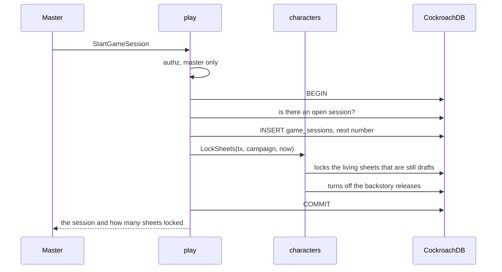
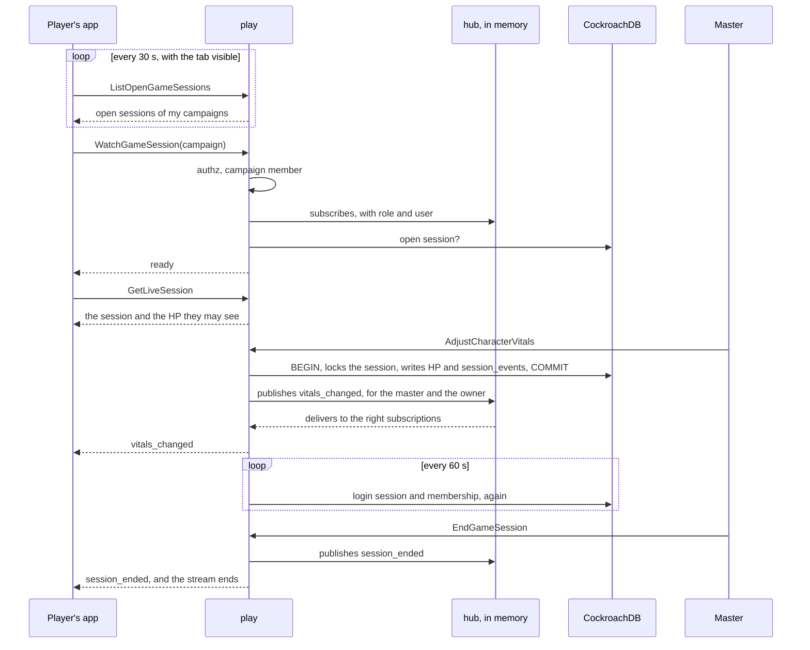

# Live session

A game session locks the sheets, and an open session streams the table's changes to everyone in the campaign.
Players learn of a session by a light poll and follow it through a stream that exists only while the session page is open and visible (ADR-0005).
The master chooses what everyone sees: the current map and one gallery image.

## Starting a session

`StartGameSession` locks the sheets in the same transaction that opens the session (RN-01).
`play` does not touch the `characters` table: it calls `SheetLocker.LockSheets`, which `characters.Service` implements.
`LockSheets` does not receive the caller, because it is "the system" of RN-01.

- **One open session per campaign.** The check inside the transaction gives the clear error; a partial unique index guarantees the rule when two calls race.
- **A character created later** stays a draft until the next session starts, because `LockSheets` runs at every start.
- **Ending unlocks nothing.** The sheet stays locked between sessions.

## The notice and the session link

- **The notice (RN-06) is a poll.** With the tab visible and the person signed in, the app calls `ListOpenGameSessions` every 30 seconds and once when the tab becomes visible again.
  It is two index reads (the person's campaigns, through `campaigns`, and their open sessions, through the partial index of `game_sessions`).
  The poll lives in `web/src/app/core/play/open-sessions.ts`, which loads the generated client with a dynamic `import()` on the first poll.
  The notice does not appear on the campaign page, on session pages, or for the campaign's master.
- **The session link** is `/campaigns/<id>/session`, with no secret (RN-07).
  The server decides:
  - without sign-in: `unauthenticated`, and the app sends to sign-in;
  - a non-member or pending member: `not_found` ("Peça um convite ao mestre", without the campaign name);
  - no open session: `failed_precondition` `GameSessionBlocked` `NO_OPEN_SESSION` ("Nenhuma sessão em andamento").

## The stream

`WatchGameSession` sends `ready` first, after registering the subscription.
Only then does the app read the snapshot (`GetLiveSession`), so no change falls in the gap.
A change may arrive before the snapshot: the `revision` of `CharacterVitals` says which is newer, and for the current map and the shown image the app keeps what the stream said while the snapshot was on its way.
A snapshot the server refuses for good (`permission_denied`, `invalid_argument`) is not asked again; the page says there is no access or offers "Tentar de novo".
A reconnection also reads the map, the fog vision and the creatures again.
The master's page reads the map again on `xp_changed`, because converting a treasure to XP changes its point and publishes no map event.

Events, after `ready`:

| Event | Meaning |
| --- | --- |
| `heartbeat` | Every 25 s (`DefaultHeartbeat`) |
| `vitals_changed` | A character's HP, slots or resources changed; to the master and the owner |
| `attack_hit` | The master applied the damage of an attack to a player's character (`ApplyPendingDamage`): the pending damage's id, the attacker's name (empty when it is hidden: the sheet says "Alguém acertou você"), the amount that landed and the type in Portuguese. To that character's player only. The sheet says it as the attack's ("A Armadura animada acertou você: 5 de dano de concussão.") and not as "O mestre ajustou", also when the attacker is hidden and its log line is the master's alone; a real adjustment keeps "O mestre ajustou". It carries no hit points: they come with `vitals_changed` |
| `current_map_changed`, `map_changed`, `token_moved`, `vision_changed`, `trap_noticed` | The map (see [Architecture](../maps/README.md#maps-points-and-tokens)) |
| `shown_image_changed`, `left_images_changed` | The image on show and the list left with the players |
| `encounter_changed`, `turn_changed`, `combatant_moved`, `combat_log_changed` | Combat (see [Combat log and events](combat-log.md)); a master-only text spend of legendary actions sends `encounter_changed` and `combat_log_changed` to the master alone ([Combat](combat.md#legendary-actions)) |
| `scene_changed`, `scene_check_rolled`, `stage_changed`, `notes_changed` | Scenes (see [Scenes and stage](scenes-and-stage.md)) |
| `xp_changed` | The campaign's XP changed |
| `spell_casts_changed` | A cast outside combat started, finished or ended |
| `creatures_changed`, `revivify_changed`, `character_changes_requested`, `character_resubmitted`, `character_revived`, `content_changed` | Contentless hints; the app reads again |
| `puzzle_changed` | A puzzle changed; only its id |
| `calling_you` | The master's nudge, to one player's streams only |
| `free_roll_rolled` | A table roll of the free dice roller, carried whole, to everyone; a secret roll is sent to nobody ([The free dice roller](free-dice-roller.md)) |
| `session_message_added` | A line of the scene's conversation, carried whole, to its readers' streams only ([The conversation](#the-conversation-of-the-scene)) |
| `master_typing` | The master is typing: content-free, to the players |
| `session_ended` | The session ended; the event carries the session id |

**Who sees what.** The master sees the `CharacterVitals` of every living player character; a player sees only their own character's, in the snapshot and in the stream.
`TestPlayersSeeOnlyTheirOwnVitals` checks both, and `TestRN11_LiveSessionNeverCarriesMasterNotes` checks that nothing in the live session carries the master's notes.

### When the stream ends

| When                                                                   | How it ends                                                                                | What the app does                                                                                                                                             |
| ---------------------------------------------------------------------- | ------------------------------------------------------------------------------------------ | ------------------------------------------------------------------------------------------------------------------------------------------------------------- |
| The master ends the session                                            | `session_ended`, then an end without error                                                 | Shows "Sessão encerrada"                                                                                                                                      |
| 10 minutes of stream (`DefaultMaxLifetime`)                            | End without error                                                                          | Reconnects and reads the snapshot again                                                                                                                       |
| The server is shutting down                                            | End without error: `play.Service.Close` runs when shutdown begins                          | Reconnects                                                                                                                                                    |
| The app fell 16 events behind (`DefaultBuffer`)                        | `unavailable`                                                                              | Reconnects and reads the snapshot again                                                                                                                       |
| A message goes 30 s without arriving                                   | `Send` fails; `close_reason` `client_gone`                                                 | Reconnects                                                                                                                                                    |
| The person already has 4 streams in the campaign (`DefaultMaxPerUser`) | The new stream is served; the person's oldest ends with `unavailable` (`live.ErrReplaced`) | The old page, if still open, reconnects with backoff. Behind the load balancer the server is not told when a page goes away, so the old ones are usually dead |
| No unary call for 3 minutes (`instanceIdleLimit`)                      | `unavailable` at the next check (every 60 s)                                               | Reconnects, now to the active revision, and reads the snapshot again                                                                                          |
| The login session ended (sign-out, revoked, idle, 30 days)             | `unauthenticated` at the next check (every 60 s)                                           | Sends to sign-in                                                                                                                                              |
| The person left the campaign                                           | `not_found` at the next check                                                              | "Peça um convite ao mestre"                                                                                                                                   |

The app reconnects with growing delay (1 s, 2 s, 4 s, up to 30 s, with jitter) and only with the tab visible.
With the tab hidden for 2 minutes it closes the stream itself and reopens with a fresh snapshot when the tab returns (see [Operations](../../operations/reference.md#live-session-stream)).

### In the app

The session page (`web/src/app/pages/live-session`) follows these rules in `core/play/live-stream.ts`.
The session's view-models (`live-session.types.ts`) and generated-client source (`live-session-source.live.ts`) sit beside it because `core/` needs them.

The map page of a player (`/campaigns/:id/maps/:mapId`) follows the table too, through `MapLive` (`pages/maps/map-page/map-live.ts`), a thin client over the same `LiveStream` that translates only the map events.
The master's map page is the editor and reads again on its own actions and on focus, because its own strokes would echo back as `map_changed`.
On `map_changed`, `vision_changed` or `trap_noticed` for the map on screen, on any combat event and on `current_map_changed`, it reads the map through `MapState.refresh()`, one read per burst (150 ms).
A `token_moved` moves the token in place and only the player's fog is read again.
A `ready` after the first reads again.
With no open session the stream ends by itself and opens again when the window regains focus.
The map page counts as one of the person's streams in the campaign (the cap of 4).
It adds no read a player could not already make (RN-10).

## The hub

The hub keeps each campaign's subscriptions in server memory (`play/live`).
Publishing never waits: each subscription has a 16-event buffer, and the one that fills is dropped instead of delaying the master's change.
With two instances, a change on one would not reach streams on the other, so the service runs with `max-instances = 1` while fan-out is in memory (see [Operations](../../operations/README.md)).
When one instance is not enough, a shared channel (a CockroachDB changefeed or Pub/Sub) takes the hub's place and nothing above changes.
During a release the old revision keeps its open streams while new calls reach the new revision.
An instance that received unary calls and then goes 3 minutes without one ends its streams at their next check (`platform/traffic`).
Each app reconnects to the active revision.
A visible page calls the server every 30 seconds, so the active instance never meets that condition.
An instance that never received a call (a cold start) never ends its streams this way.
Until the old instance ends them, those streams hear nothing: release between sessions ([Operations](../../operations/runbook.md#release-a-new-version)).

The stream goes through the same HTTP stack as everything else.
The request log wraps the response in a `statusRecorder` that passes `Flush` through, `CrossOriginProtection` refuses a POST from another origin (the stream is a POST with `Content-Type: application/connect+json`), the server speaks HTTP/1.1 and h2c, and there is no `WriteTimeout`.
`TestLiveStreamIsNotBuffered` opens the stream through the real server in HTTP/1.1 and in h2c and checks that `ready` and `vitals_changed` arrive at once.

## The master's correction of vitals

`AdjustCharacterVitals` changes only the values in the request, each from 0 up to the maximum (temporary HP up to 999).
The "Ajustar" sheet also returns spent uses of resources (`resources_used`), sets the hit dice by size (`hit_dice_used_by_die`, or the older sum `hit_dice_used`, never both) and, for a druid in a beast form, the beast's hit points (`wild_shape_hit_points_current`; 0 ends the form).
In one transaction `play` locks the session row, checks the key, asks `characters` to store and writes the `session_events` row; after `COMMIT` it publishes `vitals_changed`.
The same key again stores and publishes nothing and answers with the HP as they are now (`TestAdjustCharacterVitalsIsIdempotent`); the same key for another character is `invalid_argument`.
Event numbers come out as 1, 2, 3 without a gap, even for simultaneous corrections (`TestSessionEventsAreOrderedPerSession`).
A correction during a combat with that character raises the encounter's revision and publishes `encounter_changed`.

## The nudge

`NudgePlayer` ("Chamar a atenção") is stream-only: it writes nothing, no `session_events` row and no log line.
After the master and the open session are checked, and the character is found among the campaign's living player characters with a player, it publishes `calling_you` (an empty message) to that player's streams alone (`live.Audience{UserID}`); not even the master's stream hears it (RN-10).
A player who is not connected misses it.
One nudge per character every 10 seconds (`nudgeCooldown`, kept in memory in `nudgeBook`); a second is `resource_exhausted`.

## The conversation of the scene

The scene has a live text feed (MR-051, RN-36): the master narrates and speaks as the campaign's NPCs, the players speak as their own character or out of character.
It belongs to the game session; the app opens it with `ListSessionMessages` and then follows `session_message_added`.
The tables are in [Data](../../data/play.md#session_messages-and-session_message_readers).

**Who may read a line** is one rule, in one query shape (`GetSessionMessageForReader`, `ListSessionMessages`, `ImageInReadableMessage`): the master, or `for_everyone`, or the author, or a row of `session_message_readers`.
Every path asks it: the page, the cursor, the summary, the stream event, the image route and the audio route.
A line the caller may not read is answered exactly like one that does not exist (`not_found`, or `404` on the audio route), so nothing tells it exists (RN-10).

| Call | Who | What it does |
| --- | --- | --- |
| `SendSessionMessage` | A member | Speaker kind and rules by role; text 1 to 2,000 characters; the key is required (`idem`). Per-user rate limit ([Abuse limits](../api.md#abuse-limits)). The master may name readers (players of the campaign) and attach one gallery image; a player writes to everyone or to the master alone (`only_master`) and as their own living character only (RN-18) |
| `ListSessionMessages` | A member | The readable lines of a session (the open one by default), newest last, paged with `before_id`; `voice_enabled` says the app may show "Ouvir" |
| `SignalMasterTyping` | The master | A content-free hint that expires on its own (6 s); one per campaign every 2 s, the rest are answered and sent to nobody |

- **The stream.** After `COMMIT`, `session_message_added` carries the line itself.
  The hub's audience names one user, so the line is published once per reader (`live.Audience{UserID}`) and once to the master; a line for everyone goes to the master and the players (`Audience{Master}` plus `Audience{Players}`), never twice to the same stream.
  `master_typing` goes to `Audience{Players}` and says nothing but how long to show it.
  A retry with the same key stores and publishes nothing.
- **The image.** A fog map's image is copied first (`PrepareShow`, as "mostrar imagem"), so the raw image of a fog map never leaves through a line.
  `GET /images/{id}` lets a player open an image when a line they may read carries it or an NPC with it as its portrait speaks (`LiveSession.ImageInConversation`); the fog map's own image stays refused (MR-036).
- **The speaker** is kept with the line (`speaker_name`, `speaker_image_id`), so a renamed or deleted NPC does not change what was said. The line of an NPC hidden on the stage keeps its name and no portrait (`withoutHiddenPortrait`), so the image route never opens a hidden NPC's portrait; the stage is untouched, and only `SetSpeaker` shows the NPC.
  A line of an erased account stays and reads "Jogador removido" (`author_removed`).
- **The summary** (`GetSessionSummary.conversation`) holds the last 500 lines the caller may read, with `conversation_truncated` when there are more.

### In the app: the conversation

The web side has two layers, split so the rules are tested without a DOM.

- **`core/conversation`** is plain TypeScript, built in field initializers by the session page (`live-session-deps.ts`), not injected.
  `ConversationClient` wraps `SendSessionMessage`, `ListSessionMessages` and `SignalMasterTyping`; the caller makes the idempotency key.
  `ConversationState` holds the lines (oldest first, kept once by id wherever they come from: a page, the stream, the answer of the reader's own send), the sends in flight, the unread count and the typing hint.
  `message-view.ts` has the pure builders: `viewLine` words and classifies one line for its reader, `readersSummary` and `chooserLine` word the "Para" button and the chooser's live line, `buildSendRequest` checks a draft (text trimmed, 1 to 2,000 characters; a player never names readers, the master never says "só o mestre") before a line is shown as sent.
  `ListenController` plays the voice of one line at a time through a plain audio element created on a tap (see [Design](../../design/session.md#the-conversation-of-the-scene)).
  `conversation-errors.ts` maps the calls' failures to Portuguese sentences.
- **`pages/live-session/conversation`** draws it: the panel, the line, the two composers, the audience chooser, the listen button, the phone's tabs and the roster that names speakers and readers. The client never filters or counts a line it was not sent (RN-10), and the typing hint has no text.

The panel is a lazy part of the session page (an `@defer` block opened by `ConversationSlot`), so its code is a chunk of its own and not part of the first download. On a computer it is wanted once the session is live; on a phone, when the "Conversa" tab is first opened. The page-level `ConversationState` listens from the start so the tab can count news before the panel exists.

- **The stream.** The page routes `session_message_added` and `master_typing` from the live stream to the state. The first `ready` reads the newest page (`sync`); "Carregar anteriores" reads older ones with `before_id`.
- **Unread.** A line of someone else that arrives while the conversation is not on screen (a phone's other tabs, or the browser tab hidden) adds one; showing the conversation clears it. The reader's own lines never count.
- **Sending.** A line is shown at once as "sending". When the server answers, the line it returns takes its place. If the call fails the line stays with the reason and "Tentar de novo", which sends the same request with the same key, so a line that did reach the server before the connection dropped is stored and published once.
- **After a reconnect.** The state reads the gap (`readGap`, up to a few pages of `ListSessionMessages`) and joins it to what is on screen by id, so nothing is shown twice and nothing is missed. While reconnecting the panel says so.
- **Typing.** The master's composer calls `SignalMasterTyping` at most once in two seconds (the server limits it too); the hint on the players' screens expires by itself.
- **No Web Storage.** Nothing of the conversation, the voice or a draft goes to `localStorage`, `sessionStorage` or IndexedDB (`web/src/no-web-storage.spec.ts` guards it).

The e2e specs are `conversa.spec.ts` (who reads a line, RN-36) and the conversation scans in `a11y.spec.ts`.

### The voice ("Ouvir")

Narrator and NPC lines can be heard; players' lines are text only.
`GET /session-messages/{id}/audio` serves the voice to the readers of the line: the same session, membership and readers rule as the line (`404` for everything else, no oracle), then:

1. The stored file `campaigns/<campaign>/voice/<line>` is served (`Cache-Control: private, no-cache`, `Vary: Cookie`, the line's id as ETag; ranges work).
2. If none exists, one voice is made at a time per line (`voiceFlights`; a second request waits for the first and does not pay again). The making is detached from the request that asked, since the others who wait still want it, but it is bounded: it has its own timeout (3 minutes) and it is canceled when the last reader leaves, so a voice nobody waits for does not hold the gate or call the model; the next request starts it again, under a server-wide gate that counts the day's voices (`audio_made_at`, Brasília days) against `TTS_DAILY_LIMIT` (`429`, reason `DAILY_LIMIT_REACHED`).
3. `voice.Generator.Speak` calls Gemini (`GEMINI_TTS_MODEL`) with the narrator's voice or the NPC's (`voice.ForNPC`: a hash of the NPC's id over a short list of voices that speak Portuguese well) and answers a WAV; it is stored like an image and served from then on. The older models answer raw 16-bit PCM (`audio/L16;codec=pcm;rate=…`), which gets a WAV header; the newer ones answer a WAV file (`audio/wav`, or bytes that start with `RIFF`), which is kept byte for byte, never wrapped twice. Either is refused above 10 MiB.

Without a key and a model (and without `TTS_GENERATOR=fake`) the route answers `412` with `failed_precondition`, reason `OFF`, after the readers check, and `ListSessionMessages.voice_enabled` is false.
The file is never autoplayed by the server's answers: the app plays it only when the reader taps.
The model's text is the line's text, sent to Google as the images' prompts are ([Privacy](../../privacy.md)).

## What the session shows

The open session shows everyone two independent things: the current map and a gallery image the master chooses to show (MR-028), like a portrait or a card.
Both live on the session's row in `game_sessions`, and only the master changes them, only with the session open.

|              | Current map                                                                     | Shown image                                                                   |
| ------------ | ------------------------------------------------------------------------------- | ----------------------------------------------------------------------------- |
| Call         | `SetCurrentMap(map_id)`, empty to clear                                         | `SetShownImage(image_id, keep, audience)`, empty to stop; `SetShownImageAudience(audience)` |
| Column       | `current_map_id`                                                                | `shown_image_id`, `shown_image_keep`, `shown_image_audience`                  |
| Reveals      | The map (RN-10): the player always sees the current map                         | Only the image itself, while it is shown                                      |
| Snapshot     | `GetLiveSession.current_map_id`; the app reads the map with `MapService.GetMap` | `GetLiveSession.shown_image` (id, caption, size, URLs), only for who is in its audience |
| Stream       | `current_map_changed`, to everyone                                              | `shown_image_changed`, to the master and to the players whose picture changed |
| When deleted | `DeleteMap` sets it to null and sends an empty `current_map_changed`            | `DeleteGalleryImage` sets it to null and sends an empty `shown_image_changed` to the master and the players of the image's audience only (`LiveSession.ShownImageViewers`) |

- A new session starts with neither.
  An ended session keeps the last ones, only as a record.
- Choosing the current map reveals it, in the transaction that locks the session row.
  If the master hides the current map afterwards, the player keeps seeing it while it is current (`Map.revealed` false, `Map.current` true).
- The shown image does not open the gallery.
  The player receives the image's id only while it is shown; afterwards `GET /images/{id}` answers `404` to them unless the master left it with the players (see [Architecture](../maps/images.md#serving-images) and [MR-028](../../product/stories.md#mr-028-show-an-image-to-the-players)).

### Who sees the image

The shown image has one audience, `game_sessions.shown_image_audience`, and the audience is the same rule on the read, the stream and the image route (RN-10):

| Audience | Who sees it | When |
| --- | --- | --- |
| `table` (`WHOLE_TABLE`) | Every member | The only one with no scene open or a scene open to everyone; the master may pick it at any time ("Mostrar a toda a mesa") |
| `scene` (`SCENE_PLAYERS`) | The master and the players of the scene open to only some players, so it follows `SetSceneAudience` | The default while such a scene is open (`resolveAudience`); `SCENE_NOT_PARTIAL` if asked with none |
| `chosen` (`CHOSEN_PLAYERS`) | The master and the players of `game_session_image_viewers` ("Mudar quem vê") | Picked in the show call or with `SetShownImageAudience`: any player of the campaign (`playersOf`, `authz.IsActivePlayer`), also the player of a dead character |

- **The read.** `GetLiveSession.shown_image` is unset for a player outside the audience (`shownImageFor`); the master gets the image with `ShownImage.audience`.
- **The image route.** `maps.playersSeeImage` asks `LiveSession.ImageShownTo(user, image)` (one query, `ShownImageSeenBy`), so a player taken out is `404` on their next request, also on `If-None-Match`.
- **The stream.** `shown_image_changed` goes to the master with the audience, to the players who see the image now with the image, and to the players who saw an image and do not any more with no image (the update they already get when an image stops being shown); a player who never saw it hears nothing (`imageMove`, `publishImageMove`). The same image with the same audience, in any order of the players, sends nothing.
- **When the scene stops being the image's** (it closes, another one opens, or it opens to everyone) the image stays with the players who were in: `settleShownImage` turns `scene` into `chosen` with them, in the same transaction, and tells the master alone. The same image shown again with no audience keeps its own.
- **Tests.** `TestImageAudience_*` (play) and `TestRN10_AShownImageReachesOnlyItsAudience` (leak test: a needle and a positive control for each audience, the narrowing and the widening, on the read, the stream and the route).

### Images left with the players

The master can leave the shown image with the players ("Deixar com os jogadores", MR-028): it leaves the screen but stays in a list the players see until the master takes it away.
The list belongs to the campaign, so it is the table `campaign_left_images` (`campaign_id`, `image_id`, `left_at`; cascade on the campaign and the image), not a `game_sessions` column.
The switch of the image currently shown belongs to the session: `game_sessions.shown_image_keep`, off by default and back to off when the shown image changes.

| Call                                       | What it does                                                                                                                                                                                                                                                        |
| ------------------------------------------ | ------------------------------------------------------------------------------------------------------------------------------------------------------------------------------------------------------------------------------------------------------------------- |
| `SetShownImage(image_id, keep, audience)`  | `keep` is the switch. The master turns it on by calling again with the same image (no event: players do not know about it). With it on, stopping or swapping moves the image to the list, in the transaction that locks the session, left only with the players who saw it; `EndGameSession` does the same |
| `ListLeftImages(campaign_id)`              | Any active member, with or without a session: oldest to newest, with the same URLs as the shown image; a player reads only the images left with them, the master every one with its `audience`                                                                      |
| `TakeBackLeftImage(campaign_id, image_id)` | Master only: removes the image from the list (it stays in the gallery); `not_found` if it is not there                                                                                                                                                              |
| `left_images_changed`                      | A contentless hint to the master and the players the image was left with: an image was left, taken back or deleted                                                                                                                                                  |

The table belongs to the `maps` module (the images route reads it); `play` writes it through `MapKeeper` (`LeaveImage(…, audience)` inside its transaction (an image left again keeps the widest audience of the two leavings, `ImageAudience.Union`), `ListLeftImages(user, master)`, `TakeBackImage`, which answers who it was left with).
The audience is `campaign_left_images.audience_everyone` and `campaign_left_image_viewers`; the route reads it with `ImageIsLeftWith(user)`.
`GetLiveSession.shown_image_keep` tells the master whether the switch is on; the player always receives `false`.
