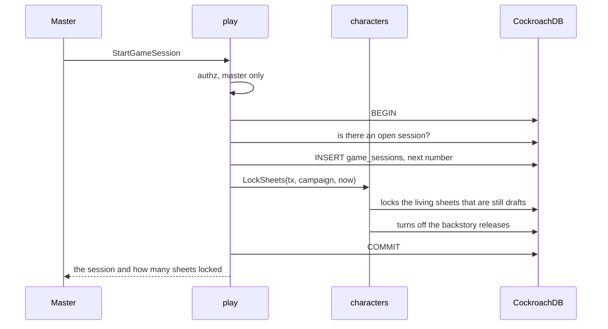
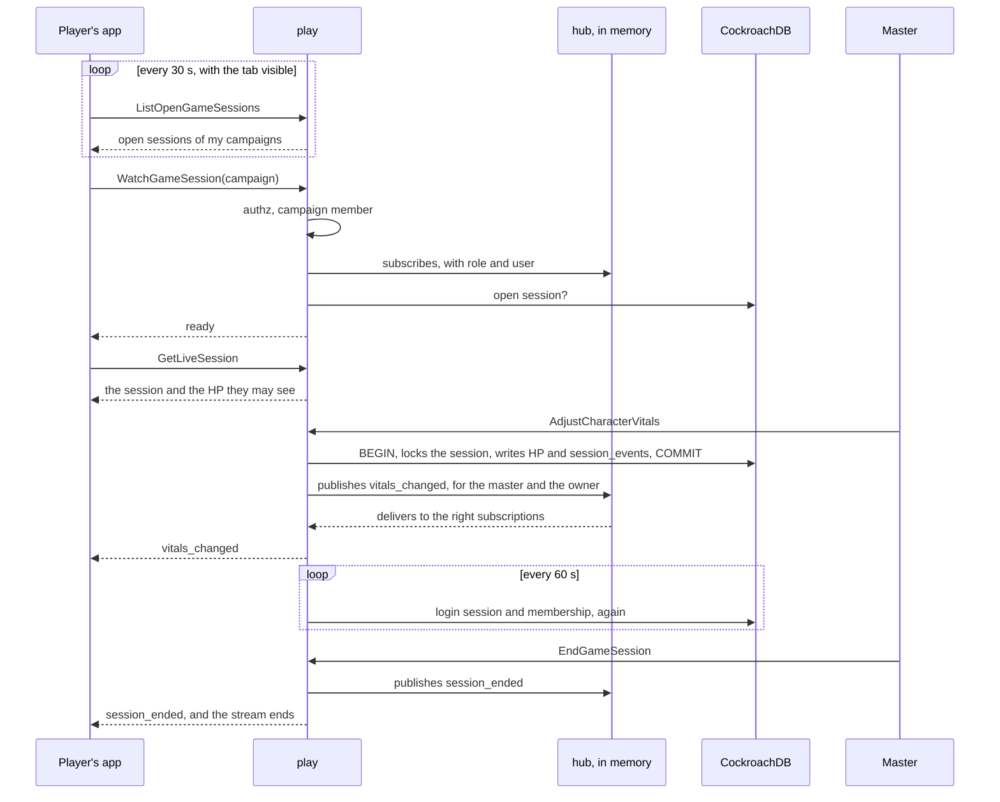

# Live session

A game session locks the sheets, and an open session streams the table's changes to everyone in the campaign.
Players learn of a session by a light poll and follow it through a stream that exists only while the session page is open and visible (ADR-0005).
The master chooses what everyone sees: the current map and one gallery image.

## Starting a session

`StartGameSession` locks the sheets in the same transaction that opens the session (RN-01).
`play` does not touch the `characters` table: it calls `SheetLocker.LockSheets`, which `characters.Service` implements.
`LockSheets` does not receive the caller, because it is "the system" of RN-01.

- **One open session per campaign.** The check inside the transaction gives the clear error; a partial unique index guarantees the rule when two calls race.
- **A character created later** stays a draft until the next session starts, because `LockSheets` runs at every start.
- **Ending unlocks nothing.** The sheet stays locked between sessions.

## The notice and the session link

- **The notice (RN-06) is a poll.** With the tab visible and the person signed in, the app calls `ListOpenGameSessions` every 30 seconds and once when the tab becomes visible again.
  It is two index reads (the person's campaigns, through `campaigns`, and their open sessions, through the partial index of `game_sessions`).
  The poll lives in `web/src/app/core/play/open-sessions.ts`, which loads the generated client with a dynamic `import()` on the first poll.
  The notice does not appear on the campaign page, on session pages, or for the campaign's master.
- **The session link** is `/campaigns/<id>/session`, with no secret (RN-07).
  The server decides:
  - without sign-in: `unauthenticated`, and the app sends to sign-in;
  - a non-member or pending member: `not_found` ("Peça um convite ao mestre", without the campaign name);
  - no open session: `failed_precondition` `GameSessionBlocked` `NO_OPEN_SESSION` ("Nenhuma sessão em andamento").

## The stream

`WatchGameSession` sends `ready` first, after registering the subscription.
Only then does the app read the snapshot (`GetLiveSession`), so no change falls in the gap.
A change may arrive before the snapshot: the `revision` of `CharacterVitals` says which is newer, and for the current map and the shown image the app keeps what the stream said while the snapshot was on its way.
A snapshot the server refuses for good (`permission_denied`, `invalid_argument`) is not asked again; the page says there is no access or offers "Tentar de novo".
A reconnection also reads the map, the fog vision and the creatures again.
The master's page reads the map again on `xp_changed`, because converting a treasure to XP changes its point and publishes no map event.

Events, after `ready`:

| Event | Meaning |
| --- | --- |
| `heartbeat` | Every 25 s (`DefaultHeartbeat`) |
| `vitals_changed` | A character's HP, slots or resources changed; to the master and the owner |
| `current_map_changed`, `map_changed`, `token_moved`, `vision_changed`, `trap_noticed` | The map (see [Architecture](../maps/README.md#maps-points-and-tokens)) |
| `shown_image_changed`, `left_images_changed` | The image on show and the list left with the players |
| `encounter_changed`, `turn_changed`, `combatant_moved`, `combat_log_changed` | Combat (see [Combat log and events](combat-log.md)) |
| `scene_changed`, `scene_check_rolled`, `stage_changed`, `notes_changed` | Scenes (see [Scenes and stage](scenes-and-stage.md)) |
| `xp_changed` | The campaign's XP changed |
| `spell_casts_changed` | A cast outside combat started, finished or ended |
| `creatures_changed`, `revivify_changed`, `character_changes_requested`, `character_resubmitted`, `character_revived`, `content_changed` | Contentless hints; the app reads again |
| `puzzle_changed` | A puzzle changed; only its id |
| `calling_you` | The master's nudge, to one player's streams only |
| `session_ended` | The session ended; the event carries the session id |

**Who sees what.** The master sees the `CharacterVitals` of every living player character; a player sees only their own character's, in the snapshot and in the stream.
`TestPlayersSeeOnlyTheirOwnVitals` checks both, and `TestRN11_LiveSessionNeverCarriesMasterNotes` checks that nothing in the live session carries the master's notes.

### When the stream ends

| When | How it ends | What the app does |
| --- | --- | --- |
| The master ends the session | `session_ended`, then an end without error | Shows "Sessão encerrada" |
| 10 minutes of stream (`DefaultMaxLifetime`) | End without error | Reconnects and reads the snapshot again |
| The server is shutting down | End without error: `play.Service.Close` runs when shutdown begins | Reconnects |
| The app fell 16 events behind (`DefaultBuffer`) | `unavailable` | Reconnects and reads the snapshot again |
| A message goes 30 s without arriving | `Send` fails; `close_reason` `client_gone` | Reconnects |
| The person already has 4 streams in the campaign (`DefaultMaxPerUser`) | The new stream is served; the person's oldest ends with `unavailable` (`live.ErrReplaced`) | The old page, if still open, reconnects with backoff. Behind the load balancer the server is not told when a page goes away, so the old ones are usually dead |
| The login session ended (sign-out, revoked, idle, 30 days) | `unauthenticated` at the next check (every 60 s) | Sends to sign-in |
| The person left the campaign | `not_found` at the next check | "Peça um convite ao mestre" |

The app reconnects with growing delay (1 s, 2 s, 4 s, up to 30 s, with jitter) and only with the tab visible.
With the tab hidden for 2 minutes it closes the stream itself and reopens with a fresh snapshot when the tab returns (see [Operations](../../operations/reference.md#live-session-stream)).

### In the app

The session page (`web/src/app/pages/live-session`) follows these rules in `core/play/live-stream.ts`.
The session's view-models (`live-session.types.ts`) and generated-client source (`live-session-source.live.ts`) sit beside it because `core/` needs them.

The map page of a player (`/campaigns/:id/maps/:mapId`) follows the table too, through `MapLive` (`pages/maps/map-page/map-live.ts`), a thin client over the same `LiveStream` that translates only the map events.
The master's map page is the editor and reads again on its own actions and on focus, because its own strokes would echo back as `map_changed`.
On `map_changed`, `vision_changed` or `trap_noticed` for the map on screen, on any combat event and on `current_map_changed`, it reads the map through `MapState.refresh()`, one read per burst (150 ms).
A `token_moved` moves the token in place and only the player's fog is read again.
A `ready` after the first reads again.
With no open session the stream ends by itself and opens again when the window regains focus.
The map page counts as one of the person's streams in the campaign (the cap of 4).
It adds no read a player could not already make (RN-10).

## The hub

The hub keeps each campaign's subscriptions in server memory (`play/live`).
Publishing never waits: each subscription has a 16-event buffer, and the one that fills is dropped instead of delaying the master's change.
With two instances, a change on one would not reach streams on the other, so the service runs with `max-instances = 1` while fan-out is in memory (see [Operations](../../operations/README.md)).
When one instance is not enough, a shared channel (a CockroachDB changefeed or Pub/Sub) takes the hub's place and nothing above changes.
During a release the old revision keeps its open streams while new calls reach the new revision, so those streams hear nothing until they end or the page reloads: release between sessions ([Operations](../../operations/runbook.md#release-a-new-version)).

The stream goes through the same HTTP stack as everything else.
The request log wraps the response in a `statusRecorder` that passes `Flush` through, `CrossOriginProtection` refuses a POST from another origin (the stream is a POST with `Content-Type: application/connect+json`), the server speaks HTTP/1.1 and h2c, and there is no `WriteTimeout`.
`TestLiveStreamIsNotBuffered` opens the stream through the real server in HTTP/1.1 and in h2c and checks that `ready` and `vitals_changed` arrive at once.

## The master's correction of vitals

`AdjustCharacterVitals` changes only the values in the request, each from 0 up to the maximum (temporary HP up to 999).
The "Ajustar" sheet also returns spent uses of resources (`resources_used`), sets the hit dice by size (`hit_dice_used_by_die`, or the older sum `hit_dice_used`, never both) and, for a druid in a beast form, the beast's hit points (`wild_shape_hit_points_current`; 0 ends the form).
In one transaction `play` locks the session row, checks the key, asks `characters` to store and writes the `session_events` row; after `COMMIT` it publishes `vitals_changed`.
The same key again stores and publishes nothing and answers with the HP as they are now (`TestAdjustCharacterVitalsIsIdempotent`); the same key for another character is `invalid_argument`.
Event numbers come out as 1, 2, 3 without a gap, even for simultaneous corrections (`TestSessionEventsAreOrderedPerSession`).
A correction during a combat with that character raises the encounter's revision and publishes `encounter_changed`.

## The nudge

`NudgePlayer` ("Chamar a atenção") is stream-only: it writes nothing, no `session_events` row and no log line.
After the master and the open session are checked, and the character is found among the campaign's living player characters with a player, it publishes `calling_you` (an empty message) to that player's streams alone (`live.Audience{UserID}`); not even the master's stream hears it (RN-10).
A player who is not connected misses it.
One nudge per character every 10 seconds (`nudgeCooldown`, kept in memory in `nudgeBook`); a second is `resource_exhausted`.

## What the session shows

The open session shows everyone two independent things: the current map and a gallery image the master chooses to show (MR-028), like a portrait or a card.
Both live on the session's row in `game_sessions`, and only the master changes them, only with the session open.

| | Current map | Shown image |
| --- | --- | --- |
| Call | `SetCurrentMap(map_id)`, empty to clear | `SetShownImage(image_id, keep)`, empty to stop |
| Column | `current_map_id` | `shown_image_id`, `shown_image_keep` |
| Reveals | The map (RN-10): the player always sees the current map | Only the image itself, while it is shown |
| Snapshot | `GetLiveSession.current_map_id`; the app reads the map with `MapService.GetMap` | `GetLiveSession.shown_image` (id, caption, size, URLs) |
| Stream | `current_map_changed`, to everyone | `shown_image_changed`, to everyone |
| When deleted | `DeleteMap` sets it to null and sends an empty `current_map_changed` | `DeleteGalleryImage` sets it to null and sends an empty `shown_image_changed` |

- A new session starts with neither.
  An ended session keeps the last ones, only as a record.
- Choosing the current map reveals it, in the transaction that locks the session row.
  If the master hides the current map afterwards, the player keeps seeing it while it is current (`Map.revealed` false, `Map.current` true).
- The shown image does not open the gallery.
  The player receives the image's id only while it is shown; afterwards `GET /images/{id}` answers `404` to them unless the master left it with the players (see [Architecture](../maps/images.md#serving-images) and [MR-028](../../product/stories.md#mr-028-show-an-image-to-the-players)).

### Images left with the players

The master can leave the shown image with the players ("Deixar com os jogadores", MR-028): it leaves the screen but stays in a list the players see until the master takes it away.
The list belongs to the campaign, so it is the table `campaign_left_images` (`campaign_id`, `image_id`, `left_at`; cascade on the campaign and the image), not a `game_sessions` column.
The switch of the image currently shown belongs to the session: `game_sessions.shown_image_keep`, off by default and back to off when the shown image changes.

| Call | What it does |
| --- | --- |
| `SetShownImage(image_id, keep)` | `keep` is the switch. The master turns it on by calling again with the same image (no event: players do not know about it). With it on, stopping or swapping moves the image to the list, in the transaction that locks the session; `EndGameSession` does the same |
| `ListLeftImages(campaign_id)` | Any active member, with or without a session: oldest to newest, with the same URLs as the shown image |
| `TakeBackLeftImage(campaign_id, image_id)` | Master only: removes the image from the list (it stays in the gallery); `not_found` if it is not there |
| `left_images_changed` | A contentless hint to everyone: an image was left, taken back or deleted |

The table belongs to the `maps` module (the images route reads it); `play` writes it through `MapKeeper` (`LeaveImage` inside its transaction, `ListLeftImages`, `TakeBackImage`).
`GetLiveSession.shown_image_keep` tells the master whether the switch is on; the player always receives `false`.
