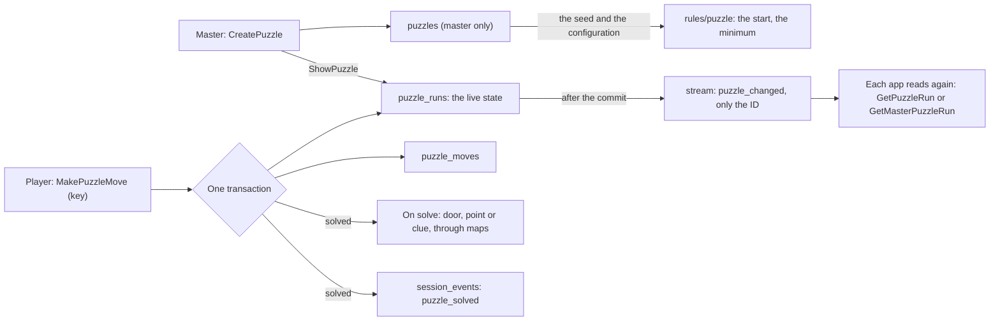
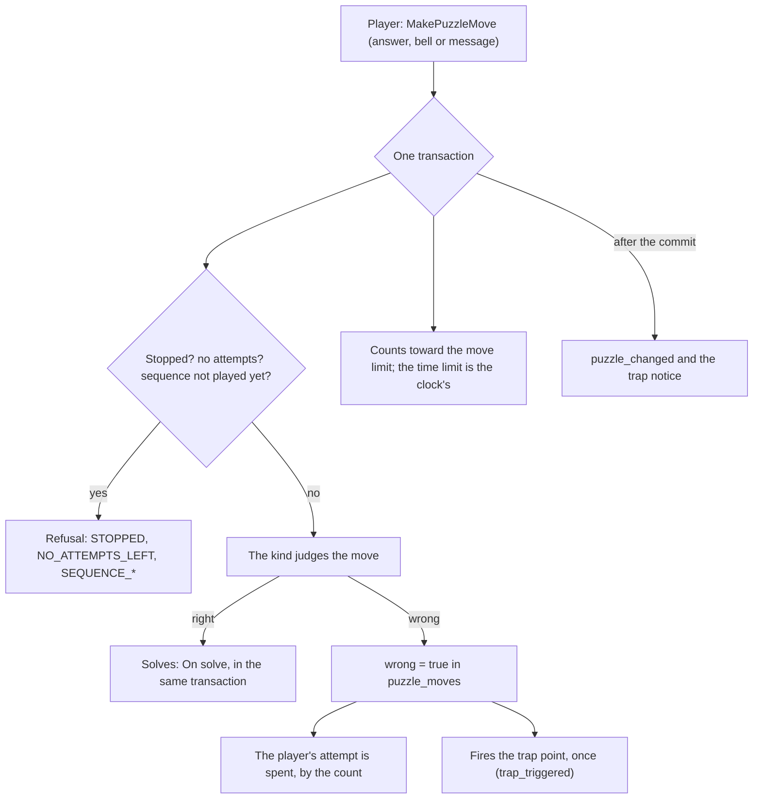

# Puzzles

Puzzles (MR-038, RN-27) belong to `play` because they are played inside the session: the master makes them in the campaign, shows one to the open session's players, and they solve it live.
The code is `backend/internal/play/puzzles*.go` (with `puzzles_rules.go` and `puzzles_hints.go`), the arithmetic is `backend/internal/rules/puzzle` (`answers.go`, `cipher.go`, `sequence.go`) and the API is `proto/meurpg/play/v1/puzzles.proto` (`PuzzleService`).
The queries are the `Puzzles` block of `play`'s `queries.sql`; the tables are in [Data](../../data/README.md#modules-and-tables).

There are six kinds: "Apagar as luzes", the combination lock, the rotating symbols, the riddle, the sequence and the cipher.

## The arithmetic

`rules/puzzle` is pure: no database, clock or draw; the seed is an input, and the same seed always gives the same start.

- **Apagar as luzes** (3 to 7 on a side; a tap flips the light and its four neighbours) keeps the panel in a `uint64`.
  The start is taps drawn from the seed; one that cancels itself (the solved panel) or ends up less than 3 taps from solved is refused and drawn again.
  The minimum number of taps is solved over GF(2): Gaussian elimination gives a solution and, when the matrix is singular (4 × 4 with a kernel of 2⁴ elements and 5 × 5 of 2², so a panel may have several solutions or none), the server looks at all the kernel's sums for the one with fewest taps.
- **The lock** has 2 to 6 wheels of digits, letters or our eight runes (Lua, Chama, Onda, Raiz, Olho, Estrela, Pedra, Folha); a move turns one wheel by one, wrapping around the alphabet.
- **The rotating symbols** have 3 to 6 pillars and 3 to 6 symbols of ours (Corvo, Lobo, Serpente, Coruja, Cervo, Peixe), with optional links (turning a pillar also turns those it lists, in the same direction, so turning back undoes it).
  The start comes from the target by drawn turns, never already solved nor less than 3 turns from it (if 64 draws in a row are too easy, the first that is not the target counts); the minimum number of turns is a breadth-first search over at most 6⁶ = 46,656 states.
- `go test ./internal/rules/puzzle -run '^$' -bench .` measures the minimum search.

## The kinds in the service

- **Each kind is one piece** (`puzzleKind`, `puzzles_kinds.go`): check what the master wrote, generate the start, apply a move, say whether it is solved, compute the minimum and strip from the configuration what the player does not read.
  Storage, rounds, the repeat-guard key, "Ao resolver", hints and who sees what never look inside a kind.
  The configuration, the answer, the state and the move are a `oneof` per kind in `puzzles.proto`.
  A new kind is an implementation of `puzzleKind` and a case in `kindOf` and in `allKinds`.
  `judges()` says whether a move may be wrong; `move` returns a `moveOutcome` (the state, what changed, whether it was wrong, the step and, in the riddle and cipher, whether it was right: their state is empty, the answer is the move).
- **One run per (session, puzzle)** (`puzzle_runs`), created on showing.
  Every change follows the same lock order: the session row, the puzzle's and the run's.
  So a session event always gets the next number, and a move waits for a "Recomeçar" in progress.
  "Mostrar" on an already shown puzzle changes nothing; a closed one returns to the round's start.
  "Recomeçar" returns to the same start; "Gerar outro começo" draws a new seed and start (lights and pillars only; the lock refuses), before or after showing (before, it prepares the run and players see nothing until "Mostrar").
  Loose hints and the move history stay.
- **`expected_revision`.** The master's actions create nothing, so they carry no idempotency key; four carry instead the revision of the run the card shows: "Recomeçar", "Gerar outro começo", the next hint and "Tocar a sequência".
  When the run is at another revision (a player moved, another tab acted, or the first call worked and its answer was lost), the server changes nothing and refuses with `STALE_REVISION`; the card reads the run again and says in place that the puzzle changed, and nothing is retried by itself.
  "Fechar" carries none.
  A failure with no answer at all (`unavailable`, `aborted`, `deadline_exceeded`, `unknown`) also makes the card read the run again.
- **Moves are relative** (tap a light, turn a wheel or pillar by one), never "put this on that", so two simultaneous moves both count: each is applied to the state the other left, inside the transaction (`TestMovesCommute`, `TestMR038_TwoPlayersMovingAtOnce`).
  Each move carries the app's repeat-guard key (`puzzle_moves`, unique per run): repeating the key returns the run as it is now, with `replayed`, without playing again, and `solved_by_this_move` and `wrong` of the original; another player's key, the key with another move, or the key of a hint try is refused.
  The retry of a move after the master closed or archived the puzzle is `not_found` like every read of it.
  Editing a puzzle (only before it was shown) deletes its prepared runs that were never shown.
  Combat's undo ignores the `puzzle_*` events and a solve's `clue_revealed`.
  Who plays is the player's living character (`NO_CHARACTER` if none), and their name is the "who played last" everyone reads.
  Once solved (`solved_at`) the run freezes: another move is `SOLVED`; if two moves solve at once, one wins and the other gets `SOLVED` (`TestMR038_TwoMovesThatSolveAtOnce`).
- **"Ao resolver"** (`PuzzleOnSolve`) is an enum and a target: only notify the master (the default), open a door, reveal a map point or reveal a scene clue to whoever solved it.
  It runs in the transaction of the move that solved it, through `maps` and the move's transaction: `PuzzleOpenDoor` opens the door whatever its state (closed, locked, portcullis, secret: the puzzle is the key), whole (on a calibrated map, all the door squares of the drawing's square), and raises the layers' revision; `PuzzleRevealPoint` reveals the point like `SetMapPointRevealed` and returns its name only when the players see the point after the reveal; `PuzzleRevealClue` gives the clue only to the player of the character who made the move, once, and logs `clue_revealed`.
  The notices (`DoorsChanged`, the map, the notes) go out after the commit.
  A target that vanished does not undo the win, and the master sees what happened in `outcome`: a door painted over or already open is `DOOR_NOT_CLOSED`; a deleted point or clue, or a gone map, `TARGET_GONE`.
  Players read, once solved, `solved_message`: the text the master wrote (`PuzzleOnSolve.message`, up to 200 characters) or a generic line ("Uma porta se abriu.", "<point> apareceu no mapa.", "Algo apareceu no mapa.", "Você ganhou uma pista."), stored in the same transaction (`puzzle_runs.solve_message`).
  The target is checked on creation (it belongs to the campaign, and a light is refused, since players never see one: `PUZZLE_INVALID_REASON_TARGET`).
- **The stream** sends `puzzle_changed` (only the puzzle's id) to everyone, after the commit of each change.
  A time gate per puzzle, like `map_changed`'s: the first hint goes out at once, the changes of the next 250 ms become one, sent when the interval ends; one already waiting in a connection's queue does not enter again (`live.Event.Coalesce`).
  Archiving an already shown puzzle also sends the hint; archiving one never shown does not.
  Each app reads the run again (`GetPuzzleRun` for the player, `GetMasterPuzzleRun` for the master, `ListShownPuzzles` when the puzzle is not yet on screen).
- **What the session records** (ADR-0007): `puzzle_shown`, `puzzle_solved` (also what "Ao resolver" did), `puzzle_reset` (also "Gerar outro começo") and `puzzle_closed`, with ids; plus the trap's `trap_triggered`.
  Moves live in `puzzle_moves`; a loose hint is not an event.
  `TestSessionEventKindsMatchTheTable` checks the table.
- **Authorization.** Creating, editing, listing, archiving, showing, restarting, generating another start, closing, releasing a hint and the master's view belong to the master (`permission_denied` for a player).
  `MakePuzzleMove` is the player's (the master gets `permission_denied`).
  `GetPuzzleRun` and `ListShownPuzzles` serve any member with what a player receives.
  A non-member or pending member gets `not_found`.
- **Errors** are `failed_precondition` with `PuzzleBlocked` (`NO_OPEN_SESSION`, `SOLVED`, `ALREADY_SHOWN`, `ARCHIVED`, `NOT_SHOWN`, `NO_CHARACTER`, `NO_MORE_HINTS`, `NO_GENERATED_START`, `STALE_REVISION`, `STOPPED`, `NO_ATTEMPTS_LEFT`, `SEQUENCE_PLAYING`, `SEQUENCE_NOT_PLAYED`...) and `invalid_argument` with `PuzzleInvalid` (the reason and the field, never the value); a repeat-guard key that is not a UUID or was already used by another change is `invalid_argument` without that detail.

## What the player never receives (RN-10, RN-27)

The lock's solution, the minimum number of moves and the path, the hints not yet released, the "Ao resolver" action and target, any puzzle that was not shown, the riddle's answers, the sequence before it plays (and beyond what the play showed), the plain message and the cipher's key, the hint's DC, the other players' parts, the text another player typed, which bell another tapped, and the trap's ids and effect.
In the rotating symbols they read the mural and the links (the challenge is the moves), and once solved the "Ao resolver" text.
There are two builders, and only one goes to a player (`playerRunProto`, `puzzles_view.go`).
An unknown, not shown, closed or archived puzzle is `not_found`.
The master reads everything (`MasterPuzzleRun`).
`TestRN10_PlayersNeverReceiveTheAnswer` is an allow-list: for each message (the read, the list, each winning move's response, the stream event) it checks the exact keys of the app's JSON and that no master text or id appears; `TestRN10_PlayersNeverReceiveWhatTheNewKindsHide` checks the riddle, sequence, cipher, hint, parts and trap paths.
In `lastMove.move` a player only reads the moves of kinds that do not judge.

## Riddle, sequence and cipher, hints, split information and consequences

- **Riddle.** `rules/puzzle.Fold` lowercases the text, strips accents (a table of ours for Portuguese and neighbouring Latin, no dependency) and keeps only letters and decimal digits (`Nd`), any other stretch counting as one space (lower case is per character, with no final-sigma rule, and `İ` becomes `i`; the web form's `fold()` follows the same rule, so a repeated answer is caught before the request).
  `Matches` compares with the accepted answers (1 to 10, up to 80 characters, no repeats after folding).
  The answer the player typed (up to 600 characters) stays in `puzzle_moves.move` and `puzzle_runs.last_move`.
- **Sequence.** The solution is the steps (`SequenceSolution.steps`); the state is the attempt's progress (`SequenceState.progress`).
  A right bell advances, the last one solves, a wrong one goes back to 0 and marks the move as wrong, with the step number.
  The bells are eight names of ours (`Bells`).
- **Cipher.** `Encipher` swaps the letters A to Z (a shift of 1 to 25, or a keyword of 3 to 26 different letters that opens the cipher alphabet) and leaves the rest in place; the server stores the ciphertext in `config.cipher.ciphertext` (what the player reads) and the message and key in the solution.
  `PreviewPuzzleCipher` enciphers for the master's form without storing anything.
- **Playing the sequence without leaking** (`PlayPuzzleSequence`, master only).
  The server stores only when the play began (`puzzle_runs.play_started_at`) and how many plays there were (`plays`).
  Each player read computes, by the server clock, how many steps have appeared (`rules/puzzle.SequencePlayback`: the first at once and one every 1.2 s) and returns only those bells in `SequencePlayback.shown`, plus `next_in_ms`.
  The server schedules a `puzzle_changed` hint for each step (`time.AfterFunc`, through the same time gate), and the app also reads again when `next_in_ms` ends, so a hint lost to a restart blocks nobody.
  Past the end `shown` goes back to empty and never again carries the sequence.
  While it plays, or before the first play, moves are refused (`SEQUENCE_PLAYING`, `SEQUENCE_NOT_PLAYED`).
  "Recomeçar" ends a play that is running and keeps the count.
  Playing writes no session event and does not touch the attempt's progress.
- **The skill hint** (`TryPuzzleHint`, player only, `puzzles_hints.go`).
  The transaction locks the session, then the run, and follows RN-18: the dice mode the campaign forced holds (`WRONG_DICE_MODE`), the physical die is the typed d20 and the bonus is the sheet's (`SceneOptions` of the `skill:...` key).
  The DC comes from `puzzles.hint_dc`, is the master's and never goes to the player: the response carries the roll and `passed`.
  Each player reads the hints the master released or the ones they earned, whichever is greater (`max(released_hints, earned)`); passing gives the next one they do not yet read, only to them (`puzzle_hint_tries.granted_count`).
  A try's key stands for that try.
  The attempt limit is one per player per hint (`UNIQUE (run_id, user_id, hint_index)`): whoever failed waits for the master to release that hint.
  Each attempt raises the run's revision and sends `puzzle_changed`; there is no session event (the master reads them in `MasterPuzzleRun.hint_tries`, the latest 50).
  The try is a held roll (see [Held rolls](held-rolls.md)).
- **Split information.** `puzzles.parts` stores up to 8 parts (character and text).
  On creation each character must be in `CombatParty` (living, a player's, an active member's).
  On read the player receives `my_part` and `part_holders` (only names of the other characters that have a part).
  `playerRunProto` receives a `playerView` with what is theirs alone, read beforehand (`viewerOf`); the master receives the whole parts in `Puzzle.parts`.
- **Consequences** (`PuzzleOnWrong`, `puzzles_rules.go`).
  The trap, the attempts and the limits combine.
  A round is what the counters count: it starts when the puzzle is shown, restarted or shown again after being closed (`puzzle_runs.round_start_seq`, `round_started_at`); the round's moves are those in `puzzle_moves` after that `seq`.
  - **The trap** is the path `play` already has for the master to fire a trap by hand (`fireOutside`, nobody caught, `Manual`): inside the wrong move's transaction `maps` marks the point as triggered, `play` writes `trap_triggered` (which stays out of the combat undo chain) and, after the commit, the usual hints notify the map.
    A trap that already fired, was disarmed or was deleted does not fire again, and the move goes on; the master arms the point again to fire another time.
    A repeated move returns the old response before reaching here: it never fires twice.
    The point's name goes to the player in `last_move.trap_name`, only after it fired (a point that fired is public; the DC and effect never).
  - **The attempt** is the wrong move itself: the server counts the player's in the round (`CountWrongPuzzleMoves`) with the run locked, so the count is exact even with simultaneous moves, and refuses the next one with `NO_ATTEMPTS_LEFT`.
  - **The limits** (moves and time) are never stored as "stopped": `stopOf` computes from the counts and the clock (the round's moves against `max_moves`, `round_started_at + time_limit_seconds` against now), so a time that runs out with nobody playing also counts, and "Recomeçar" opens another round.
    The move that reaches the move limit and solves, solves; the others refuse with `STOPPED`, and so do the skill hint and "Tocar a sequência".
    At the end of the time the server schedules a `puzzle_changed` hint.
    The master reads `stop_reason` (moves or time); the player only `stopped` and a neutral line.

## On the web

The client is `core/puzzles`: `PuzzlesClient`; `PuzzlePlay`, which sends each move with a new key, repeats with the same key when the response does not arrive and only applies a response of a greater revision; and `PuzzleSessionState`, the session list that `puzzle_changed` maintains.
The master's pages are lazy routes (`campaigns/:id/puzzles/new` and `…/:puzzleId/edit`) plus the campaign page's panel, and the session has the master's live panel and card and the player's notice.
The player plays on the session page itself (`?puzzle=ID`, in place of the panel), so the session keeps a single stream (ADR-0005).
Each kind is a screen in `shared/puzzle-boards` behind the `PuzzleHost` (`riddle-board`, `sequence-board` with `bells-board` and `sequence-strip`, `cipher-board`, and the first three kinds' boards); the panels do not look inside a kind; the "Ao errar" counters are `limit-counters`.
The browser computes no solution, minimum or victory: the form's start comes from `PreviewPuzzleStart`, and the seed the master saw is the one stored.

- **The sequence at the server's pace.** The browser draws only `SequencePlayback.shown`.
  `PuzzlePlay` schedules a read for `next_in_ms` (plus 60 ms) after each response, as a safety net for the `puzzle_changed` hint (the scheduler is injected, so tests walk the clock by hand).
  Since the revealed step, the end of the time and the found key do not change the revision, "only applies a response of a greater revision" has an exception that only moves forward (`movedOn`): on the same revision a new play (greater `plays`) wins; on the same play only a read with more bells shown or that says the play ended wins; after the play ended a late read from the middle is discarded; a `stopped` the clock decided wins; and the cipher key that reached the notes wins.
- **Bells go one at a time.** Two taps in a row would be two `MakePuzzleMove` calls at once, which the server may store in any order.
  `PuzzlePlay` queues the bell taps (each after the response to the previous); the screen says how many are waiting ("2 toques a enviar"), and a wrong bell discards those queued behind it.
  A repeat of a move that did not arrive keeps the order.
- **Work belongs to the puzzle that began it.** Opening another puzzle drops the bell queue, the count of moves in flight and the hint try, and every answer, error or read on its way for the previous puzzle is ignored.
  A typed answer (riddle, cipher) spends an attempt, so while one is in flight another is not sent.
  A first read that fails for any reason but "closed" leaves a message and "Tentar de novo".
  Once the master closed the puzzle, "Tentar uma dica" is not offered.
  The "Ao resolver" form's reads of maps, points and doors are cached by value; a failed read is not kept.
- **A wrong answer is the player's own.** The server does not send the player the typed answer or the bell tapped (`PuzzleLastMove.move` comes empty on these kinds); the screen knows its own answer was wrong because the response to that very move carries `wrong` (`MoveVerdict`), also on a replay; it is never inferred from `last_move`, which can be another player's.
  The sequence's "Errou o passo 4" is everyone's (`wrong` and `step` in `last_move`) and disappears when the master plays again: a sequence's move stores the plays that had happened when it was made (`PuzzleLastMove.plays_at_move`), and the note holds only while `SequencePlayback.plays` has not passed that number.
- **The skill hint** (`hint-try`) reuses the combat's `RollPicker`.
  On `WRONG_DICE_MODE` the session reads the campaign's dice mode again.
  The button appears only when `can_try_hint` is true, and the attempt's idempotency key repeats on the retry.
- **The cipher key.** The player receives `has_key_clue` and, on finding the clue, the master's `key_clue_id`; their note has the reveal's id, not the clue's, so the screen says "Pista achada na aventura" and leads to the notes (`openNotes`).
  Finding the clue does not change the puzzle's revision: the `notes_changed` hint notifies, and the session reads the open puzzle again.
- **The form refuses on the field.** `puzzleInvalid` gives the reason and the field (`config.riddle.text`, `parts[2].character_id`, `on_wrong.trap`...), which `invalidSection` takes to the form part; the message is by reason, never the server's text.
  The cipher shown to the master comes from `PreviewPuzzleCipher` after a 300 ms pause, with a request number that discards a late response.
  The counters' time runs on the client from the server's `deadline`.
