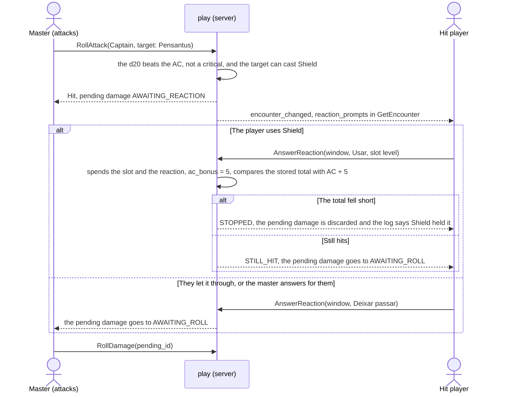

# Reactions

One mechanism covers every reaction the SRD gives a creature: the reaction window (PM-04).
A window opens when something a reaction can change happens, and the action that caused it waits: nothing of it is written until every window of its group is answered or closed.
The code is `combat_reactions.go` and `combat_reaction_*.go`; the answer is `AnswerReaction`.

## Windows

`Encounter.reaction_windows[]` is backed by two tables: `reaction_windows` (one row per reactor and trigger, with a `group_id` for the windows of the same trigger and a `step` for two-step ones) and `reaction_holds` (the request of an action that waits).

| Reaction | Trigger (SRD 5.1) | Held until answered |
| --- | --- | --- |
| Shield | A hit on the reactor, or Magic Missile | The hit's damage roll (`AWAITING_REACTION`). Offers the slots and, for a creature with the Innate Spellcasting grant, a use of its resource |
| Uncanny Dodge | A hit the rogue sees, after the damage is rolled | The damage landing: halved, rounded down |
| Deflect Missiles | A ranged weapon hit on the monk | The damage landing, less 1d10 + Dexterity + monk level; at 0 it is caught and, for 1 ki, thrown back with `RollAttack(catch_window_id)`. The server builds the attack from the missile (its dice plus Dexterity, proficiency plus Dexterity to hit, 20/60 ft) and ignores `attack_key`. The second-step prompt (`DeflectMissilesThrowPrompt`) carries the missile's name and bonus; closing that sheet without a roll passes the window (the missile is kept) |
| Hellish Rebuke | The reactor was damaged by a creature it sees within 60 ft, and survived | Nothing: it happens after. Offers the Infernal Legacy (a 2nd-level cast, once per long rest) and the slots; the NPC aggressor's save is the master's (second step) |
| Counterspell | A cast by a creature the reactor sees within 60 ft | The whole cast (held with its request and replayed after); the countered cast still spends its slot |
| Cutting Words | An attack roll (a weapon's, a cantrip's or a spell cast from a slot with one target), an ability check in combat or a damage roll of a creature of the other side that the bard sees within 60 ft | The roll (the bard answers before the die is thrown). A creature that cannot hear or is immune to charm opens no window (`cuttingWindows` skips it), and neither does one the bard's player cannot see (`reactorSees`: a hidden NPC, the fog). The sheet setting asks for checks only in "todos". The checks held are the initiator's roll of a contest (`StartContest`), the answer to a contest (`RespondContest`) and a `Hide`; the spell attack joins the Counterspell windows of its cast. See [Cutting Words on a check](#cutting-words-on-a-check) |
| Protection | An attack on a creature of the reactor's side within 5 ft of the reactor (not the reactor itself), by a creature the reactor sees, while the reactor wields a shield | The attack roll (before the d20): the roll gets disadvantage |
| Feather Fall | A fall of a pit trap (`fall_ft` of the preset) within 60 ft | The fall damage (`AWAITING_REACTION` trap damage); up to 5 creatures saved |
| Opportunity attack | A creature leaves a reach | The mover's turn (its own offers, shown as a window; see [Movement](movement.md#opportunity-attacks)) |
| Contest | A grapple, shove or escape that waits for the defender's roll or the shover's choice | Nothing: the contest row itself. Answered with `RespondContest` or `ResolveShove`, never `AnswerReaction`. Opened by `syncContests`, closed by itself when the contest no longer waits (see [Contests](contests.md)) |
| Hidden reveal | A player's area spell hit hidden creatures and the table asks ("Perguntar a cada vez") | The turn: the master reads it as a window (`HIDDEN_REVEAL`) and answers with `ResolveHiddenReveal` |
| Concentration save | Damage that lands on a concentrating creature (DC 10 or half the damage); 0 HP ends it with no save | The attack that dealt the damage (`CONCENTRATION_SAVE_PENDING`), answered with `ResolveConcentrationSave` (the app's die, a physical die, "Deixar o mestre rolar por mim" or the master's "keep") |
| Effect save | An end-of-turn or start-of-turn save of a lasting effect, or the save a spell zone asks of a player's character or of an NPC with Legendary Resistance and a use left (`EFFECT_SAVE`) | The turn (see [Lasting effects](lasting-effects.md), [Spell zones](spell-zones.md)) |
| Master check | The table rule "Reações dos inimigos" set to "Sempre" (`MASTER_CHECK`): a one-tap check on every attack, hit, cast and damage of a player against an enemy, so the pause says nothing | The action |
| Parry | A melee weapon hit on an NPC whose stat block has Parry (see [Parry](#parry)) | The hit's damage roll (`AWAITING_REACTION`) |
| Legendary Resistance | A player's spell whose saving throw reaches a creature with the trait and a use left, or a hit rider (Stunning Strike, an Open Hand technique, a creature's rider) whose save it makes, passed or failed (`LEGENDARY_RESISTANCE`) | The cast or the rider's answer (hold kind `cast` or `hit_rider`), with the d20s and effect dice of its saves |

The Legendary Resistance window has no reactor: the master alone turns the failures he picks (`creature_ids`, one use each) or passes.
When every such save passed, the window offers nothing and he passes.
The cast, or the answer to the rider, then settles with the same dice.
A zone's save against such a creature has no hold: the master answers the zone's `EFFECT_SAVE` window, which only the master reads, with the roll and the choice of the trait.
[Creatures](creatures.md#legendary-resistance) lists the saves that are not offered the trait.

`AnswerReaction` answers a window: "Usar" (with the slot, `use_racial`, the die, the creatures of a Feather Fall) or "Deixar passar".
It is the reactor's player, or the master for an NPC's and, to answer for the player, any.
`UseReaction` and `DeclineReaction` are the Shield's two answers kept for clients that still send them; they act as `AnswerReaction` on the hit's Shield window.

## Shield

When a non-critical blow hits a player character who can cast Shield now (prepared, with a free slot, reaction free, standing), the pending damage is born `AWAITING_REACTION`, not `AWAITING_ROLL`.
The attacker sees "esperando a reação"; the hit player and the master get the notice in `GetEncounter` (`reaction_prompts`, by who sees: the master all, the player their own character's, without the attacker and without the blow's total).
The player decides without knowing the total, as at a table.
The Shield window opens after every reaction that lowers the attack roll.
Cutting Words, Protection and Counterspell hold the action before its outcome is applied, and the replay of the held action opens Shield from the hit that is left.
A cut that turns the hit into a miss opens no Shield window and spends no slot, and a countered Magic Missile opens none either.
The master's trigger carries the total after the cut; the player's prompt carries no total and no die.
A creature whose Innate Spellcasting lists a reaction spell with uses a day (the Couatl's Shield) gets the use as one more `SlotChoice`, with `resource` set to the resource key and `free` and `total` counting uses.
Answering with that `resource` counts one use under `res:<resource>` in the combatant's `slots_used`.
The undo gives the use back, as it gives a slot back.
The same path serves any reaction spell the window handles.
The attacker's sheet follows the answer: on each `encounter_changed` it reads `GetTurnOptions` again, a pending damage that is gone (Shield stopped the hit) turns the result into a miss, and one back in `AWAITING_ROLL` goes on to the damage.
The player learns only that, never the armor class.

`RollDamage` and `ApplyPendingDamage` on a blow waiting for the reaction give `REACTION_PENDING`; the attacker's `EndTurn` gives `PENDING_DAMAGE` (only the master passes, discarding).
The +5 stays in `combatants.ac_bonus` until the start of the character's next turn (`ResetCombatantTurn`): every attack in the meantime uses the sheet's AC plus the bonus, and the bonus never alters the sheet (RN-04).
The opportunity attack is `RollAttack` with `as_reaction`: a melee attack off turn spending the reaction in place of the action.

## Parry

A melee weapon attack that hits an NPC whose stat block has Parry waits in a window of kind `parry` (`combat_reaction_parry.go`).
The window belongs to the master, who answers for the creature: "Aparar (+N CA)" or "Deixar passar".
The hit is held as the Shield's is: its pending damage is born `AWAITING_REACTION`, and the d20 is kept in it (`attack_total`, `attack_armor_class`).
"Usar" spends the creature's `reaction_used` and compares the kept total with the armor class the roll was compared with plus N, so nothing is rolled again.
A total below it is a miss: the pending damage is discarded.
Otherwise the pending damage goes to `AWAITING_ROLL` and the hit lands.
"Deixar passar" lets the hit land and keeps the reaction.
The bonus is not stored on the creature: it holds for that one attack (the Shield's +5 is `combatants.ac_bonus` until the creature's next turn).

The window opens when all of this holds:

- the target is an NPC with a Parry in its stat block (`ReactionStats.MonsterReactions`);
- the attack is a melee weapon attack: a melee attack of the attacker's sheet that is not a spell, and, for a thrown melee weapon on a map, a target within the weapon's melee reach;
- the hit is not a critical one (it hits whatever the armor class);
- the creature can react: `reaction_used` is false, it is not defeated, surprised or incapacitated (`incapacitating`), and no effect takes its reactions;
- the creature sees the attacker (not blinded, the attacker not invisible, and on a map with fog the creature's senses reach the attacker's square);
- the creature has no Shield window for the same hit (a Shield window is opened first).

The app does not know what the creature wields, so the master answers for the "wielding a melee weapon" condition.
The window opens also when the bonus cannot change the outcome (the roll is far over the armor class), so the pause says nothing about how far the roll was (RN-10).
A second hit of the same round finds the reaction spent and opens no window; the reaction returns in `ResetCombatantTurn` at the start of the creature's turn.
The table rule "Reações dos inimigos" ([above](#who-reads-what-rn-10-rn-20)) applies as to any NPC reaction: with "Sempre" the Parry window takes the place of the master's check.

`reaction_window_opened` and `reaction_window_closed` go to the master only: the creature has no player.
The attack's own response and the combat's change hints are the ordinary ones.

## Protection

The Protection fighting style (`protectionWindows`, `combat_protection.go`) opens its windows in the same group as Cutting Words, from `holdAttackRoll`: the attack is held before its d20 is rolled.
A shield-bearer gets a window when it has the style (`ReactionStats.Protection`), can react (reaction free, conscious, not surprised), sees the attacker (any distance; a hidden or invisible attacker is seen by no player, a blind reactor sees nothing, the fog applies), stands within 5 ft of the target and is neither the attacker nor the target.
The target must be on the reactor's side and the attacker must not: the style shields a neighbor, so a bearer is not asked to hinder the attack of its own side on an enemy.
A combat without a map opens none, since the 5 ft are not known.
`ReactionStats.Protection` is true only when the sheet has the style and the shield counts: `Derived.ShieldIdle` (a two-handed weapon on the sheet, see [Rules](../rules.md)) turns it off.

A used Protection spends the reaction, closes the other Protection windows of the attack, and the replay of the held attack reads `replayState.protectors`.
`applyProtection` (called from `rollD20`) adds the `protection` source to the attack's mode, which resolves with the others (advantage and disadvantage cancel).
The request was made under the mode the screen showed, so a requested mode equal to the mode before the reaction is dropped; a mode the caller chose differently, or a master's answer to a mode request, wins.
The dice follow the new mode: typed dice are kept (the first ones) and a missing die is rolled in the app, so a physical d20 typed before the reaction is joined by a server die.
The roll's sources read "Proteção de <name>: desvantagem" to the master and to whoever sees the bearer, and "Outra fonte: desvantagem" to a player who does not.
The prompt carries the attacker and the protected creature only when the reader sees them.

The replayed attack's event keeps `protected_by`; the undo of that attack (the used window's own event never closes the undo chain, `chainProtection`) gives the bearers' reaction back, and the master can make the attack again.
A spell attack cast from a slot (`CastSpell`) opens no Protection window.

## Cutting Words on a check

A check is held as an attack roll is (`combat_cutting_checks.go`): `holdCheck` opens the Cutting Words windows with `Roll: "test"`, keeps the request in a hold of kind `contest`, `contest_answer` or `hide`, and the handler returns before anything is spent or rolled.
When the windows are answered the replay runs `startContest`, `respondContest` or `hide` again as the original caller, and `rollFor` takes the die off the total (`cutRoll`) and adds a note "Palavras de Interrupção: −N" to the roll, so the contest compares the cut number.
A spell attack from a slot is held in `holdCast` beside the Counterspell windows (a single target only, because the die cuts one roll) and the replay lowers the spell's attack bonus, as `RollAttack` does for a weapon.
The window opens before the roll, so it names the roller and never a total; a roller the bard's player does not see opens none, and in "Sempre" a player's check against an enemy waits for the master's check when no bard could cut it.
The rolls with no window: a check outside a combat (a group check, a scene check, a trap search, a puzzle hint) has no encounter to hold a window in, and a roll the player leaves to the master (`defer_to_master`) is held when the master rolls it.
The Help action rolls nothing.
A damage roll opens its window in `damageWindows`, for every damage that is not healing: a weapon's, a cantrip's and a spell's.
The window is the same for a player's creature and for an NPC.
The log line of the cut names the die, what it came off (the attack, the test or the damage) and the roll before and after; a player's line says only whether the attack still hit.

## The settle step and the gate

After every write of a combat, `settleReactions` runs:

1. it closes the windows that stopped being valid (the reactor spent the reaction, fell or is incapacitated, the trigger is gone) with a reason (`reaction.Closure`);
2. it lets a hit whose windows are all closed go on to its damage roll;
3. it replays the held actions in the combat's transaction (the same handler as the RPC, with what the answers decided in `replayState`: the countered cast, the Cutting Words die, the halved or deflected damage).
   Replaying a held request with its idempotency key returns the same answer.

`reactionGate` refuses `EndTurn`, a second action, `RollDamage` and `ApplyPendingDamage` with `REACTION_PENDING` (or `CONCENTRATION_SAVE_PENDING`) while a window waits, for the master too (who ends the combat or answers).
Windows are answered in the initiative order inside a group (`NOT_YOUR_TURN_TO_ANSWER` otherwise); two answers at once settle to one.
A window the reactor can no longer use closes by itself and says so, in words, only to its own reactor.
Ending the combat discards every window and held action.

## The automatic pass (client side)

An optional reaction a player does not answer passes after 30 seconds.
The server keeps no timer: the master's screen (`core/combat/reaction-autopass.ts`, driven by `combat-view`) remembers when it first saw each open window of kind Shield, Uncanny Dodge, Hellish Rebuke (the cast), Counterspell, Cutting Words, Deflect Missiles, Protection or Feather Fall waiting for its player (`reactor_is_player`, `answer_now`), and after `AUTO_PASS_SECONDS` (30) sends the same `AnswerReaction` "Deixar passar" the master can tap, with the idempotency key `auto-pass:<window id>`, so two tabs or a retry never answer twice; a refusal because it was answered meanwhile is ignored.
Saving throws (`CONCENTRATION_SAVE`, `EFFECT_SAVE`, the Hellish Rebuke second step), contests and the master's check never auto-pass.
A reload starts the 30 s again (in memory only).
The player's prompt only shows the countdown; their client never answers by itself.

**The player is rolling.** A physical die takes longer than 30 s to find, roll and type, so when a player taps "Usar" on an optional reaction and moves to the die step, their screen calls `MarkReactionRolling` (the reactor's player alone; others get `permission_denied`).
It is idempotent, writes no event or log line, and stores `rolling` in the window's `trigger` JSON.
The window then carries `rolling` for the master and the reactor, and the master's clock (`AutoPassClock`) restarts the wait from when it first saw the mark with `ROLLING_WAIT_SECONDS` (120), still bounded: after it the window passes like any other, and the master can pass it by hand at any time.
The player reads the same countdown on the die step; the master's card reads "Rolando… passa sozinho em N s".
If the call fails the roll goes on with the 30 s clock.

## Who reads what (RN-10, RN-20)

A player gets only their own windows (`for_you`) and `reaction_wait`, the line the server writes for the whole table ("Esperando o mestre", "Esperando a reação de Pensantus": the name only when the reactor is a player character the reader sees).
Never which NPC, which reaction or why.
The Legendary Resistance window has no reactor: a player reads the wait and nothing of the offer, the failed roll, the count or the trait.
The wait itself is visible: that it opens at all tells a player that the NPC has a reaction or a trait (a Shield, a Parry or Legendary Resistance).
The app does not hide that timing.
A legendary spend, attack or move is refused while a window or hold is open (`REACTION_PENDING`), as every other action of the table is.
The Counterspell prompt carries no spell name or level; a Cutting Words prompt to a bard has no total; the numbers of the trigger (`ReactionTrigger`) are the master's.
`reaction_window_opened` and `reaction_window_closed` go only to the reactor and the master.
The table rule "Reações dos inimigos" (`enemy_reactions`) defaults to opening a window only for an enemy that can react; "Sempre" opens the master's check on every one.
A two-step answer (Hellish Rebuke against an NPC, Deflect Missiles' throw back) keeps who made the reactor's decision in `windowTrigger.ByMaster`: the master rolling the NPC aggressor's save is not "respondido pelo mestre" for a reaction the player chose.

Hellish Rebuke's second-step prompt carries the aggressor's modifier only for the master.

## The log and undo

Each reaction is one line (`COMBAT_LOG_KIND_REACTION_WINDOW`) with the master's and the players' text; `reaction_answered` and `concentration_save_rolled` are the session event kinds.
A used Shield keeps `reaction_used` (undoable), and so does a used Parry.
A spent reaction records its kind and the round in `combatants.reaction_kind` and `reaction_round`.
The kind is the reaction window's key, `opportunity` for an opportunity attack, or the key of the feature whose action is a reaction.
`spendReactionAs` writes the economy and the record together; `recordReaction` (`SetCombatantReactionSpent`) writes the record where another path spends the reaction.
The throw back of Deflect Missiles writes nothing: answering Deflect recorded it.
The start of the combatant's turn clears the record, and so does an economy write that gives the reaction back (the undo).
The view sends `Combatant.reaction_kind` and `reaction_round` to the owner and the master only.
A joint-turn partner reads `reaction_used`, and no other player reads any of the three.
An NPC's record is the master's.
`reaction_kind` is `UNSPECIFIED` when the server has no name for the reaction, as for a feature's.
An undo reopens its window, closes the windows of the damage it takes back and gives an NPC's slot back; the undo of the master's "Não aplicar" on a hit that waited reopens the windows the discard closed (`closed_windows`; see [Undo](undo.md)).
A held action's event closes the undo chain.

## What the SRD leaves out

The app decides, and says so:

- the triggers' "see" and 60 ft come from the Player's Handbook reaction texts;
- a reaction spell cannot be countered by the app;
- an NPC bard's ability-check rolls are not asked (no flow rolls an enemy's checks);
- Hellish Rebuke's fire is always rolled in the app;
- Deflect Missiles' free-hand condition is not checked;
- the shield counts as wielded unless a two-handed weapon is on the sheet, and a versatile weapon is one-handed (the sheet has no hands);
- Feather Fall's trigger is the pit trap (a creature thrown into a fall by another effect has no window).
