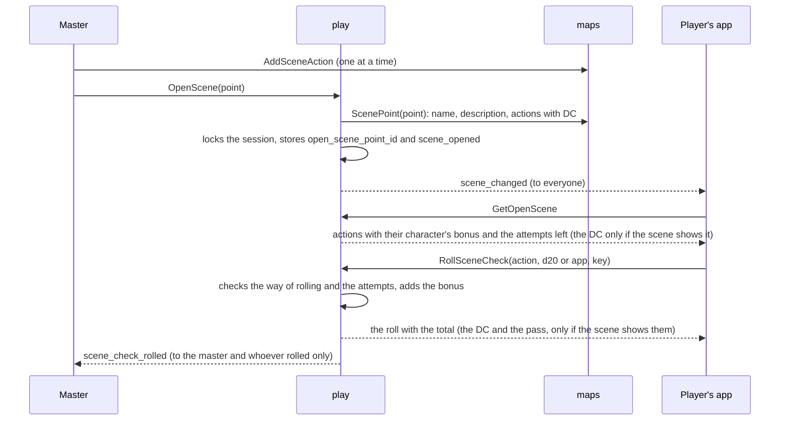

# Scenes and stage

An RP scene is a map point of kind `scene` with actions the master chose (MR-015); NPCs can stand "on stage" in the open scene (MR-031).
The actions, images, clues and hooks live in `maps`; opening the scene in the session, rolling and the log belong to `play` (`scene.go`, `stage.go`).

| Call | Who may | Own errors |
| --- | --- | --- |
| `OpenScene(point_id)` | The master, session open (opening another scene empties the stage) | `NO_OPEN_SESSION`; `not_found` unless the point is a scene point of the campaign. Any scene point opens, even without actions; opening discovers the scene |
| `CloseScene` | The master, session open | With no open scene it changes nothing; closing empties the stage |
| `GetOpenScene` | Campaign members | `NO_OPEN_SESSION` |
| `RollSceneCheck` | A player with a living character, session open | `permission_denied` for the master; `SceneBlocked`: `NO_OPEN_SCENE`, `ALREADY_ROLLED` (no attempt left), `WRONG_DICE_MODE`, `NO_CHARACTER`; `not_found` ("action not found") for an action not of the open scene **and for one the master hid**, the same error; `invalid_argument` for a d20 outside 1 to 20 |
| `GrantSceneAttempt` | The master, session open | `SceneBlocked` `NO_OPEN_SCENE`; `not_found`; `invalid_argument` for a key that is not a UUID or already used by another change. On an unlimited action it changes nothing |
| `PutOnStage(character_id, hidden)` | The master, session open | `SceneBlocked` `NO_OPEN_SCENE`, `STAGE_FULL` (4 on stage, the hidden ones too); `not_found` unless the id is a living NPC of the campaign. An NPC already on stage changes nothing, whatever `hidden` says |
| `TakeOffStage` | The master, session open | An NPC not on stage changes nothing |
| `SetStageNpcHidden(character_id, hidden)` | The master, session open | `not_found` if the NPC is not on stage. Setting what it already is changes nothing |
| `SetSpeaker` | The master, session open | `not_found` if the NPC is not on stage. An empty `character_id` takes the floor from everyone. A hidden NPC given the floor is shown in the same call |

`TestAuthorizationMatrix` and `TestSceneAuthorizationMatrix` call each as master, player, outsider, pending and signed out.

## The actions

- **What an action is.** A skill check, an ability check or a saving throw, each with an optional name (up to 60 characters) and DC (1 to 30), at most 20 per point.
  The master changes one at a time (`AddSceneAction`, `UpdateSceneAction`, `MoveSceneAction`, `RemoveSceneAction`); each response carries the list as it ended up.
- **The key** is checked against the rules catalogue (`rules.Content.SceneCheckName`, handed to `maps` in `Config.Rules`): only skills, the six abilities and the six saving throws, so an attack or a spell is `invalid_argument`.
- **What `MapPoint.scene_actions` carries.** The master receives everything; the player only on the points they see (RN-10), and the DC only when the point has `show_dc` on (RN-20).
  Every member receives `max_attempts`.
- **Hidden actions.** `scene_actions.hidden` ("Escondida") is set by `AddSceneAction(hidden)` and `UpdateSceneAction(hidden)` (alone or with the other fields) and is the master's alone: `attachActions` leaves a hidden action out of a player's `MapPoint.scene_actions`, and `SessionMaps.ScenePoint` carries `Hidden` to `play`, which takes it out of a player's `GetOpenScene` (`sceneViewing.hideActions`) together with the rolls made on it, and refuses a player's `RollSceneCheck` on it with the very error of an action that does not exist (`visibleSceneActionOf`).
  Nothing is erased: showing the action again gives the players back their rolls and attempts.
  The master's copies (`SceneAction.hidden`, `SceneActionView.hidden`) say which are hidden, and `GrantSceneAttempt` accepts a hidden action.
  A change that touches only hidden actions (adding one hidden, editing, moving or removing one that is and stays hidden) sends `map_changed` and `scene_changed` to the master alone (`actionsChangedFor`); showing or hiding one sends them to everyone, so the players read the scene again.
  The group check asks a skill of the table, never a scene action, so it does not carry a hidden action.
  The summary counts the tries and passes of a character without the action, so it stays as the table saw it.
- **Showing the DC.** `map_points.show_dc` is per scene, off by default; the master changes it with `UpdateMapPoint` or `CreateMapPoint`.
  A point that stops being a scene loses it.
  Every member receives the key (`MapPoint.show_dc`, `OpenSceneInfo.show_dc`).
  When on, the player receives `dc` on actions that have one and `passed` on their own rolls.
  The master always sees the DC.
  Changing the key with the scene open sends `scene_changed` to everyone.
  Each roll stores whether the scene showed the DC when it was made (`dc_shown`); it is that mark, not today's key, that the [session summary](highlights-and-summary.md#session-summary) counts.
- **The scene's images** ("Imagens da cena", `map_point_images`, `sceneimages.go`): up to 8 gallery images per scene point, in order.
  `SetSceneImages` replaces the whole list in one transaction with the point locked (every image must be the campaign's, repeats and more than 8 are refused, and an identical list does nothing, telling nobody), so it is idempotent without a key.
  The list is the master's, like the clues: `attachImages` fills `MapPoint.images` only for the master, `SessionMaps.ScenePoint` hands it to `play`, which sets `OpenSceneInfo.images` only on the master's reply.
  No player read, stream event or image route learns it.
  Each image carries `shows_whole_map`, so "Mostrar aos jogadores" asks first for a whole-map picture.
  Showing calls the session's `SetShownImage` with its usual rules; the scene never shows anything by itself.

## Opening, closing and reading

- **Opening and closing.** `OpenScene(point_id)` picks any scene point of the campaign, hidden or not: opening a hidden point does not reveal it on the map, but discovers the scene (`scene_discoveries`, MR-030).
  One scene at a time: opening another swaps the first; opening the open one changes nothing.
  The open scene is `game_sessions.open_scene_point_id`; a deleted point, or one that stops being a scene, closes it.
  Each opening and closing is a `session_events` row (`scene_opened`, `scene_closed`).
  The enum value `SceneBlocked` `NO_ACTIONS` exists but the server never sends it.
- **Reading** (`GetOpenScene`, a call of its own: it computes bonuses from the sheet, and the app reads it after `ready` and each `scene_changed`).
  The point's name and description go to everyone.
  - The **master** also receives the hooks and the clues, each with who has it, and the actions with the DC and attempt limit and all the rolls, each with who rolled, the die, the total, `passed` (when the action had a DC) and `attempts_left`.
  - The **player** never receives hooks or clues (RN-20), nor the clues already revealed to them (those they read in the notes).
    They receive the actions without the DC (unless the scene shows it), each with the bonus and the passive of their own living character (`rules.SceneOptions`, through `CombatRoster.SceneOptions`; the passive only on Perception, Investigation and Insight), the limit and the attempts their own character still has, and only their own rolls, without `passed` (unless the scene shows the DC).
    A player without a living character, or with a basic sheet, gets actions without a bonus.

## Rolling

`RollSceneCheck` (RN-18): the player rolls with their own living character an action of the open scene.
The server rolls the d20, or takes the typed d20 (1 to 20); a mode forced by the campaign refuses the other form with `WRONG_DICE_MODE`.
Total = d20 + the `SceneOptions` bonus, with the advantage rules and the held-roll gate applied (see [Held rolls](held-rolls.md)).
`physical` rolls type both faces (`d20_faces`) when the mode has two dice.

- **Attempts.** Each character rolls each action up to its limit (`scene_actions.max_attempts`: 1 by default, 1 to 5, or 0 for unlimited), counting rolls and granted attempts since the last `scene_opened`.
  With none left: `ALREADY_ROLLED` (the name dates from when the limit was 1).
  An unlimited action still has a cap of 200 rolls per character per opening (`maxUnlimitedSceneRolls`), refused with the same reason, because every roll is a row of the session log.
  The database counts them (`CountSceneRolls`).
  Closing and opening the scene again resets the counts.
  Lowering the limit below what someone spent deletes nothing (what is left is `max(limit - rolls + granted, 0)`, computed on each read).
- **"Dar mais uma tentativa"** (`GrantSceneAttempt(action_id, character_id, idempotency_key)`): master only, scene open.
  It adds one attempt, stores `scene_attempt_granted` (the point and action in the payload, the character in the event) and sends `scene_changed` to everyone.
- **Idempotency.** The same `idempotency_key` returns the first roll and stores nothing; the same key with another action or typed d20 is `invalid_argument`.
- **The reply** to the player is the roll with the total; the DC and the pass come only when the scene shows the DC.
  The master's log is the `GetOpenScene` roll list, from `session_events`, newest first.



## The stream

| Event | Goes to |
| --- | --- |
| `scene_changed` | Everyone, when the scene opens, closes or changes (an action or the point's text). Contentless: the app reads the scene again, already filtered. A change only the master reads (clues, revealing a clue in the open scene, a change to an action that is hidden and stays hidden) goes to the master alone |
| `scene_check_rolled{action_id}` | The master and whoever rolled. No number |
| `stage_changed` | Everyone, when the stage changes (an NPC the players see comes in or goes out, the speaker changes, an NPC is shown or hidden). Putting a hidden NPC on the stage, or taking one off, goes to the master alone: the players never knew it |
| `notes_changed` | Only the players who received a clue; contentless (published through `maps.LiveSession.PublishToUsers`) |

## Hooks, clues and discoveries (MR-029, MR-030)

- **Hooks** ("Ganchos e anotações") are the master's Markdown text, up to 4,000 characters, in `map_points.hooks`.
  They save with the point (`UpdateMapPoint`) and only the master receives them.
- **Clues** (`scene_clues`) are texts of 1 to 500 characters, up to 30 per scene, changed one at a time (`AddSceneClue`, `UpdateSceneClue`, `MoveSceneClue`, `RemoveSceneClue`).
- **Revealing** (`RevealSceneClue(campaign, clue, character_ids)`): the master picks who receives it ("Marcar todos" ticks all).
  Each player receives a clue once (`scene_clue_reveals`, unique per clue and player; repeating changes nothing, stores no event and notifies nobody), and there is no "hide again".
  The row stores a copy of the text, so editing or deleting the clue afterwards does not change what the player received.
  With an open session the reveal is the `clue_revealed` event (ids only: clue, point, the characters that did not have it yet; never the text), stored by `maps` through `LiveSession.AppendEvent`.
  Only the players who received it hear `notes_changed`; someone offline reads it at the next `ListNotes`.
- **Who has each clue:** the master receives each clue with `revealed_to`; "Todos", "Só a Brisa" and "Ninguém ainda" are computed by the screen.
- **Discoveries** (`scene_discoveries`): a scene is discovered when its point is revealed on the map (`SetMapPointRevealed(true)` or `UpdateMapPoint` with `revealed`) or when the master opens it, even hidden.
  It holds for the whole party and keeps holding if the point is hidden again.
  It is the only list of scenes a player reaches by name outside the map and the open scene (see [Architecture](../notes.md#notes-module-player-notes)).

**How the modules meet.** `play` reads the scene through `MapKeeper.ScenePoint` (hooks and clues come only for the master), stores the discovery through `MapKeeper.DiscoverScene` in `OpenScene`'s transaction, and asks `CombatRoster.SceneOptions` and `CombatRoster.SceneCheckName` (`characters.Service`).
`maps` asks which point is the open scene through `LiveSession.OpenScenePoint`, to notify the stream when an action or the open scene's point changes.

**History** (`session_events`).
`scene_check_rolled` carries ids and numbers only: the point, the action, the check key, the d20, the bonus, the total, `physical`, `dc_shown` and, if the action had a DC, `passed`; never a name or the DC (see [Privacy](../../privacy.md)).
`scene_attempt_granted` carries the point and action.
`stage_changed` carries `change` (`put`, `taken_off`, `speaker`, `hidden`, `shown`, `cleared`) and the NPC's id, no name; `hidden` marks a `put` that put the NPC on the stage hidden, and `revealed` a `speaker` that showed a hidden NPC.

**In the app.** `MapsClient` (the action calls) and `SceneClient` (`OpenScene`, `CloseScene`, `GetOpenScene`, `RollSceneCheck`) are called only by lazy code.
`SceneState` keeps the scene as each person sees it and says in a live region what changed; it reads after `ready` (the first read is silent) and on each `scene_changed` or `scene_check_rolled`.
`SceneBlocked` reasons become text through `scene-errors.ts`, never the message.
The screens are in [Design](../../design/session.md#rp-scenes-stage-clues-and-notes).

## NPCs on stage

The stage is the queue of NPCs "on scene" in the open scene, as in a visual novel (MR-031): the portrait lives on the NPC's sheet and appears in the scene and on the combat card.

- **The portrait** is `portrait_image_id` on an NPC's sheet (`FullSheet` or `BasicSheet`): an image of the campaign gallery.
  `characters` checks it through the `Gallery` interface (`SetGallery`; implemented by `maps.SessionMaps.ImageInCampaign`): an image of another campaign, or one that does not exist, is `invalid_argument` with the same text, so nobody learns it exists elsewhere; a player's sheet refuses the field.
  Deleting the gallery image clears the portrait (`DeleteGalleryImage` calls `ClearPortraits` in the same transaction and sends `stage_changed`); the portrait falls back to initials.
  A portrait saved at the instant the image is deleted may outlive it: the URL answers `404` and the next sheet save is refused until it is swapped.
  The NPC's combat card (`Combatant.portrait_url`) carries the URL only in the master's copy.
- **The stage** is the table `stage_npcs`: per session, in order, at most 4, the hidden ones included.
  Each of the four calls locks the session row, changes the table, stores a `stage_changed` event (ids only) in the same transaction and, after `COMMIT`, publishes `stage_changed` to everyone, or to the master alone when only he read the change (`stageDone.master`).
  Any living NPC of the campaign may be put on stage, hidden in combat or not (which does not reveal it there).
  The response is the stage as it ended up.
  Closing the scene, or opening another, empties the stage in the same transaction (`clearStage`).
- **What each receives (RN-20).** The stage goes in `OpenSceneInfo.stage` (`GetOpenScene` and `OpenScene`): each entry has the NPC's name, the portrait URL (empty without a portrait) and whether it speaks.
  The master also receives the `character_id`, which the calls ask for, and `hidden`.
  The player never receives the type, HP, AC, XP, sheet, notes or the character's id: the entry's `id` is the place on stage, made when the NPC enters, and names no one.
  `TestMR031_APlayerSeesOnlyNameAndPortrait` reads every response and event as the app's JSON.
- **Hidden NPCs (RN-10).** `stage_npcs.hidden` ("Escondida dos jogadores") keeps an NPC from the players while it still takes a place of the 4.
  Everything a player reads of the stage goes through `ListShownStage` (the rows where `hidden` is false): `stageOf` for a player, `ImageOnStage`, and the casts' stage (`stageMapOf`), so a hidden NPC's cast is secret, no player can aim at it, and the casts it made in plain sight leave a player's list while it is hidden (`castLens.hidden`) and come back when it is shown.
  `PutOnStage(hidden)` and `TakeOffStage` of a hidden NPC reach the master's stream alone; `SetStageNpcHidden` and `SetSpeaker` send `stage_changed` to everyone, so the players read the scene again and the NPC appears or is gone, with nothing that tells hiding from taking off.
  A hidden NPC does not speak: hiding clears `speaking`, and `SetSpeaker` on it shows it (`stage_npcs_hidden_does_not_speak`).
  `TestMR031_TheMasterPutsAnNPCOnStageHidden`, `TestMR031_TheMasterShowsAndHidesAnNPCOnStage`, `TestMR031_GivingTheFloorShowsAHiddenNPC` and `TestRN10_AHiddenStageNPCNeverReachesAPlayer` cover it; the leak test (`TestRN10_AHiddenStageNPCIsTheMastersAlone`) holds the needles.
- **Downloading the portrait.** A player downloads an NPC's image (and thumbnail) only while it is on the stage of the open scene of the campaign's open session and shown; at any other time it is `404`, also on `If-None-Match` (never `304`).
  `maps.playersSeeImage` asks `play` (`LiveSession.ImageOnStage`).
  The master always downloads (`TestMR031_PortraitsAreVisibleOnlyOnStage`, `TestMR031_AHiddenNPCsPortraitIs404ForPlayers`).

```mermaid
sequenceDiagram
    participant M as Master
    participant P as play
    participant C as characters
    participant J as Player's app
    participant K as maps
    M->>P: PutOnStage(NPC, hidden)
    P->>C: CombatCharacters: is it a living NPC of the campaign?
    P->>P: locks the session, checks the limit of 4, stores stage_npcs and stage_changed
    P-->>J: stage_changed (to everyone; to the master alone when hidden)
    J->>P: GetOpenScene
    P-->>J: name, portrait and who speaks, no ID or sheet
    J->>K: GET /images/{portrait}
    K->>P: ImageOnStage(image)
    P-->>K: yes, while the NPC is on stage and shown
    K-->>J: 200 (and 404 after the master takes it off)
```
