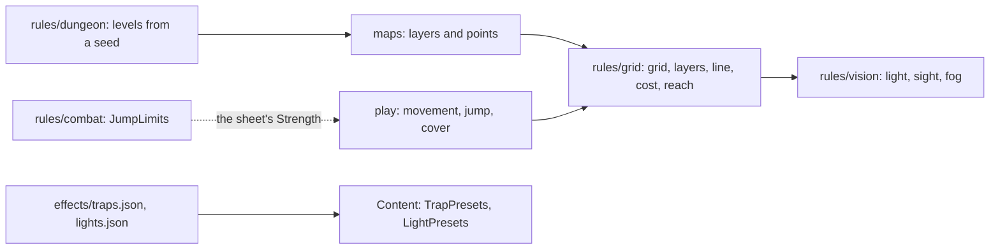
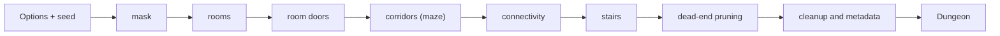

# Rules module: grid, vision and dungeons

Three pure packages under `rules` do the map geometry, the fog of war and the dungeon generator.
None uses a database, network, clock or randomness (ADR-0008).
The [maps module](maps/README.md) stores the layers and the points, the [play module](play/README.md) asks what a move costs, and `vision` builds the fog on `grid`'s line.
The browser computes nothing: it draws what the server sends.
For the engine around them see [Rules module](rules.md).

## Grid

**`rules/grid`.**
A map's grid (`Grid`: columns up to `MaxColumns`, 200, and rows up to `MaxRows`, 400) is counted in squares of 5 ft (1.5 m).
Rows come from the image through `RowsFor(columns, width, height)`: `round(columns × height / width)`, kept between 1 and `MaxRows`.
Positions are basis points (0 to 10000 of the image's width and height) or squares (`Grid.SquareOf`, `Grid.CenterOf`).
Movement is kept in tenths of a foot (the `DFt` suffix): a square straight is 50 and a diagonal 71.
Ranges are in whole feet.

### Packed layers

`maps` stores the packed layers and the API sends them; the browser decodes them, so the byte layout is part of the contract.
Squares are numbered row-major, `n = row × columns + column`, from the north-west corner.

| Layer | Type | Bytes |
| --- | --- | --- |
| Walls, difficult terrain | `Layer`: 1 bit per square | `ceil(squares / 8)`. Square `n` is bit `n % 8` of byte `n / 8`, least significant first. |
| Light | `LightLayer`: 2 bits (0 unpainted, 1 dark, 2 dim, 3 bright) | `ceil(squares / 4)`. Square `n` is bits `2 × (n % 4)` and the next of byte `n / 4`. |
| Cover | `CoverLayer`: 2 bits (0 none, 1 half, 2 three-quarters; 3 is never stored) | Same as light. |
| Doors | `DoorLayer`: 4 bits (0 none, 1 open, 2 closed, 3 locked, 4 barred, 5 secret; 6 to 15 never stored) | `ceil(squares / 2)`. Square `n` is the low nibble of byte `n / 2` when `n` is even and the high one when odd. |

The unused bits of the last byte are 0.
`Decode…` refuses a wrong size, a leftover bit set, a cover value of 3 and a door value above 5 (`ErrLayerSize`).
A wall is total cover; it and a three-quarters cover square block movement.
Walls block sight and light, and so do closed, locked and secret doors (`Door.BlocksSight`); a barred door (a grade) blocks movement only, as do locked and secret ones (`Door.BlocksMove`); a closed door does not block a move, which opens it.

### Calibration

A map drawn with bigger squares says how many 5-ft rules squares fit in each square of the drawing: the factor (1 is 1.5 m, the default; 2 is 3 m; up to `MaxFactor`, 20).
`EngineGrid(drawnColumns, factor, width, height)` gives the grid the rules use and every layer is sized by: the drawn columns and rows times the factor, refused with `ErrGridLimits` past 200 × 400.
`ScaleStep(from, to)` says when a change of factor loses nothing (the new factor is a multiple of the old): every painted square becomes a block of `step × step` squares (`Layer.Scaled`, `LightLayer.Scaled` and the others).
Any other change cannot be done without guessing, so the layers are cleared.

### Line, cost and reach

The straight line between the centres of two squares (`Line`) is walked with integers, so the result is the same on every machine: the exit square is left out, the arrival square enters, and a line passing exactly through a corner does not enter the two squares beside it.
When those two are walls (or a wall and a pillar, in movement), the line is squeezed and blocked.

| Function | What it does |
| --- | --- |
| `Terrain.Move(from, to, occupants, mover)` | The cost of a straight move in tenths of a foot: the line's length (exact to the tenth) plus 50 for each square the line enters that is difficult terrain or holds another creature (once, even if both apply). A flier does not pay the map's terrain, only creature space. It blocks by wall, pillar, squeeze, a locked door, a hostile creature that cannot be passed (two sizes of difference, `Size`), and by ending on someone's square (except Tiny with Tiny). |
| `Terrain.MoveUntil(…, stop, remaining)` | The move as it really happens when the player does not see everything (fog) or there is a trap: it follows the line and stops before the first real obstacle, before the first square the remaining movement does not pay (`StopMovement`), or at the first square of the `stop` set (a trap's area). The cost is the real one up to there and never exceeds what is left. `Stopped` says where it ended (`Reached`), the cost, the squares entered and why it stopped (`StopWall`, `StopNoPass`, `StopLocked`, `StopMarked`, `StopOccupied`, `StopMovement`). `Terrain.NoPass` is the "can't pass" layer: its squares block movement like a wall (`StopNoPass` when nothing else would), are not standable, and block neither sight nor light. |
| `grid.Arrange(t, anchor, n, formation, taken)` | The squares of a group put on the map (`FormationLine`, `FormationBlock`, `FormationArc`, `FormationSquares`): each one's place of the shape, or the nearest standable square nobody holds when the place does not fit, in rings of growing distance with ties in row-major order; fewer than n when the map has no room. `PutPartyOnMap` uses it. |
| `Terrain.Reach(from, remaining, occupants, mover)` | Every square reachable in a straight move, with its cost, in reading order: the circle, shrunk by terrain and cut by walls. It is what the server sends for the browser to draw. |
| `Terrain.Jump(from, to, occupants, mover)` | The cost of a long jump: only the length (passes over difficult terrain and creatures); it does not cross a wall or pillar. |
| `Terrain.CoverBetween(attacker, target, creatures)` | The target's cover: the best among the line's squares without the two end ones; a wall or a squeeze is total, another creature gives half. |
| `LeavesReach(from, to, reactor, reach)` | Whether a move leaves the reactor's reach (the opportunity attack), crossing through it included, and its last square inside the reach. |
| `RangeSquares`, `RangeFt` | Attack and spell range: the distance between centres rounded down in squares, times 5 ft. |
| `Terrain.Validate()`, `NewSight(grid, walls)` | Check the grid is valid and each layer has its size (`ErrBadGrid`): a layer's bytes mean nothing on another grid. Outside input never takes the server down. |
| `Sight.Clear(from, to)` | Whether the line crosses no wall, fast: with a sum of wall areas it skips the stretch of the line whose box has no wall and halves the rest. `vision` uses it. |
| Areas (`area.go`) | The squares of a spell's area (cone, cube, cylinder, line, sphere) from an origin and one of eight directions (`Toward`, `Area.FromPoint`...). The SRD does not say how to lay a cone or a line on squares, so a table needs one rule; this is it. |

## Vision

`rules/vision` is the fog-of-war arithmetic.
From the `Scene` (the grid, the walls and doors, the map's base light, the painted light and the light sources), `Compile` computes each square's light, the greatest that reaches it, and `Lit.See(viewer)` says what a viewer sees.

| State | Meaning |
| --- | --- |
| Unseen | The viewer does not see the square. |
| Wall seen | A wall that touches a seen square. |
| Grey | Seen in the dark, inside darkvision or blindsight. |
| Dim | Seen in dim light. |
| Bright | Seen in bright light. |

- Light and sight stop at walls and at closed, locked and secret doors, by the same line as movement.
- A viewer has a square and senses in feet (darkvision, blindsight, truesight, Devil's Sight).
  Darkvision, within its range, sees dim as bright and dark as grey; blindsight sees regardless of light, in grey; truesight sees both as bright; Devil's Sight sees dark, magical or not, as bright within its range, leaves dim light dim and, like every sense but blindsight, sees through no cloud.
- An observer always knows their own square.
- `Lit.Union` joins several viewers (the party's view, or a player with more than one creature); it keeps the greatest state.
- `PassivePenalty` gives -5 for dim and grey (lightly obscured, SRD) and 0 for bright.
- A light source with no bright radius lights even its own square as dim only.
  Bright and dim radii are capped at `MaxLightFt`, 120 ft.
- `Compile` returns an error for an invalid grid or layers of another grid.

Budgets: the sketch's cave well below 1 ms, a 60 × 40 map below 10 ms and the biggest (200 × 400) below 300 ms.
Measure with `go test ./internal/rules/vision -run '^$' -bench . -benchmem` (in `backend/`); the maps module's fog benchmark is in [CONTRIBUTING](maps/fog.md#the-budget).

## Dungeon generator

The pure package `rules/dungeon` generates a dungeon level from `(Options, seed)`: a rectangular grid of 5-ft squares with rooms, one-square corridors, doors and stairs, plus the metadata.
It uses no database, network, clock, global variable or goroutine, no floating point in any decision, no recursion in the maze (an explicit stack) and iterates no map without sorting the keys.
The same `(Version, seed, Options)` gives the same `Dungeon`, byte for byte, on any platform.
The integration with the map (the image, the wall and door layers, the service) is in the [maps module](maps/README.md).

**Options.**
The defaults are `DefaultOptions(seed)`: 51 × 51, silhouette `none`, rooms 3 to 11 squares per side, aspect limit 3, room density 100%, `spread` placement, `meandering` corridors, door density 100%, `typical` door mix, 2 stairs, 60% dead-end removal, no extra loops.
The ranges `Generate` enforces (it rejects, never clamps, except where it normalises an even size to the odd one below):

| Option | Range |
| --- | --- |
| Width, height | 15 to 199, 15 to 399 |
| Silhouette (`Mask`) | `none`, `donut` (hole 20 to 60 percent), `plus`, `l_shape`, `ellipse`, `diamond`, `custom` (a coarse yes/no bitmap) |
| Room side, min and max | min 3 to 15, max from min to 31, both odd |
| Aspect limit | 1.0 to 6.0 |
| Room density | 10 to 200 percent |
| Placement | `spread` or `tiled` |
| Corridor style | `twisty`, `meandering`, `long_runs` (0, 40 and 85 percent chance to try the arrival direction first) |
| Door density | 25 to 200 percent |
| Door mix | `open`, `typical`, `secured`, `paranoid` |
| Dead-end removal, extra loops, stairs | 0 to 100 percent, 0 to 100, 0 to 8 |

**Functions.**

| Function | What it does |
| --- | --- |
| `Generate(opts)` | The generator. Refuses an out-of-range option with `*OptionError` (names the option; `errors.Is(err, ErrInvalidOption)`) and returns `ErrNoSpace` when the silhouette leaves no space even for a room of the smallest size. The effective options come back in `Dungeon.Options`. |
| `Check(d)` | Checks the invariants readable from the result: bounds and effective options, room parity and size, no overlap or blocked square, reachability from the entrance, doors (parity, open on both sides, four squares apart, no trap on an open door or a grade), exits on two rooms, corridors with no 2 × 2 and no outside floors, stairs, entrance and dead ends at pruning 100. It runs inside `Generate` with `Options.SelfCheck`. Determinism and stream independence are separate tests. |
| `WallsMask`, `Markers`, `PromptOf`, `PromptJSON`, `ASCII` | What the caller derives from the result: the mask of open squares and walls (a wall is any closed square with an open one among its eight neighbours), a marker per door and per stair, the structured JSON for the image prompt (rooms, direct connections, corridor networks with each one's rooms), and a text drawing for tests. The image itself (floors and walls only) is `maps/dungeonimg`'s. |

`Dungeon` stores data, not bits: `Kinds` (rock, room, corridor, door; a square outside the mask is rock), `RoomIDs`, `CorridorIDs`, `Mask`, `Rooms` (with `Exits`), `Doors`, `Corridors`, `Stairs`, `Entrance`, `DiscardedRooms` and `StairsPlaced`.
Door kinds are `archway`, `closed`, `barred`, `locked` and `secret`, plus a `Trapped` mark, the axis and what the door joins; they match the door layer's states (RN-26).
A secret door is in the result; hiding it from the players is the integration's job.

**Determinism.**
The random generator is ours (xoshiro256\*\* with the seed expanded by SplitMix64), not `math/rand`, whose stream is not stable across Go versions.
Each phase has its own stream (SplitMix64 of the seed with a phase constant), so changing `stairs` does not change the rooms and changing `door_mix` moves no door: every door's type and trap mark come from their own stream ("door kinds").
Draws use unbiased integers (Lemire) and Fisher-Yates shuffles.
The order of the draws, commented in the code (`DRAW:`), is part of the contract.
Changing any number that alters the output requires a new `Version` (`types.go`) and the regenerated goldens in `testdata/` (`go test ./internal/rules/dungeon -update`).
The list of specification readings the code made is in the package comment (`doc.go`).

**Budgets and tests.**
The biggest dungeon (199 × 399) generates below 50 ms with a 250 ms ceiling, and `PromptOf` below 20 ms; the tests only check these times with `MEURPG_MEASURE=1` and without `-race`, on a quiet machine.
Benchmarks: `go test -run '^$' -bench 'Generate|Worst|PromptOf' -benchmem ./internal/rules/dungeon`.
Connectivity retries orphan groups and discards a room only when a pass makes no progress.
A service that calls the generator should run it with a deadline and refuse requests above the limits first.
Fuzz: `go test ./internal/rules/dungeon -run '^$' -fuzz FuzzOptions -fuzztime 60s` (CI does not run it); `DUNGEON_SWEEP=1` also runs a sweep of 20,000 combinations.

**Clean room (ADR-0015).**
The generator was written only from a behaviour specification, by someone who had not seen any other generator's code.
The specification and its origin note stay with the generator's PR as comments, not in this document or the code; the audit is in the private ADR.
