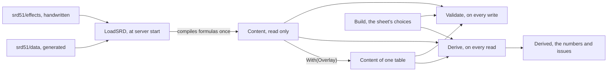

# Rules module: the engine

`rules` turns a character's choices (a `Build`) into the numbers of the sheet (a `Derived`), from rules content that is data and not code (ADR-0008).
It uses no database, network, clock or randomness: the same `Build` and the same content always give the same result.
The code is in `backend/internal/rules`; the module that stores sheets and serves them is [characters](characters.md).

How the embedded content is made (the SRD snapshot, the importer, the handwritten `effects/` files, the revisions) is in [Rules content](../rules-content.md).
This page is about what the engine does with that content.

Related pages:

| Page | Subject |
| --- | --- |
| [Level-up](rules-level-up.md) | What a level gives and what a locked sheet may change. |
| [Table content](rules-table-content.md) | `Content.With`: the master's own classes, races, spells and feats over the SRD. |
| [Creatures, items and presets](rules-creatures-items.md) | Creatures, summons, Wild Shape, magic items, trap and light presets. |
| [Combat engine](rules-combat.md) | The pure arithmetic of the fight, spell details and reactions. |
| [Grid, vision and dungeons](rules-maps.md) | Map geometry, fog of war and the dungeon generator. |

## Shape of the engine

Content is loaded once at start and read by every request; `Derive` runs on every sheet read and `Validate` on every write.

| Package | What it holds |
| --- | --- |
| `rules` | `Build`, `Derived`, `Content`, `Validate`, `Derive`, level-up, choices, the table overlay, creatures, summons, Wild Shape, magic items, traps, lights, treasure, the encounter table, the Portuguese texts. |
| `rules/srd51` | The embedded content files and their Go types. |
| `rules/formula` | The sandboxed formula language of the effects. |
| `rules/combat` | The arithmetic of the fight. See [Combat engine](rules-combat.md). |
| `rules/reaction` | The numbers and ordering of reaction windows. See [Combat engine](rules-combat.md#reactions). |
| `rules/grid`, `rules/vision` | Map geometry and fog of war. See [Grid, vision and dungeons](rules-maps.md). |
| `rules/dungeon` | The dungeon generator. See [Grid, vision and dungeons](rules-maps.md#dungeon-generator). |
| `rules/puzzle` | The puzzle arithmetic (riddle and cipher comparison, sequences, the lights-out and pillar solvers). The puzzle flows are in the [play module](play/README.md). |
| `rules/encounter` | The encounter budget and the seeded generator. The encounter builder is in the [play module](play/README.md). |

The treasure generator lives in `rules` itself (`treasure.go`, `treasure_generate.go`); its flow is in the [maps module](maps/README.md).
Every package here is pure.

## Functions

| Function | When it runs | What it does |
| --- | --- | --- |
| `LoadSRD()` | Once, at start | Reads the snapshot and the effects, checks the schema and compiles every formula. An error here is a bug in the embedded content, and the server does not start. |
| `Validate(build, content)` | On every sheet write | Refuses what makes no sense: an ability score outside 1 to 30, a total level above 20, a key that does not exist or does not belong with the others (a subrace of another race), lists too large. Returns a `*ValidationError` with the field, in the proto's names, and never repeats the value. |
| `Derive(build, content)` | On every sheet read | Computes the sheet. It never fails: an unknown key, a choice outside the rules or a formula that breaks becomes an `Issue`, and the rest is computed ("the app is an assistant, not a judge"). |
| `Content.Catalog()`, `NamePT(key)`, `Summary(build)` | In the edit screens and lists | What the editor offers, with Portuguese names; the name of a key; "Mago 3" for a list row. |
| `Content.Version()`, `Archived(key)`, `Conditions()`, `StandardActions()` | Everywhere | The content version, whether a table entry is archived, the condition names, the ten standard actions. |
| `Content.NextLevelXP(level)`, `LevelForXP(xp)`, `XPForChallenge(cr)`, `SplitXP(total, n)` | In XP and on the sheet | The experience arithmetic (RN-09, RN-12): the XP of the next level (false at 20), the level of an XP value, the XP of a challenge rating (`"1/4"`, `"5"`...) and each one's share of a split, rounded down. The tables are `effects/advancement.json`, checked on load. `Derived.NextLevelXP` and `Catalog().ChallengeRatings` (for the NPC's CR picker) come from them. |
| `SceneOptions(derived, actions)` | In the RP scene (MR-015) | For each check the master put in the scene (`skill:investigation`, `ability:str`, `save:wis`, with optional name and DC): the character's bonus, the Portuguese name and the passive Perception, Investigation and Insight. The types are closed: nothing from combat enters a scene, and an unknown key returns a `*SceneError`, never a panic. |

## What `Derive` computes

`Derive` is a pipeline of phases over one `deriver`.
In order: it resolves the race, subrace, classes, subclasses and armor; names things; computes the ability scores; the level and proficiency bonus; collects the active effects (race and subrace traits, background, class features up to each class level, feats, picked options); builds the formula environment; then applies the ability effects, proficiencies, saving throws, skills, armor class, hit points, speed and senses, languages, spellcasting, ranged-attack switches, attacks, resources and actions, hints, choice effects and the choice check; and last it drops the lower tiers a higher tier replaces.
A feat whose prerequisite the sheet no longer meets is listed but not applied: `Derive` judges the feats on the finished sheet and derives again without the lost ones (SRD 5.1, Feats).

The result covers the 12 SRD classes and 9 SRD races from level 1 to 20 (and the table's own):

- **Ability scores** with race, subrace and manual bonuses, and the modifiers.
  A score above 20 is accepted only with a manual bonus (a magic item, a boon the master granted) or a feature that lifts the ceiling (Primal Champion, up to 24); without one it is the `score_above_20` issue.
- **Proficiency bonus**, the six saving throws (from the first class), the 18 skills (none, half, proficient, expertise), the three passives and initiative.
- **Armor class** with armor, shield and unarmored defenses, and a description of how it got there; a shield adds its +2 only while no two-handed weapon is on the sheet (the sheet lists the weapons carried, not the hands: a two-handed weapon is read as the one in hand, a versatile weapon as one-handed), and `Derived.ShieldIdle` and a hint say why when it does not; **maximum hit points** (fixed or rolled) and hit dice, one pool per die size; speed and senses.
  Heavy armor whose Strength requirement is not met cuts walking speed by 10 ft (dwarves keep theirs).
  `Derived.ArmorUntrained` says which of the worn armor and the shield the character is not proficient with (`rules/armor_training.go`); the sheet's warning and the play rules (disadvantage on Strength and Dexterity rolls, no spells) read the same answer.
  An `hp.max` modifier never takes the maximum below one hit point per level.
- **Spellcasting** per class (DC, attack, cantrips, spells known or prepared), spell slots with the multiclass table, and the warlock's pact magic.
- **Attacks**: the sheet's weapons, the unarmed strike and damage cantrips.
  - The unarmed strike (`attack:unarmed-strike`) is always there: Strength, proficient, 1 + Strength bludgeoning.
    A monk with Martial Arts uses the monk die and the better of Dexterity and Strength.
  - A finesse weapon takes the better of Strength and Dexterity.
  - Martial Arts applies only with no armor and no shield, and its die replaces the weapon's on the two-handed line too.
  - A heavy weapon in the hands of a Small race gets a reminder.
  - `Attack.Beams` is how many attack rolls one action makes (Eldritch Blast: 1, 2, 3 and 4 beams at character levels 1, 5, 11 and 17).
    `Attack.SpellDice` is the plain dice a damage cantrip rolls at the character's level.
    `Attack.Light`, `MartialArts` and `AbilityMod` tell the bonus-action attacks which weapons they go with.
  - A weapon-damage bonus tagged `wielding:one-melee-weapon` (the Dueling fighting style) is applied to every melee weapon that is not two-handed, in the damage rolled in one hand.
    The sheet lists the weapons carried, not the ones in hand, so the attack line says the condition for the table to check (`Attack.damage_note_pt`).
  - Each attack's damage is also given as numbers (`DamageDice`, `VersatileDice`).
  - `Derived.CriticalRange` is 20, 19 with Improved Critical and 18 with Superior Critical; `Derived.TwoWeaponFighting` says the character has the fighting style.
- **Choices counted**: each feature that offers options (fighting styles, metamagic, invocations, pact boon, hunter's prey...) allows a fixed number of picks, shared by the features that offer the same options.
  More picks, or the same option name twice, raise `choice_count`, and the repeated one gives no effect.
- **Features and traits** up to the character's level, with the SRD text (see [Portuguese texts](#portuguese-texts-of-the-srd)), the `hints` and the `issues`.
  A scaling feature appears once, at its newest tier.
- **Resources** with uses (`Resources`: Second Wind, Ki, Rage, with the maximum at the level and when they return) and **actions** (`Actions`: what a feature grants, the action it spends and the resource it consumes; `StandardActions`: the ten everyone has).

**What it does not compute.**
Active spells such as Mage Armor and Shield, current hit points, spent slots and resources in use belong to the game session (the [play module](play/README.md) stores them; `rules/combat` only does arithmetic on what the session stores).
A feature with no effect appears only as text and the master resolves it (for instance Diamond Soul, Slippery Mind, Remarkable Athlete, Mystic Arcanum, Signature Spell, and the Aura of Protection's bonus for allies within 10 ft).

## Effects

The SRD describes features in prose.
What the engine needs to know is written by hand in `effects/*.json`, in a closed set of types; loading refuses anything else.

| Type | What it does |
| --- | --- |
| `modifier` | Changes a target with a mode (`add`, `max`, `set`) and a formula. Targets: `ac.base` (the highest of the options, e.g. Unarmored Defense `10 + mod("dex") + mod("con")` with `armor() == "none"`), `ac`, `hp.max`, `speed.walk`, `initiative`, `attack.weapon.melee`, `attack.weapon.ranged`, `damage.weapon.melee`, `damage.weapon.ranged`, plus the dynamic targets (a skill, a saving throw, `save.all`, which Aura of Protection uses, and `score.<ability>`). A score modifier is an `add` with a `cap` above 20, the highest value the effect lifts it to (Primal Champion: `+4`, cap 24); a score already above the cap is left alone, and no other modifier has a cap. |
| `proficiency` | A proficiency, expertise, or half proficiency (Jack of All Trades: every skill, raw ability check and initiative). With `only_proficient`, an expertise effect doubles a skill only where the character is proficient from another source (see [Table content](rules-table-content.md#the-closed-menu-of-effects)). |
| `roll_mode` | Advantage or disadvantage on a kind of roll (`attack`, `death_save`, `initiative`, `check.all`, `save.all`, an ability's checks, a skill, a save). With a tag (`against:magic`, Gnome Cunning) it becomes a hint. |
| `sense` | Darkvision, blindsight, truesight, tremorsense, with the range. |
| `spellcasting` | Ability, how spells are prepared or known, the list, the prepared formula (Wizard: `max(1, mod("int") + classLevel("wizard"))`). |
| `resource`, `grant_action` | Rage, Second Wind: become `Derived.Resources` and `Derived.Actions`. A resource's recharge may depend on the level (`recharge_if`, a Bool formula, with `recharge_then`: Bardic Inspiration also returns on a short rest from bard level 5). Unlimited uses are stored as 99 and shown as "ilimitado". Two classes that give the same resource (Channel Divinity) share one pool with the larger `max`. A `grant_action` may name `resource`, a resource another feature owns, and each use spends one of it (Channel Divinity actions, Cutting Words, the monk's ki actions); without that resource at the character's level the action is not offered. |
| `extra_attack` | How many attacks the Attack action makes (`Derived.AttacksPerAction`, the largest `count`, 1 without it). |
| `extra_damage` | Only table content uses it. Damage added to a weapon hit, once per turn, at the player's choice. `applies` is `any_target` or `larger_target` (the target is of a larger size than the attacker; a creature with no size is medium). `value` is an Int formula for the fixed damage (1 to 999, never doubled by a critical hit; anything else is ignored with a `formula` issue). `resource`, when set, names a `resource` effect of the same entry or its class and each use spends one use; without it only the once-per-turn limit holds. One for each feature (a second is refused at its `.type`). `Derive` fills `Derived.ExtraDamages`; they reach play as `link.Traits.ExtraDamages`. |
| `ranged_attack` | Only table content uses it: no SRD feature has one. `applies` is `spell` (a spell that needs an attack roll) or `weapon` (a ranged weapon attack, and a thrown weapon used beyond 5 ft). `ignore_cover` takes the half and three-quarters cover bonus off the target's AC; `range_multiplier` (spells only, 2 or 3) multiplies the range in feet of a spell attack; `no_long_range_disadvantage` (weapons only) drops the disadvantage beyond the normal range, up to the long range. At least one switch is set and no `tags`. `Derive` adds them into `Derived.SpellAttackRangeMultiplier`, `SpellAttackIgnoresCover`, `RangedWeaponIgnoresCover` and `RangedWeaponNoLongRangeDisadvantage`, and `Derived.SpellRangeFt` gives the range a spell has for this caster. They reach play as `link.Traits`. |
| `resistance` | Only table content uses it. Resistance to every damage type but `except` (a `damage-type:` key of the content), held while `while` is `rage`; both are required, and the effect has no `when` and no `tags`. `Content.Resistances` lists it with the resistances of `effects/damage_resistances.json`, as one `Resistance` per source whose `DamageTypes` are all the types but `except`, so play applies it while the rage state lasts (and no heavy armor is worn) and resistance to one type from two sources counts once. The sheet shows it as a hint ("while raging"). |
| `ambush` | Table content only. Advantage on attack rolls against a creature that has not had its turn yet, or a critical hit on a surprised one (`applies`). See [Table content](rules-table-content.md#ambush). |
| `superiority_die` | Table content only. A die an option (a maneuver) adds to a roll and that spends a use of a resource. See [Table content](rules-table-content.md#maneuvers). |
| `ability_increase` | Feats only: `count` different abilities from `from`, `value` 1 or 2 each. |
| `beast_spells` | The druid's Beast Spells (level 18): the druid keeps its spellcasting in a beast form (`Content.CastsInBeastForm`). |
| `song_of_rest` | The bard's Song of Rest die of the tier (`sides`: 6, 8, 10 or 12), read into `Derived.SongOfRestSides` (the largest wins). The rests use it. |
| `wild_shape` | The druid's Wild Shape limits at levels 2, 4 and 8: `max_cr`, `no_fly`, `no_swim`. See [Creatures, items and presets](rules-creatures-items.md#wild-shape). |
| `replaces` | A higher tier of a scaling feature names the lower one it takes over from (Channel Divinity, Extra Attack, Action Surge, Indomitable, Brutal Critical, Bardic Inspiration and Song of Rest dice, Favored Enemy, Natural Explorer, Unarmored Movement, Wild Shape). `Derived.Features` keeps only the newest tier, after everything else is derived: the lower tier's effects, choices and options still count. The effect takes the feature key and nothing else; table content never uses it. |
| `choice`, `note`, `handler` | Player choices, what appears only as text, and a registered Go function (SRD only: table content never uses `handler`). |

An effect with `tags` (like `against:magic`) is never applied by itself: it becomes a hint on the sheet and the master decides.
The one exception is `wielding:one-melee-weapon` on a weapon-damage modifier (Dueling), applied to the attack line that meets it; once applied it is no longer a hint.

The content version, `srd51@<commit>+fx.<n>` (with `+mesa.<revision>` when the campaign has its own content), appears on the sheet.
A new snapshot or revision can change the numbers of a locked sheet, and `content_version` says which content they were computed with.
To change an effect or a name, see [Rules content](../rules-content.md) and `CONTRIBUTING.md`.

## Formulas

Effect formulas run in Expr (`github.com/expr-lang/expr`), pinned in `go.mod` and never below v1.17.7 (CVE-2025-68156).
Table content is untrusted input, so `rules/formula` closes Expr in layers:

- **Closed, typed environment.** A formula only sees `level()`, `classLevel("wizard")`, `mod("int")`, `score("int")`, `prof()`, `armor()` and `shield()`.
  None touches the database, network, clock or randomness, and an unknown name is a compile error.
- **No builtins.** `DisableAllBuiltins` turns them all off; only `floor`, `ceil`, `min` and `max` come back, as our own functions with fixed types.
- **Allow-list before compiling.** The tree may only have numbers, true/false, arithmetic, comparisons, `and`/`or`/`not`, the ternary and calls to the functions above, with literal, known text arguments (the six abilities, the classes, the armor categories).
  Ranges (`1..1000000` allocates memory even without builtins), `in`, `matches`, pipes, `??`, `let`, member access, lists, maps and closures are refused.
- **Limits.** At most 256 bytes and 64 nodes; literal numbers up to 1,000 and results up to 10,000.
  A fraction in the final result rounds down as the rules do (`-3 / 2` is -2), while `floor` and `ceil` round where they are written.
  A division that gives NaN or an infinity is refused with the same fixed error on every CPU (`Program.Int` reads the float result only after that check).
  A formula whose steps could pass about two billion is refused when written, because 64-bit integer arithmetic wraps.
  Compilation happens once, on loading the content, never in a request.
- **Execution that does not take the server down.** A runtime error (`%` by zero) becomes an `Issue` and the effect is ignored; execution is also protected by `recover`.
- **Tests.** One test per forbidden construct, and a fuzz (`FuzzCompileFormula`) that feeds the compiler random input.

## Rests and class resources

The rest and resource arithmetic is pure and lives in `rest.go`, `resources.go` and `songofrest.go`; the [characters](characters.md#vitals-and-rests) module applies it to the stored vitals and the [play module](play/README.md) decides who may ask.

- **Rests** (SRD 5.1, "Resting").
  `RechargesOnRest(recharge, kind)` says whether a resource comes back: `short_rest` resources return on either rest, `long_rest` ones only on the long one, and `dawn` or `none` belong to an item or the master's ruling.
  Pact slots return on either rest, spell slots and the end of temporary hit points on the long one, and a long rest gives nothing to a character below 1 hit point (`LongRestNeedsHitPoints`).
  The app records the rests the master calls and does not count hours.
- **Hit dice** are one pool per die size.
  `SplitHitDiceUsed`, `HitDiceLeft`, `SpendHitDice`, `HitDieHeal(face, con)`, `LongRestHitDiceLimit` and `HitDiceReturned` do the counting: a long rest gives back up to half of the total number of dice (at least one), the largest dice first unless the player chooses fewer or other sizes.
- **Class resources.** `LayOnHandsAmount`, `LayOnHandsNoEffect`, the Flexible Casting costs (`SlotCreationCost`, `CreateSlotCheck`, `ConvertSlotCheck`), the Bardic Inspiration die, target rule and expiry, and `ArcaneRecoveryAllowance` / `ArcaneRecoveryCheck`.
- **Song of Rest.** `SongOfRestFor(singers)` gives the die the party hears: the largest Song of Rest die among the bards with at least 1 hit point (0 when nobody sings); the `song_of_rest` effect gives each bard's die.

## Class and race choices

The choices live in `rules/choice*.go`, with the option data in `effects/choices.json`: the Draconic Ancestry table, the invocation prerequisites, the Favored Enemy types, the Natural Explorer terrains, the racial resistances and one Portuguese line per option.
The loader refuses a row without its SRD source, a key the content lacks and a field it does not know.

`Content.Choices(build)` returns the `ChoiceSet`: groups by origin (race, class, subclass, background, feat), each with its choices (key, picks, options, what is picked, how many are missing) and the problems (`ChoiceProblems`, which `Validate` reports as `Issue`s).
A key is scoped by the choice that holds it, so the same option taken by two choices (two Fighting Styles) is two picks.
`Derive` turns picks into numbers and lines (resistances, breath weapon, +1s, granted spells), and `CheckLevelUp` asks the late and the new choices with the same engine.
The RPCs that expose it (`PreviewChoices`, `CompleteCharacterChoices`, `GetCampaignOpenChoices`) are in [Characters](characters.md#class-and-race-choices).

**A feat of the player's choice** is a `choice` effect of kind `feat` on a trait, feature, race, subrace, background, background feature or feat (the table menu's "Talentos").
It becomes a choice with the key `<owner>#feat`; its options are the feats of the content (or the effect's `from`), without the feats the sheet already has, retired ones, and ones switched off for players unless already picked.
An option the character does not qualify for is blocked with a Portuguese reason.
The pick is the scoped string `<owner>#feat=<feat key>` in `Build.FeatureChoices`, so the existing machinery stores, validates, re-asks and keeps it through editor saves.
`Derive` applies the pick after `Build.Feats`, only while the owner is on the sheet, up to `count`, at most once per feat; an `ability_increase` of such a feat is not applied.
`feats_allowed` does not gate it.

## Portuguese texts of the SRD

The English text of spells, magic items, features, traits, background features and feats comes from `data/`.
Our own Portuguese translation sits beside it in `effects/*_pt.json`, keyed like `names_pt.json` (`spell:<index>`, `item:<index>`, `feature:<index>`, `trait:<index>`, `background-feature:<index>`, `feat:<index>`).
The files and the rules for writing them are in [Rules content](../rules-content.md); this is how the engine and the API use them.

- `loadTextsPT` (`texts_pt.go`) and `loadRuleTextsPT` (`rule_texts_pt.go`) read the files with a strict decoder: a key that is not an SRD entry of the file's kind, an unknown field, another paragraph count than the English one, an empty paragraph, and a material text without a material component (or the reverse) are refused.
- An entry the files lack is not a load error: `SpellDetails.TextPTMissing` and `MagicItem.DescPTMissing()` say the English is all there is, and a coverage test asks for every entry.
- The API sends both languages and never drops the English: `SpellDetails.description_pt`, `higher_level_pt`, `components.material_text_pt`, `text_pt_missing`; `GetMagicItemResponse.description_pt` with `description_pt_missing`; on a sheet's `Feature`, `description_pt`, `description_pt_missing`, `description_pt_only`; on a `FeatOption`, `desc_pt`, `desc_pt_missing`, `desc_pt_only`.
- A table spell, feature or feat is written in Portuguese by the master: its text is sent as both with `*_pt_only` set, and the screen offers no English for it.
- The web draws Portuguese first (`chooseText`, `core/text/description-language.ts`), keeps the "Ver em inglês" choice in a root signal service for the whole app until reload (never in Web Storage), and draws the markdown of the texts with `app-srd-text` and `app-rule-text` using text bindings only.
