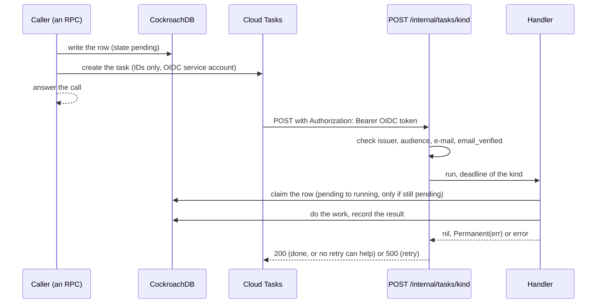
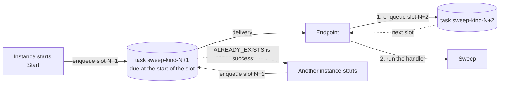

# Detached work

Some work outlives the call that asked for it: an image being made, a campaign being exported, the sweep of what expired. Cloud Run bills CPU per request, so a goroutine that keeps running after its call answered is throttled and starves. `platform/tasks` therefore gives that work a request of its own.

Two implementations satisfy one interface, `tasks.Runner` (`Register`, `Enqueue`, `Every`, `Start`, `Wait`), and run a handler the same way:

| Runner | When | How |
| --- | --- | --- |
| `CloudTasks` | `TASKS_QUEUE`, `TASKS_TARGET_URL` and `TASKS_SERVICE_ACCOUNT` are set (production) | `Enqueue` creates a task on the queue; Cloud Tasks calls the service back and Cloud Run gives CPU for that request |
| `InProcess` | Anything else: local runs, tests, CI | `Enqueue` starts a tracked goroutine; `Every` is a ticker. Nothing is retried |

A module takes a `Runner` in its config (`maps.Config.Tasks`, `campaignpackage.Config.Tasks`), registers one handler per kind, and enqueues. `cmd/api` builds the runner from the configuration, mounts the endpoint, calls `Start` once the handlers are registered, and cancels and waits at shutdown.

## A task

- **IDs only.** The payload is JSON with IDs (campaign, request, export), never free text or personal data. The handler reads everything else from the row.
- **At least once.** Cloud Tasks may deliver twice, so every handler is idempotent: it claims its work with a conditional update, and a duplicate, or work already done, returns `nil` and does nothing. Only an error that a retry can help is returned plainly (`500`); a permanent failure is recorded in the row as failures always were, and the handler returns `nil` or `tasks.Permanent(err)` (`200`, logged).
- **Named tasks.** `Job.Name` makes the task unique (a Cloud Tasks task id: letters, digits, hyphens, underscores); a second `Enqueue` with the name is `ErrExists`, which callers treat as success.
- **Deadline.** Each kind sets how long one delivery may run. It is the task's dispatch deadline and the deadline of the handler's context, capped at 30 minutes, the most Cloud Tasks gives an HTTP target.

## The endpoint

`CloudTasks.Handler()` is mounted at `/internal/tasks/` on the server's mux (`srv.Handle`), outside Connect, under the same request log and recovery as every route. The load balancer forwards every path to the service, so the endpoint is reachable from the internet too and **the check is the only gate**:

1. The method is `POST` and the `Authorization` header carries a Google-signed OIDC token: the signature (Google's keys, `https://www.googleapis.com/oauth2/v3/certs`), the issuer `https://accounts.google.com`, the audience `TASKS_TARGET_URL` and the expiry (go-oidc), then `email` equal to `TASKS_SERVICE_ACCOUNT` with `email_verified` true.
2. Anything else (no header, a bad token, another audience or account, an expired token, another method) answers `401` with an empty body and no detail; the token is never logged. After a valid token, an unknown kind is `404`.
3. The handler runs with the request's context limited to the kind's deadline, so Cloud Run keeps the CPU while it runs. `nil` is `200`, `Permanent(err)` is `200`, any other error is `500`, a panic is recovered and is `500`. The body is capped at 64 KiB.

The per-IP limit (`ratelimit.Middleware`) covers only the API prefixes, so Cloud Tasks is never refused with a `429`; the CSRF protection only judges requests that carry browser headers. The static app is mounted at `/`, and the more specific `/internal/tasks/` wins.

The call goes to the service's `run.app` URL, which the ingress `internal-and-cloud-load-balancing` accepts from Cloud Tasks of the same project ([operations](../operations/README.md#ingress-and-cloud-tasks)).

## Sweeps

A sweep (what expired, what a stopped export left behind) is a kind registered with `Every(kind, interval, ...)`. In process it is a ticker. On Cloud Tasks it is a self-scheduling chain of named tasks, one per slot of `interval`:

- The task of slot `N` is named `sweep-<kind>-N`, where `N` is the unix time divided by the interval, and is due at the start of that slot.
- The delivery enqueues the following slot **before** it runs the handler, so a handler that fails or is cut off does not break the chain; the retry of a failed delivery finds the slot already there and carries on.
- Every instance that starts also enqueues the next slot, which revives a chain that was lost. `ALREADY_EXISTS` counts as success, so several instances never double a sweep.
- The slot is in the name because Cloud Tasks refuses a task id again for about an hour after the task ran.
- A sweep therefore runs at least once every interval (10 minutes for the exports), as the ticker did, plus the queue's latency.

## Failure

A token or Cloud Tasks call that fails is an error, and never carries a response body or a token. An `Enqueue` that cannot reach the API is retried twice (`5xx`, `429`, network) and then returned to the caller, who records the failure the way the work always did.

Setup and cost: [operations](../operations/reference.md#cloud-tasks) and [first deploy](../operations/runbook.md#11-cloud-tasks).
