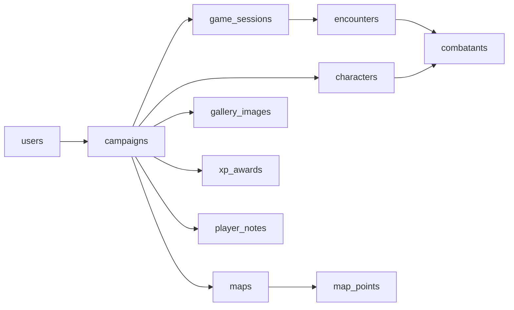

# Data model

The database is CockroachDB, and the schema is whatever the goose migrations in `backend/migrations/` leave behind.
This page holds the conventions every table follows and the map from module to tables.
One page per module (linked below) holds the tables, the non-obvious columns, the relations and who may read what.

The old app's database is not migrated; the one exception is a one-off, hand-reviewed import of characters, tracked in the [roadmap](../roadmap.md).
See also [Privacy](../privacy.md#the-legacy-app-database).

## Modules and tables

Each table belongs to one module, which is the only code that writes it.
A module reads another module's data through that module's interface, never by joining its tables (see [Architecture](../architecture/README.md)).
The `play` module's tables are split over three pages because there are 35 of them.

| Module | Page | Tables |
| --- | --- | --- |
| `identity` | [identity.md](identity.md) | `users`, `user_identities`, `auth_sessions`, `oidc_login_states` |
| `campaigns` | [campaigns.md](campaigns.md) | `campaigns`, `campaign_members`, `campaign_invites`, `campaign_documents`, `campaign_table_rules` |
| `characters` | [characters.md](characters.md) | `characters`, `character_master_notes`, `character_reviews`, `claim_links`, `claim_sign_ins`, `character_vitals`, `character_wild_shapes`, `character_level_ups`, `character_level_up_rolls`, `character_ability_rolls`, `character_creatures`, `npc_spell_use`, `campaign_content`, `campaign_content_state`, `campaign_content_off`, `campaign_content_imports` |
| `play` | [play.md](play.md) | `game_sessions`, `game_session_scene_players`, `game_session_image_viewers`, `session_events`, `session_event_kinds`, `session_messages`, `session_message_readers`, `stage_npcs`, `spell_casts`, `revivify_requests`, `battle_encounters`, `group_checks`, `group_check_members`, `character_effects`, `character_inspiration`, `inspiration_holds`, `trap_damages` |
| `play` (combat) | [combat.md](combat.md) | `encounters`, `combatants`, `pending_damages`, `roll_holds`, `reaction_holds`, `reaction_windows`, `opportunity_offers`, `hidden_reveals`, `roll_mode_requests`, `combat_reasons`, `combatant_states`, `hit_riders`, `spell_zones`, `combat_contests`, `combat_holds`, `combat_hide_attempts`, `combat_hiding`, `combat_helps`, `combat_surprised` |
| `play` (puzzles) | [puzzles.md](puzzles.md) | `puzzles`, `puzzle_runs`, `puzzle_moves`, `puzzle_hint_tries` |
| `maps` | [gallery.md](gallery.md) | `gallery_images`, `image_requests`, `campaign_left_images`, `campaign_left_image_viewers` |
| `maps` | [maps.md](maps.md) | `maps`, `map_layers`, `map_vision_memory`, `generated_dungeons`, `map_points`, `map_point_reveals`, `map_treasure_finders`, `map_tokens`, `map_creature_tokens`, `map_point_images`, `scene_actions`, `scene_clues`, `scene_clue_reveals`, `scene_discoveries`, `scene_player_discoveries` |
| `progression` | [progression.md](progression.md) | `xp_awards`, `xp_award_shares`, `xp_award_treasures`, `planned_milestones` |
| `notes` | [notes.md](notes.md) | `player_notes` |
| `campaignpackage` | [package.md](package.md) | `campaign_exports`, `campaign_imports`, `campaign_import_parts` |

Two tables belong to no module: `goose_db_version` (goose's own) and `migration_lock` (see [Migration lock](#migration-lock)).

The campaign is the center: almost every table reaches `campaigns` through a foreign key, and deleting a campaign cascades to what it owns.

## Conventions

These rules apply to every table.
A module page repeats one only where its table breaks or sharpens it.

- **Text with `CHECK`, not `ENUM`.** A closed set of values (`role`, `status`, `kind`, `mode`...) is a `TEXT` column with a `CHECK`, so adding a value is a small migration.
  Where the set grows often (`session_events.kind`) it is a reference table instead (see [Reference tables](#reference-tables)).
  A few `kind` columns have no `CHECK` on purpose, because the code is the list (`puzzles.kind`).
- **Sizes are checked twice.** The API limit (in characters) is enforced by the server, and a looser `CHECK` (in bytes) is the last defence.
- **Ids are UUIDs.** Most primary keys are `UUID DEFAULT gen_random_uuid()`.
  `gallery_images.id` has no default, because the API needs the id before it writes the files.
  `campaign_exports.id` is 32 random hex digits.
  Proto ids are strings; a handler checks that an id from a client is a UUID before a query runs.
- **Timestamps are `TIMESTAMPTZ`**, set by the application from its clock, or by `now()` where a default exists.
  The migration lock is the exception: it uses only the database clock.
- **JSON columns.** A character's `sheet` and `story`, a map point's `trap`, a puzzle's `config` and `solution`, a combat payload and similar columns are JSONB or, for hold requests, protobuf `BYTES`.
  They carry the protojson of a `.proto` message with its field names, which never change (`buf breaking` enforces it).
  No computed number is stored: the `rules` module computes everything on each read (ADR-0008).
  No index looks inside a document.
- **Packed layers are `BYTES`.** A map's painted layers, a player's remembered squares and a generated dungeon's cells are bit-packed in the `rules/grid` format, row by row.
- **Foreign keys state their `ON DELETE`.** Deleting a campaign cascades to everything it owns.
  Deleting a user account cascades to what only that user can use (identities, sessions, notes) and sets `NULL` where history must survive (`actor_user_id`, `uploaded_by`, `given_by`).
  An id that would close a reference cycle is a plain `UUID` without a foreign key, and the server checks it (`map_points.treasure_session_id`, `pending_damages.trap_point_id`, `encounters.current_combatant_id`, `xp_award_treasures.point_id`).
- **Indexes are only where something searches.** A foreign key searched only when a parent row is deleted usually has no index, because the table is small.
  Where a cascade or an `ON DELETE SET NULL` scans a big table, the index exists (`session_events`, `pending_damages`, `combatants`, `puzzle_moves`, `image_requests`).
  `TestCascadeForeignKeysOfBigTablesAreIndexed` keeps the biggest tables covered.
  A partial index (`WHERE col IS NOT NULL`) serves a `SET NULL` on a mostly empty column.
- **Secrets are stored as hashes.** Session tokens, invite tokens, claim-link tokens and the OIDC `state` are stored as SHA-256 (32 bytes, checked by a `CHECK`).
  Whoever reads the database cannot use them.
- **Personal data is minimal.** The only personal data in `users` is the display name the person types.
  Free text a person writes (names, notes, reasons) is listed in [Privacy](../privacy.md).
- **A table that holds a per-campaign document has a `revision`.** A save with an old revision is refused with `aborted`, so two people editing at once do not erase each other's work.

## Retention and TTL

Seven tables expire rows by CockroachDB row-level TTL; everything else lives until its parent is deleted.
The TTL job runs daily, hourly for `oidc_login_states`.
Queries keep filtering the expiry column, because an expired row exists until the job passes.

| Table | TTL expression | Effect |
| --- | --- | --- |
| `auth_sessions` | `expires_at` | A `CHECK` also forbids a session longer than 30 days. |
| `oidc_login_states` | `expires_at` | Hourly. A `CHECK` limits the life to 10 minutes. |
| `campaign_invites` | `expires_at + INTERVAL '30 days'` | An invite disappears 30 days after it expires. |
| `claim_links` | `COALESCE(used_at, revoked_at, expires_at) + INTERVAL '30 days'` | A claim link disappears 30 days after it ended: used, revoked or, if neither, expired. |
| `claim_sign_ins` | `expires_at` | The link a person signed in with is kept only as long as the login state that carried it. |
| `campaign_members` | `pending_expires_at` | A pending member who never made the character disappears (RN-15). `NULL` for everyone else. |
| `characters` | `CASE WHEN kind = 'player' AND player_user_id IS NULL AND campaign_id IS NULL THEN created_at END` | Deletes only the orphan: a player character with no player and no campaign. `TestOrphanedPlayerCharactersAreDeletedByTheDatabase` checks the expression on real rows. |

CockroachDB rewrites a table's TTL expression whenever a column is added.
So every `ADD COLUMN` on `characters` sets the TTL expression again at its end; without it the second run of the migration leaves the table different (`TestMigrationsAreSafeToRerun`).
A column added to `characters` that way is the reason no per-sheet metadata (such as the content revision a sheet was saved with) is a column: it lives inside the sheet JSON.

## Idempotency columns

A retry never creates a second row, even when two calls with the same key run at the same time.
A unique index protects the key; a request hash catches the same key reused for a different request.
Keys and hashes are opaque values with no personal data.

| Where | Columns | Rule |
| --- | --- | --- |
| `session_events` | `idempotency_key` (UUID), `idempotency_hash` | `UNIQUE (game_session_id, idempotency_key)`; `NULL` for an event without a key (NULLs do not collide). The hash covers the whole request but its key: the same key and request replays, another request is `invalid_argument`. |
| `xp_awards` | `idempotency_key` (UUID), `idempotency_hash`, `undo_key`, `milestone_again` | `UNIQUE (campaign_id, idempotency_key)`. The undo has its own key. `milestone_again` lets the server refuse a key reused for another kind of request. |
| `planned_milestone_moves` | `move_key`, `move_hash` | Primary key `(campaign_id, move_key)`; one row per `MoveMilestone` made with a key, since a move creates no row to hold it. The hash covers the request but its key. |
| `image_requests` | `idempotency_key`, `idempotency_hash` | Unique per campaign. |
| `puzzle_moves`, `puzzle_hint_tries` | `idempotency_key` (UUID) | `UNIQUE (run_id, idempotency_key)`: a repeated move returns the round as it is now. |
| `roll_holds` (unused), `inspiration_holds` | `idempotency_key`, `answer_key` | Unique per encounter (`roll_holds`) or campaign (`inspiration_holds`); the answer key lets a retry find the hold answered. |
| `trap_damages` | `settle_key`, `settle_hash` | Unique where set: settling a trap damage works with no session open, where no event can hold the key. |
| `character_reviews`, `revivify_requests`, `characters` (revive) | `request_key`/`request_hash`, `resubmit_key`/`resubmit_hash`; `create_key`/`create_hash`, `answer_key`/`answer_hash`; `revive_key`/`revive_hash` | Only the latest key of each kind is kept. |
| `campaign_content_imports` | `create_key`, `create_hash`, `response` | Primary key `(campaign_id, create_key)`; a retry returns the stored `response`. |
| `campaign_exports` | `create_key`, `create_hash` | Unique where set. |
| `characters`, `map_points` | `create_key`, `create_hash` | `characters`: partial unique `(campaign_id, create_key)`, used by `CreateCharacter` and by "Create NPC" from a creature (one such NPC per campaign and creature). `map_points`: the treasure generator's "Put on the map". |
| `campaigns`, `maps`, `scene_actions`, `scene_clues`, `player_notes`, `game_sessions`, `session_messages`, `puzzles`, `planned_milestones`, `campaign_content`, `character_creatures` | `create_key`, `create_hash` (`TEXT`, optional) | The key of the RPC that creates the row. It stores the owner and the app's key (`<user>:<key>`, `<campaign>:<key>` or `<campaign>:<author>:<key>`), so it is unique per owner. A partial unique index `<table>_create_key_idx` makes it hold under concurrency. `NULL` on rows made without a key. See [Architecture](../architecture/api.md#contracts). |

## Reference tables

`session_event_kinds` (one row per `kind`) is the reference table of the session history's event types.
`session_events.kind` points to it by a foreign key with `ON DELETE RESTRICT`.
**To add an event kind**, write a migration with `INSERT INTO session_event_kinds (kind) VALUES (...) ON CONFLICT (kind) DO NOTHING`, and add the `event...` constant in the code.
No `session_events` row is read again, which matters because it is the fastest-growing table: a `CHECK` listing the kinds would make CockroachDB validate every row on each change.
Nothing deletes from the table.
The test databases copy a seeded table with its rows and never empty it (`internal/platform/dbtest` finds seeded tables in the migrated template).
`TestEveryEventKindOfTheCodeIsInTheTable` (`migrations`, which reads every `event...` constant under `internal/`) and `TestSessionEventKindsMatchTheTable` (`play`) fail when the code's list and the table's list differ.

## Migrations

Migrations are numbered `NNNNN_description.sql` files in `backend/migrations/`, embedded in the `migrate` binary and applied by goose (`make migrate` locally, the `cmd/migrate` job in production).

- **Production is live, so a migration only adds:** a table, column, index or row; never a rename, a drop, or a new `NOT NULL` without a default on something the running code reads.
  The old code must keep working on the new schema during the switch and after a roll back ([Operations](../operations/runbook.md#release-a-new-version)).
  To remove something, release the code that stops using it first and drop it in a later release.
- **One change per migration:** a `CREATE TABLE IF NOT EXISTS` with its constraints inside, a `CREATE INDEX IF NOT EXISTS`, or an `ALTER TABLE`.
  A migration that creates several indexes writes each in its own `CREATE INDEX IF NOT EXISTS`.
- **Re-runnable:** CockroachDB commits before each schema change, so a migration with several statements is not all-or-nothing.
  Every statement is idempotent (`IF NOT EXISTS`, `IF EXISTS`), and a backfill touches only rows still in the old state.
  `TestMigrationsAreSafeToRerun` runs every `Up` twice.
- **SQL both databases accept:** the tests can run on PostgreSQL as well as CockroachDB, so a new migration and every query in a `queries.sql` use `TEXT`, never `STRING`.
  They use no `unique_rowid()`, no row TTL and no other CockroachDB-only syntax.
  Rows that expire are swept by the application.
  `TestNewMigrationsAndQueryFilesAvoidCockroachDBOnlySQL` refuses them in `queries.sql` and in migrations after 00288.
  It does not read SQL written inside Go files.
  Migrations up to 00288 may use CockroachDB-only syntax; the test runner adapts them on PostgreSQL in `backend/migrations/postgres.go`, the one place that knows the difference.
- **Indexes in their own migration**, not inside `CREATE TABLE`, because sqlc reads the migrations with the PostgreSQL parser, which does not know CockroachDB's inline index syntax.
  Covered columns use `INCLUDE` (see [Contributing](../../CONTRIBUTING.md#code-rules-that-bite)).
- **Numbering has gaps.** goose accepts them.
  A new migration takes the number after the highest, never an unused one.
- **Ownership:** each module's migrations only create and change that module's tables.
- **A migration never rereads a big table**, which is why event kinds are a reference table.
- sqlc turns each module's `queries.sql` into typed Go (`backend/internal/<module>/<module>db`); the schema it reads is these migrations.

### Migration lock

`migration_lock` is not a migration.
It is the lease lock of `migrate up` and `migrate down`: one row (`id = 1`, `CHECK`) with `holder` and `expires_at`, created by the lock's own code (`backend/migrations/lock.go`) before goose runs, because goose has no lock for CockroachDB.
Whoever runs first writes the row with a validity of 60 s and renews it every 20 s.
A second `migrate` waits (up to 10 minutes, polling every second) and then exits with a clear message.
A run that cannot renew cancels itself before the lease can end, so goose stops between statements; a statement already sent keeps going as a CockroachDB schema-change job, which no lock holds back.
A run that crashed leaves the row, and the next run takes it once `expires_at` has passed.
All times are the database clock's `now()`, never the runner's.
See [Operations](../operations/reference.md#database-connections).

## Who may read what

The RN-10 rule (what the master hides never reaches a player) is enforced in the module's code, not by the database: every table is read through a service that classifies the caller.
Each module page ends its tables with a "Who reads" line.
`backend/internal/leaktest` proves it: a campaign with one hidden thing of each kind, every read and every stream event asked by every person (see [Architecture](../testing.md#leak-tests-rn-10)).
Tables whose rows only the master reads are marked **master only** on their page.

## See also

- [Glossary](../product/glossary.md)
- [Business rules](../product/rules.md)
- [Architecture](../architecture/README.md): the modules that own each table.
