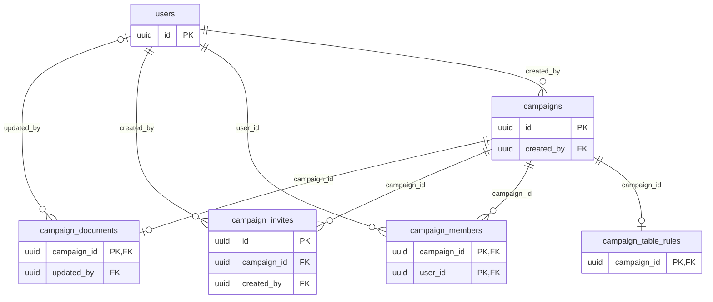

# Campaign tables

The `campaigns` module owns the campaign, its members, invites, document and table rules.
A campaign is the unit everything else hangs from.

## `campaigns`

`name` is 1 to 80 characters; the server also trims the ends, returns Unicode form NFC and refuses line breaks, control and invisible characters and a name with no visible character.
`created_by` is the creating master; deleting that account deletes the campaign and, with it, everything the campaign owns (see [Privacy](../privacy.md#delete-the-account)).
A player's account deletion does not delete the character: the membership goes, the character stays with the master (RN-16).
`xp_mode` is `enemies`, `gold` or `milestones` (RN-09); `xp_mode_changed_at` is when the master last changed it after creation.
`dice_mode` is `players_choose` (default), `app` (everyone rolls in the app) or `physical` (everyone types the total) (RN-18).
`create_key`/`create_hash` are the creation idempotency key (see [conventions](README.md#idempotency-columns)).

## `campaign_members`

The primary key is `(campaign_id, user_id)`, so "is this person a member?" is one read; an index on `user_id` answers "which campaigns is she in?".
`role` is `master` or `player`.
`status` is `active` (default) or `pending`; a `CHECK` allows only a player to be pending.
A pending member is not a member for anything except creating and editing their own character (see [Architecture](../architecture.md#pending-member)).
Approving the character makes the row `active`; refusing it deletes the row, in the same transaction that changes or deletes the character.
`pending_expires_at` is `joined_at + 30 days` while the member is pending and has not made the character, and `NULL` otherwise (a `CHECK` forbids a deadline on an active member); row TTL deletes the row at that time (RN-15).
Reads treat a pending member past the deadline as no member, even before the TTL job passes; a new invite accepted by that person deletes the stale row first.
`dice_preference` (`app` default, or `physical`) is each member's own choice, the master's too; it only counts under `dice_mode = 'players_choose'` and is kept otherwise.

## `campaign_invites`

`token_hash` is the SHA-256 of the 32-byte token (unique); the token is shown once.
`max_uses` and `use_count` have a `CHECK` that `use_count` never exceeds `max_uses`, even with two players accepting at once; `expires_at` is at most 30 days after `created_at` (`CHECK`).
`revoked_at` ends an invite early.
`requires_approval` (RN-15, MR-024) decides whether the person who accepts joins as `active` or `pending`.
Row TTL deletes an invite 30 days after it expires.

## `campaign_documents`

The campaign document (MR-018): at most one row per campaign, `campaign_id` as primary key.
A campaign without a row has an empty document at revision 0; the first save writes revision 1 and each later save raises it by 1, only if the caller still holds the revision it read (see [Architecture](../architecture.md#campaign-document)).
`body` is the Markdown as written, at most 204,800 bytes (`octet_length`, the same unit as the API).
`updated_by` is the last editor; deleting that account keeps the document (`SET NULL`).
The ids inside the text's links (`map:`, `character:`, `image:`) are not foreign keys: a link to something deleted shows as unavailable.

## `campaign_table_rules`

The table rules (MR-025, RN-24): one row per campaign.
**Without a row the defaults apply** (the code reads a missing row as the zero value of `tablerules.Rules`), so no campaign needs a backfill.

| Column | Values | Used by |
| --- | --- | --- |
| `hit_points_rule` | `roll`, `average`, `player_chooses` (default) | level-up |
| `ability_standard_array`, `ability_point_buy`, `ability_roll_4d6`, `ability_typed` | booleans, all on by default; a `CHECK` keeps at least one on | character creation |
| `critical_rule` | `doubled_dice` (default), `max_plus_roll` | combat |
| `death_saves` | `visible_to_all` (default), `owner_and_master` | combat |
| `combat_starts_with_map` | default true | `StartEncounter` when the request does not choose a mode (RN-25) |
| `fog_on_new_maps` | default false | `maps`, when a map is created |
| `feats_allowed` | default false | level-up (see [Architecture](../architecture.md#table-rules-mr-025-rn-24)) |
| `hidden_area_hits` | `reveal` (default), `keep_hidden`, `ask` | what an area spell does to a hidden creature it hits |
| `enemy_reactions` | `only_when_possible` (default), `always` | combat reactions |
| `house_rules` | `TEXT[]`, at most 20 (the server also limits each to 200 characters) | displayed only |

The dice mode stays in `campaigns.dice_mode`; the table style writes it there in the same transaction.
The style itself is never stored: it is derived from the dice mode, `combat_starts_with_map` and `fog_on_new_maps`, and "Personalizado" is whatever matches none of the presets.
Free text exists only in the house rules, which the master writes for the table.

## Who reads

- Any active member reads the campaign, the member list and the table rules.
- The master reads and writes invites, the document and the master's list of pending members; a player never reads the document.
- Token hashes never leave the server.
