# Character tables

The `characters` module owns characters, their vitals and creatures, the level-up log, claim links and the table's own content (classes, spells and so on the master adds).

```mermaid
erDiagram
    characters {
        uuid id PK
        uuid campaign_id FK
        uuid player_user_id FK
        uuid master_user_id FK
    }
    character_master_notes {
        uuid campaign_id PK,FK
        uuid character_id PK,FK
    }
    character_reviews {
        uuid character_id PK,FK
        uuid campaign_id FK
        uuid player_user_id FK
    }
    claim_links {
        uuid id PK
        uuid campaign_id FK
        uuid character_id FK
        uuid created_by FK
        uuid used_by FK
    }
    claim_sign_ins {
        uuid user_id PK,FK
    }
    character_vitals {
        uuid character_id PK,FK
        uuid familiar_sight_creature_id FK
    }
    character_wild_shapes {
        uuid character_id PK,FK
    }
    character_level_ups {
        uuid id PK
        uuid campaign_id FK
        uuid character_id FK
    }
    character_level_up_rolls {
        uuid character_id PK,FK
        int to_level PK
    }
    character_ability_rolls {
        uuid campaign_id PK,FK
        uuid user_id PK,FK
    }
    character_creatures {
        uuid id PK
        uuid campaign_id FK
        uuid character_id FK
    }
    campaign_content {
        uuid campaign_id PK,FK
        text content_key PK
    }
    campaign_content_state {
        uuid campaign_id PK,FK
    }
    campaign_content_off {
        uuid campaign_id PK,FK
        text content_key PK
    }
    campaign_content_imports {
        uuid campaign_id PK,FK
        text create_key PK
    }
    campaigns {
        uuid id PK
    }
    users {
        uuid id PK
    }
    campaigns ||--o{ campaign_content : "campaign_id"
    campaigns ||--o{ campaign_content_imports : "campaign_id"
    campaigns ||--o{ campaign_content_off : "campaign_id"
    campaigns ||--o| campaign_content_state : "campaign_id"
    campaigns ||--o{ character_ability_rolls : "campaign_id"
    users ||--o{ character_ability_rolls : "user_id"
    campaigns ||--o{ character_creatures : "campaign_id"
    characters ||--o{ character_creatures : "character_id"
    characters ||--o{ character_level_up_rolls : "character_id"
    campaigns ||--o{ character_level_ups : "campaign_id"
    characters ||--o{ character_level_ups : "character_id"
    campaigns ||--o{ character_master_notes : "campaign_id"
    characters ||--o{ character_master_notes : "character_id"
    campaigns ||--o{ character_reviews : "campaign_id"
    characters ||--o| character_reviews : "character_id"
    users ||--o{ character_reviews : "player_user_id"
    characters ||--o| character_vitals : "character_id"
    character_creatures |o--o{ character_vitals : "familiar_sight_creature_id"
    characters ||--o| character_wild_shapes : "character_id"
    campaigns |o--o{ characters : "campaign_id"
    users |o--o{ characters : "master_user_id"
    users |o--o{ characters : "player_user_id"
    campaigns ||--o{ claim_links : "campaign_id"
    characters ||--o{ claim_links : "character_id"
    users ||--o{ claim_links : "created_by"
    users |o--o{ claim_links : "used_by"
    users ||--o| claim_sign_ins : "user_id"
```

## `characters`

The campaign is on the row: `campaign_id` replaces a `campaign_characters` link table.
With a column, RN-03 ("one living character per player in a campaign") is a partial unique index `characters_one_living_player_character` on `(campaign_id, player_user_id)` where `kind = 'player'` and `status != 'dead'`, so a pending character (MR-024) also counts as living.
An NPC stays in the campaign where it was created.

- **`kind`** is `player`, `enemy`, `boss`, `minion` or `story`.
  Enemy and boss use the full sheet, minion and story the basic one.
- **The owner is in two columns.** `player_user_id` (player characters only) is `SET NULL` when the account is deleted, so the character stays with the campaign's master (RN-16).
  `master_user_id` (NPCs only) is `CASCADE`: the master's NPCs go with the account.
  A `CHECK` (`characters_owner`) forbids a player character with a master owner and an NPC without a master or with a player.
  `campaign_id` is `SET NULL`: when the campaign is deleted, the player character stays with the player.
- **State** is `status` plus `sheet_locked_at`; the API computes `CharacterState` from the two (see [Rules](../product/rules.md#character-lifecycle)).
  `status` is `active`, `dead` or `pending`.
  A dead character changes state, never row (RN-03) and has `died_at` (`CHECK`).
  `CHECK`s allow only a player character to die, be pending, be locked or get the story release.
- **Death and Revivify.** `ReviveCharacter` sets `status` back to `active`, sets `revived_at`, leaves `sheet_locked_at` and keeps `died_at`; a new death sets `died_at` again.
  `death_round` and `death_encounter_id` (no foreign key) say in which combat and round the master confirmed the death (`NULL` outside a combat).
  `revivify_blocked` is the switch "Revivificar não funciona nesta morte".
  `revive_key`/`revive_hash` are the idempotency key of the last `ReviveCharacter`.
- **Pending.** A character made by a pending member is born `pending` (MR-024).
  The session does not lock it (`LockSheets` locks only `active`), and it cannot die.
  The master approves it (`active`, same revision) or refuses it.
  `RejectCharacter` deletes the row and the pending membership; it is the only character deletion outside account deletion, and the query deletes only `status = 'pending'` rows.
- **Reserved characters (MR-049).** `reserved = true` means a player character with no owner for a player to claim (`CHECK characters_reserved_shape`: `kind = 'player'`, `player_user_id` NULL, `status = 'active'`, `claimed_at` NULL).
  `claimed_at` is set when a player takes it through a link and is what lets the master give it back; it lives on the character because the link row expires.
  The queries that list a party leave reserved characters out.
- **`sheet`** is the protojson of `CharacterSheet`: the player's choices by content key such as `class:wizard`.
  **`story`** is the protojson of `CharacterStory` (personality, appearance, history, allies).
  Both are JSON objects of at most 128 KiB (`CHECK`); the API limits, in characters, are well below.
  `sheet_schema` marks the sheet document's version.
- **Sheet fields that are not columns.** The NPC's `initiative_bonus`, `attacks`, `monster_key`, `ability_scores`, `challenge_rating`, `xp_value`, `portrait_image_id` (a gallery image of the campaign; deleting the image removes the field from the sheets and raises their `revision` in the same transaction), the XP (`FullSheet.experience_points`, which `progression` adds to), the content revision a sheet was saved with and its `known_issues` live inside the JSON.
  `combat_only` marks the NPC the app keeps for each creature put in combat (RN-29): one per campaign and creature (for a table creature, one per set of numbers), reused by every combat, never shown in `ListCharacters` to the master and never deleted.
  The cap on characters (RN-30) does not count it; combat-only NPCs have their own cap of 1,000 per campaign.
- **`active_states`** (JSONB, `'[]'`) is the list of temporary states that are on, `{"key": "<feature key>#<state name>", "rounds_left": N}` in the order they began, with `rounds_left` absent for a state that lasts until it ends.
  A `CHECK` allows an array of at most 32 items. It is on the character, not on `character_vitals`, because the sheet's numbers depend on it (see [Characters](../architecture/characters.md#temporary-states)).
- **`story_editing_allowed`** is the master's story release, character by character (RN-01); the start of each session turns off all the campaign's releases.
- **`revision`** goes up on each change of name, sheet or story.
  A save with an old revision gets `aborted`.
  Locking, dying and releasing the story do not touch it.
- **`create_key` (UUID) and `create_hash`** are the idempotency key of `CreateCharacter` and of "Create NPC" from a creature (see [conventions](README.md#idempotency-columns)).
- **Indexes.** `(campaign_id, player_user_id)` serves the lists and the lock.
  There is no index on `player_user_id` or `master_user_id` alone: only account deletion searches by them.
- **Row TTL** deletes only the orphan: a player character with no player and no campaign (see [Retention](README.md#retention-and-ttl)).

## `character_master_notes`

The master's private notes about a character: primary key `(campaign_id, character_id)`, so the same NPC in two campaigns can have separate notes.
`notes` is 1 to 20,000 characters; empty notes delete the row.
Both foreign keys cascade, including when a pending character is refused.
The query that builds a player's sheet never touches this table, so it cannot leak (RN-11).

## `character_reviews`

The master's "Pedir ajustes" on a pending character (RN-15): one row per character that was sent back, none while the review is awaiting.
`status` is `changes_requested` or `resubmitted` (with `resubmitted_at`, by `CHECK`).
`reason` is 1 to 500 characters of the master's text about the player, which is personal data of the player (see [Privacy](../privacy.md)).
`request_key`/`request_hash` and `resubmit_key`/`resubmit_hash` are the idempotency keys of the last request and last resubmit.
The character, the campaign and the player all cascade, and approval deletes the row in its own transaction.

## `claim_links` and `claim_sign_ins`

`claim_links` holds the link the master sent for a reserved character (MR-049), one row per link.
Like `campaign_invites`, only the SHA-256 of the 32-byte token is stored (`token_hash`, unique); the secret is shown once.
A link works while `used_at` and `revoked_at` are NULL and `expires_at` is in the future; `CHECK`s keep it within 30 days and forbid a link that is both used and revoked.
The partial unique index `claim_links_one_live_per_character` allows one live link per character, even when two `CreateClaimLink` calls race (a new link revokes the old one first).
`used_by` is the person who took the character (`SET NULL` if they delete the account).
Row TTL deletes the link 30 days after it ended.
Taking the character, the **claim**, is one transaction: it sets `player_user_id`, clears `reserved`, sets `claimed_at`, makes the person a member and spends the link.
`ReturnCharacterToReserve` reverses it and keeps the membership.

`claim_sign_ins` keeps, for a person who signed in with a claim link, the SHA-256 of that link for 10 minutes (one row per person, replaced by a newer link), so the page can show the card after sign-in without the secret in the address.
Nothing is claimed by it.

## `character_vitals`

What changes during play and lasts from one session to the next (RN-02).
The primary key is `character_id` (`CASCADE`).
Only player characters have a row; an NPC's combat HP lives on `combatants`.
**Without a row the character is whole**: full HP, nothing used.
The row is born at the master's first correction.
The name is "vitals" because a character's *state* already means the lifecycle.

| Column | Meaning |
| --- | --- |
| `hit_points_current` | `NULL` until set, which reads as full HP whatever the maximum becomes. |
| `hit_points_temporary` | Temporary HP. |
| `hit_points_max_bonus` | The HP Aid added to the maximum. |
| `spell_slots_used` | `INT4[]`: item k is the used slots of level k (at most 9 items). |
| `spell_slots_created` | Same shape: slots Flexible Casting created, which add to the sheet's and vanish on a long rest. |
| `pact_slots_used`, `hit_dice_used` | The warlock's pact slots; hit dice spent across all classes. |
| `hit_dice_used_by_die` | The same dice by die size, JSONB `{size: count}`. `NULL` reads from `hit_dice_used`, largest dice first. |
| `resources_used` | JSONB `{resource key: spent uses}`: Second Wind, Action Surge, Rage... |
| `armor_class_base` | The base armor class an effect gives (Mage Armor), 1 to 60. |
| `exhaustion_level` | 0 to 6. |
| `familiar_sight_creature_id`, `familiar_sight_in_combat`, `familiar_sight_conditions` | The player sees through the familiar (MR-036); the creature is `SET NULL`. |
| `revision`, `updated_at` | `revision` goes up on each correction. |

**Maximums are not stored.** `rules.Derive` computes max HP, slots, pact slots and hit dice on each read, and the server cuts the stored usage to today's maximum on read only: a correction writes back the stored usage, changing just what it sets, so a sheet that loses a level for a while gets its usage back with it.
So there is no maximum `CHECK`, only a minimum of 0.

## `character_wild_shapes`

The druid's Wild Shape (MR-037): one row per character in beast form.
`beast` is the SRD creature (`monster:wolf`) and `hp` the beast's current HP, 1 or more; at 0 the form ends and the row disappears (the maximum is the beast sheet's, never stored).
The character's own HP stays still and only takes carry-over damage.
It is a separate table, not vitals columns, because of locking: a combat write changes the vitals row and then reads the sheet through another connection, which now needs the form; on the same row it would wait on its own transaction.
For the API it is part of the vitals (`CharacterVitals.wild_shape`), and changing the form raises the vitals' `revision` in the same transaction.

## `character_level_ups` and `character_level_up_rolls`

`character_level_ups` (MR-040) is the log of each guided level-up: one row per level-up, written in the transaction that saves the sheet and never changed.
`class_key` is the class that gained the level; `from_level` and `to_level` are total levels (`to_level = from_level + 1`, at most 20, `CHECK`); `hp_method` (`average`, `rolled_in_app`, `rolled_physical`) and `hp_value` (1 to 12) repeat the HP so the history reads without opening the JSON; `choices` is the protojson of `LevelUpChoices` (content keys and numbers, no free text).
The master reads the campaign's log newest first, in pages, through `(campaign_id, created_at DESC, id DESC)`; `(character_id, created_at DESC, id DESC)` serves one character's log.

`character_level_up_rolls` holds the hit die the server rolled for the next level, until the level-up uses it.
The primary key is `(character_id, to_level)`, **not** per class: the server rolls once and returns the same result on later calls (RN-18), so a two-class character does not roll a d6 and a d12 for one level and keep the better.
`class_key` is the class that rolled, and the roll is valid only for it; `die` is 6, 8, 10 or 12 and `value` is 1 to `die`.
The level-up deletes the row; the value remains in `character_level_ups`.

## `character_ability_rolls`

The six sets of 4d6 the server rolled (or the player typed with physical dice) for a player's next sheet (MR-025, RN-24): one row per `(campaign_id, user_id)`.
`sets` is JSON such as `[[6,5,5,2],...]` (the lowest die of each set is dropped) and `source` is `app` or `typed` (RN-18).
The server returns the same sets until `CreateCharacter` uses them and deletes the row in the same transaction.
Numbers only.

## `npc_spell_use`

The spell slots and per-day uses a hand-made NPC spent, kept from one combat to the next.
Primary key `character_id`, which cascades with the character; `slots_used` is JSON with the keys of `combatants.slots_used` (`"1"` to `"9"`, `"pact"`, `"res:<resource>"`); `updated_at`.
A monster's `combat_only` NPC never has a row: each fight of it starts with an empty count.
Several copies of one NPC share the row, and it keeps the highest count any copy of the combat holds, never the sum: `SyncNPCSpellUse` sets it after each change of `combatants.slots_used` (an undo too), so an undo lowers it only when no other copy holds more.
`SeedCombatantSlotsUsed` copies the row into each combatant when the NPC joins a combat, and the table's long rest deletes the rows of the campaign.

## `character_creatures`

A player character's creatures (MR-037): the familiar, animals and undead a spell summoned, those the master gave.
They last from session to session until dismissed; the app never counts a spell's duration.
`monster_key` is the SRD creature or the table creature (`creature:<slug>@mesa`, a `campaign_content` row of kind `creature`); the sheet comes from `rules`, never stored; `name` is the player's name for it, **free text of 1 to 40 characters** (listed in [Privacy](../privacy.md)); `source` is `familiar`, `animate_dead`, `conjure_animals`, `table` (a table spell's summon) or `master`; `attack` is what the spell lets it do (`none`, `reaction`, `full`).
`summon_key` (migration 00299) is the table spell that summoned the creature, set exactly when `source` is `table`.
`summon_group_id` groups the creatures of one casting (initiative and undo; a summon with its own initiative gives each creature its own group); `concentration_cast_id` marks those that last only while the caster concentrates.
`hp_current` and `hp_max` (copied from the creature sheet at birth: a table creature's entry is copied when the creature is given, and a later edit of the entry does not change them) are its HP outside combat, corrected by the master (RN-02).
`stat_block` (`JSONB`, `NULL` by default; migration 00297) is the numbers of a table creature whose entry has formulas, worked out for its owner when the creature is created (a `rules.ResolvedCreature`).
It is a snapshot: a later level of the owner or an edit of the formulas does not change it.
It is `NULL` for an SRD creature and for a table creature with no formula, whose numbers are read from the content.
A dismissed creature is not deleted: it keeps `dismissed_at` and `dismissed_reason` (`owner`, `master`, `defeated`, `concentration`, `replaced`, `undone`; both set or both NULL, `CHECK`), so the master's undo can bring it back.
Partial index on the living ones of a character; indexes on the summon group and the campaign.
Cascades with the campaign and the character.

## Table content

The content the master adds to a campaign (MR-025, RN-23, ADR-0018): classes, subclasses, races, subraces, backgrounds, spells, feats, options, class features and creatures.
It lives in `characters` and not in `campaigns` so that `characters` never writes another module's table.

- **`campaign_content`**: one row per entry.
  The key is `<kind>:<name>@mesa`, built by the server at creation and never changed (`CHECK`).
  `kind` is one of ten: `class`, `subclass`, `race`, `subrace`, `background`, `spell`, `feat`, `option`, `classfeature` and `creature` (the `campaign_content_kind_valid` `CHECK`; migration 00289 added `creature`).
  `name_pt` is the Portuguese name, `data` the protojson of the kind's message (`rules/v1/table_content.proto`), `revision` the campaign revision at the entry's last change.
  **Nothing is deleted**: what a sheet already uses must keep working, so the way out is `archived_at`.
  Archiving and unarchiving change only `archived_at` and the campaign revision (for the cache), not the entry's `revision` and `updated_at`; `updated_at` is the date of the last real change, the one the "A classe mudou" warning shows.
  The limits are 1,000 entries per campaign and 64 KiB of `data` per entry (server rules, which show the error on the field; a 128 KiB `CHECK` on `data` is the last defence, with room for JSONB being longer than compact protojson).
- **`campaign_content_state`**: the campaign's content revision, one row per campaign, created by the first write (no row means revision 0).
  Every write raises it in the same transaction, so two writes to one campaign run one after the other, and every content read reads this row inside the caller's transaction (see [Architecture](../architecture/characters-table-content.md#the-live-source)).
- **`campaign_content_off`**: the options the master turned off for the players ("Opções para os jogadores").
  **No row means on**; turning on again deletes the row.
  The key is that of an SRD or table class, subclass, race, subrace, background, spell or feat, or of a table option, class feature or creature (`class:wizard`, `race:anao@mesa`, `creature:lobo-da-mesa@mesa`); it is not a foreign key, because SRD keys live in the rules snapshot, and the server checks the key exists before writing.
  Each write raises the campaign revision.
- **`campaign_content_imports`**: the idempotency record of `ImportTableContent`, primary key `(campaign_id, create_key)`, with `create_hash` and the stored `response` (protobuf).
  See [Architecture](../architecture/characters-table-content.md#content-packs-exporttablecontent-importtablecontent).

Only names and texts the master writes; no personal data (see [Privacy](../privacy.md)).

## Who reads

- A player reads their own character's sheet, story and vitals, and the sheet of other characters only as the API's player view allows.
  The master reads every character of the campaign, `character_master_notes` and `character_reviews`.
- `character_master_notes`, `claim_links` and the NPC fields hidden from players (`xp_value`, `challenge_rating`, `combat_only`) never reach a player.
- A reserved character is read by the master only until it is claimed.
- `character_ability_rolls` is read by its player only.
- Table content (`campaign_content`) is read by the whole campaign through the rules overlay, minus what `campaign_content_off` switched off, which never reaches a player in any read; the import records are not read by players.
- `character_creatures` are read by the owner and the master; the creature's name is free text.
