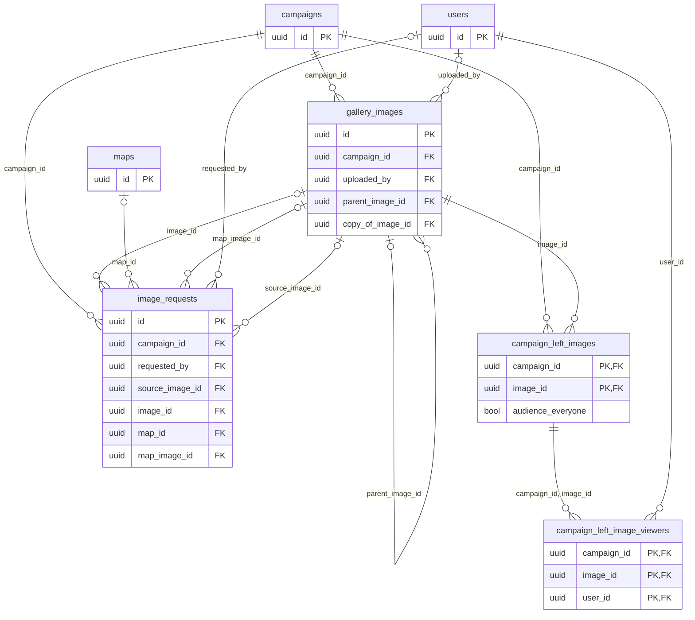

# Gallery tables

The `maps` module owns the campaign's image gallery, the AI image requests and the images left with the players.

## `gallery_images`

The row keeps only the image's description; **the file lives in the blob store** (on disk locally, in Cloud Storage in production) under `campaigns/<campaign_id>/images/<id>` and `…/<id>.thumb`, plus `…/<id>.ref`, the 1,024 px reference that goes to the AI, only for larger images (see [Architecture](../architecture/maps/image-generation.md)).
`id` has no `DEFAULT`: the API creates the id before writing the files, whose keys carry it.
The files go first and the row last, so every row has its files; deleting does the opposite (see [Architecture](../architecture/maps/README.md)).
Deleting a campaign deletes the rows but not the files: the blob-store prefix `campaigns/<campaign_id>/` is deleted separately (see [Privacy](../privacy.md)).

- **The stored image is not the one uploaded:** the server encoded it again, without metadata.
  `content_type` (`image/jpeg` or `image/png`), `width` and `height` (1 to 8,192) and `byte_size` (1 byte to 10 MiB) describe the stored image, and `CHECK`s repeat the API limits.
  `byte_size` counts toward the campaign quota (300 images and 500 MiB, the `maps` defaults, checked in the `INSERT` transaction).
- `name` comes from the file name; the master changes it. 1 to 80 characters, free text.
- `uploaded_by` is who uploaded, for more than one master (RN-13); it does not go out in the API.
  `SET NULL`: the image stays when the account leaves.
- `generated`, `parent_image_id`, `generated_kind` (MR-039): an image the `ImageGenerationService` stored has `generated = true` and is hidden from players like any image (RN-10).
  An adjustment points to the image it started from (`parent_image_id`, `SET NULL`); the chain is the tree of those links (`ListImageEdits`, a recursive query).
  `generated_kind` is `scene`, `map_scene`, `isometric` or `textured_map` (empty on an upload), and an adjustment inherits the chain root's.
  A `textured_map` image shows the whole map, including what the players have not discovered, so the app asks before showing it to players, and only it and its adjustments can become the map image (RN-10).
- `copy_of_image_id` marks the copy of a fog map's image made to show it to the players, or to be an NPC's portrait (RN-10: the original never reaches a player).
  Showing the same image again finds the copy instead of making another (a file and a quota slot each time).
  A copy that has become the background of a fog map is never reused.
  `SET NULL`: deleting the original keeps the copy.
- Indexes: `(campaign_id, created_at DESC)` with `byte_size` stored (the gallery newest first, and quota use), and partial indexes on `parent_image_id` and `copy_of_image_id`.

## `image_requests`

The request and the month's count.
A campaign's monthly slot is the month's rows (`quota_month`, in the form `YYYY-MM`, on fixed UTC-3 time) that were not refunded (`refunded`).
A row's life:

- `pending` without `sent_at`: the slot is reserved and the request has not left ("Cancelar" gives the slot back).
- `pending` with `sent_at`: it left.
  "Cancelar" only stops the waiting, the slot stays spent, and the image, if it comes, goes to the gallery.
- `done` (with `image_id`).
- `refused` or `failed`: nothing was generated (`refunded = true`, with `reason`).
- `canceled`.

A `pending` row that never left and is older than 10 minutes (the server restarted midway) fails and gives the slot back.
One that left and is still `pending` 10 minutes later fails as `timeout` **with the slot spent** (the call may have been billed); if the image still arrives it enters the gallery and the request becomes `done`, once only, in the same transaction as the `INSERT`.
Both happen when someone reads the request, the month's state or asks for another image.

- `idempotency_key` (unique per campaign) and `idempotency_hash` make a retry return the first row.
- `prompt` is the master's text as written (1 to 500 characters); it disappears with the campaign (`CASCADE`), with no TTL.
  `style`, `aspect_ratio`, `model`, `number` (the "Imagem n" number) and `kind` (`scene`, `edit`, `map_scene`, `isometric`, `textured_map`) describe the request.
- `reference_ids` and `character_ids` are gallery image ids sent as reference, as text with no foreign key (an image deleted later makes the request fail again with "an image was deleted"); `character_ids` also keeps the portraits of the marked NPCs.
  `source_image_id` is the image an `edit` started from.
- `image_name` is the name the image will have in the gallery, because the player it is shown to reads it.
- **Requests made from a map** (`map_scene`, `isometric`, `textured_map`) have `map_id` (`SET NULL`) and the map as the request saw it: `map_image_id`, `map_grid_columns`, `map_grid_factor`, `map_width`, `map_height`.
  "Usar como imagem do mapa" is valid only while the map still has that image, those columns and that factor (`map_image_id` becomes `NULL` if the image is deleted).
  `map_plan_hash` is the hash of the floor and walls the drawing showed.
  `pad_x0`, `pad_y0`, `pad_x1`, `pad_y1` are the fractions of the map rectangle in the textured-map drawing, used to crop the model's answer.
  `used_map_image_id` is the image "Usar como imagem do mapa" put on the map (its own, or a fog map's copy), so a repeated "Usar" answers the same while it is still the map's image.
  The reference drawing is stored nowhere: it is redone from the map on each request and goes only to the AI service.
- Indexes: `(campaign_id, quota_month)`, `created_at` (the server-wide daily cap counts the day's rows without scanning), and partial indexes on the four image and map foreign keys (`image_id`, `source_image_id`, `map_id`, `map_image_id`).

## `campaign_left_images`

Images left with the players (MR-028).
They belong to the campaign, not the session: they remain after the session ends, until the master takes them away.
Primary key `(campaign_id, image_id)` lists a campaign's images and prevents leaving one twice; `left_at` gives the order.
Both foreign keys cascade.
The switch is `game_sessions.shown_image_keep` ([play.md](play.md#game_sessions)).
`audience_everyone` (true by default) says the image was left with the whole table; when it is false the image was left only with the players of `campaign_left_image_viewers` (`(campaign_id, image_id, user_id)`, cascading with the left image and the player's account; `user_id` is indexed): the players who were in the audience of the shown image when it stopped being shown (RN-10).
It is a column, not "no rows", so erasing the last player's account never leaves the image with everyone.
Leaving an image again takes the audience of the latest leaving.

## Who reads

- Players read only the images the master showed or left with them, and the copies made for them; a generated image and its original are hidden like any image (RN-10).
- `image_requests` (prompts, models, quota) are the master's.
- `uploaded_by` and the blob keys never go out in the API.
