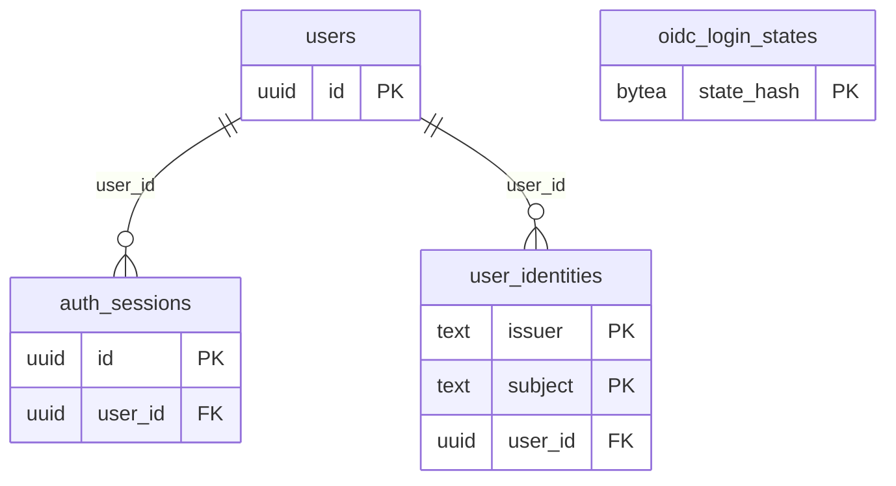

# Identity tables

The `identity` module owns the account, the way a person signs in and the server-side session.
It holds no profile beyond an optional display name.

`oidc_login_states` links to no account: the sign-in has not finished, so nobody knows who it is yet.
Every foreign key to `users` is `ON DELETE CASCADE`: deleting the account deletes its identities and sessions.

## `users`

The account only: `id` and `created_at`.
`display_name` is `NULL` until the person chooses one, is 1 to 40 characters (`CHECK`) and never comes from the sign-in provider.
The provider's name and photo are never stored.

## `user_identities`

Links an account to an OIDC sign-in.
The primary key is `(issuer, subject)`, because `sub` is only unique within a provider; the code does not depend on Google, and another way to sign in (ADR-0009) needs no change to `users`.
`UNIQUE (user_id, issuer)`: an account has at most one identity per provider, so two Google accounts never merge.
`email` is stored only when the provider says it is verified, and is updated or erased at each sign-in.

## `auth_sessions`

The server side of each sign-in session (ADR-0002).
`id` lists and revokes a session; `token_hash` is the SHA-256 of the cookie token (unique, with `user_id`, `created_at` and `expires_at` stored in the index, so the lookup reads one index).
`auth_time` is a record only.
`last_used_at` is the last use, for the idle limit (`SESSION_IDLE_TIMEOUT`); it is written at most every 10 minutes and left out of the lookup index.
A `CHECK` keeps a session within 30 days; row TTL deletes it at `expires_at`.
The index on `user_id` serves "sign out of all devices" and account deletion.

## `oidc_login_states`

One row per sign-in in progress, keyed by the SHA-256 of `state` (`state_hash`).
It holds the PKCE `code_verifier`, the `nonce` and `return_to`, lives at most 10 minutes (`CHECK`, hourly row TTL).
`intent_kind` and `intent_data` hold what to finish right after sign-in, such as accepting an invite (see [Architecture](../architecture.md#accepting-an-invite-through-sign-in)).
Both are `NULL` on an ordinary sign-in and a `CHECK` requires them together, the kind with 1 to 32 characters and the data with at most 256 bytes.
For an invite, `intent_data` is the SHA-256 of the invite token, never the token.

## Who reads

Only the `identity` module reads these tables.
The API answers a person with their own account (`GetMe`) and their own sessions; no other person's rows are reachable.
Token hashes never leave the server.
