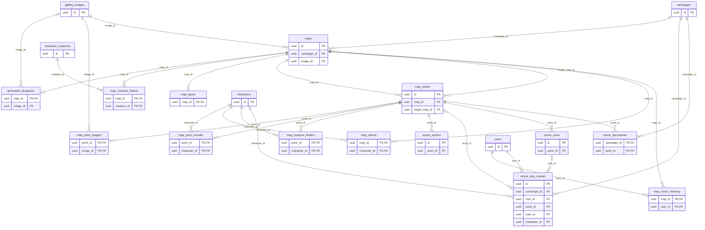

# Map tables

The `maps` module owns maps, their points of interest, painted layers, tokens, fog memory, generated dungeons and the RP scenes with their clues.
The gallery images they point to are in [gallery.md](gallery.md).

Limits the server checks in the `INSERT` transaction: 200 maps per campaign (`DefaultMaxMaps`) and a per-map point limit (`DefaultMaxPointsPerMap`), answered with `resource_exhausted`.
The lists are not paginated.

## `maps`

- **`image_id` is `ON DELETE RESTRICT`**: an image used in a map cannot be deleted, and `DeleteGalleryImage` answers `failed_precondition` with the detail `ImageInUse`, naming the maps (MR-019).
  The server also checks the image belongs to the same campaign.
  Deleting a campaign deletes maps and images in one statement; CockroachDB checks the `RESTRICT` at its end, when both are gone (`TestDeletingTheCampaignDeletesItsMaps`).
  Indexes: `(campaign_id, created_at)` and `image_id`.
- `revealed_at` is when the master revealed the map; empty means hidden, and every map is born hidden.
  The player sees the revealed map, or the session's current map even if hidden.
- `revision` goes up when the name or image change (revealing does not); a save with an old revision gets `aborted`.
- **The grid (MR-013, RN-21).** `grid_columns` is how many 1.5 m squares fit in the image width, 4 to 200, or `NULL` without a grid.
  Rows are not stored: they follow the image's aspect ratio.
  Changing the grid touches `updated_at`, not `revision`.
  It is the grid **of the rules**, the one every layer, the fog and the combat use.
  With the calibration (`grid_factor`, 1 to 20, MR-025, RN-25; `grid_columns` must be a multiple, by `CHECK`) the drawing's columns are `grid_columns / grid_factor` and the rules' rows are the drawing's times the factor.
  Other drawing columns, or a smaller factor, or one that is not a multiple of the old one, erase the painted layers and the players' memory, like replacing the image; a factor that is a multiple of the old one with the same drawing columns **multiplies** them (each square becomes a block, `rules/grid` `Scaled`).
  Both are refused while a combat is on the map; removing the grid turns the fog off and returns the factor to 1.
- **Fog (MR-036).** `fog_enabled` (off by default; it turns on only with a grid, which the server checks; turning it off erases nothing), `base_light` (`dark` default, `dim`, `bright`; `bright` shows the players the whole floor plan, generated dungeons are `dim`) and `group_vision` ("Visão do grupo", off).
  `fog_on_first_grid` means the table rule "fog on new maps" was on at birth and has not been applied yet; the fog turns on with the first grid (RN-24).
- **Counters apart from `revision`**, so that painting never makes another tab's `UpdateMap` fail with `aborted`: `layers_revision` and `light_revision` go up once per change of the painted layers (the light, which no player reads, on its own counter; the master reads the sum).
  `vision_epoch` is the generation of the players' memory and goes up with each clearing.
- `create_key`/`create_hash` are the creation idempotency pair.

## `map_layers`

The layers painted on a map (MR-034, MR-036): `map_id` is the primary key (`CASCADE`), and `difficult_terrain`, `walls`, `cover`, `light` and `doors` are `BYTEA` in the `rules/grid` packed format, row by row.
Terrain and wall are 1 bit per square; cover and light 2 bits; doors (MR-010, RN-26) 4 bits per square (square `n` is the low nibble of byte `n / 2` when `n` is even and the high one when odd): 0 none, 1 open, 2 closed, 3 locked, 4 portcullis, 5 secret.
They are a separate table because `maps` is almost always read whole.
A map with nothing painted has no row, and an unpainted layer is `NULL`.
The server measures each layer against the grid on write and reads as "nothing painted" one that does not fit.
Changing the drawing's columns or the image deletes the row; a calibration that is a multiple of the old one rewrites the five layers at scale, in the same transaction.

## `map_vision_memory`

What each player **has already seen** of a map with fog (MR-036): one row per `(map_id, user_id)`.
`seen` is a bitmap in the `rules/grid` format (1 bit per square, per row); a wall seen next to a seen square counts as seen.
It only grows, in the writes that change what someone sees (never in a read), and keeps **squares, never creatures**: a remembered square shows no NPC.
`epoch` is the `maps.vision_epoch` it was made in: each clearing (grid or image changed, the master's `ForgetMapVision` "Esquecer o que foi visto") raises the map's epoch, and a row of an old epoch reads empty and is never written back (the write checks the epoch inside the command).
A calibration that is a multiple of the old one rewrites it at scale instead of clearing it.
Cascades with the map or the player.
No extra index: the primary key serves who reads and who deletes by map.

## `generated_dungeons`

One row per map made by `DungeonService` (MR-010, RN-26); the primary key is `map_id` (`CASCADE`).
**Master only**: the room list, seed and options give the dungeon away (RN-10).
It keeps everything the map was made from: `seed` (the generator's `uint64` as `INT8`, the same 64 bits), `generator_version`, `width` and `height` (15 to 199 by 15 to 399, `CHECK`), `options` (the `DungeonOptions` message as used, defaults filled in), `rooms` (a `GetDungeonRoomsResponse` with only the rooms, the true kind of each door, the trap mark, the doors, stairs and the entrance) and `cells`, the final grid of square types, 2 bits each (0 rock, 1 room, 2 corridor, 3 door; square `n` is in bits `2 × (n mod 4)` of byte `n / 4`, from the low bit).
"Redesenhar" uses the cells, with today's layers, to know what is solid rock.
Because the cells are stored, a new generator version never changes an existing map.
A `CHECK` verifies `cells` has `⌈width × height / 4⌉` bytes (by multiplication, because CockroachDB integer division gives a decimal).
`image_id` is the image the generator drew (`SET NULL`; `NULL` means unknown and never matches): "Redesenhar" replaces and deletes only that image and refuses a map whose image is another.
No personal data.

## `map_points`

Points of interest.

- `kind` is `battle`, `submap`, `scene`, `trap`, `treasure` or `light`.
  `name` (1 to 80) and `description` (up to 2,000 characters) are the master's text for the players.
  `x_bp` and `y_bp` are the position in base points (0 to 10,000) of the image's width and height, independent of the image size.
- `target_map_id` is the map a `submap` leads to, or a `battle` point's combat map (MR-013): only on those kinds, never the map itself, always of the same campaign (the server checks).
  `SET NULL` when the target map is deleted; the point's own map cascades.
- `revealed_at` works like the map's; every point is born hidden.
  A **trap** is seen by all when `revealed_at` is set, by whoever has a `map_point_reveals` row, and by everyone once `trap_triggered_at` is set.
  A **treasure** is seen by everyone when `treasure_found_at` is set.
  A **light** is never sent to a player.
- **Data of the newer kinds**, `NULL` in the others (one `CHECK` per kind): `trap` (JSONB in the shape of the API's `TrapSpec` without the state), `trap_state` (`armed`, `triggered`, `disarmed`), `trap_triggered_at` (the first time it fired; only a combat firing's "Desfazer" clears it: a trap that fired is public even disarmed or re-armed); `treasure_value_po` (0 to 1,000,000), `treasure_found_at`, `treasure_session_id` (the session open when found), `treasure_converted_award_id` (the XP award that converted it; with it set, the value and the mark are locked); `light_preset`, `light_bright_ft`, `light_dim_ft` (0 to 120, multiples of 5, not both 0).
- The two `treasure_…` ids have no foreign key, on purpose: `map_points` and `game_sessions` already reference each other (the open scene), and a reference to `game_sessions` or `xp_awards` would close a cycle the test databases' table copy cannot build.
  A session and an award only disappear with the campaign, which takes the points with it.
- A found (or converted) treasure cannot be deleted, nor can its map.
  Changing the kind erases the old kind's data, except for a found treasure, whose kind cannot change until the master unmarks it (`TREASURE_FOUND`).
- `stairs` is `up` or `down` on a generated dungeon's staircase (MR-010), `NULL` elsewhere.
- `hooks` are the master's "Ganchos e anotações", up to 4,000 characters, only on a `scene` point, never sent to a player (RN-20).
  `show_dc` ("Mostrar a CD aos jogadores", off) is turned on only for a scene point.
  Changing the kind clears the hooks and deletes the actions, clues and images.
- Indexes: `(map_id, created_at)`, `target_map_id`, and partial indexes on the two treasure columns.
- `create_key`/`create_hash`: the treasure generator's "Put on the map" (see [conventions](README.md#idempotency-columns)).

## `map_point_reveals` and `map_treasure_finders`

`map_point_reveals` (RN-10) records who knows a trap: one row per `(point_id, character_id)`; `how` is `noticed` or `searched` (in play) or `master` (`RevealTrap`), `at` is when.
There is no undo.
`map_treasure_finders` (MR-041) records who found a treasure, `(point_id, character_id)`; marking again replaces the set, unmarking deletes.
Both cascade with the point or the character; neither has an index by `character_id`, because only character deletion searches for it.

## `map_tokens` and `map_creature_tokens`

`map_tokens`: one token per character per map, primary key `(map_id, character_id)`.
The character is a living character of the campaign, player or NPC (checked by `characters`); one who dies stays in the table but `GetMap` does not list it.
`hidden` is born `false` for a player character and `true` for an NPC.
`carried_light` is the key of the light the character carries (`light:torch`), or `NULL`; only the master and the character's owner receive it.
`x_bp`, `y_bp` are base points, as for points.

`map_creature_tokens` (MR-037): the token of a character's creature on the exploration map, primary key `(map_id, creature_id)`.
It is a table of its own because `map_tokens`' key is per character and a character has many creatures.
There is no `hidden`: it is a group token which no player stops seeing.
`maps` asks `characters` for the living creatures (`MapCreatures`); a dismissed one is not listed although the row stays.
Combat only moves a token that already exists, at the end of the fight; the master creates it (`PlaceMapToken` with `creature_id`).

## Scenes and clues

- **`scene_actions`** (MR-015): the actions of a RP scene.
  `point_id` is a `scene` point; the API accepts an action only on that kind and deletes the actions when the point changes kind.
  `position` orders from 0 (not unique: moving renumbers).
  `key` is `skill:<skill>`, `ability:<ability>` or `save:<ability>` (a `CHECK` on the format; the API checks the key in the rules catalog, `rules.Content.SceneCheckName`, and attack, spell and combat ability never enter).
  `name` is the master's label (up to 60 characters, empty for none); `dc` is 1 to 30 or `NULL`.
  `max_attempts` is how many times each player may roll the action while the scene is open: 1 by default, 1 to 5, or 0 for unlimited; the rolls and the attempts given live in `session_events`, so lowering the limit deletes nothing.
  `hidden` (default false) keeps the action from the players ("Escondida"): the master's reads carry it, a player's never do, and a roll on it is refused as on an action that does not exist.
  At most 20 per point (`maxSceneActions`).
- **`scene_clues`**: `position` (from 0), `text` (1 to 500 characters).
  At most 30 per point (`maxSceneClues`), checked in the `INSERT` transaction with the point locked.
- **`map_point_images`** ("Imagens da cena"): the gallery images attached to a scene point.
  Primary key `(point_id, image_id)`; `position` orders from 0 (the API rewrites the whole list in one transaction with the point locked); at most 8 per point (`maxSceneImages`).
  Both foreign keys cascade: deleting the point or the gallery image deletes only the link.
  Showing an image to the players does not read this table (`SetShownImage`).
- **`scene_clue_reveals`**: each reveal, one row per clue and player (`UNIQUE (clue_id, user_id)`: revealing again changes nothing).
  **The row keeps a copy of the text**, so what the player received stays as said at the table even if the master edits or deletes the clue or the scene (`clue_id` and `point_id` become `NULL`, and the note loses only its label).
  `user_id` is the player who owns the note (`CASCADE` on account deletion); `character_id` is the character the master chose, for "Só a Brisa".
  There is no "hide again".
- **`scene_discoveries`**: key `(campaign_id, point_id)`; the first time counts.
  `maps` writes it when a scene point is revealed, and when the master opens the scene (`play` calls `maps` for it; `OpenScene` counts even on a hidden point), in each one's transaction.
  It holds for the whole group and survives the point being hidden again.
  The list of scenes a player may label notes with joins `map_points` and shows only what is still a `scene`.

## Who reads

- A player reads a revealed map or the session's current map, the points revealed to them, the tokens the fog lets them see, and their own vision memory.
  Hidden maps, points, NPC tokens, traps nobody found and unfound treasure never reach them (RN-10).
- Per-player fog tiles are assembled on the server from the map image; the original image of a fog map is never sent to a player (see [Architecture](../architecture/maps/fog.md#per-player-image-tiles)).
- `generated_dungeons`, `scene_clues`, `scene_actions` (the DC only when `show_dc` is on), `hooks`, `map_point_images` and `map_layers`' light are master only; the player receives the other layers (walls, cover, terrain, doors) filtered by what the character sees.
- A player reads a revealed clue through `scene_clue_reveals`, only their own rows.
