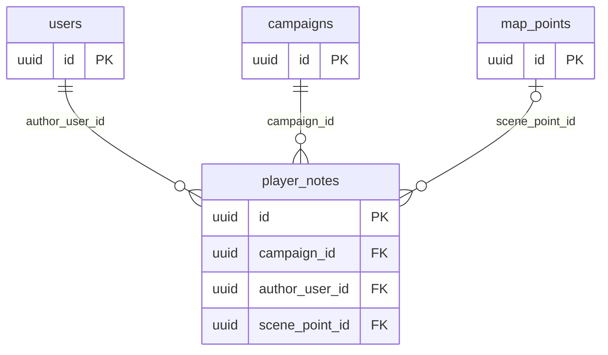

# Notes tables

The `notes` module owns the players' private notes.

## `player_notes`

A player's private note in a campaign (MR-030).
`text` is 1 to 2,000 characters; at most 300 notes per player per campaign, checked in the `INSERT` transaction (received clues do not count).
`scene_point_id` optionally labels the note with a scene the player discovered (see `scene_discoveries` in [maps.md](maps.md)); the API only accepts a discovered scene, and deleting the point removes the label (`SET NULL`).
`create_key`/`create_hash` are the creation idempotency key.
The index `(campaign_id, author_user_id, updated_at DESC)` lists a player's notes, newest first.
Deleting the account or the campaign deletes the notes (`CASCADE`).

## Who reads

Only the author.
Every query filters by the author, so another person's note is never found, not even by the master.
The clues the master revealed to a player come from `scene_clue_reveals` (see [maps.md](maps.md)) and appear in the same list.
