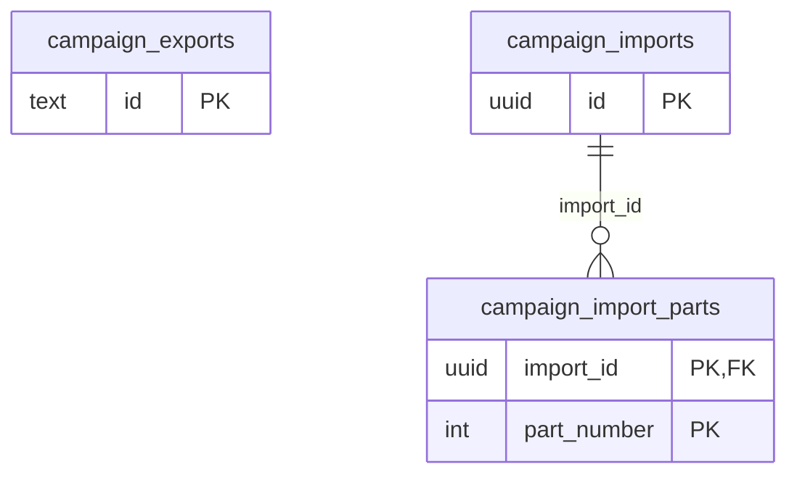

# Campaign package tables

The `campaignpackage` module (MR-050) owns the export and import of a whole campaign.
The files themselves are blobs, not rows (see [Architecture](../architecture/campaign-package.md#campaign-package-mr-050)).

These tables have no foreign keys to `campaigns` or `users` (except `campaign_import_parts`), on purpose: a cascade would delete the row and leave the file where nothing names it.
The application's cleanup deletes the file first and then the row, not a row TTL.
The sweeper also removes rows whose campaign or account no longer exists, whatever their expiry, on its next pass.

## `campaign_exports`

One row per export.
`id` is 32 random hex digits (128 bits, a `CHECK`) and is the download address.
`state` is `pending` (the task has not claimed it yet), `running`, `done`, `failed` or `canceled`; `percent` is 0 to 100; `failure` is empty, `too_big` or `interrupted`.
`file_name` is the name the download suggests (ASCII, from the campaign name); `blob_key`, `byte_size` and `entry_count` describe the file.
`create_key`/`create_hash` are the idempotency key of `StartCampaignExport`, scoped to the campaign and the caller.
`campaign_id` and `requested_by` are plain columns.
`expires_at` is when the cleanup deletes the file and the row.

## `campaign_imports`

An upload in progress, bound to `user_id` (a plain column).
A unique index on `user_id` keeps one per person.
`fingerprint` is what the app derives from the file so that choosing it again resumes the upload; `total_bytes` is 1 byte to 200 MiB (`CHECK`); `part_size` and `part_count` (1 to 1,000) are fixed when the import begins.
`expires_at` is set from the last part.

## `campaign_import_parts`

Which parts arrived: `part_number` from 1 and `byte_size`.
Primary key `(import_id, part_number)`; rows go with the import (`ON DELETE CASCADE`).
The part itself is the blob `imports/<id>/parts/<n>`.

## Who reads

Only the person who asked for the export or started the import, and only while the row exists.
The export download address is the secret: 128 random bits.
