# Play tables: sessions, history and effects

The `play` module owns the game session and everything that happens in it.
This page holds the session, its history, the stage, casting outside combat, group checks, lasting effects on characters and the Bardic Inspiration die.
Combat is in [combat.md](combat.md) and puzzles in [puzzles.md](puzzles.md).

```mermaid
erDiagram
    game_sessions {
        uuid id PK
        uuid campaign_id FK
        uuid current_map_id FK
        uuid shown_image_id FK
        uuid open_scene_point_id FK
        bool open_scene_everyone
        text shown_image_audience
    }
    game_session_scene_players {
        uuid game_session_id PK,FK
        uuid user_id PK,FK
    }
    game_session_image_viewers {
        uuid game_session_id PK,FK
        uuid user_id PK,FK
    }
    session_events {
        uuid id PK
        uuid game_session_id FK
        text kind FK
        uuid actor_user_id FK
        uuid character_id FK
        uuid encounter_id FK
    }
    session_event_kinds {
        text kind PK
    }
    session_messages {
        uuid id PK
        uuid campaign_id FK
        uuid game_session_id FK
        uuid author_user_id FK
        uuid speaker_ref FK
        uuid speaker_image_id FK
        uuid image_id FK
    }
    session_message_readers {
        uuid message_id PK
        uuid user_id PK
    }
    stage_npcs {
        uuid id PK
        uuid game_session_id FK
        uuid character_id FK
    }
    spell_casts {
        uuid id PK
        uuid campaign_id FK
        uuid game_session_id FK
        uuid caster_id FK
        uuid carried_encounter_id FK
    }
    revivify_requests {
        uuid id PK
        uuid campaign_id FK
        uuid game_session_id FK
        uuid caster_character_id FK
        uuid target_character_id FK
        uuid requested_by_user_id FK
    }
    battle_encounters {
        uuid map_point_id PK,FK
        uuid campaign_id FK
        uuid map_id FK
    }
    group_checks {
        uuid id PK
        uuid game_session_id FK
    }
    group_check_members {
        uuid group_check_id PK,FK
        uuid character_id PK,FK
    }
    character_effects {
        uuid id PK
        uuid campaign_id FK
        uuid character_id FK
        uuid source_character_id FK
    }
    character_inspiration {
        uuid character_id PK,FK
        uuid campaign_id FK
        uuid source_character_id FK
    }
    inspiration_holds {
        uuid id PK
        uuid campaign_id FK
        uuid character_id FK
        uuid combatant_id FK
        uuid encounter_id FK
    }
    trap_damages {
        uuid id PK
        uuid game_session_id FK
        uuid character_id FK
    }
    campaigns {
        uuid id PK
    }
    characters {
        uuid id PK
    }
    encounters {
        uuid id PK
    }
    combatants {
        uuid id PK
    }
    gallery_images {
        uuid id PK
    }
    map_points {
        uuid id PK
    }
    maps {
        uuid id PK
    }
    users {
        uuid id PK
    }
    campaigns ||--o{ battle_encounters : "campaign_id"
    maps ||--o{ battle_encounters : "map_id"
    map_points ||--o| battle_encounters : "map_point_id"
    campaigns ||--o{ character_effects : "campaign_id"
    characters ||--o{ character_effects : "character_id"
    characters |o--o{ character_effects : "source_character_id"
    campaigns ||--o{ character_inspiration : "campaign_id"
    characters ||--o| character_inspiration : "character_id"
    characters |o--o{ character_inspiration : "source_character_id"
    campaigns ||--o{ game_sessions : "campaign_id"
    maps |o--o{ game_sessions : "current_map_id"
    map_points |o--o{ game_sessions : "open_scene_point_id"
    gallery_images |o--o{ game_sessions : "shown_image_id"
    characters ||--o{ group_check_members : "character_id"
    group_checks ||--o{ group_check_members : "group_check_id"
    game_sessions ||--o{ group_checks : "game_session_id"
    campaigns ||--o{ inspiration_holds : "campaign_id"
    characters ||--o{ inspiration_holds : "character_id"
    combatants |o--o{ inspiration_holds : "combatant_id"
    encounters |o--o{ inspiration_holds : "encounter_id"
    campaigns ||--o{ revivify_requests : "campaign_id"
    characters ||--o{ revivify_requests : "caster_character_id"
    game_sessions ||--o{ revivify_requests : "game_session_id"
    users |o--o{ revivify_requests : "requested_by_user_id"
    characters ||--o{ revivify_requests : "target_character_id"
    users |o--o{ session_events : "actor_user_id"
    characters |o--o{ session_events : "character_id"
    encounters |o--o{ session_events : "encounter_id"
    game_sessions ||--o{ session_events : "game_session_id"
    session_event_kinds ||--o{ session_events : "kind"
    campaigns ||--o{ spell_casts : "campaign_id"
    encounters |o--o{ spell_casts : "carried_encounter_id"
    characters ||--o{ spell_casts : "caster_id"
    game_sessions ||--o{ spell_casts : "game_session_id"
    game_sessions ||--o{ game_session_scene_players : "game_session_id"
    game_sessions ||--o{ game_session_image_viewers : "game_session_id"
    users ||--o{ game_session_scene_players : "user_id"
    users ||--o{ game_session_image_viewers : "user_id"
    characters ||--o{ stage_npcs : "character_id"
    game_sessions ||--o{ stage_npcs : "game_session_id"
    characters ||--o{ trap_damages : "character_id"
    game_sessions ||--o{ trap_damages : "game_session_id"
```

## `game_sessions`

One row per game night; ids and times only, no personal data.
`session_number` counts the campaign's sessions from 1 (`UNIQUE (campaign_id, session_number)`).
A session is open while `ended_at` is empty; the partial unique index `game_sessions_one_open_per_campaign` leaves at most one open per campaign.
Starting a session writes the row, locks the sheets and turns off the story releases in one transaction; the last two belong to `characters`, which `play` calls through an interface (see [Architecture](../architecture/play/README.md)).

What the session shows is on the row, all optional and independent, none set in a new session:

| Column | Meaning |
| --- | --- |
| `current_map_id` | The current map. `SET NULL`: deleting the map takes it off. Choosing it reveals the map. |
| `shown_image_id` | The image the master shows the players (MR-028). `SET NULL` on deletion. |
| `shown_image_keep` | When on, stopping the display, swapping or ending the session copies the image into `campaign_left_images` ([gallery.md](gallery.md)), in the same transaction. |
| `open_scene_point_id` | The `scene` map point the master opened, one at a time. Opening a hidden point does not reveal it (RN-10). `SET NULL` when the point is deleted. |
| `open_scene_everyone` | True (the default) when the open scene is open to the whole table, a player who joins later included; false when it is open to exactly the players of `game_session_scene_players`. A column, not "no rows", so erasing the last player's account never opens the scene to everyone. Opening, closing or changing the scene sets it and the rows together. |
| `shown_image_audience` | Who sees the shown image: `table` (every member, the default), `scene` (the players of `game_session_scene_players`, so it follows who is in the scene) or `chosen` (the players of `game_session_image_viewers`). When the scene stops being the image's (it closes, another opens, or it opens to everyone) the server turns `scene` into `chosen` with the players who were in. |

`play` keeps only the ids; the `maps` module owns the targets and `play` reads them through the `MapKeeper` interface (see [Architecture](../architecture/play/live-session.md#what-the-session-shows)).
There is no index on these columns: only deleting a map or image searches for them, and the table is small.
What counts as "scene open again" is the last `scene_opened` event of the session: a roll only counts toward `scene_actions.max_attempts` if it comes after it, so closing and reopening a scene resets the counts without deleting history.

## `game_session_scene_players` and `game_session_image_viewers`

The players a scene is open to, and the players a shown image is shown to, when they are not the whole table (MR-015, MR-028, RN-10).
`(game_session_id, user_id)` is the primary key of both; both foreign keys cascade, so the rows go with the session and with the player's account (`user_id` is indexed for that).
The rows of `game_session_scene_players` are read only while `open_scene_everyone` is false (and by an image whose audience is `scene`); opening, closing or changing the scene rewrites them.
The rows of `game_session_image_viewers` are read only while `shown_image_audience` is `chosen`.
`game_session_scene_players.joined_by_self` marks a player who joined by themselves (`JoinScene`); `game_sessions.scene_players_may_join` is the master's switch "Os jogadores podem entrar".
They hold ids only.
The history keeps the accounts of a scene open to only some players too (`scene_opened.players`, `scene_check_rolled.audience`); erasing an account takes its id out of those lists with the other who-saw lists (migration `00278`).

## `session_events` and `session_event_kinds`

`session_events` (ADR-0007) is the session history: each change made at the table becomes a row that is never altered, written in the same transaction as the change.

- `seq` numbers a session's events from 1 in the order they happened: the next is the highest plus 1, read with the session row locked (`FOR UPDATE`), and `UNIQUE (game_session_id, seq)` is the final guarantee.
- `kind` is a foreign key to `session_event_kinds` (see [Reference tables](README.md#reference-tables)).
  The kinds group as: HP corrections, the combat's life and turns, attacks and damage, spells and reactions, XP, scenes and clues, the stage, traps and treasure, doors, creatures and Wild Shape, puzzles, casting outside combat, rests, and character choices.
- `idempotency_key` (UUID) and `idempotency_hash` are the idempotency pair (see [conventions](README.md#idempotency-columns)).
  The hash is kept on the combat's changes; `NULL` on an event made without one.
- `payload` is a small JSON object (at most 16 KiB, `CHECK`) of ids, keys and numbers, with the values before and after: **no free text, no names**.
  A weapon's name never enters (the log reads it from the sheet); the reason of an XP award stays in `xp_awards`.
  Erasing an account takes its id out of the who-saw lists of every payload (below), in the same statement.
- `actor_user_id` (`SET NULL`) is who made the change; `character_id` (`SET NULL`) the character; `encounter_id` (`CASCADE`, optional) the combat the event belongs to, for the log and the undo (`NULL` on HP corrections).
- Partial indexes serve a combat's events in order and the two `SET NULL` cascades, so deleting a character or account does not scan the history.
- **The undo is a compensating row**: the undone one stays.
  Action events carry the round, `secret` (a hidden combatant was in it: the player never receives the row, even if the master shows the combatant later, RN-20) and the "before" of everything the undo restores.
  The helper lists an undo reads (`ended_lines`, `follow_ups`, `marks_before`, `closed_windows`, `reveal_lines`...) are dropped in a fixed order before the write if the payload would pass 16 KiB, so the `CHECK` never refuses an action because of them (`combat_events.go`).
- **Fog.** In a map with fog, the payload of action events with an NPC in it carries `fogged` and `seen_by`, the account ids of the players who saw **all** the NPCs of the event when it happened; the combat log gives the row only to those players and never recomputes the list (`combat_fog.go`).
  Cover that only some players would read carries `cover_restricted` and `cover_seen_by` the same way.
  A spell's `hits` and a trap's `caught` keep such a list for each target, and a cast keeps `cover_users`, the players that the bits of the masks (`seen_mask`, `cover_seen_mask`) count by position.
- **Erasing an account** (`DELETE FROM users`) runs the `BEFORE DELETE` trigger `users_scrub_session_events` (migration 00266), in the same transaction.
  For the events of the campaigns the account belongs to, it removes the id from `seen_by`, `cover_seen_by`, `hits[].cover_seen_by` and `trap.caught[].seen_by`, keeping the order of the others and leaving an empty list empty, and replaces it with `""` in `cover_users`, so that no mask changes meaning.
  The row, its `seq` and the rest of its payload do not change.
  A new place in a payload that holds account ids needs the same case in `session_event_payload_without_user`, and a test in `play/erasure_seen_by_test.go`.
- Puzzle events (`puzzle_shown`, `puzzle_solved`, `puzzle_reset`, `puzzle_closed`) carry `puzzle_id` and `run_id` only; state, solution and moves stay in `puzzle_moves`.
  A scene check event carries ids, the check key, the d20, the bonus, the total, whether it was a physical die, `dc_shown` and `passed`, never the DC or a name.
- A free roll (`free_roll_rolled`, [the free dice roller](../architecture/play/free-dice-roller.md)) carries the die's sides, the count, the modifier, the mode (`""`, `advantage` or `disadvantage`), each face with `discarded`, the total, `by_master` and `secret`, never a name.
  `secret` is always written, because the list's SQL keeps a player to rows that say `"secret": false`; the event has no `encounter_id`, so no combat log or undo reads it.
  Its idempotency key is the UUID the server derives from the member and the key the app sent (1 to 64 characters), so a key belongs to one member.

## `session_messages` and `session_message_readers`

The conversation of a game session (MR-051, RN-36): the master narrates and speaks as an NPC, the players speak as their character or out of character.
A line is never edited and has no deletion; it goes with its session and its campaign (`CASCADE`).
`speaker_kind` is `narrator`, `npc`, `character` or `out_of_character` (a `CHECK` is the backstop; the API checks the combinations).
`speaker_ref` is the character of `npc` and `character`; `speaker_name` and `speaker_image_id` keep the name and portrait it had when the line was sent, so the line still reads the same if the NPC is renamed or deleted (`SET NULL` on the character and the image).
`text` is 1 to 2,000 characters.
`image_id` is the gallery image the master put in the line (`SET NULL` if it is deleted).
`author_user_id` is `SET NULL` when the account is erased: the line stays and the author reads "Jogador removido" ([Privacy](../privacy.md)).
`for_everyone` says every member reads the line; when it is false the readers are the rows of `session_message_readers` (`message_id`, `user_id`, both `CASCADE`), plus the master and the author.
It is a column and not "no rows" so that erasing the account of the last reader never widens a line.
`create_key`, `create_hash` are the idempotency pair of `SendSessionMessage` (`<campaign>:<author>:<key>`), unique through a partial index.
`audio_made_at` is when the voice of the line was made (the file is in the blob store); it counts the day's voices against `TTS_DAILY_LIMIT`.
Indexes: `(game_session_id, created_at, id)` for the page; one on each foreign key the cascades scan; the reader's `user_id`.

## `stage_npcs`

The NPCs on stage in a session (MR-031): one row per NPC, at most 4 (`maxStage`, checked in the inserting transaction with the session row locked).
`id` is the place on the stage, made when the NPC enters; it is what the player's copy carries instead of the character id, which is the master's secret (RN-20).
`position` is the order of entry from 0 (a new NPC takes the highest plus one, so a removal leaves a gap that does not change the order).
`UNIQUE (game_session_id, character_id)` prevents the same NPC twice; the partial unique index `stage_npcs_one_speaker` leaves at most one `speaking`.
`hidden` (default false) keeps the NPC from the players ("Escondida dos jogadores"): it counts for the limit, and only the master's reads and stream hear of it; a hidden NPC never speaks (`CHECK (NOT (hidden AND speaking))`: hiding clears `speaking`, and giving it the floor clears `hidden`).
Every read for a player, the portrait route and the casts go through the rows where `hidden` is false.
Both foreign keys cascade.
Closing or changing the scene deletes the session's rows.
Each change is a `stage_changed` event with ids only (`change`, the character, `hidden` for an NPC put hidden, `revealed` for a floor that showed one).
A player out of a scene open to only some players reads no row of it: the stage is the scene's.

## `spell_casts`

One casting outside a combat, from start to end (MR-048, RN-32); the rows of a session are also its log of casts.
Ids, spell keys and numbers, no personal data; cascades with the campaign, the session and the caster.

- `status` is `casting` (the spell takes time and the time has not passed: no slot spent, the caster concentrates on the casting), `active` (it took effect and lasts), `ended` or `failed` (no slot spent).
  `end_reason` is `instant`, `dismissed`, `concentration`, `rest`, `interrupted` or `caster_gone`.
  The row is over exactly when `ended_at` and `end_reason` are set (`spell_casts_over_valid`).
- `caster_id` is a player character or an NPC.
  `slot_level` (0 for a cantrip or ritual) and `slot_pact` only record the slot; it is spent in `character_vitals` when the casting finishes.
  An NPC caster spends nothing.
- `concentrating` says the caster concentrates on this cast now.
  `duration_seconds` is the spell's timed duration (`NULL`: nothing to count) and `rest_ends` the rest long enough to end it.
  The app never counts a duration: the master, the caster's concentration or a rest ends the spell.
- `targets` is JSON with, per target, the character, the effect (`narrated`, `heal`, `temporary_hit_points`, `max_hit_points`, `armor_class`), the amounts and the HP before and after.
  `roll_faces` are the faces a healing spell rolled and `creature_ids` the creatures a summon made.
- `secret` is set when an NPC that is not on stage cast it.
- `carried_encounter_id` is the combat that carries the caster's concentration while a long cast goes on in it (`SET NULL`).
- Two partial unique indexes make the rules a fact of the table: one `casting` row per caster and one concentrating live row per caster.

## `revivify_requests`

A Revivify cast outside a combat waiting for the master (the app does not record when a creature died out of combat, so he says whether the creature died less than a minute ago).
It holds the session (`CASCADE`), the caster and the target (`characters`, `CASCADE`), the slot (`slot_level` 3 to 9, `slot_pact`), `status` (`pending`, `confirmed`, `denied`; `answered_at` is set exactly when it is not pending, by `CHECK`) and the keys of the cast (`create_key`, unique per campaign, `create_hash`) and of the answer (`answer_key`, `answer_hash`).
Nothing is spent while it is pending.

## `battle_encounters`

The encounter saved on a battle point (MR-043, RN-29): one row per point (`map_point_id` is the primary key, `CASCADE` with the point, the map and the campaign); saving again replaces the row, and saving the same again writes nothing.
`campaign_id` and `map_id` copy the point's, for the map's list.
`encounter` is the protojson of the API's `BattleEncounter`: the SRD creatures with quantities (1 to 40, up to 20 creatures), each one's base name, how the monsters' HP are chosen and whether they start hidden.
XP and difficulty are never stored; they are counted again on read against the day's party.
Fiction only: creature keys, numbers and the monsters' names the master writes.

## `group_checks` and `group_check_members`

A check or saving throw the master asked of the whole party or of some characters, in the session (so it can exist outside a combat).
`group_checks`: `skill_key`, `dc` (1 to 40, optional), `show_dc` (whether players see it), `status` (`open`, `closed`), `passed` (the verdict once closed), `is_group` (whether the half rule gives a group verdict).
`group_check_members` has one row per asked character: `roll` (JSON, `NULL` until rolled), `rolled_by_master`, `rolled_at`.
Both cascade from the session or the character.

## `character_effects`

Effects that last on a character outside a running combat (RN-22).
`source_key` is the spell or catalog key, `source_character_id` who cast it (`SET NULL`), `group_id` the cast's id (so ending the cast ends them all), `source_kind` is `spell`, `feature` or `master`.
`condition_keys` and `modifiers` (JSON array, at most 8) are what it gives.
`duration_kind` is `rounds`, `until_start_of_turn_of`, `until_end_of_turn_of`, `concentration`, `until_dismissed` or `long_rest`; `seconds_left` is the game time left (a round is 6 seconds; `NULL` until it is dismissed or the caster stops concentrating).
The save columns (`end_save_ability`, `start_save_ability`, `save_dc`, `on_fail_effect`), the trigger columns (`trigger_dice`, `trigger_damage_type`, `trigger_max_triggers`, `triggers_fired`) and `follows_key` (an effect that follows another, such as Haste's lethargy) carry the effect's rules.
`player_visible`, `audience` (`all` or `owner`) and `player_label` (1 to 30 characters) are the master's switches for what the player reads.
When a combat takes the character in, the row becomes a `combatant_states` row of kind `effect` with the same id, and goes back when the combat ends (see [combat.md](combat.md#combatant_states-and-hit_riders)).

## `character_inspiration` and `inspiration_holds`

`character_inspiration` is the Bardic Inspiration die a character holds out of a running combat (SRD 5.1): the primary key is `character_id` (one die at a time), `sides` is 6, 8, 10 or 12, `source_character_id` the bard (`SET NULL`), and `seconds_left` is 1 to 600 seconds of game time (the master's clock moves it and deletes a die with none left).
In a combat the die is the combatant's (`combatants.inspiration_*`) and this row is gone.

`inspiration_holds` keeps a roll that waits for the player's answer about the die, or about the halfling's Lucky.
`kind` is `scene_check`, `group_check`, `trap_search`, `hint_try`, `spell_attack`, `effect_save` or `concentration_save` today; the check also accepts `weapon_attack` and the kinds of the rolls that will wait next (`death_save`, `initiative`, `contest_check`, `hide_check`, `counterspell_check`), and the code refuses a kind it does not know.
`request` is the request that made it (protobuf), `faces`, `modifier`, `total`, `counted` and `physical` the d20 it rolled, `answer_key` is set once answered, unique on `(campaign_id, idempotency_key)`.
`round` is the combat's round for a roll held in a combat and `NULL` out of one.
`combatant_id` (the roller in a combat, `CASCADE`) and `encounter_id` (the combat the roll was held in, `CASCADE`) are `NULL` out of a combat; when `combatant_id` is set it is the owner of the hold (the copies of an NPC and the creatures of a combat share a `character_id`).
`window_hold` says the hold is the attack a reaction window kept.
The weapon attack waits here too (kind `weapon_attack`, `window_hold` for the one a reaction window held, whose `idempotency_key` is the request's own); `roll_holds` is empty and unused ([held rolls](../architecture/play/held-rolls.md)). Every roll held in a combat names its combatant and its combat; an older one has both `NULL` and belongs to its character.
The partial index `inspiration_holds_open_combat_idx` on `(encounter_id, combatant_id)` where `answer_key IS NULL` serves the open questions of a combat.
Lucky: `lucky_index` is the die that shows a 1 (0 for a single d20; 0 or 1 for a pair, in the order rolled; `NULL` with no Lucky question), `lucky_answer_key` the key of the answer and `lucky_to` the new face (1 to 20; `NULL` when the player kept the 1).
The question waits while `lucky_index` is set and both keys are `NULL`; then `faces`, `counted` and `total` hold the d20 after the answer, which a die question (if the character holds one) is asked about next.
Indomitable: `indomitable_ask` marks the question asked (after the result of a save is known) and `indomitable_failed` whether the roller may be told the save failed (`false` when the table hides it).
`indomitable_answer_key` is the key of the answer, `indomitable_from` and `indomitable_to` the faces (1 to 20) before and after a reroll, both `NULL` when the player kept the roll.
Stroke of Luck: `stroke_ask` marks the question asked (after the result of an attack or a check is known) and `stroke_failed` whether the roller may be told the roll missed or failed (`false` when the table hides it).
`stroke_answer_key` is the key of the answer and `stroke_from` the d20 (1 to 20) that counted when the player used the feature, `NULL` when the player kept the roll.
The check `inspiration_holds_stroke_face_valid` keeps `stroke_from` between 1 and 20.
`die_answer_key` and `die_used` keep the Bardic Inspiration die answered while this question follows, since the row stays open.
A hold out of a combat is not forgotten when the dice run out; one of a combat only when the round or the combat is over.

## `trap_damages`

The damage a triggered trap did to a player character when **there is no combat** on the map (MR-035, RN-02), one row per damage part.
The server rolls when the trap fires: `dice_count` (doubled on the trap attack's critical), `dice_sides`, `dice_bonus`, `faces`, `roll_total` and `amount` (half, rounded down, for one who passed a save that halves).
`status` is `rolled` (waits for the master), `applied` or `discarded`; `applied_amount` is what the master applied when it was not `amount`.
`fire_id` labels the damages of one trigger; `trap_point_id` has no foreign key (a cycle through `map_points`).
The end of a combat turns trap damage still waiting in `pending_damages` into rows here.
`settle_key`/`settle_hash` are the idempotency pair of the call that applied or discarded it, scoped to the campaign: settling works with no session open.
The master reads the damages waiting in the whole campaign.
Cascades with the session or the character; the index is by session.

## Who reads

- Players read the session row's public parts (the current map if revealed, the shown image, the open scene), the stage through the stage-copy ids, and the history through the player stream, which never receives an event marked `secret` or fogged for them.
- `session_messages`: the master, the author, the lines `for_everyone`, and the rows of `session_message_readers`; the same rule on every path, and a line the caller may not read is `not_found` ([live session](../architecture/play/live-session.md#the-conversation-of-the-scene)).
- `battle_encounters`, `revivify_requests` and `trap_damages` are master only (a player sees their own character's applied result in the log).
- A saving throw the master made a success (`lasting_effect_saved`, `concentration_save_rolled`) keeps `resisted` and `resist_left` on its payload, beside the roll that failed.
  The log shows a player the line of a save that passed, never the roll, the count or the trait.
- A `legendary_action_spent` event (the master's spend of a text option) is always `secret`.
  It holds the creature's id, the round, the option's key and name and `spend_cost`.
  It is the master's alone in the log, the stream and every count.
  An attack or a move made as a legendary option keeps only `spend_cost` on its ordinary event, a number for the undo.
- A `recharge_rolled` event (the d6 the server rolls for a creature's Recharge action at its turn start) is always `secret` and fogged for everybody, and its row names no user and no character.
  It holds the creature's combatant id, the round, the action's key and name, `recharge_face` and `recharged`.
  It is the master's alone in the log, the stream and every count, the map revision included.
  An attack or an action that spent a limited action keeps `limit_key` on its ordinary event, the key for the undo.
- A `free_roll_rolled` event is read by everyone when `secret` is false; a secret one is the master's alone, on every path: the list, the stream, the summary and any count (RN-10).
- `spell_casts` rows are read by the master and the target's player for the amounts; a `secret` cast is the master's alone (RN-10).
- `character_effects`: the owner and the master, filtered by `player_visible` and `audience`.
- `inspiration_holds` and `character_inspiration`: the holder and the master.
