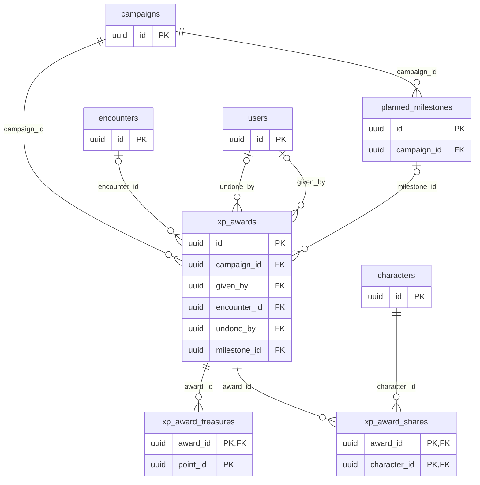

# Progression tables

The `progression` module owns the XP history and the planned milestones (MR-016, RN-09, RN-12).
The XP itself lives in the character's sheet JSON (`FullSheet.experience_points`, owned by `characters`): an award adds each share there in the same transaction, the undo subtracts (never below 0), and the sheet's `revision` goes up so an edit a player opened before is refused as old.
The sheet lock (RN-01) does not prevent it, because it is the master's act.

## `xp_awards`

The campaign's XP history: one row per "Dar XP" or "Registrar marco".
**Never deleted or rewritten** (ADR-0007).

- `mode` is `enemies` (the XP of the defeated NPCs of an ended combat), `gold` (1 XP per gp), `manual` (the number the master typed) or `milestone` (no XP; marks the characters "can level up").
  `CHECK`s tie the fields to the mode: `total_xp` is 0 on a milestone and 1 to 1,000,000 otherwise; `gold` is set only for `gold`.
- `reason` (1 to 120 characters) is what the master wrote.
  The whole campaign reads it, and it never goes into a `session_events` payload.
- `encounter_id` (`SET NULL`) is the combat of an `enemies` award.
  The partial unique index `xp_awards_one_per_encounter` allows one live award per combat.
- Undoing the last award fills `undone_at`, `undone_by` (`SET NULL`) and `undo_key` (the undo's own idempotency key); the XP returns through the sheets.
- `idempotency_key` (UUID, `UNIQUE (campaign_id, idempotency_key)`) and `idempotency_hash` are the award's idempotency pair; `milestone_again` marks "Dar a mais alguém" rather than the award that reached the milestone.
- `milestone_id` (`SET NULL`) links a milestone award to its planned milestone.
  `given_by` is `SET NULL` if the account is deleted.
- Indexes: the campaign history newest first, a milestone's awards, and a character's awards.

## `xp_award_shares`

What each character received.
`xp` is the XP the sheet gained from the split of the total, rounded down; a sheet holds at most 1,000,000 XP, so a share can be less than the split; 0 on a milestone; the undo takes back exactly this.
`level_at_mark` (milestone only) is the character's total level when marked: the "Pode subir de nível" mark lasts while the sheet's level does not exceed it, compared on read, with nothing written when the master raises the level.
Primary key `(award_id, character_id)`; both cascade.

## `planned_milestones`

The planned milestones of a milestone campaign: `text` (1 to 120 characters, the master's fiction) and `position` (his order; moving renumbers the list in a transaction).
A milestone is **reached** while some `xp_awards` row with its `milestone_id` has not been undone: undoing the only one makes it planned again, with nothing to keep in sync.
The API never removes a milestone that had any award, live or undone, so an award never loses the link.
Index `(campaign_id, position)`; `create_key`/`create_hash` are the creation idempotency pair.

## `planned_milestone_moves`

The idempotency keys of `MoveMilestone`, which changes positions and creates no row: `move_key` (the campaign's ID, a colon and the app's key) and `move_hash` (the hash of the request minus the key), primary key `(campaign_id, move_key)`; the campaign cascades. A retry with the same key and hash moves nothing again; another hash is refused.

## `xp_award_treasures`

For a "Voltar à cidade" award (MR-041): the treasure converted (`point_id`) and the value in gp it had then (`value_po`, 0 to 1,000,000); primary key `(award_id, point_id)`; `award_id` cascades.
`point_id` has **no foreign key**, on purpose: after an undo the treasure goes back to the master, who may delete it, and the history of the undone award still says what it converted.
The real lock is `map_points.treasure_converted_award_id`, which `progression` fills through the `Treasures` interface that `maps` implements, in the award's transaction (the point row is locked with `SELECT … FOR UPDATE`, so two awards for one treasure convert once) and clears when the award is undone.
IDs and numbers only.

## Who reads

The whole campaign reads the XP history and everyone's XP (RN-12), including `reason`.
Only the master writes.
