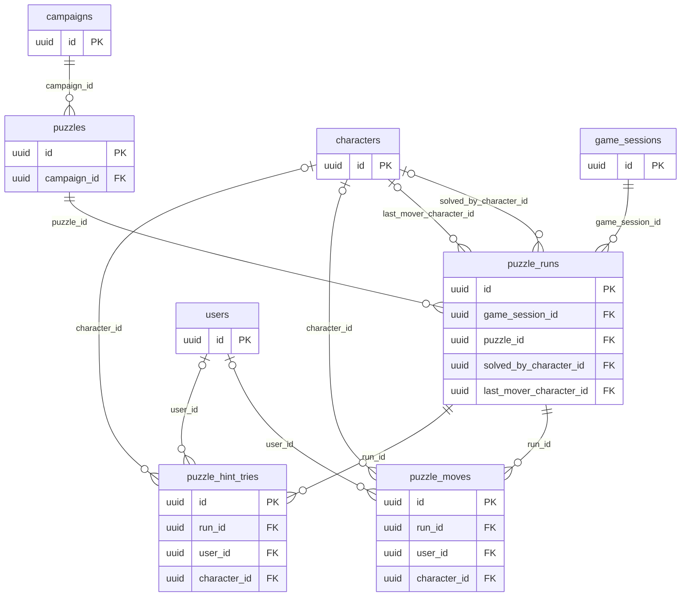

# Puzzle tables

The `play` module owns puzzles (MR-038, RN-27) because they are played inside the session: the master makes them in the campaign, shows one to the open session's players, and they play it together (see [Architecture](../architecture/play/puzzles.md)).

## `puzzles`

The puzzle as the master makes it.
**Master only** (RN-10): no player reads this table, and the solution even less.

- `kind` has no `CHECK`: the code says which kinds exist (`lights`, `lock`, `pillars`, `riddle`, `sequence`, `cipher`), so a new kind needs no migration.
- `config` is the protojson of the kind's public configuration (panel size; wheels and alphabet; pillars, symbols and links; the cipher's ciphertext and the key clue's id).
  `solution` is the answer (the lock's wheels, the pillars' mural, the riddle's answers, the sequence's steps, the cipher's message and key; lights have none, the goal is everything off).
  `start` is the starting state.
  The start of lights and pillars comes from `seed` through the `rules/puzzle` package, so the same seed and configuration always give the same start, never already solved; the lock's start is what the master chose.
- `minimum_moves` is the minimum number of taps, when the kind has one.
  `clue` and `hints` (JSON array, at most 10) are the master's texts.
- `hint_skill` and `hint_dc` (both or neither) are the skill and DC of the check hint; the DC is master only.
- `parts` is the split information: a list of `{character_id, text}`, at most 8.
- `on_wrong` is the JSON of "Ao errar": the trap point, attempts per player, move limit and time limit.
- "Ao resolver" is `solve_action` (`notify`, `open_door`, `reveal_point`, `reveal_clue`) plus `solve_target` (JSON; its ids have no foreign key).
- A puzzle is archived (`archived_at`), never deleted, and is edited only until first shown.
- Index: the campaign's list, newest first.

## `puzzle_runs`

The puzzle in a session, and what everyone reads: one row per `(game_session_id, puzzle_id)`, created when the master shows it, or when he prepares another start before showing (`shown_at` `NULL`).

- `state` changes only through relative moves (tap, rotate), so two simultaneous moves both count.
  Once solved (`solved_at`), the state freezes; only the master's "Recomeçar" (back to `start`), "Gerar outro começo" (a new `seed` and `start` for the round, the puzzle untouched) and "Fechar" (`closed_at`) touch it again.
- `solve_outcome` is what "Ao resolver" did and `solve_message` what the players read, stored in the transaction of the move that solved it.
  `solved_by_character_id`, `last_mover_character_id`, `last_move`, `last_moved_at`, `moves_made` and `revision` track play.
- `released_hints` is how many hints the master released.
- `round_start_seq` (the round's moves are those of `puzzle_moves` after this `seq`) and `round_started_at` (where the time limit counts from; `NULL` while the round is only prepared) are what "Ao errar" limits count from.
  `plays` and `play_started_at` belong to the sequence: how many times the master played it and when the last began.
- Every change locks the session row and then the run's, in that order.
- Cascades with the session or the puzzle; the character columns become `NULL`.
  Index `(puzzle_id) INCLUDE (shown_at)` serves "which puzzles have been shown" and the cascade.

## `puzzle_moves`

Each move of a round, in the order the server applied them, with the app's `idempotency_key`: a repeated move finds the row and returns the round as it is now.
`seq` counts 1, 2, 3...
(`UNIQUE (run_id, seq)`); `move` is relative (what was done, never what the state became), plus the `revision` after it and `solved` (the move that solved it).
`wrong` marks a wrong move; each player's attempts in a round are the wrong moves after `puzzle_runs.round_start_seq`, per user.
The `move` of a riddle or cipher keeps what the player typed.
Indexes on `user_id` and `character_id` let account or character deletion null them without scanning.

## `puzzle_hint_tries`

One row per attempt by a player to earn the next hint by rolling the skill the master chose: `hint_index` (`UNIQUE (run_id, user_id, hint_index)`: one attempt per player per hint), `passed`, `granted_count` (how many hints the player reads after passing; `NULL` on failure), the d20, `d20_b` (the second d20 when the roll had advantage or disadvantage), `counted` (the one that counted), `roll_mode`, the `modifier`, the `total` and `physical`.
`lucky_index` is the d20 the halfling's Lucky rolled again, in the order rolled (`NULL` when none: the stored faces are the new ones, and the die it replaced was a 1).
`bonus_sides` and `bonus_face` are the Bardic Inspiration die the player added after the d20 (`NULL` when none: `modifier` and `total` already hold the face; a retry of the try answers with the die from these two columns, which both are set or both `NULL`).
The DC is not stored, only whether it was reached.
The hints a player reads are the larger of those the master released (`released_hints`) and those the player earned (`granted_count`).
Indexes on `user_id` and `character_id`, like `puzzle_moves`.

## Who reads

- `puzzles` is master only.
  A player never reads `solution`, the hint DC, the cipher key or the clue that holds it.
- `puzzle_runs` and `puzzle_moves` are read by the session's players for the puzzle shown to them (the public state, the hints they may read, their own attempts), and by the master fully.
- `puzzle_moves` and `puzzle_hint_tries` keep the account id (`user_id`) of who played, which is personal data (see [Privacy](../privacy.md)); `SET NULL` nulls it when the account is deleted.
  The rest is fantasy, numbers and ids.
