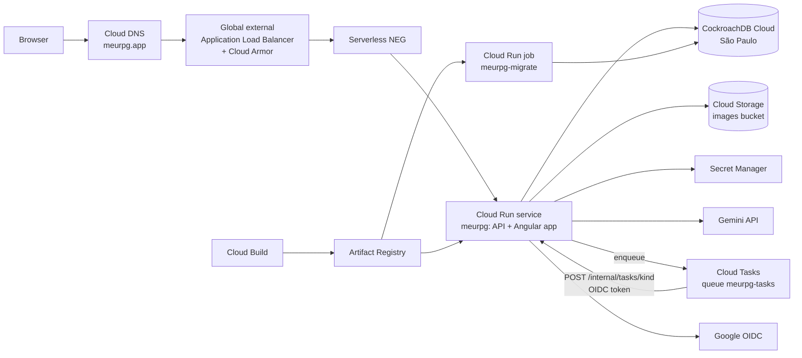

# Operations

MeuRPG runs on Google Cloud in `southamerica-east1` (São Paulo), and a session-free month costs close to nothing: with nobody playing, no instance runs and no stream is open.

| Page | Answers |
| --- | --- |
| This page | What runs where, and the limits of the hosting |
| [runbook.md](runbook.md) | How to release, roll back, deploy the first time, rotate a secret, read the logs and answer an alert |
| [reference.md](reference.md) | Every environment variable, secret, limit, budget, alert and cost |
| [logs.md](logs.md) | The log format on Cloud Run and the local ELK stack |

The local environment (`make up`, the optional ELK) is described in [CONTRIBUTING](../../CONTRIBUTING.md).

## What runs where

| Part | What it is | Notes |
| --- | --- | --- |
| Cloud Run service `meurpg` | The `api` binary of `backend/Dockerfile`: it serves the Connect API, the uploads and downloads, the live-session streams and the Angular build (`/app/web`) | One image carries `/app/api`, `/app/migrate` and the web build, on a distroless `static` base running as `nonroot` |
| Cloud Run job `meurpg-migrate` | The same image, with `/app/migrate up` as the command | Runs before each new revision gets traffic; the API never migrates by itself |
| CockroachDB | Managed CockroachDB in the same region | `DATABASE_URL` is a secret and must verify the server certificate on Cloud Run |
| Cloud Storage | One private bucket for gallery images, thumbnails and campaign packages | Reached by the service account's token; no public or signed URL ([reference](reference.md#images-and-the-bucket)) |
| Cloud Tasks | One queue, `meurpg-tasks`, in the same region: the detached work (images, exports, sweeps) is a task that calls the service back, so it runs inside a request and has CPU | Free for this volume (the first million operations a month); [reference](reference.md#cloud-tasks), [first deploy](runbook.md#11-cloud-tasks). The service's own `run.app` URL is the target, see [Ingress](#ingress-and-cloud-tasks) |
| Secret Manager | `database-url`, `oidc-client-secret`, `gemini-api-key` (optional) | Delivered to Cloud Run as environment variables |
| Cloud Build and Artifact Registry | One build per release, run as the `meurpg-build` service account | `deploy/gcp/cloudbuild.yaml`; the registry keeps the 10 newest images and deletes the rest after 30 days |
| Load balancer and Cloud Armor | Terminates TLS for `meurpg.app`, applies the [edge policy](runbook.md#the-edge-policy-cloud-armor) | Cloud Run domain mappings are not offered in this region, so the domain sits behind a load balancer |
| Cloud DNS and Cloud Domains | The zone (DNSSEC on) and the `.app` registration | [DNS records](runbook.md#dns-certificates-and-e-mail) |
| Cloud Monitoring and Cloud Billing | An uptime check and alert on `/readyz`; two budgets | [Alerts](reference.md#alerts) |
| ImprovMX | Forwards mail sent to `@meurpg.app` | A processor ([Privacy](../privacy.md#processors-and-where-data-lives)) |

Nothing here is created from the repository by automation: the GCP resources are made by the commands of the [first deploy](runbook.md#first-deploy), and releases are run by hand ([release](runbook.md#release-a-new-version)). CI never deploys.

## Cloud Run settings

| Setting | Value | Why |
| --- | --- | --- |
| Region | `southamerica-east1` | The players and the database are in Brazil |
| CPU and memory | 2 vCPU, 1 GiB, CPU only during a request | One browser action makes every open screen ask for its turn options again at once |
| `GOMEMLIMIT` | `400MiB` | The memory budgets in [reference](reference.md#memory-budgets) were sized against it |
| `min-instances` | 0 | Scales to zero when idle |
| `max-instances` | **1** | The live-session fan-out (`play/live` hub) and the rate-limit counters are in process memory, so a second instance would split a table in two ([architecture](../architecture/play/live-session.md#live-session)) |
| `concurrency` | 50 | Each live stream counts; a table has about 14 at once. At Cloud Run's default of 80 the worst case of stalled request bodies passes `GOMEMLIMIT` |
| Request timeout | `--timeout=2100` (35 minutes) | Streams live up to 10 minutes and a campaign package download up to 30 |
| Ingress | `internal-and-cloud-load-balancing` | Only the load balancer reaches the service; with it `TRUSTED_PROXY_HOPS=2` |
| Authentication | `--allow-unauthenticated` | The app does its own sign-in |

After a deploy, the old instance ends its live streams by itself.
An instance that received unary calls and then goes 3 minutes without one ends them at their next check, every 60 seconds.
Each page then reconnects to the active revision.
A cold instance never does this.

When one instance stops being enough, the hub gives way to a shared channel (see [roadmap](../roadmap.md#infrastructure-not-built-yet)), and `max-instances` can go up. Re-read [the abuse limits](reference.md#abuse-limits) when it does.

### Ingress and Cloud Tasks

The ingress is `internal-and-cloud-load-balancing` and the task targets the default `run.app` URL, not the domain. Google's [ingress page](https://cloud.google.com/run/docs/securing/ingress) (it redirects to docs.cloud.google.com) lists Cloud Tasks among the Google Cloud products whose requests count as internal when they come from the same project (or VPC Service Controls perimeter) and use the default `run.app` URL, not a custom domain. The sentence was read through a search engine's excerpt, not from the page itself (the page could not be fetched when this was written), so the first deploy proves it with a test task ([first deploy, step 11](runbook.md#11-cloud-tasks)): a `404` in the request log for `/internal/tasks/smoke` means the call got through, anything else means it did not.

## See also

- [Architecture](../architecture/README.md)
- [Data model](../data/README.md)
- [Privacy](../privacy.md)
- `docs/adr/` (private repository): infrastructure decisions that are hard to undo.
