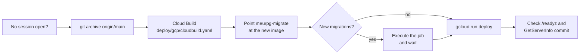

# Operations runbook

How to run the production environment. Each section is a task; the values are in the [reference](reference.md), and what runs where is in the [overview](README.md).

Commands assume `gcloud` is signed in as a project owner and these variables are set in the terminal (zsh needs `setopt interactive_comments` once, so the `#` comments in the blocks are not passed as arguments):

```bash
export PROJECT_ID=<your-project-id>
export REGION=southamerica-east1
export SERVICE=meurpg
export REPO=meurpg                          # Artifact Registry repository
export SA_NAME=meurpg-api
export SA=$SA_NAME@$PROJECT_ID.iam.gserviceaccount.com
export BUCKET=$PROJECT_ID-images
export BUILD_SA=projects/$PROJECT_ID/serviceAccounts/meurpg-build@$PROJECT_ID.iam.gserviceaccount.com
export DOMAIN=meurpg.app
export QUEUE=meurpg-tasks                   # Cloud Tasks queue
```

## Release a new version

A release ships what is merged on `main`: build the image in Cloud Build, run the migration job, then deploy. It takes a few minutes, and the switch itself about 20 seconds. It is run by hand, from a script, and never while a game session is open.



1. **Check that nobody is playing.** Cloud Run keeps the old instance until its requests end, while every new call, the master's included, reaches the new revision, whose in-memory hub those streams are not in. The old instance ends its streams after 3 minutes without a call (checked every 60 s), and each page reconnects to the new revision. Until then a page that was open before the release hears nothing new. So release between sessions (look for an open game session in the database first). When you cannot, tell the table to wait a few minutes, or to reload the session page.
2. **Build.** The source is a `git archive` of the commit, with only what `backend/Dockerfile` reads (`.dockerignore`, `LICENSE`, `NOTICE`, `third_party`, `backend`, `web`), so nothing local enters the image. Pass `--service-account` every time: without it Cloud Build uses the default account, which has no role, and the build fails.

   ```bash
   git fetch origin
   export C=$(git rev-parse --short=8 origin/main)
   export IMAGE=$REGION-docker.pkg.dev/$PROJECT_ID/$REPO/api:$C
   git archive --format=tar.gz -o /tmp/meurpg-src-$C.tgz origin/main -- .dockerignore LICENSE NOTICE third_party backend web
   git show origin/main:deploy/gcp/cloudbuild.yaml > /tmp/cloudbuild-$C.yaml
   gcloud builds submit /tmp/meurpg-src-$C.tgz --config=/tmp/cloudbuild-$C.yaml --region=$REGION \
     --service-account=$BUILD_SA --substitutions=_IMAGE=$IMAGE,_COMMIT=$C
   ```

3. **Migrate.** Point the job at the new image. Execute it when `backend/migrations/` changed since the commit that runs now; with nothing new, goose applies nothing, so running it is harmless. If it fails, stop and read its log ([read the logs](#read-the-logs)): the running revision is untouched.

   ```bash
   gcloud run jobs update meurpg-migrate --image=$IMAGE --region=$REGION
   gcloud run jobs execute meurpg-migrate --region=$REGION --wait
   ```

4. **Deploy.** `gcloud run deploy` with only the image keeps every variable, secret and flag of the previous revision.

   ```bash
   gcloud run deploy $SERVICE --image=$IMAGE --region=$REGION
   ```

5. **Check.** `curl -s https://$DOMAIN/readyz` answers `{"status":"ready","database":"up"}`, and `SystemService.GetServerInfo` reports the new commit:

   ```bash
   curl -s -X POST -H 'Connect-Protocol-Version: 1' -H 'Content-Type: application/json' -d '{}' \
     https://$DOMAIN/meurpg.system.v1.SystemService/GetServerInfo
   ```

This is safe because a migration only adds (a table, column or row; never a rename or a drop of something the running code reads; see [CONTRIBUTING](../../CONTRIBUTING.md#code-rules-that-bite)): the old revision keeps working on the new schema while traffic switches, and after a [roll back](#roll-back).

## Roll back

Revisions are kept. Send the traffic back to the previous one:

```bash
gcloud run revisions list --service=$SERVICE --region=$REGION
gcloud run services update-traffic $SERVICE --region=$REGION --to-revisions=<previous-revision>=100
```

After this command the service stays pinned to that revision: a later `gcloud run deploy` creates a new revision but sends it no traffic. Before the next deploy, release the pin with `gcloud run services update-traffic $SERVICE --region=$REGION --to-latest`.

A rollback does not undo migrations: the database keeps the schema the job applied, and the previous revision runs on it. Before rolling back, read the migrations of the release you are leaving (`backend/migrations/`) and check that they do not break the old code; if they do, release a fix forward instead of running `migrate down`. A secret rolls back by version: `gcloud run services update $SERVICE --region=$REGION --update-secrets=DATABASE_URL=database-url:<version>`.

## Rotate a secret

Create a new version, then make a new revision read it, then retire the old version.

1. Add the version without leaving the value in the shell history (the value is typed at a hidden prompt):

   ```bash
   stty -echo; printf 'new value: '; IFS= read -r V; stty echo; printf '\n'
   printf '%s' "$V" | gcloud secrets versions add <secret> --data-file=-; unset V
   gcloud secrets versions access latest --secret=<secret> | wc -c    # must be above 0
   ```

2. A new version only takes effect in a new revision or when an instance starts again: deploy one (`gcloud run services update $SERVICE --region=$REGION --update-secrets=<VAR>=<secret>:latest`) and check `/readyz`.
3. Disable the old version (`gcloud secrets versions disable <n> --secret=<secret>`).

Per secret:

- `GEMINI_API_KEY`: create a new key in Google AI Studio, restricted to the Gemini API, add the version, deploy, then delete the old key.
- `OIDC_CLIENT_SECRET`: create the new secret on the Google OAuth client, add the version, deploy, then delete the old one at Google.
- `DATABASE_URL`: change the password in the CockroachDB console, add a version with the new string (still `sslmode=verify-full`, and `pool_max_conns` only to change the default), update the migration job too (`gcloud run jobs update meurpg-migrate --region=$REGION --update-secrets=DATABASE_URL=database-url:latest`), and deploy.

## Respond to an alert

| Alert | First look | Then |
| --- | --- | --- |
| `MeuRPG is down (readyz)` | `curl -s https://meurpg.app/readyz`. `503` or `"database":"down"` is the database; no answer at all is the revision or the load balancer | Read the logs ([below](#read-the-logs)); if the last release is the cause, [roll back](#roll-back); if the database does not answer, check the CockroachDB console. The checkers are outside Brazil, which is why the geo rule of the edge policy lets their user agent through |
| Budget e-mail | The billing report by service for the month | The fixed costs are the load balancer and Cloud Armor. A jump in Cloud Run is a stream or a request stuck open (look at request counts and at `LOG_LEVEL`); a jump in Gemini is the image limits (`IMAGE_DAILY_LIMIT`) |
| Players report `429` or "Muitas ações em pouco tempo" | `rate limit hit` lines in the log, with the limit name | Raise `RATE_LIMIT_MULTIPLIER` ([reference](reference.md#abuse-limits)); if all clients share one bucket, check `TRUSTED_PROXY_HOPS` ([the client IP](reference.md#the-client-ip)) |

## Read the logs

The API writes one JSON line per event to stdout, which Cloud Run sends to Cloud Logging. The lines of one request share a `request_id` (the `X-Request-Id` of the response) and, when `GOOGLE_CLOUD_PROJECT` is set, the Cloud Trace id. Format and fields: [logs](logs.md).

```bash
gcloud run services logs read $SERVICE --region=$REGION --limit=100
gcloud logging read 'resource.type="cloud_run_revision" AND resource.labels.service_name="'$SERVICE'" AND severity>=ERROR' \
  --freshness=1h --limit=50 --format='value(timestamp,jsonPayload.message,jsonPayload.error)'
# One request, by the X-Request-Id of its response:
gcloud logging read 'resource.type="cloud_run_revision" AND jsonPayload.request_id="<id>"' --freshness=1d
# The migration job:
gcloud logging read 'resource.type="cloud_run_job" AND resource.labels.job_name="meurpg-migrate"' --freshness=1d
```

Cloud Logging keeps the logs for 30 days in its `_Default` bucket. The log never holds a password, a token or an e-mail ([Privacy](../privacy.md#logs-in-elk)).

## Alerts

Create the two budgets and the uptime check once. Budgets go to the billing account's administrators; they never stop a cost.

```bash
export BILLING_ACCOUNT=$(gcloud billing projects describe $PROJECT_ID --format='value(billingAccountName)' | sed 's#billingAccounts/##')
gcloud billing budgets create --billing-account=$BILLING_ACCOUNT \
  --display-name="MeuRPG projeto R\$250/mes" --budget-amount=250BRL \
  --filter-projects=projects/$PROJECT_ID \
  --threshold-rule=percent=0.8 --threshold-rule=percent=1.0 --threshold-rule=percent=1.2 \
  --threshold-rule=percent=1.0,basis=forecasted-spend

gcloud monitoring uptime create meurpg-readyz --resource-type=uptime-url \
  --resource-labels=host=$DOMAIN,project_id=$PROJECT_ID \
  --path=/readyz --protocol=https --period=5 --timeout=10
```

The alert policy goes in with `gcloud alpha monitoring policies create --policy-from-file=<file>`: a condition on the metric `monitoring.googleapis.com/uptime_check/check_passed` of that check, `REDUCE_COUNT_FALSE` grouped by region, above 1 for 600 s, and an e-mail channel (`gcloud beta monitoring channels create --type=email`). The text of the policy points to [Roll back](#roll-back) and [Read the logs](#read-the-logs). The operator's e-mail is personal data: it lives only in the channel, never in the repository.

## First deploy

This creates the environment from nothing. What the app needs: one Cloud Run service (the Go API, which also serves the Angular app), one Cloud Run job (the migrations), one private bucket, up to four secrets, one service account, one Google OAuth client, and a CockroachDB cluster in the same region (not created here). Run the steps in order, from the repository root, with `gcloud` signed in as a project owner and the variables above set.

### 1. Project and APIs

```bash
gcloud config set project $PROJECT_ID
gcloud config set run/region $REGION
gcloud services enable run.googleapis.com artifactregistry.googleapis.com \
  secretmanager.googleapis.com storage.googleapis.com iam.googleapis.com cloudbuild.googleapis.com \
  cloudtasks.googleapis.com
```

Link a billing account to the project first and create the [budget alerts](#alerts). The Gemini key (only for AI images) is made in Google AI Studio and restricted to the Gemini API there.

### 2. The registry and the build account

The image is `backend/Dockerfile`, built from the repository root. It has three stages: Node 22 builds the Angular app, Go 1.27 compiles `api` and `migrate`, and a distroless `static` image carries `/app/api`, `/app/migrate` and the web build in `/app/web`.

Cloud Build runs as its own service account, `meurpg-build`, which can only push to this repository, write its log and read the uploaded source. The Compute Engine default service account keeps no role on the project (take `roles/editor` off it if the project gave it one).

```bash
gcloud artifacts repositories create $REPO --repository-format=docker --location=$REGION
gcloud iam service-accounts create meurpg-build --display-name="MeuRPG build"
export BUILD_SA_EMAIL=meurpg-build@$PROJECT_ID.iam.gserviceaccount.com

gcloud artifacts repositories add-iam-policy-binding $REPO --location=$REGION \
  --member=serviceAccount:$BUILD_SA_EMAIL --role=roles/artifactregistry.writer
gcloud projects add-iam-policy-binding $PROJECT_ID \
  --member=serviceAccount:$BUILD_SA_EMAIL --role=roles/logging.logWriter --condition=None
# The bucket where gcloud uploads the source.
gcloud storage buckets create gs://${PROJECT_ID}_cloudbuild --location=$REGION --uniform-bucket-level-access
gcloud storage buckets add-iam-policy-binding gs://${PROJECT_ID}_cloudbuild \
  --member=serviceAccount:$BUILD_SA_EMAIL --role=roles/storage.objectViewer

# Keep the 10 newest images, delete the others after 30 days.
cat > /tmp/meurpg-ar-cleanup.json <<'JSON'
[
  {"name": "keep-recent", "action": {"type": "Keep"}, "mostRecentVersions": {"keepCount": 10}},
  {"name": "delete-old", "action": {"type": "Delete"}, "condition": {"olderThan": "30d"}}
]
JSON
gcloud artifacts repositories set-cleanup-policies $REPO --location=$REGION \
  --policy=/tmp/meurpg-ar-cleanup.json --no-dry-run
```

Then build the first image with step 2 of [Release a new version](#release-a-new-version).

### 3. The service account

One account runs the service and the migration job. It gets the bucket and the secrets below, and no project-level role.

```bash
gcloud iam service-accounts create $SA_NAME --display-name="MeuRPG API"
```

### 4. The images bucket

One bucket, Standard class, in the region, with uniform bucket-level access, public-access prevention and a 7-day soft delete. Only the service account has access, with the role that gives it exactly what the app does (create, read, delete and list objects; the start-up check lists one).

```bash
gcloud storage buckets create gs://$BUCKET --location=$REGION \
  --default-storage-class=STANDARD --uniform-bucket-level-access \
  --public-access-prevention --soft-delete-duration=7d
gcloud storage buckets add-iam-policy-binding gs://$BUCKET \
  --member=serviceAccount:$SA --role=roles/storage.objectUser
```

Then the lifecycle rule that backs up the campaign package cleanup. A rule matches a prefix, not a pattern, so the second one takes the objects under `campaigns/` whose name ends in `.zip`: only exports do (an image is `campaigns/<id>/images/<id>` and its thumbnail `<id>.thumb`).

```bash
cat > /tmp/meurpg-lifecycle.json <<'JSON'
{"rule": [
  {"action": {"type": "Delete"}, "condition": {"age": 1, "matchesPrefix": ["imports/"]}},
  {"action": {"type": "Delete"}, "condition": {"age": 2, "matchesPrefix": ["campaigns/"], "matchesSuffix": [".zip"]}}
]}
JSON
gcloud storage buckets update gs://$BUCKET --lifecycle-file=/tmp/meurpg-lifecycle.json
gcloud storage buckets describe gs://$BUCKET --format='yaml(lifecycle_config)'    # must show both rules
```

### 5. Secrets

Each value is typed at a hidden prompt, so it stays out of the shell history. The helper works in bash and zsh, refuses an empty value, and reads the secret back to check it has content.

```bash
mksecret() {   # mksecret <secret-name> <prompt label>
  printf '%s: ' "$2"; stty -echo; IFS= read -r V; stty echo; printf '\n'
  if [ -z "$V" ]; then echo "empty value: $1 was NOT created" >&2; unset V; return 1; fi
  printf '%s' "$V" | gcloud secrets create "$1" --replication-policy=user-managed \
    --locations=$REGION --data-file=- || { unset V; return 1; }
  unset V
  gcloud secrets add-iam-policy-binding "$1" \
    --member=serviceAccount:$SA --role=roles/secretmanager.secretAccessor >/dev/null || return 1
  N=$(gcloud secrets versions access latest --secret="$1" | wc -c | tr -d ' ')
  if [ "$N" -gt 0 ]; then echo "$1: created, $N bytes"; else echo "$1: EMPTY, delete it and try again" >&2; return 1; fi
}
```

`DATABASE_URL` is the CockroachDB connection string from its console and, on Cloud Run, must say `sslmode=verify-full` (or `verify-ca`), or the server does not start. Check its TLS first (next part), then create the secrets:

```bash
mksecret database-url "DATABASE_URL"
mksecret gemini-api-key "GEMINI_API_KEY (skip this command to leave AI images off)"
```

Each command must print `<name>: created, <n> bytes` with `n` above 0.

#### Check the database's TLS

With `verify-full`, the server checks that the certificate is signed by a CA it trusts and carries the host name. The production image is `distroless/static`, whose `/etc/ssl/certs/ca-certificates.crt` holds Debian's bundle, so a cluster whose certificate comes from a public CA needs nothing more than `sslmode=verify-full`.

The real test runs the image's own `migrate` against the string. `migrate` does not apply the Cloud Run rule about `sslmode` (only the API reads `K_SERVICE`), so the string itself must say `sslmode=verify-full`: the driver then refuses a certificate it cannot verify.

```bash
docker run --rm --platform linux/amd64 -e DATABASE_URL="<connection string>" \
  --entrypoint /app/migrate $IMAGE status
```

A TLS failure shows as `x509: certificate signed by unknown authority` (or `certificate is valid for ..., not ...`).

If the cluster has its own CA, download the certificate from its console, keep it in Secret Manager, mount it as a file on both the job and the service, and point the string at it:

```bash
test -s <path/to/the-console-ca.crt> && gcloud secrets create cockroach-ca --replication-policy=user-managed \
  --locations=$REGION --data-file=<path/to/the-console-ca.crt>
gcloud secrets add-iam-policy-binding cockroach-ca \
  --member=serviceAccount:$SA --role=roles/secretmanager.secretAccessor
```

Add `&sslrootcert=/etc/cockroach/ca.crt` next to `sslmode=verify-full` in the `database-url` secret, and `,/etc/cockroach/ca.crt=cockroach-ca:latest` to `--set-secrets` in steps 7 and 8. With `sslrootcert`, only that CA is trusted for the database. If the service logs `could not read root certificate file`, the process (uid 65532) cannot read the mount; `migrate status` on the deployed job shows it first.

### 6. Google OAuth client

Sign-in is Google only. The client is made in the console (there is no `gcloud` command for a web client): APIs & Services, OAuth consent screen (Google Auth Platform in the newer console).

1. Consent screen: user type External; scopes `openid` and `.../auth/userinfo.email` (the app asks for `openid email` and nothing more; neither is sensitive). While the screen is in Testing, only the e-mails listed as test users can sign in: add the whole table there, or publish the screen, which these scopes allow without Google's review.
2. Credentials, OAuth client ID, Web application. Under Authorized redirect URIs put exactly the value of `OIDC_REDIRECT_URL`: `https://<host>/auth/callback`. The `run.app` host can be computed before the service exists: `https://$SERVICE-$(gcloud projects describe $PROJECT_ID --format='value(projectNumber)').$REGION.run.app`. Leave Authorized JavaScript origins empty (the flow is a server-side redirect).
3. The client id goes into the service as `OIDC_CLIENT_ID`; the secret goes into Secret Manager:

```bash
export OIDC_CLIENT_ID=<client id, ends in .apps.googleusercontent.com>
export APP_URL=https://<domain or run.app host>          # no trailing slash
export MASTER_EMAIL=<the master's verified e-mail>        # CAMPAIGN_CREATORS
mksecret oidc-client-secret "OIDC_CLIENT_SECRET"
```

### 7. The migration job

The job runs the image's `/app/migrate up` before each new revision gets traffic. It only needs `DATABASE_URL`.

```bash
gcloud run jobs create meurpg-migrate --image=$IMAGE --service-account=$SA \
  --command=/app/migrate --args=up --set-secrets=DATABASE_URL=database-url:latest \
  --max-retries=0 --task-timeout=15m
gcloud run jobs execute meurpg-migrate --wait
```

### 8. The service

Notes on the flags (the values are in the [overview](README.md#cloud-run-settings) and the [reference](reference.md#environment-variables)):

- `--set-env-vars` starts with `^#^`, gcloud's escape that makes `#` the separator between variables, so the commas and `@` of `CAMPAIGN_CREATORS` stay inside a value. A value must not contain `#`, `"`, a backtick or a backslash.
- `--set-secrets` must name only secrets that exist. Use the first line below with `gemini-api-key`, or the second without it; with a database CA file, add the mount.
- Never set `BLOB_DIR`, `IMAGE_GENERATOR=fake` or `MAX_CAMPAIGNS_PER_USER=off`: the server refuses to start on Cloud Run with any of them. `OIDC_MAX_AGE`, `LISTEN_HOST` and `PORT` are not set.
- `TRUSTED_PROXY_HOPS` stays unset on the `run.app` URL; step 10 sets it to 2.

```bash
export SECRETS=OIDC_CLIENT_SECRET=oidc-client-secret:latest,DATABASE_URL=database-url:latest,GEMINI_API_KEY=gemini-api-key:latest
# OR, without AI images:
export SECRETS=OIDC_CLIENT_SECRET=oidc-client-secret:latest,DATABASE_URL=database-url:latest
# With a database CA file: export SECRETS="$SECRETS,/etc/cockroach/ca.crt=cockroach-ca:latest"

gcloud run deploy $SERVICE --image=$IMAGE --service-account=$SA \
  --allow-unauthenticated --cpu=2 --memory=1Gi \
  --min-instances=0 --max-instances=1 --concurrency=50 --timeout=2100 \
  --set-secrets="$SECRETS" \
  --set-env-vars="^#^GOMEMLIMIT=400MiB#GOOGLE_CLOUD_PROJECT=$PROJECT_ID#BLOB_BUCKET=$BUCKET#OIDC_ISSUER=https://accounts.google.com#OIDC_CLIENT_ID=$OIDC_CLIENT_ID#OIDC_REDIRECT_URL=$APP_URL/auth/callback#CAMPAIGN_CREATORS=$MASTER_EMAIL#MAX_CAMPAIGNS_PER_USER=10#IMAGE_DAILY_LIMIT=100#IMAGE_MONTHLY_LIMIT=200#RATE_LIMIT_MULTIPLIER=1"
```

The start-up log must say `images are stored in Cloud Storage`. If it also says `the images bucket could not be reached at start`, read the reason: unless it is a passing network error, uploads and downloads fail with `503` until the bucket name, the role of step 4 or the service account is fixed and a new revision is deployed.

Check the address with `gcloud run services describe $SERVICE --format='value(status.url)'`. If it differs from the `APP_URL` registered on the OAuth client, register the real one (step 6) and update `OIDC_REDIRECT_URL` (`gcloud run services update $SERVICE --update-env-vars OIDC_REDIRECT_URL=...`).

### 9. The domain

The domain goes behind a global external Application Load Balancer with a serverless network endpoint group, because Cloud Run domain mappings are not offered in `southamerica-east1` and Firebase Hosting rewrites cut a request at 60 seconds, which breaks the long stream. The `run.app` URL keeps working until the last command below closes the ingress, so the smoke test can use it first.

The domain is registered with Cloud Domains, with a Cloud DNS zone as its DNS. Create the zone first, see the yearly price, then register (try `--validate-only` first). The contact file holds the registrant's personal data and never enters the repository; the registry e-mails a verification link to the registrant, which must be followed.

```bash
export DNS_ZONE=<cloud dns zone name>
export LB=meurpg-lb                          # prefix of every load balancer resource
gcloud services enable compute.googleapis.com dns.googleapis.com

gcloud dns managed-zones create $DNS_ZONE --dns-name=$DOMAIN. --visibility=public --dnssec-state=on
gcloud domains registrations get-register-parameters $DOMAIN
gcloud domains registrations register $DOMAIN --cloud-dns-zone=$DNS_ZONE \
  --contact-data-from-file=<contacts.yaml> --contact-privacy=redacted-contact-data \
  --yearly-price="<price> USD" --notices=hsts-preloaded

# 1. The global static IPv4 address
gcloud compute addresses create $LB-ip --ip-version=IPV4 --global
# 2. The serverless NEG, pointing at the Cloud Run service
gcloud compute network-endpoint-groups create $LB-neg \
  --region=$REGION --network-endpoint-type=serverless --cloud-run-service=$SERVICE
# 3. The backend service, with the NEG
gcloud compute backend-services create $LB-backend --global --load-balancing-scheme=EXTERNAL_MANAGED
gcloud compute backend-services add-backend $LB-backend \
  --global --network-endpoint-group=$LB-neg --network-endpoint-group-region=$REGION
# 4. The URL map
gcloud compute url-maps create $LB-map --default-service=$LB-backend
# 5. The Google-managed certificate
gcloud compute ssl-certificates create $LB-cert --domains=$DOMAIN --global
# 6. The SSL policy: TLS 1.2 or newer, modern ciphers
gcloud compute ssl-policies create $LB-ssl-policy --profile=MODERN --min-tls-version=1.2
# 7. The HTTPS proxy
gcloud compute target-https-proxies create $LB-proxy \
  --url-map=$LB-map --ssl-certificates=$LB-cert --ssl-policy=$LB-ssl-policy
# 8. The forwarding rule, on 443
gcloud compute forwarding-rules create $LB-https --global --load-balancing-scheme=EXTERNAL_MANAGED \
  --address=$LB-ip --target-https-proxy=$LB-proxy --ports=443
# 9. The A record
export LB_IP=$(gcloud compute addresses describe $LB-ip --global --format='value(address)')
gcloud dns record-sets create $DOMAIN. --zone=$DNS_ZONE --type=A --ttl=300 --rrdatas=$LB_IP
```

The certificate is issued 15 to 60 minutes after the A record resolves to `$LB_IP`. Wait for `ACTIVE`:

```bash
gcloud compute ssl-certificates describe $LB-cert --global --format='value(managed.status,managed.domainStatus)'
```

Then, in this order: register `https://$DOMAIN/auth/callback` on the OAuth client (keep the `run.app` one until the domain works), then close the direct way in and point the app at the domain:

```bash
gcloud run services update $SERVICE --ingress=internal-and-cloud-load-balancing \
  --update-env-vars=TRUSTED_PROXY_HOPS=2,OIDC_REDIRECT_URL=https://$DOMAIN/auth/callback
```

| | `run.app` | Behind the load balancer |
| --- | --- | --- |
| `OIDC_REDIRECT_URL` | `https://<run.app host>/auth/callback` | `https://$DOMAIN/auth/callback`, registered before the variable changes |
| `--ingress` | `all` | `internal-and-cloud-load-balancing` |
| `TRUSTED_PROXY_HOPS` | unset (1) | 2 |

- A serverless NEG backend has a fixed timeout of 60 minutes, which covers the 10-minute stream and the 30-minute download.
- A TLD on the HSTS preload list, such as `.app`, needs no HTTP-to-HTTPS redirect. For any other domain, add a second forwarding rule on port 80 with a URL map that redirects.
- To go back to `run.app`, change both together: `gcloud run services update $SERVICE --ingress=all --update-env-vars=TRUSTED_PROXY_HOPS=1,OIDC_REDIRECT_URL=https://<run.app host>/auth/callback`. Never leave `TRUSTED_PROXY_HOPS=2` with `--ingress=all`: a client reaching `run.app` directly could choose its own rate-limit bucket.
- The load balancer costs money all month ([costs](reference.md#costs)).

### The edge policy (Cloud Armor)

A Cloud Armor Standard policy on the backend service judges each request before it reaches Cloud Run. Rules, lowest priority number first:

| Priority | Rule | Action | Why |
| --- | --- | --- | --- |
| 900 | The request is not from Brazil (`origin.region_code != 'BR'`), unless its user agent is Google's uptime checker | `403` | The app serves one table in Brazil; most scanners come from abroad. Not a security boundary: a VPN in Brazil passes and anyone can send the checker's user agent. A player abroad gets `403` until the rule is relaxed |
| 1000 | Every request, counted per client IP | Above 3,000 in 60 s, `429` | A coarse flood limit. A whole table plays from one connection, so its requests share an IP; 3,000 leaves room for a full table with map tiles in bursts. Per IP and not per user because a cookie or header a client sends can be forged |
| 2000 | The preconfigured OWASP rules for SQL injection, XSS, local and remote file inclusion and remote code execution (`*-v33-stable`, sensitivity 1) | `403`, in preview | Preview only logs what the rule would block. Free text the master writes can look like an attack, so enforce only after reading the matches |
| 2001 | The scanner, protocol attack and method enforcement rules | `403`, in preview | The same |
| default | Anything else | allow | |

Adaptive Protection (the layer 7 DDoS defence) is on; on the Standard tier it raises alerts and does not block by itself.

```bash
gcloud compute security-policies create meurpg-edge --description="MeuRPG edge"
gcloud compute security-policies update meurpg-edge --enable-layer7-ddos-defense

gcloud compute security-policies rules create 900 --security-policy=meurpg-edge \
  --expression="origin.region_code != 'BR' && !request.headers['user-agent'].contains('GoogleStackdriverMonitoring-UptimeChecks')" \
  --action=deny-403 --description="Brazil only (uptime checks exempt)"
gcloud compute security-policies rules create 1000 --security-policy=meurpg-edge \
  --expression="true" --action=throttle --enforce-on-key=IP \
  --rate-limit-threshold-count=3000 --rate-limit-threshold-interval-sec=60 \
  --conform-action=allow --exceed-action=deny-429 --description="per-IP flood throttle"
gcloud compute security-policies rules create 2000 --security-policy=meurpg-edge --preview \
  --expression="evaluatePreconfiguredWaf('sqli-v33-stable', {'sensitivity': 1}) || evaluatePreconfiguredWaf('xss-v33-stable', {'sensitivity': 1}) || evaluatePreconfiguredWaf('lfi-v33-stable', {'sensitivity': 1}) || evaluatePreconfiguredWaf('rfi-v33-stable', {'sensitivity': 1}) || evaluatePreconfiguredWaf('rce-v33-stable', {'sensitivity': 1})" \
  --action=deny-403 --description="OWASP injection rules (preview)"
gcloud compute security-policies rules create 2001 --security-policy=meurpg-edge --preview \
  --expression="evaluatePreconfiguredWaf('scannerdetection-v33-stable', {'sensitivity': 1}) || evaluatePreconfiguredWaf('protocolattack-v33-stable', {'sensitivity': 1}) || evaluatePreconfiguredWaf('methodenforcement-v33-stable', {'sensitivity': 1})" \
  --action=deny-403 --description="scanners and protocol attacks (preview)"
gcloud compute backend-services update $LB-backend --global --security-policy=meurpg-edge
```

To see what the preview rules would have blocked, and then enforce one:

```bash
gcloud logging read 'resource.type="http_load_balancer" AND jsonPayload.previewSecurityPolicy.outcome="DENY"' \
  --freshness=7d --limit=50 \
  --format='value(timestamp,httpRequest.requestMethod,httpRequest.requestUrl,jsonPayload.previewSecurityPolicy.priority,jsonPayload.previewSecurityPolicy.preconfiguredExprIds)'
gcloud compute security-policies rules update 2000 --security-policy=meurpg-edge --no-preview
```

A match that is the app's own traffic is not a reason to keep the whole rule in preview: exclude that signature (`evaluatePreconfiguredWaf('<rule>', {'sensitivity': 1, 'opt_out_rule_ids': ['<id>']})`) and enforce the rest.

### No indexing, and the request log

The app is not meant to be found: `robots.txt` disallows everything, the pages carry a `noindex` meta tag, and the load balancer adds an `X-Robots-Tag` header to every answer. The backend service also logs every request (sample rate 1.0), with the client IP, user agent, URL and Cloud Armor's decision, for 30 days in Cloud Logging's `_Default` bucket ([Privacy](../privacy.md)).

```bash
gcloud compute backend-services update $LB-backend --global \
  --custom-response-header='X-Robots-Tag: noindex, nofollow, noarchive, nosnippet, noimageindex' \
  --enable-logging --logging-sample-rate=1.0
```

### DNS: certificates and e-mail

The zone has DNSSEC on, and these records besides the A record:

| Record | Value | Why |
| --- | --- | --- |
| `CAA` | `0 issue "pki.goog"`, `0 issue "letsencrypt.org"`, `0 issuewild ";"` | Only the two authorities a Google-managed certificate can come from may issue one, and nobody a wildcard. There is no `iodef`: it would put an e-mail address in public DNS |
| `MX` | `10 mx1.improvmx.com.`, `20 mx2.improvmx.com.` | Mail to `@meurpg.app` goes to ImprovMX, which forwards it |
| `TXT` (apex) | `v=spf1 include:spf.improvmx.com ~all` | The SPF record ImprovMX asks for |
| `TXT` (apex) | `google-site-verification=<token>` | Proves the domain to Google (Cloud Identity Free for the test accounts, and the brand verification of the OAuth consent screen). Keep it |
| `TXT` on `_dmarc` | `v=DMARC1; p=reject; adkim=s; aspf=s` | The domain sends no e-mail, so any message that claims to come from it is rejected |

```bash
gcloud dns record-sets create $DOMAIN. --zone=$DNS_ZONE --type=CAA --ttl=3600 \
  --rrdatas='0 issue "pki.goog"','0 issue "letsencrypt.org"','0 issuewild ";"'
gcloud dns record-sets create $DOMAIN. --zone=$DNS_ZONE --type=MX --ttl=3600 \
  --rrdatas='10 mx1.improvmx.com.','20 mx2.improvmx.com.'
gcloud dns record-sets create _dmarc.$DOMAIN. --zone=$DNS_ZONE --type=TXT --ttl=3600 \
  --rrdatas='"v=DMARC1; p=reject; adkim=s; aspf=s"'
# The apex TXT holds both strings in one record set.
gcloud dns record-sets create $DOMAIN. --zone=$DNS_ZONE --type=TXT --ttl=300 \
  --rrdatas='"v=spf1 include:spf.improvmx.com ~all"','"google-site-verification=<token>"'
```

The contact address on `/terms` and `/privacy`, `privacidade@meurpg.app`, is an ImprovMX alias (free plan) that forwards to the people who answer data requests, and a catch-all alias forwards everything else to the same people. Their addresses live only in the ImprovMX account, never in the repository. An answer goes out from the person's own address: with `p=reject` and no sending service, a message sent as `@meurpg.app` would be rejected.

### 10. Smoke test

In order; stop at the first failure and read the logs.

- [ ] `curl -s $APP_URL/readyz` answers `200` with `{"status":"ready","database":"up"}`. `/healthz` answers `200` too.
- [ ] The start-up log has `sign-in is enabled` and `images are stored in Cloud Storage`, and no `OIDC_ISSUER is not set` warning. A variable with a typo in its name does not stop the API: it only shows here.
- [ ] `$APP_URL` loads the app.
- [ ] Sign in with the master's Google account. Another account sees the campaign creation refused if `CAMPAIGN_CREATORS` is set.
- [ ] Create a campaign. Upload an image to the gallery, see its thumbnail, and find its two objects with `gcloud storage ls -r gs://$BUCKET/campaigns/`.
- [ ] Invite a player (a private window, another Google account), join, and open a map the master shared: the image loads, and stops loading when the master hides it.
- [ ] Start a live session with two browsers: a change made by the master reaches the player at once, and the stream survives a minute of silence (the heartbeat).
- [ ] The client IP: the item of `X-Forwarded-For` that `TRUSTED_PROXY_HOPS` counts is the caller's ([the client IP](reference.md#the-client-ip)).
- [ ] Only with `GEMINI_API_KEY`: generate one image in a scene; it appears in the gallery.
- [ ] Delete the image: both objects leave the bucket listing (soft delete keeps them 7 days, out of reach of the API).

### 11. Cloud Tasks

Detached work (images, exports, sweeps) needs CPU, which the service has only inside a request, so each piece is a task that Cloud Tasks delivers to the service ([reference](reference.md#cloud-tasks)). Do this after step 10, once the service has its `run.app` address. Until then the three variables stay unset and the work runs in the process.

1. **The queue**, in the service's region. The settings:

   - `--max-concurrent-dispatches=4` and `--max-dispatches-per-second=5`: the service has one instance with 2 vCPU and a memory budget ([reference](reference.md#memory-budgets)), also serving streams; four exports or images at once is what it can carry, and a burst waits in the queue instead of reaching the instance.
   - `--max-attempts=5`, `--min-backoff=10s`, `--max-backoff=300s`, `--max-doublings=4`: a handler answers `500` only when a retry can help (the database was busy, an instance was stopping), so a few tries over minutes are enough: 10 s, 20 s, 40 s, 80 s.
   - `--max-retry-duration=3600s` (one hour; the flag takes seconds): the most a task survives after its first attempt. This is the figure [Privacy](../privacy.md#logs-memory-and-infrastructure) quotes.

   ```bash
   gcloud tasks queues create $QUEUE --location=$REGION \
     --max-attempts=5 --min-backoff=10s --max-backoff=300s --max-doublings=4 --max-retry-duration=3600s \
     --max-dispatches-per-second=5 --max-concurrent-dispatches=4
   ```

2. **The roles** of the service account: it creates tasks on this queue, and it may act as itself, which is what lets Cloud Tasks sign the OIDC token with it.

   ```bash
   gcloud tasks queues add-iam-policy-binding $QUEUE --location=$REGION \
     --member=serviceAccount:$SA --role=roles/cloudtasks.enqueuer
   gcloud iam service-accounts add-iam-policy-binding $SA \
     --member=serviceAccount:$SA --role=roles/iam.serviceAccountUser
   ```

3. **The variables** on the service. `TASKS_TARGET_URL` is the service's own `run.app` URL (the one `gcloud` prints, with no path), the same in the token's audience; the queue is `projects/$PROJECT_ID/locations/$REGION/queues/$QUEUE`. A new revision starts with them.

   ```bash
   export TASKS_TARGET_URL=$(gcloud run services describe $SERVICE --region=$REGION --format='value(status.url)')
   gcloud run services update $SERVICE --region=$REGION --update-env-vars="^#^TASKS_QUEUE=projects/$PROJECT_ID/locations/$REGION/queues/$QUEUE#TASKS_TARGET_URL=$TASKS_TARGET_URL#TASKS_SERVICE_ACCOUNT=$SA"
   ```

   The start-up log must say `detached work runs on Cloud Tasks`. A partial set stops the revision with an error naming what is missing.

4. **Prove the path** with a task for a kind that does not exist: it goes through Cloud Tasks, the ingress and the token check, and the service answers `404`. Read it in the request log, then delete that one task (Cloud Tasks would retry a `404`). Never purge the queue here: it also holds the sweep's next slot, and nothing schedules it again until an instance starts.

   ```bash
   export SMOKE=$(gcloud tasks create-http-task --queue=$QUEUE --location=$REGION \
     --url=$TASKS_TARGET_URL/internal/tasks/smoke --method=POST --body-content='{}' \
     --oidc-service-account-email=$SA --oidc-token-audience=$TASKS_TARGET_URL --format='value(name)')
   gcloud logging read "resource.type=cloud_run_revision AND httpRequest.requestUrl:\"/internal/tasks/smoke\"" --limit=3 --freshness=5m \
     --format='value(httpRequest.status,httpRequest.requestUrl)'
   gcloud tasks delete $SMOKE --quiet
   ```

   The queue then holds one task, `sweep-campaign-sweep-<slot>`, due at the next 10-minute mark; its request log line reads `200`, and the next slot takes its place.

   `404`: working. No line: the ingress refused the call (it never reached the container; see [Ingress and Cloud Tasks](README.md#ingress-and-cloud-tasks)). A line with `401`: the token was refused; check the account, the audience (the URL must be exactly `TASKS_TARGET_URL`) and the role of step 2.

5. **Roll back to in-process work**: unset the three variables. The new revision runs everything in its own process, as before; purge the queue, because the tasks still in it would hit a revision without the endpoint.

   ```bash
   gcloud run services update $SERVICE --region=$REGION --remove-env-vars=TASKS_QUEUE,TASKS_TARGET_URL,TASKS_SERVICE_ACCOUNT
   gcloud tasks queues purge $QUEUE --location=$REGION --quiet
   ```

   The CPU of that work is throttled again outside a request: images and exports may stall until the next request arrives.

A change to the queue's retry settings later is `gcloud tasks queues update $QUEUE --location=$REGION ...` with the same flags; keep `--max-retry-duration` in step with the [privacy text](../privacy.md).
